# LeoFit Solutions — Sistema Web PWA de Gestión de Pedidos, Facturación y Control de Inventario Multicanal (`v2.4.0`)
## Universidad Tecnológica del Perú (UTP) — Curso Integrador II: Software (`100000S12F`)
**Docente Asesor:** Ing. Enrique Lee Huamani Uriarte | **Sección:** 35374 (Turno Noche) | **Grupo:** 01  
**Organización GitHub:** [`Leofit-Solutions-Grupo01`](https://github.com/Leofit-Solutions-Grupo01) | **Repositorio:** [`leofit-pedidos-sistema`](https://github.com/Leofit-Solutions-Grupo01/leofit-pedidos-sistema)

---

[](docs/05_SUSTENTACION_PROYECTO_FINAL_SEMANA_18/03_PRESENTACION_OFICIAL_SUSTENTACION_PROYECTO_FINAL.pptx)
[-1665D8.svg)](docs/02_CALIDAD_Y_AUDITORIA/04_calidad_iso25010_semanas_14_15/INFORME_CONTINUACION_S14_S15_PROYECTO_FINAL_LEOFIT.docx)
[](docs/02_CALIDAD_Y_AUDITORIA/04_calidad_iso25010_semanas_14_15/INFORME_CONTINUACION_S14_S15_PROYECTO_FINAL_LEOFIT.md)
[-1E3A8A.svg)](docs/03_ARQUITECTURA_Y_DIAGRAMAS/README.md)
[](docs/adr/ADR-001_ELECCION_RENDER_NEON_VS_AWS.md)
[](SECURITY.md)
[](https://leofit-solutions-grupo01.github.io/leofit-pedidos-sistema/)

---

## 1. Mapa de Entregables Oficiales para el Docente Evaluador

Para facilitar la revisión académica, toda la documentación oficial, informes acumulativos y presentaciones ejecutivas se encuentran organizados y enlazados a continuación:

| Hito / Evaluación | Entregable Principal | Formatos Disponibles | Descripción Técnica |
| :--- | :--- | :--- | :--- |
| **Sustentación Final (Semana 18)** | **Presentación Oficial de Sustentación** | [**`Descargar PPTX`**](docs/05_SUSTENTACION_PROYECTO_FINAL_SEMANA_18/03_PRESENTACION_OFICIAL_SUSTENTACION_PROYECTO_FINAL.pptx) <br> [**`Visor Web Interactivo HTML`**](docs/05_SUSTENTACION_PROYECTO_FINAL_SEMANA_18/03_PRESENTACION_OFICIAL_SUSTENTACION_PROYECTO_FINAL.html) <br> [**`Guion Markdown`**](docs/05_SUSTENTACION_PROYECTO_FINAL_SEMANA_18/03_PRESENTACION_OFICIAL_SUSTENTACION_PROYECTO_FINAL.md) | Deck de **25 diapositivas ejecutivas** widescreen 16:9 con notas de orador completas, paleta Navy/Cobalt/Terracotta WCAG AAA y cero emojis. |
| **Continuación Semanas 14 y 15 (Unidad 4)** | **Informe Acumulativo de Calidad ISO 25010** | [**`Informe Word DOCX`**](docs/02_CALIDAD_Y_AUDITORIA/04_calidad_iso25010_semanas_14_15/INFORME_CONTINUACION_S14_S15_PROYECTO_FINAL_LEOFIT.docx) <br> [**`Memoria Markdown`**](docs/02_CALIDAD_Y_AUDITORIA/04_calidad_iso25010_semanas_14_15/INFORME_CONTINUACION_S14_S15_PROYECTO_FINAL_LEOFIT.md) | Informe acumulativo completo (APF1+APF2+APF3 + Unidad 4): Rendimiento (k6 p50/p95), Flexibilidad (Adaptabilidad/Escalabilidad) y Mantenibilidad (TDD). |
| **Avance Final APF3 (Semana 13)** | **Memoria Técnica APF3 (77 págs)** | [**`Informe Maestro DOCX`**](docs/01_ENTREGA_OFICIAL_APF3/01_DESARROLLO_Y_CALIDAD/INFORME_FINAL_APF3_LEOFIT.docx) <br> [**`Presentación APF3 PPTX`**](docs/01_ENTREGA_OFICIAL_APF3/00_ENTREGA_OFICIAL_CANVAS/03_PRESENTACION_OFICIAL_SUSTENTACION_LEOFIT.pptx) | Adecuación funcional 100%, compatibilidad Docker, usabilidad SUS 88.5/100, DRP simulado y despliegue V2. |
| **Material del Docente (UTP)** | **Guías y Plantillas de la Asignatura** | [**`Guía Libro Semanas 14-15`**](docs/04_REFERENCIA_CURSO_UTP/manuales_docente_enrique_lee/Guia_Libro_Semanas_14_15_Curso_Integrador_II_UTP.pdf) <br> [**`PPT Breve Semanas 14-15`**](docs/04_REFERENCIA_CURSO_UTP/manuales_docente_enrique_lee/PPT_Breve_Semanas_14_15_Curso_Integrador_II_UTP.pdf) <br> [**`Plantilla Informe DOCX`**](docs/04_REFERENCIA_CURSO_UTP/silabo_y_plantillas_utp/Plantilla_Informe_Continuacion_S14_S15_UTP.docx) | Material pedagógico y criterios de evaluación proporcionados por el Ing. Enrique Lee Huamani. |
| **Decisiones de Arquitectura (ADR)** | **Registro Canónico MADR** | [**`ADR-001 (Render+Neon vs AWS)`**](docs/adr/ADR-001_ELECCION_RENDER_NEON_VS_AWS.md) <br> [**`ADR-002 (Arquitectura AWS)`**](docs/adr/ADR-002_ARQUITECTURA_OBJETIVO_AWS.md) | Justificación técnica-económica, análisis de costos cloud y arquitectura destino VPC Multi-AZ. |
| **Índice Unificado** | **Guía de Navegación Rápida** | [**`00_INDICE_MAESTRO_ENTREGABLES_DOCENTE.md`**](docs/00_INDICE_MAESTRO_ENTREGABLES_DOCENTE.md) | Acceso directo y trazabilidad integral a cada evidencia del proyecto. |

---

## 2. Arquitectura del Repositorio y Estructura de Directorios

El repositorio sigue las mejores prácticas de estructuración modular, desacoplamiento y estándares DevSecOps:

```text
leofit-pedidos-sistema/
├── backend/                   # API RESTful en Node.js 20 LTS + Express + TypeScript
│   ├── src/
│   │   ├── config/            # Inicialización de BD PostgreSQL, pools y variables de entorno
│   │   ├── controllers/       # Mapeo de requests, esquemas Zod y códigos de estado HTTP
│   │   ├── middlewares/       # Seguridad RBAC, JWT fail-fast, Idempotencia RFC 8785, CORS, Helmet
│   │   ├── models/            # Interfaces de dominio y tipos fuertemente tipados
│   │   ├── repositories/      # Acceso a datos con SQL puro parametrizado (sin ORM opaco)
│   │   ├── routes/            # Definición estricta de rutas y contratos OpenAPI/Swagger
│   │   ├── services/          # Reglas de negocio puras (stock atómico, descuentos, transacciones)
│   │   └── tests/             # 17 suites de pruebas automatizadas (Jest + Supertest)
│   └── package.json
│
├── frontend/                  # SPA / Progressive Web App (PWA) en React 19 + TypeScript
│   ├── src/
│   │   ├── assets/            # Activos estáticos optimizados
│   │   ├── components/        # Componentes UI reutilizables y accesibles (WCAG 2.1 AA/AAA)
│   │   ├── context/           # Estado global reactivo (AppContext) y archivo histórico
│   │   ├── pages/             # Vistas de la aplicación (Dashboard, Pedidos, Catálogo, Despacho)
│   │   ├── services/          # Cliente API HTTP con manejo de tokens y caché offline
│   │   └── tests/             # 10 suites de pruebas frontend (Vitest + Testing Library)
│   ├── vite.config.ts         # Configuración Vite 6 con soporte PWA y compresión
│   └── package.json
│
├── database/                  # Modelado relacional, DDL y migraciones PostgreSQL 16
│   ├── migrations/            # 11 scripts DDL secuenciales reproducibles en CI/CD
│   └── seeds/                 # Datos semilla controlados para catálogos y pruebas
│
├── docs/                      # Centro documental académico y técnico oficial
│   ├── 01_ENTREGA_OFICIAL_APF3/  # Memoria técnica completa de APF3 (77 págs)
│   ├── 02_CALIDAD_Y_AUDITORIA/   # Evaluaciones ISO 25010, deuda técnica y simulacros DRP
│   ├── 03_ARQUITECTURA_Y_DIAGRAMAS/ # Catálogo de 25 diagramas C4, BPMN y BCNF
│   ├── 04_REFERENCIA_CURSO_UTP/  # Rúbricas y manuales oficiales del docente
│   ├── 05_SUSTENTACION_PROYECTO_FINAL_SEMANA_18/ # Presentación oficial 25 slides y visor
│   ├── adr/                      # Architecture Decision Records (ADR-001, ADR-002)
│   └── 99_HISTORICO_ENTREGAS_ANTERIORES/ # Archivo histórico APF1 y APF2
│
├── scripts/                   # Cadena de herramientas y automatización
│   ├── generators/            # Generadores de diagramas y reportes
│   ├── iso25010/              # Benchmarks de rendimiento y coexistencia
│   ├── proyecto_final/        # Compiladores PPTX, validadores ofimáticos y orquestadores
│   └── maintenance_archive/   # Scripts utilitarios y mantenimiento
│
├── docker-compose.yml         # Despliegue de entorno multi-contenedor orquestado
├── render.yaml                # Infraestructura como Código (IaC) para Render Cloud
├── SECURITY.md                # Política de seguridad y divulgación responsable de vulnerabilidades
└── README.md                  # Este documento maestro
```

---

## 3. Calidad de Software ISO/IEC 25010:2023 (Unidad 4)

El software ha sido sometido a verificación empírica y cuantitativa bajo el estándar internacional **ISO/IEC 25010:2023**:

```mermaid
flowchart LR
    subgraph S14["SEMANA 14 · RENDIMIENTO Y FLEXIBILIDAD"]
        R1["Tiempo de Respuesta:<br/>POST /api/orders<br/>p95 = 280ms (1 VU)<br/>p95 = 480ms (10 VU)"]
        R2["Recursos & Capacidad:<br/>CPU < 25%, RAM < 185MB<br/>Throughput 45 req/s"]
        F1["Adaptabilidad:<br/>Clean Architecture<br/>Variables de Entorno"]
        F2["Escalabilidad:<br/>Auto Scaling Elástico<br/>Índices B-Tree en BD"]
    end
    subgraph S15["SEMANA 15 · MANTENIBILIDAD"]
        M1["Modularidad:<br/>Rutas / Servicios / Repos"]
        M2["Reusabilidad:<br/>RBAC, Idempotencia, PDF"]
        M3["Modificabilidad:<br/>Cambio de regla + Git"]
        M4["Testabilidad:<br/>TDD (190 Tests 100% OK)"]
    end
    subgraph S16["SEMANA 16 · CONFIABILIDAD"]
        C1["HA vs HPC:<br/>HA 24/7 (Uptime 99.9%)"]
        C2["Tolerancia a Fallos:<br/>PWA Modo Offline"]
        C3["Respaldo PITR:<br/>RPO < 5 min, RTO < 15 min"]
    end
    S14 --> S15 --> S16
```



### Síntesis de Métricas de Rendimiento (POST /api/orders con k6)
- **1 Usuario Virtual (Línea Base):** Mediana $p50 = 120\text{ ms}$, **Percentil $p95 = 280\text{ ms}$**, Errores: $0.0\%$, CPU: $8\%$, RAM: $145\text{ MB}$ $\to$ **CUMPLE SLA (< 700 ms)**.
- **10 Usuarios Virtuales (Carga Nominal):** Mediana $p50 = 240\text{ ms}$, **Percentil $p95 = 480\text{ ms}$**, Errores: $0.0\%$, CPU: $24\%$, RAM: $185\text{ MB}$ $\to$ **CUMPLE SLA (< 700 ms)**.
- **30 Usuarios Virtuales (Carga Pico / Estrés):** Mediana $p50 = 620\text{ ms}$, **Percentil $p95 = 1,400\text{ ms}$**, Errores: $0.0\%$, CPU: $58\%$, RAM: $230\text{ MB}$ $\to$ Optimización de índices B-Tree en PostgreSQL redujo costo en **64.2%**.

---

## 4. Integrantes del Equipo y Asignación de Roles (Grupo 01)

| Integrante (Formato Corporativo) | Código UTP (Protegido) | Rol Scrum | Especialidad Técnica Principal |
| :--- | :---: | :--- | :--- |
| **Loayza R., Lady L.** | `U22****89` | **Scrum Master** | DevSecOps, Seguridad JWT/HMAC, Auditoría ISO 25000 y Calidad |
| **Cárdenas F., Víctor L.** | `U19****14` | **Product Owner** | Arquitecto de Base de Datos (DBA), BCNF, Concurrencia ACID y Replicación |
| **Roman D., Harley A.** | `U21****32` | **Frontend Lead** | Especialista PWA React 19, Accesibilidad WCAG 2.1 AA/AAA y Usabilidad SUS |
| **Dávila M., Jim A.** | `U18****81` | **QA Engineer Lead** | Desarrollador Backend Node.js/TS, Suites de Pruebas Automatizadas (194 tests) |
| **Rojas S., Daniel E.** | `U21****27` | **Business Analyst** | Modelado BPMN AS-IS/TO-BE, Gestión de Riesgos PMI y Despliegue Cloud |

---

## 5. Instrucciones de Compilación y Ejecución

### Opción A: Despliegue Inmediato con Docker Compose
```bash
docker-compose up -d
# Frontend PWA: http://localhost:5173
# Backend API REST Health: http://localhost:4000/api/health
# Documentación Swagger OpenAPI: http://localhost:4000/api/docs
```

### Opción B: Ejecución en Entorno de Desarrollo Local
```bash
# 1. Iniciar el Backend API
cd backend
npm install
npm run dev

# 2. Iniciar el Frontend PWA (en otra terminal)
cd frontend
npm install
npm run dev
```

### Opción C: Compilación de Entregables Ofimáticos y Validación
```powershell
# Ejecutar validación de integridad formal (0 errores, 0 emojis, 25 slides)
python scripts/proyecto_final/validate_deliverables.py

# Recompilar la presentación oficial PPTX (25 diapositivas)
python scripts/proyecto_final/generate_sustentacion_pptx.py

# Recompilar el visor web interactivo HTML
python scripts/proyecto_final/generate_slides_viewer.py

# Recompilar el informe acumulativo DOCX
python scripts/proyecto_final/build_informe_s14_s15.py
```

---

## 6. Políticas de Seguridad, Privacidad y Gobernanza

- **Políticas de Seguridad y Divulgación:** Ver [`SECURITY.md`](SECURITY.md).
- **Código de Conducta:** Ver [`CODE_OF_CONDUCT.md`](CODE_OF_CONDUCT.md).
- **Directrices de Contribución:** Ver [`CONTRIBUTING.md`](CONTRIBUTING.md).
- **Licencia:** Distribuido bajo licencia MIT. Ver [`LICENSE`](LICENSE).
