# LeoFit Solutions — Sistema Web PWA de Gestión de Pedidos, Facturación y Control de Inventario Multicanal (`v2.4.0`)

## Universidad Tecnológica del Perú (UTP) — Curso Integrador II: Software (`100000S12F`)

**Docente Asesor:** Ing. Enrique Lee Huamani Uriarte | **Sección:** 35374 (Turno Noche) | **Grupo:** 01
**Organización GitHub:** [`Leofit-Solutions-Grupo01`](https://github.com/Leofit-Solutions-Grupo01) | **Repositorio:** [`leofit-pedidos-sistema`](https://github.com/Leofit-Solutions-Grupo01/leofit-pedidos-sistema)

---

[](docs/01_ENTREGA_FINAL_PROYECTO_SEMANA_18/03_PRESENTACION_OFICIAL_SUSTENTACION_LEOFIT.pptx)
[](docs/01_ENTREGA_FINAL_PROYECTO_SEMANA_18/01_INFORME_FINAL_LEOFIT.docx)
[](docs/01_ENTREGA_FINAL_PROYECTO_SEMANA_18/02_INFORME_CONTINUACION_S14_S15_LEOFIT.docx)
[](docs/03_ARQUITECTURA_Y_DIAGRAMAS/README.md)
[](docs/adr/ADR-001_ELECCION_RENDER_NEON_VS_AWS.md)
[](SECURITY.md)
[](https://leofit-solutions-grupo01.github.io/leofit-pedidos-sistema/)

---

## 1. Mapa de Entregables Oficiales (Para el Equipo y Docente Evaluador)

Para facilitar la revisión académica y el trabajo de sustentación del equipo (Grupo 01), toda la documentación oficial, informes acumulativos en APA 7, libros de cálculo y presentaciones ejecutivas se encuentran centralizados en [`docs/01_ENTREGA_FINAL_PROYECTO_SEMANA_18/`](docs/01_ENTREGA_FINAL_PROYECTO_SEMANA_18/) y enlazados a continuación:

| Hito / Evaluación | Entregable Principal | Formatos Disponibles | Descripción Técnica |
| :--- | :--- | :--- | :--- |
| **Informe General Final (Semana 18)** | **Informe General Final del Proyecto** | [**`DOCX`**](docs/01_ENTREGA_FINAL_PROYECTO_SEMANA_18/01_INFORME_FINAL_LEOFIT.docx) · [**`PDF`**](docs/01_ENTREGA_FINAL_PROYECTO_SEMANA_18/01_INFORME_FINAL_LEOFIT.pdf) | **Memoria técnica integral del proyecto** en formato APA 7ma Edición (19 capítulos, 713 párrafos, 35 tablas): Antecedentes LeoFit S.A.C., metodología, arquitectura, base de datos BCNF, API REST, y absorción completa de la evaluación ISO 25010 / ISO 9126 ($X = 1 - A/B$) de semanas 10-11. |
| **Continuación Semanas 14-15 (Unidad 4)** | **Informe de Continuación de Calidad** | [**`DOCX`**](docs/01_ENTREGA_FINAL_PROYECTO_SEMANA_18/02_INFORME_CONTINUACION_S14_S15_LEOFIT.docx) · [**`PDF`**](docs/01_ENTREGA_FINAL_PROYECTO_SEMANA_18/02_INFORME_CONTINUACION_S14_S15_LEOFIT.pdf) · [**`MD`**](docs/01_ENTREGA_FINAL_PROYECTO_SEMANA_18/02_INFORME_CONTINUACION_S14_S15_LEOFIT.md) | Informe acumulativo bajo la plantilla oficial del docente (`Plantilla_Informe_Continuacion_S14_S15_UTP`) en APA 7ma Edición. Evalúa Rendimiento k6 ($p95 < 700\text{ ms}$), Flexibilidad (Adaptabilidad y Escalabilidad) y Mantenibilidad (Modularidad, Reusabilidad, Modificabilidad, Testabilidad). |
| **Sustentación Final (Semana 18)** | **Presentación Oficial de Sustentación** | [**`PPTX`**](docs/01_ENTREGA_FINAL_PROYECTO_SEMANA_18/03_PRESENTACION_OFICIAL_SUSTENTACION_LEOFIT.pptx) · [**`PDF`**](docs/01_ENTREGA_FINAL_PROYECTO_SEMANA_18/03_PRESENTACION_OFICIAL_SUSTENTACION_LEOFIT.pdf) · [**`Visor HTML`**](docs/01_ENTREGA_FINAL_PROYECTO_SEMANA_18/03_VISOR_WEB_PRESENTACION_SUSTENTACION.html) | Presentación ejecutiva de **25 diapositivas** widescreen 16:9 con diseño corporativo Navy/Cobalt/Terracotta WCAG AAA, 6 gráficos científicos de calidad a 300 DPI y notas de orador integradas. |
| **Auditoría y Trazabilidad (Semana 18)** | **Plan de Auditoría y Métricas de Calidad** | [**`XLSX`**](docs/01_ENTREGA_FINAL_PROYECTO_SEMANA_18/04_PLAN_AUDITORIA_CALIDAD_Y_TRAZABILIDAD_LEOFIT.xlsx) | Dashboard profesional en Excel con **7 pestañas**: Matriz Trazabilidad Jurado, Inventario Cloud, Auditoría Código ISO 25010, Gap Analysis SUNAT CPE, Dimensionamiento, Leyes/Estándares y Cierre de Auditoría. |
| **Carátula Oficial y Enlaces** | **Hoja de Entrega y Credenciales** | [**`DOCX`**](docs/01_ENTREGA_FINAL_PROYECTO_SEMANA_18/00_HOJA_DE_ENTREGA_Y_ENLACES_DOCENTE.docx) · [**`PDF`**](docs/01_ENTREGA_FINAL_PROYECTO_SEMANA_18/00_HOJA_DE_ENTREGA_Y_ENLACES_DOCENTE.pdf) · [**`MD`**](docs/01_ENTREGA_FINAL_PROYECTO_SEMANA_18/00_HOJA_DE_ENTREGA_Y_ENLACES_DOCENTE.md) | Carátula formal con integrantes, roles, accesos Cloud en producción, credenciales de prueba y checklist de entregables. |
| **Material del Docente (UTP)** | **Guías y Plantillas de la Asignatura** | [**`Guía Libro S14-S15`**](docs/04_REFERENCIA_CURSO_UTP/manuales_docente_enrique_lee/Guia_Libro_Semanas_14_15_Curso_Integrador_II_UTP.pdf) <br> [**`PPT Breve S14-S15`**](docs/04_REFERENCIA_CURSO_UTP/manuales_docente_enrique_lee/PPT_Breve_Semanas_14_15_Curso_Integrador_II_UTP.pdf) | Material pedagógico y criterios de evaluación proporcionados por el Ing. Enrique Lee Huamani. |
| **Decisiones de Arquitectura (ADR)** | **Registro Canónico MADR** | [**`ADR-001 (Render+Neon vs AWS)`**](docs/adr/ADR-001_ELECCION_RENDER_NEON_VS_AWS.md) <br> [**`ADR-002 (Arquitectura AWS)`**](docs/adr/ADR-002_ARQUITECTURA_OBJETIVO_AWS.md) | Justificación técnica-económica, análisis de costos cloud y arquitectura destino VPC Multi-AZ. |
| **Índice Unificado Maestro** | **Guía de Navegación Rápida** | [**`00_INDICE_MAESTRO_ENTREGABLES_DOCENTE.md`**](docs/00_INDICE_MAESTRO_ENTREGABLES_DOCENTE.md) | Acceso directo y trazabilidad integral a cada evidencia del proyecto. |

---

## 2. Arquitectura del Repositorio y Estructura de Directorios

El repositorio sigue las mejores prácticas de estructuración modular, desacoplamiento y estándares DevSecOps:

```text
leofit-pedidos-sistema/
├── backend/                   # API RESTful en Node.js 20 LTS + Express + TypeScript
│   ├── src/
│   │   ├── config/            # Inicialización de BD PostgreSQL, pools y variables de entorno
│   │   ├── controllers/       # Mapeo de requests, esquemas Zod y códigos de estado HTTP
│   │   ├── middlewares/       # Seguridad RBAC, JWT fail-fast, Idempotencia RFC 8785, CORS, Helmet
│   │   ├── models/            # Interfaces de dominio y tipos fuertemente tipados
│   │   ├── repositories/      # Acceso a datos con SQL puro parametrizado (sin ORM opaco)
│   │   ├── routes/            # Definición estricta de rutas y contratos OpenAPI/Swagger
│   │   ├── services/          # Reglas de negocio puras (stock atómico, descuentos, transacciones)
│   │   └── tests/             # 17 suites de pruebas automatizadas (Jest + Supertest)
│   └── package.json
│
├── frontend/                  # SPA / Progressive Web App (PWA) en React 19 + TypeScript
│   ├── src/
│   │   ├── assets/            # Activos estáticos optimizados
│   │   ├── components/        # Componentes UI reutilizables y accesibles (WCAG 2.1 AA/AAA)
│   │   ├── context/           # Estado global reactivo (AppContext) y archivo histórico
│   │   ├── pages/             # Vistas de la aplicación (Dashboard, Pedidos, Catálogo, Despacho)
│   │   ├── services/          # Cliente API HTTP con manejo de tokens y caché offline
│   │   └── tests/             # 10 suites de pruebas frontend (Vitest + Testing Library)
│   ├── vite.config.ts         # Configuración Vite 6 con soporte PWA y compresión
│   └── package.json
│
├── database/                  # Modelado relacional, DDL y migraciones PostgreSQL 16
│   ├── migrations/            # 11 scripts DDL secuenciales reproducibles en CI/CD
│   └── seeds/                 # Datos semilla controlados para catálogos y pruebas
│
├── docs/                      # Centro documental académico y técnico oficial
│   ├── 01_ENTREGA_FINAL_PROYECTO_SEMANA_18/ # Paquete oficial de entrega final y sustentación
│   ├── 02_CALIDAD_Y_AUDITORIA/   # Evaluaciones ISO 25010, deuda técnica y simulacros DRP
│   ├── 03_ARQUITECTURA_Y_DIAGRAMAS/ # Catálogo de 25 diagramas C4, BPMN y BCNF
│   ├── 04_REFERENCIA_CURSO_UTP/  # Rúbricas y manuales oficiales del docente
│   ├── adr/                      # Architecture Decision Records (ADR-001, ADR-002)
│   └── 99_HISTORICO_ENTREGAS_ANTERIORES/ # Archivo histórico de entregas (APF1, APF2, APF3)
│
├── scripts/                   # Cadena de herramientas y automatización
│   ├── generators/            # Generadores de diagramas y reportes
│   ├── iso25010/              # Benchmarks de rendimiento y coexistencia
│   ├── proyecto_final/        # Compiladores PPTX, validadores ofimáticos y orquestadores
│   └── maintenance_archive/   # Scripts utilitarios y mantenimiento
│
├── docker-compose.yml         # Despliegue de entorno multi-contenedor orquestado
├── render.yaml                # Infraestructura como Código (IaC) para Render Cloud
├── SECURITY.md                # Política de seguridad y divulgación responsable de vulnerabilidades
└── README.md                  # Este documento maestro
```

---

## 3. Calidad de Software: Fundamentos ISO 9126 e ISO/IEC 25010:2023 (Unidad 4)

El software ha sido sometido a verificación empírica y cuantitativa bajo el modelo fundacional **ISO/IEC 9126** (partes 1 a 4, métricas internas, externas y en uso) y el estándar internacional vigente **ISO/IEC 25010:2023** (9 características, incorporando *Safety* e integrando *Scalability* formalmente en *Flexibility*):

```mermaid
flowchart LR
    subgraph S14["SEMANA 14 · RENDIMIENTO Y FLEXIBILIDAD (ISO 9126-2 / ISO 25010)"]
        R1["Tiempo de Respuesta:<br/>POST /api/orders<br/>p50=120ms | p95=280ms (1 VU)<br/>p50=240ms | p95=480ms (10 VU)<br/>p99=720ms (Cola larga)"]
        R2["Recursos & Capacidad:<br/>SRE Saturación CPU < 25%<br/>RAM < 185MB | Throughput 45 RPS<br/>Tasa de Errores: 0.00% (< 0.1%)"]
        F1["Adaptabilidad & Resiliencia:<br/>Circuit Breaker | Bulkhead<br/>Retry + Backoff & Jitter<br/>Rate Limiting (100 req/min)"]
        F2["Escalabilidad Elástica:<br/>Auto-scaling (>70% CPU, 42s)<br/>Índices B-Tree en PostgreSQL"]
    end
    subgraph S15["SEMANA 15 · MANTENIBILIDAD (ISO 9126-3 / ISO 25010)"]
        M1["Modularidad & Clean Arch:<br/>Dominio <- Aplicación <- Infra<br/>Desacoplamiento Estricto"]
        M2["Reusabilidad:<br/>RBAC, Idempotencia RFC 8785<br/>Generador PDF, Cliente HTTP"]
        M3["Modificabilidad & Blast Radius:<br/>Complejidad Ciclomática 1-3 (<=4)<br/>Cambio de regla: 2 archivos"]
        M4["Testabilidad & Pirámide:<br/>TDD (194 Tests 100% OK)<br/>125 Backend + 69 Frontend"]
    end
    subgraph S16["SEMANA 16 · CONFIABILIDAD (ISO 9126-1 / ISO 25010)"]
        C1["HA vs HPC:<br/>HA 24/7 (Uptime 99.9%)"]
        C2["Tolerancia a Fallos:<br/>PWA Modo Offline"]
        C3["Respaldo PITR:<br/>RPO < 5 min, RTO < 15 min"]
    end
    S14 --> S15 --> S16
```



### Síntesis de Métricas de Calidad ISO 9126 / ISO 25010
- **Adecuación Funcional (ISO 9126-1 / Diapo 17):** $X = 1 - (A/B) = 1 - (0/10) = 1.0 \implies 100\%$ de funciones requeridas implementadas y verificadas.
- **Madurez de Fiabilidad (ISO 9126-1 / Diapo 19):** $X = A/B = 194/194 = 1.0 \implies 100\%$ de casos de prueba automatizados aprobados (0 defectos abiertos).
- **Métricas Dinámicas de Rendimiento (POST /api/orders con k6 y Google SRE):**
  - **1 Usuario Virtual (Línea Base):** Mediana $p50 = 120\text{ ms}$, **Percentil $p95 = 280\text{ ms}$**, $p99 = 410\text{ ms}$, Errores: $0.0\%$, CPU: $8\%$, RAM: $145\text{ MB}$ $\to$ **CUMPLE SLA (< 700 ms)**.
  - **10 Usuarios Virtuales (Carga Nominal):** Mediana $p50 = 240\text{ ms}$, **Percentil $p95 = 480\text{ ms}$**, $p99 = 720\text{ ms}$, Errores: $0.0\%$, CPU: $24\%$, RAM: $185\text{ MB}$ $\to$ **CUMPLE SLA (< 700 ms)**.
  - **30 Usuarios Virtuales (Carga Pico / Estrés):** Mediana $p50 = 620\text{ ms}$, **Percentil $p95 = 1,400\text{ ms}$**, $p99 = 1,950\text{ ms}$, Errores: $0.0\%$, CPU: $58\%$, RAM: $230\text{ MB}$ $\to$ Optimización de índices B-Tree en PostgreSQL redujo costo de ejecución en **64.2%**.
- **Cuatro Señales Doradas de Google SRE:** Latencia ($p95 \le 480\text{ ms}$ en operación nominal), Tráfico ($45\text{ RPS}$ sostenidos), Errores ($0.00\%$, margen $< 0.1\%$) y Saturación (CPU $24\%$, RAM $36\%$, dentro del límite seguro $< 70\%$).
- **Tipología de Pruebas de Carga k6:** *Ramp-up* (búsqueda de punto de quiebre), *Steady-state* (30 min a carga nominal), *Spike* (pico súbito de 35 VU) y *Soak* (4 horas para descartar fugas de memoria).
- **Patrones de Resiliencia Cloud (Flexibilidad):** *Circuit Breaker* (fail-fast), *Bulkhead* (aislamiento de conexiones de BD), *Retry con Exponential Backoff y Jitter* (anti-thundering herd), *Rate Limiting / Load Shedding* (100 req/min, descarte selectivo si CPU $> 75\%$) y *Observabilidad* (OpenTelemetry, Prometheus, Winston).
- **Mantenibilidad Comprobada (Métricas Internas ISO 9126-3):** Arquitectura Hexagonal / Clean Architecture, Complejidad Ciclomática McCabe de **1 a 3** (rango óptimo $\le 4$), Cobertura de pruebas unitarias/integración del **100% en 194 pruebas automatizadas** y Radio de Impacto (*Blast Radius*) mínimo (CHG-01 modificó solo 2 archivos).
- **Calidad en Uso (ISO 9126-4):** Evaluación SUS con 5 participantes obteniendo **88.5 / 100** (Grado A, Percentil 96%) y reducción del tiempo de registro en un **87.6%** (de 310s a 38.2s).

---

## 4. Integrantes del Equipo y Asignación de Roles (Grupo 01)

| Integrante (Formato Corporativo)   | Código UTP (Protegido) | Rol Scrum                  | Especialidad Técnica Principal                                               |
| :--------------------------------- | :---------------------: | :------------------------- | :---------------------------------------------------------------------------- |
| **Loayza R., Lady L.**       |      `U22****89`      | **Scrum Master**     | DevSecOps, Seguridad JWT/HMAC, Auditoría ISO 25000 y Calidad                 |
| **Cárdenas F., Víctor L.** |      `U19****14`      | **Product Owner**    | Arquitecto de Base de Datos (DBA), BCNF, Concurrencia ACID y Replicación     |
| **Roman D., Harley A.**      |      `U21****32`      | **Frontend Lead**    | Especialista PWA React 19, Accesibilidad WCAG 2.1 AA/AAA y Usabilidad SUS     |
| **Dávila M., Jim A.**       |      `U18****81`      | **QA Engineer Lead** | Desarrollador Backend Node.js/TS, Suites de Pruebas Automatizadas (194 tests) |
| **Rojas S., Daniel E.**      |      `U21****27`      | **Business Analyst** | Modelado BPMN AS-IS/TO-BE, Gestión de Riesgos PMI y Despliegue Cloud         |

---

## 5. Instrucciones de Compilación y Ejecución

### Opción A: Despliegue Inmediato con Docker Compose

```bash
docker-compose up -d
# Frontend PWA: http://localhost:5173
# Backend API REST Health: http://localhost:4000/api/health
# Documentación Swagger OpenAPI: http://localhost:4000/api/docs
```

### Opción B: Ejecución en Entorno de Desarrollo Local

```bash
# 1. Iniciar el Backend API
cd backend
npm install
npm run dev

# 2. Iniciar el Frontend PWA (en otra terminal)
cd frontend
npm install
npm run dev
```

### Opción C: Compilación de Entregables Ofimáticos y Validación

```powershell
# Ejecutar validación de integridad formal (0 errores, 0 emojis, 25 slides)
python scripts/proyecto_final/validate_deliverables.py

# Recompilar la presentación oficial PPTX (25 diapositivas)
python scripts/proyecto_final/generate_sustentacion_pptx.py

# Recompilar el visor web interactivo HTML
python scripts/proyecto_final/generate_slides_viewer.py

# Recompilar el informe acumulativo DOCX
python scripts/proyecto_final/build_informe_s14_s15.py
```

---

## 6. Políticas de Seguridad, Privacidad y Gobernanza

- **Políticas de Seguridad y Divulgación:** Ver [`SECURITY.md`](SECURITY.md).
- **Código de Conducta:** Ver [`CODE_OF_CONDUCT.md`](CODE_OF_CONDUCT.md).
- **Directrices de Contribución:** Ver [`CONTRIBUTING.md`](CONTRIBUTING.md).
- **Licencia:** Distribuido bajo licencia MIT. Ver [`LICENSE`](LICENSE).
