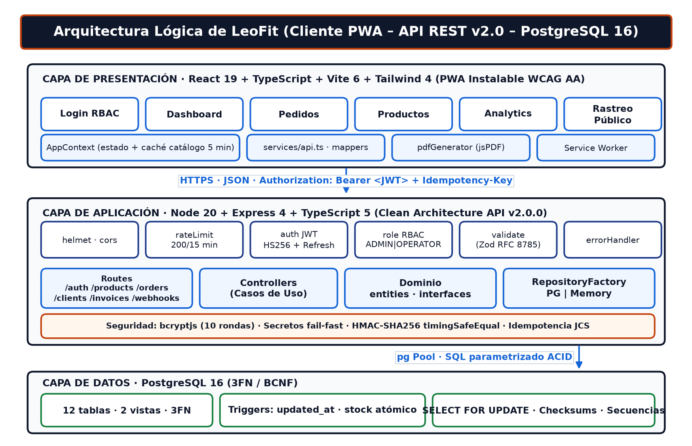
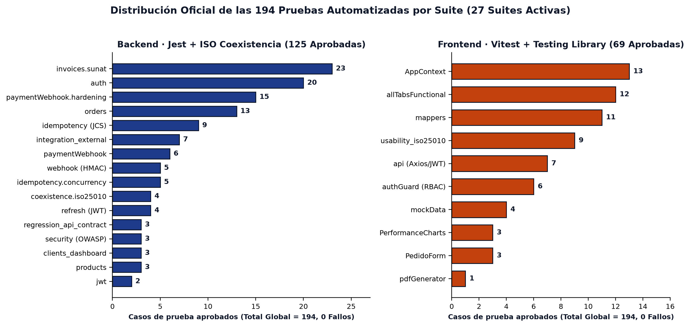

# LeoFit Solutions — Sistema Web PWA de Gestión de Pedidos y Control de Inventario Multicanal (`v2.0.0`)
## Universidad Tecnológica del Perú (UTP) — Curso Integrador II: Software (`100000S12F`)
**Docente Asesor:** Ing. Enrique L. Huamani U. | **Sección:** 35374 | **Grupo:** 01  
**Organización GitHub:** [`Leofit-Solutions-Grupo01`](https://github.com/Leofit-Solutions-Grupo01) | **Repositorio:** [`leofit-pedidos-sistema`](https://github.com/Leofit-Solutions-Grupo01/leofit-pedidos-sistema)

---

[-0F172A.svg)](docs/01_ENTREGA_OFICIAL_APF3/01_DESARROLLO_Y_CALIDAD/INFORME_FINAL_APF3_LEOFIT.docx)
[-15803D.svg)](docs/02_CALIDAD_Y_AUDITORIA/02_calidad_iso25010_semanas_10_11/README.md)
[-1665D8.svg)](docs/03_ARQUITECTURA_Y_DIAGRAMAS/README.md)
[](docs/03_ARQUITECTURA_Y_DIAGRAMAS/README.md)
[](docs/adr/ADR-001_ELECCION_RENDER_NEON_VS_AWS.md)
[](SECURITY.md)
[](https://leofit-solutions-grupo01.github.io/leofit-pedidos-sistema/)

---

## 1. Ubicación Rápida de los Entregables para el Profesor (`docs/`)

Para facilitar la revisión inmediata, la carpeta [`docs/`](docs/README.md) está organizada en una estructura estructurada de entregas académicas:

| Directorio | Contenido Principal | Acceso Directo al Documento Principal |
| :--- | :--- | :--- |
| **[`docs/01_ENTREGA_OFICIAL_APF3/`](docs/01_ENTREGA_OFICIAL_APF3/)** | **Entrega Oficial APF3 (Informe Maestro, Diapositivas y Paquete Canvas)** | [**`Guía de Entrega APF3`**](docs/01_ENTREGA_OFICIAL_APF3/README.md) <br> [**`Informe Maestro APF3 (77 págs)`**](docs/01_ENTREGA_OFICIAL_APF3/01_DESARROLLO_Y_CALIDAD/INFORME_FINAL_APF3_LEOFIT.docx) <br> [**`Hoja de Entrega y Enlaces Docente`**](docs/01_ENTREGA_OFICIAL_APF3/01_DESARROLLO_Y_CALIDAD/HOJA_DE_ENTREGA_Y_ENLACES_DOCENTE.md) <br> [**`Presentación PPTX`**](docs/01_ENTREGA_OFICIAL_APF3/01_DESARROLLO_Y_CALIDAD/presentacion_sustentacion/APF3_LEOFIT_Presentacion.pptx) |
| **[`docs/02_CALIDAD_Y_AUDITORIA/`](docs/02_CALIDAD_Y_AUDITORIA/)** | **Calidad de Software ISO/IEC 25010, Auditoría, Deuda Técnica y DRP** | [**`Informe Calidad ISO 25010`**](docs/02_CALIDAD_Y_AUDITORIA/02_calidad_iso25010_semanas_10_11/README.md) <br> [**`Auditoría y Cierre de Proyecto`**](docs/02_CALIDAD_Y_AUDITORIA/03_auditoria_y_cierre_proyecto/DEUDA_TECNICA.md) <br> [**`Simulacro de Respaldo DRP`**](docs/02_CALIDAD_Y_AUDITORIA/05_operaciones_respaldo_drp/BACKUP_RESTORE_DRILL.md) |
| **[`docs/03_ARQUITECTURA_Y_DIAGRAMAS/`](docs/03_ARQUITECTURA_Y_DIAGRAMAS/)** | **Catálogo de 25 Diagramas de Arquitectura (C4, BPMN, 3FN, Secuencia)** | [**`Catálogo Visual de Diagramas (README.md)`**](docs/03_ARQUITECTURA_Y_DIAGRAMAS/README.md) |
| **[`docs/04_REFERENCIA_CURSO_UTP/`](docs/04_REFERENCIA_CURSO_UTP/)** | **Material Oficial de Referencia UTP (Rúbricas, Sílabo y Manuales Docente)** | [**`Rúbricas de Evaluación UTP`**](docs/04_REFERENCIA_CURSO_UTP/rubricas_evaluacion_utp/) <br> [**`Manuales Docente Enrique Lee`**](docs/04_REFERENCIA_CURSO_UTP/manuales_docente_enrique_lee/) |
| **[`docs/adr/`](docs/adr/)** | **Registro Canónico de Decisiones Arquitectónicas (MADR)** | [**`ADR-001 (Render+Neon vs AWS)`**](docs/adr/ADR-001_ELECCION_RENDER_NEON_VS_AWS.md) <br> [**`ADR-002 (Arquitectura Objetivo AWS)`**](docs/adr/ADR-002_ARQUITECTURA_OBJETIVO_AWS.md) |
| **[`docs/99_HISTORICO_ENTREGAS_ANTERIORES/`](docs/99_HISTORICO_ENTREGAS_ANTERIORES/)** | **Archivo Histórico Consolidado de Evaluaciones Previas (APF1 y APF2)** | [**`Histórico APF1 y APF2`**](docs/99_HISTORICO_ENTREGAS_ANTERIORES/APF1_APF2/) |

---

## 2. Descripción del Proyecto

**LeoFit Solutions** es una plataforma web progresiva (PWA) de alto rendimiento conectada a una API RESTful v2.0.0 bajo **Clean Architecture** con persistencia transaccional en **PostgreSQL 16 (3FN/BCNF)**. La solución digitaliza el flujo integral de ventas, toma de pedidos, facturación electrónica SUNAT y control de existencias en tiempo real para la empresa textil deportiva **LeoFit Confecciones y Diseños Deportivos S.A.C.** (Emporio Comercial de Gamarra, La Victoria, Lima).



---

## 3. Integrantes del Equipo y Asignación de Roles (Grupo 01)

| Integrante (Formato Corporativo) | Código UTP (Protegido) | Rol Scrum | Especialidad Técnica |
| :--- | :---: | :--- | :--- |
| **Loayza R., Lady L.** | `U22****89` | **Scrum Master** | DevSecOps, Seguridad JWT/HMAC, Auditoría ISO 25000 y Gobernanza |
| **Cárdenas F., Víctor L.** | `U19****14` | **Product Owner** | Arquitecto de Base de Datos (DBA), 3FN/BCNF, Concurrencia ACID y Replicación |
| **Roman D., Harley A.** | `U21****32` | **Frontend Lead** | Especialista PWA React 19, Accesibilidad WCAG 2.1 AA/AAA y Usabilidad ISO 25010 |
| **Dávila M., Jim A.** | `U18****81` | **QA Engineer Lead** | Desarrollador Backend Node.js/TS y Arquitectura de 194 Pruebas Automatizadas |
| **Rojas S., Daniel E.** | `U21****27` | **Business Analyst** | Procesos BPMN AS-IS/TO-BE, Gestión de Riesgos PMI y Despliegue Cloud DevOps |

---

## 4. Batería de 194 Pruebas Automatizadas (100% Aprobadas, 0 Fallos)

El sistema cuenta con **194 pruebas automatizadas aprobadas** en **27 suites activas** (`125 Backend + 69 Frontend`):



### Ejecución Rápida de Pruebas
```bash
# 1. Ejecutar las 125 validaciones de Backend (Jest + Supertest + Benchmark Coexistencia)
cd backend && npm test
python scripts/iso25010/run_coexistence_benchmark.py

# 2. Ejecutar las 69 pruebas de Frontend (Vitest + React Testing Library)
cd frontend && npm test
```

---

## 5. Guía de Ejecución Local y Despliegue con Docker

### Opción A: Despliegue con Docker Compose
```bash
docker-compose up -d
# Backend API Health: http://localhost:4000/api/health
```

### Opción B: Ejecución en Entorno de Desarrollo
```bash
# 1. Iniciar Backend API
cd backend && npm install && npm run dev

# 2. Iniciar Frontend PWA
cd frontend && npm install && npm run dev
```

---

## 6. Seguridad, Privacidad PII y Accesibilidad Universal (WCAG 2.1 AA/AAA)

- **Cero Credenciales y Cero Filtración PII:** Todas las claves se inyectan por entorno (`fail-fast`). Los nombres personales, códigos universitarios (`U22****89`), RUC (`206089*****`) y direcciones exactas están sanitizados en toda la documentación.
- **Identidad Oscura Accesible:** Paleta oficial LeoFit (`#0F172A` con contraste **17.8:1 AAA**, `#1665D8` con **5.42:1 AA** y acento terracota deportivo `#C2410C` con **5.74:1 AA**), adaptada para personas con visibilidad media o baja.
- **Políticas y Gobernanza:** Ver [`LICENSE`](LICENSE), [`CODE_OF_CONDUCT.md`](CODE_OF_CONDUCT.md), [`CONTRIBUTING.md`](CONTRIBUTING.md) y [`SECURITY.md`](SECURITY.md).

