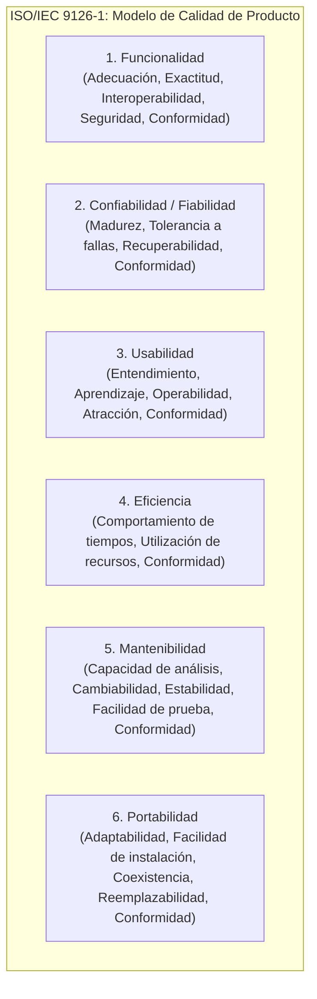
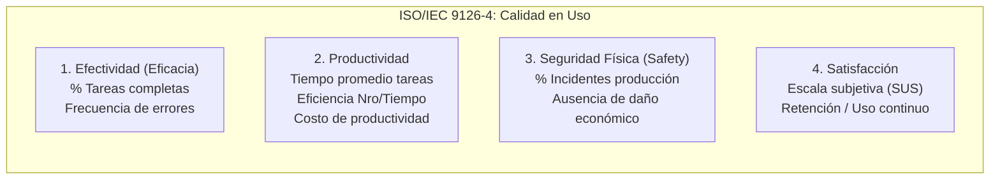
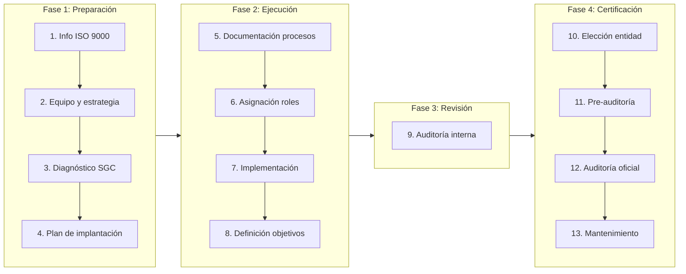
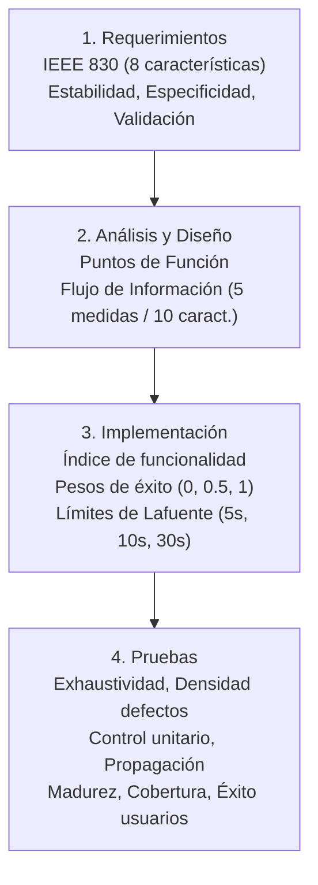
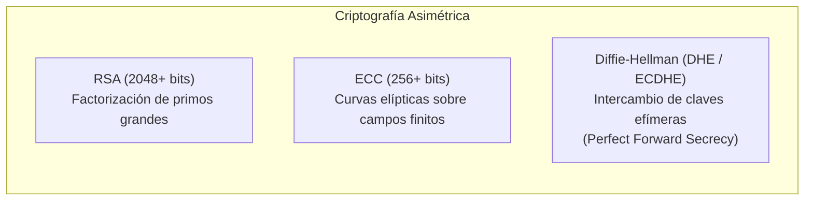
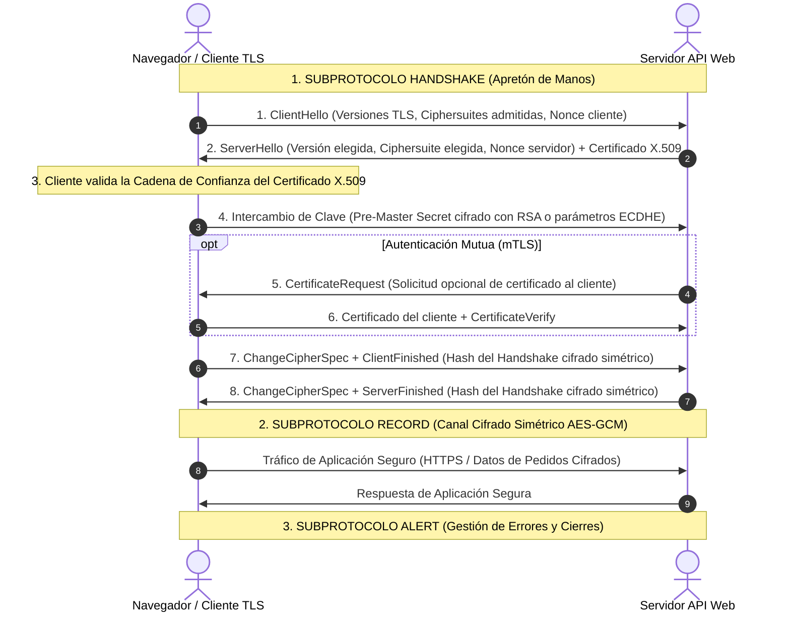
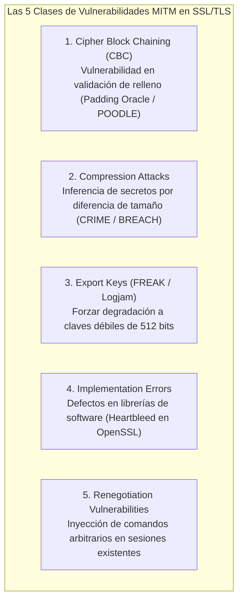
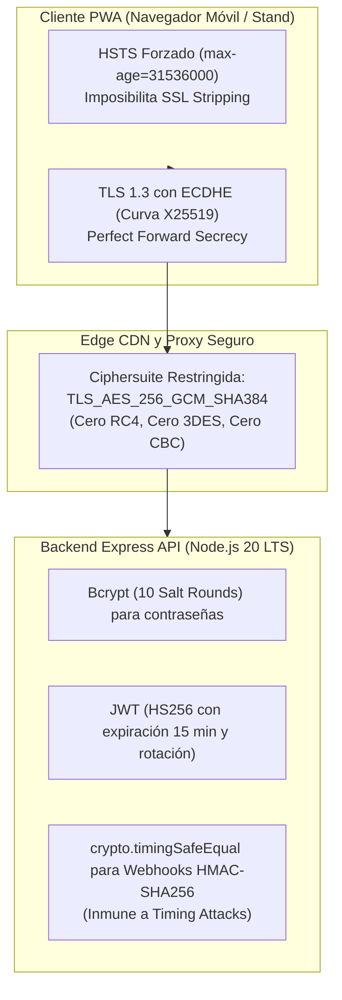

# Compendio Técnico Integral: Calidad de Software, Testing Estandarizado y Seguridad Criptográfica SSL/TLS

**Curso:** Curso Integrador II: Sistemas y Software (`100000S12F`)  
**Institución:** Universidad Tecnológica del Perú (UTP)  
**Grupo:** Grupo 01 — LeoFit Solutions  
**Docente Evaluador:** Ing. Enrique Lee Huamani Uriarte  
**Fuentes Base:** 
1. *Guía Maestra de Estudio: Calidad y Pruebas de Software (Compendio Integral Sesiones 21 a 29 UTP)*.
2. *Determinación de actividades y vulnerabilidades SSL/TLS y de encriptación (Polanía Tovar, 2024, Revista Agunkuyâa 14(1): 27-47)*.

---

## Tabla de Contenidos
1. [Bloque I: Marco Teórico y Modelos de Calidad de Software (Sesiones 21 a 26 UTP)](#1-bloque-i-marco-teórico-y-modelos-de-calidad-de-software)
   - 1.1 [NTP-ISO/IEC 9126: Calidad Interna y Externa (Sesión 21)](#11-ntp-isoiec-9126-calidad-interna-y-externa-sesión-21)
   - 1.2 [ISO/IEC 9126-4: Atributos y Métricas de Calidad en Uso (Sesión 22)](#12-isoiec-9126-4-atributos-y-métricas-de-calidad-en-uso-sesión-22)
   - 1.3 [ISO/IEC 25000 (SQuaRE): Calidad del Producto Software (Sesión 24)](#13-isoiec-25000-square-calidad-del-producto-software-sesión-24)
   - 1.4 [ISO 9000-3: Modelo de Procesos para Fábricas de Software (Sesión 23)](#14-iso-9000-3-modelo-de-procesos-para-fábricas-de-software-sesión-23)
   - 1.5 [ISO 9001:2015: Sistema de Gestión de Calidad y Procesos RUP (Sesión 25)](#15-iso-90012015-sistema-de-gestión-de-calidad-y-procesos-rup-sesión-25)
   - 1.6 [KmKey: Plataforma de Gestión de Calidad y Proyectos (Sesión 26)](#16-kmkey-plataforma-de-gestión-de-calidad-y-proyectos-sesión-26)
2. [Bloque II: Estándares, Métricas y Técnicas de Prueba de Software (Sesiones 27 a 29 UTP)](#2-bloque-ii-estándares-métricas-y-técnicas-de-prueba-de-software)
   - 2.1 [ISO/IEC/IEEE 29119: Estándar Internacional de Testing (Sesión 27)](#21-isoiecieee-29119-estándar-internacional-de-testing-sesión-27)
   - 2.2 [Métricas Relativas a las 4 Etapas del Ciclo de Vida (Sesión 28)](#22-métricas-relativas-a-las-4-etapas-del-ciclo-de-vida-sesión-28)
   - 2.3 [Proceso de Prueba: Fases, Caja Negra y Caja Blanca (Sesión 29)](#23-proceso-de-prueba-fases-caja-negra-y-caja-blanca-sesión-29)
3. [Bloque III: Fundamentos Criptográficos y Arquitectura del Protocolo SSL/TLS](#3-bloque-iii-fundamentos-criptográficos-y-arquitectura-del-protocolo-ssltls)
   - 3.1 [Criptografía Clásica vs. Criptografía Moderna](#31-criptografía-clásica-vs-criptografía-moderna)
   - 3.2 [Criptografía Simétrica (SKC): Algoritmos y Modos de Cifrado](#32-criptografía-simétrica-skc-algoritmos-y-modos-de-cifrado)
   - 3.3 [Criptografía Asimétrica (PKC), Curvas Elípticas e Intercambio Diffie-Hellman](#33-criptografía-asimétrica-pkc-curvas-elípticas-e-intercambio-diffie-hellman)
   - 3.4 [Funciones Hash, Códigos de Autenticación de Mensajes (MAC) y Firmas Digitales](#34-funciones-hash-códigos-de-autenticación-de-mensajes-mac-y-firmas-digitales)
   - 3.5 [Arquitectura y Subprotocolos de SSL/TLS (Handshake, Record, ChangeCipherSpec, Alert)](#35-arquitectura-y-subprotocolos-de-ssltls)
   - 3.6 [Infraestructura de Clave Pública (PKI), Certificados X.509 y Cadena de Confianza](#36-infraestructura-de-clave-pública-pki-certificados-x509-y-cadena-de-confianza)
4. [Bloque IV: Taxonomía de Vulnerabilidades SSL/TLS y Estrategias de Mitigación](#4-bloque-iv-taxonomía-de-vulnerabilidades-ssltls-y-estrategias-de-mitigación)
   - 4.1 [Ataques Man-In-The-Middle (MITM) y sus 5 Clases de Vulnerabilidades](#41-ataques-man-in-the-middle-mitm-y-sus-5-clases-de-vulnerabilidades)
   - 4.2 [Mecanismos Modernos de Protección y Detección Temprana (CAA, DANE, HSTS, HPKP)](#42-mecanismos-modernos-de-protección-y-detección-temprana)
   - 4.3 [Ataques de Degradación (Downgrade/Rollback) y Claves Débiles de Exportación (FREAK)](#43-ataques-de-degradación-downgraderollback-y-claves-débiles-de-exportación-freak)
   - 4.4 [Ataques Entre Protocolos (Cross-Protocol Attacks) con Intercambio ECC](#44-ataques-entre-protocolos-cross-protocol-attacks-con-intercambio-ecc)
5. [Bloque V: Mapeo y Aplicación Técnica Directa en el Proyecto LeoFit Solutions](#5-bloque-v-mapeo-y-aplicación-técnica-directa-en-el-proyecto-leofit-solutions)
   - 5.1 [Implementación del Modelo de Calidad ISO 9126 / ISO 25010 en LeoFit](#51-implementación-del-modelo-de-calidad-iso-9126--iso-25010-en-leofit)
   - 5.2 [Aseguramiento de Pruebas ISO 29119 y Cobertura Automatizada](#52-aseguramiento-de-pruebas-iso-29119-y-cobertura-automatizada)
   - 5.3 [Blindaje Criptográfico: TLS 1.3, AES-256-GCM, Bcrypt, JWT y Webhooks HMAC](#53-blindaje-criptográfico-tls-13-aes-256-gcm-bcrypt-jwt-y-webhooks-hmac)
   - 5.4 [Seguridad Transaccional y Ausencia de Daño Económico (ACID FOR UPDATE)](#54-seguridad-transaccional-y-ausencia-de-daño-económico-acid-for-update)
6. [Referencias Normativas y Bibliográficas](#6-referencias-normativas-y-bibliográficas)

---

## 1. Bloque I: Marco Teórico y Modelos de Calidad de Software

### 1.1 NTP-ISO/IEC 9126: Calidad Interna y Externa (Sesión 21)

La norma **ISO/IEC 9126** (*Software engineering — Product quality*) constituye el marco fundacional para la especificación y evaluación rigurosa de los atributos de calidad de productos de software. La primera parte (**ISO/IEC 9126-1**) clasifica la calidad del producto en dos perspectivas complementarias:
1. **Calidad Interna y Calidad Externa:** Modelo estructural jerárquico dividido en 6 características maestras y 27 subcaracterísticas.
2. **Calidad en el Uso:** Modelo orientado al impacto operativo del sistema en las tareas del usuario.



#### Taxonomía de las 6 Características y 27 Subcaracterísticas

| N° | Característica | Pregunta Clave | Subcaracterísticas Oficiales |
| :--- | :--- | :--- | :--- |
| **1** | **Funcionalidad** | ¿El software hace lo que debe hacer? | **Adecuación (Adecuidad)**, **Exactitud**, **Interoperabilidad**, **Seguridad**, **Conformidad de funcionalidad**. |
| **2** | **Confiabilidad (Fiabilidad)** | ¿Es estable y no se cae bajo carga o fallas? | **Madurez**, **Tolerancia a fallas**, **Recuperabilidad**, **Conformidad de fiabilidad**. |
| **3** | **Usabilidad** | ¿Es fácil de entender, aprender y operar? | **Entendimiento**, **Aprendizaje**, **Operabilidad**, **Atracción**, **Conformidad de usabilidad**. |
| **4** | **Eficiencia** | ¿Responde rápido y optimiza recursos? | **Comportamiento de tiempos**, **Utilización de recursos**, **Conformidad de eficiencia**. |
| **5** | **Capacidad de Mantenimiento** | ¿Es fácil modificar, corregir y probar? | **Capacidad de análisis**, **Cambiabilidad**, **Estabilidad**, **Facilidad de prueba (Testabilidad)**, **Conformidad de mantenimiento**. |
| **6** | **Portabilidad** | ¿Se adapta y despliega en diversos entornos? | **Adaptabilidad**, **Facilidad de instalación**, **Coexistencia**, **Reemplazabilidad**, **Conformidad de portabilidad**. |

#### Fichas Oficiales de Métricas de Clase (Sesión 21)

##### Ficha Técnica 1.1: Métrica de Adecuidad (Funcionalidad — Diapositiva 17)
- **Nombre:** Completitud de la implementación funcional.
- **Propósito:** Determinar qué tan completa está la implementación de las funciones requeridas por el negocio.
- **Método de aplicación:** Contar las funciones faltantes o deficientes ($A$) y compararlas con las descritas en el contrato de especificación ($B$).
- **Fórmula Matemática:**
  $$X = 1 - \left(\frac{A}{B}\right)$$
- **Interpretación:** $0 \le X \le 1$. A mayor cercanía a $1.0$, mayor es la completitud de las funciones del sistema.
- **Tipo de escala / Tipo de medida:** Escala Absoluta. Medida $X = \text{count} / \text{count}$.
- **Fuente de medición:** Especificación de Requisitos (SRS), Documento de Arquitectura, Código fuente e Informes de revisión.
- **Mapeo ISO/IEC 12207 SLCP:** Procesos 6.6 Validación y 6.6 Revisión conjunta.
- **Audiencia:** Analistas de requerimientos, desarrolladores y clientes.

##### Ficha Técnica 2.1: Métrica de Madurez (Fiabilidad — Diapositiva 19)
- **Nombre:** Suficiencia de las pruebas.
- **Propósito:** Determinar cuántos de los casos de prueba requeridos están formalmente cubiertos y aprobados en el plan de pruebas.
- **Método de aplicación:** Contar los casos de prueba ejecutados satisfactoriamente ($A$) frente al total de pruebas planificadas requeridas ($B$).
- **Fórmula Matemática:**
  $$X = \frac{A}{B}$$
- **Interpretación:** $0 \le X \le 1$ (o $X \ge 1$ si se superan los casos base). A mayor valor de $X$, mayor suficiencia y menor tasa de fallas latentes.
- **Tipo de escala / Tipo de medida:** Escala Absoluta. Medida $X = \text{count} / \text{count}$.
- **Fuente de medición:** Plan de Pruebas ($A$) y Especificación de Requisitos ($B$).
- **Mapeo ISO/IEC 12207 SLCP:** Aseguramiento de Calidad, Verificación y Resolución de problemas.
- **Audiencia:** Desarrolladores, ingenieros de QA y mantenedores de software.

---

### 1.2 ISO/IEC 9126-4: Atributos y Métricas de Calidad en Uso (Sesión 22)

Mientras que ISO 9126-1 evalúa el código y las interfaces, **ISO/IEC 9126-4** evalúa el comportamiento del software en producción cuando interactúa con usuarios humanos en escenarios comerciales reales.



#### Los 4 Atributos de Calidad en Uso

| Atributo | Definición Normativa | Métricas Oficiales de Clase |
| :--- | :--- | :--- |
| **1. Efectividad (Eficacia)** | Permitir a los usuarios alcanzar objetivos especificados con exactitud y completitud en su contexto de uso. | 1. **% Efectividad de Tareas** = $\frac{\text{Tareas exitosas}}{\text{Total asignadas}} \times 100\%$.<br>2. **% Tareas Completas**.<br>3. **Frecuencia de Errores** = $\frac{\text{Errores detectados}}{\text{Total tareas}}$. |
| **2. Productividad** | Permitir a los usuarios gastar una cantidad adecuada de recursos (tiempo, esfuerzo humano, consumibles o costo financiero). | 1. **Tiempo promedio de tareas** ($\text{segundos o minutos}$).<br>2. **Eficiencia de tareas** = $\frac{N^\circ\text{ Tareas}}{\text{Tiempo}}$.<br>3. **Costo de Productividad** = $\frac{\text{Tareas completadas}}{\text{Costo total de operación}}$.<br>4. **% Tiempo Productivo** = $\frac{\text{Tiempo en tarea activa}}{\text{Tiempo total de turno}} \times 100\%$.<br>5. **% Eficiencia Relativa** = $\frac{\text{Tiempo operador experto}}{\text{Tiempo usuario novato}} \times 100\%$. |
| **3. Seguridad física (Safety)** | Alcanzar niveles aceptables del riesgo de hacer daño a personas, al negocio, al software, a las propiedades o al ambiente. | 1. **% Seguridad de Software** = $\frac{\text{Usuarios sin incidentes}}{\text{Total usuarios}} \times 100\%$.<br>2. **% Afectación Software** = $\frac{\text{Sesiones degradadas}}{\text{Total sesiones}} \times 100\%$.<br>3. **Daño Económico** ($\text{Soles o Dólares perdidos por fallos}$). |
| **4. Satisfacción** | Nivel de respuesta afectiva, comodidad y agrado que experimenta el usuario al interactuar con el sistema. | 1. **Escala de Satisfacción** (Cuestionarios estandarizados SUS o Likert).<br>2. **Uso del Software** (% de adopción continuada voluntaria). |

> [!IMPORTANT]
> **Diferencia Fundamental entre Security y Safety:**
> - En **ISO 9126-1** (Funcionalidad), la **Seguridad (Security)** previene el acceso no autorizado a los datos mediante credenciales, cifrado y tokens.
> - En **ISO 9126-4** (Calidad en Uso), la **Seguridad física (Safety)** garantiza la *ausencia de daño* físico o financiero al negocio (evitando pérdidas económicas o corrupción de inventario).

---

### 1.3 ISO/IEC 25000 (SQuaRE): Calidad del Producto Software (Sesión 24)

La familia de normas **ISO/IEC 25000** (*Software Product Quality Requirements and Evaluation — SQuaRE*) unifica y sustituye a las series ISO 9126 e ISO 14598.

#### Los 7 Apartados Oficiales de ISO 25000
1. **Apartado 1 (Ámbito de Aplicación):** Delimita el marco para definir requisitos y evaluar productos software.
2. **Apartado 2 (Conformidad con Requisitos):** Criterios verificables de cumplimiento contractual.
3. **Apartado 3 (Normas para Consulta):** Referencias normativas de la serie ISO 25000 (2501n, 2502n, 2503n, 2504n).
4. **Apartado 4 (Términos y Definiciones):** Glosario estandarizado internacional.
5. **Apartado 5 (Marco de Calidad):** Estructurado en 3 pilares: (1) Parámetros internos y externos, (2) Categorías y subcategorías, (3) Evaluación periódica de continuidad.
6. **Apartado 6 (Modelo de Calidad del Producto - 8 Características):**
   - Funcionalidad.
   - Fiabilidad.
   - Eficiencia del rendimiento.
   - Operatividad (Usabilidad).
   - Seguridad (elevada a característica de primer nivel).
   - Compatibilidad (incluye interoperabilidad y coexistencia).
   - Facilidad de mantenimiento.
   - Capacidad de transferencia (Portabilidad).
7. **Apartado 7 (Calidad en Uso del Modelo):** Evalúa efectividad, eficiencia, satisfacción y mitigación de riesgos operacionales.

#### Los 6 Requisitos Documentales Obligatorios
1. Políticas de gestión de calidad de software y objetivos de calidad.
2. Definición formal de las características del modelo según las necesidades del cliente.
3. Simulacros de uso del software para detectar fallos antes del lanzamiento a producción.
4. Medidas documentadas de satisfacción de clientes y usuarios.
5. Registro de modificaciones y revisiones de los cambios aplicados al software.
6. Registros de evolución histórica y trazabilidad de versiones.

---

### 1.4 ISO 9000-3: Modelo de Procesos para Fábricas de Software (Sesión 23)

La **ISO 9000-3** adapta las directrices generales de aseguramiento de calidad al ciclo de vida del software, interconectando tres engranajes fundamentales: **Calidad de Software $\longleftrightarrow$ Procesos del Ciclo de Vida $\longleftrightarrow$ Desarrollo de Sistemas de Información**.

#### Las 3 Reglas Obligatorias del Alcance
1. **Control en todas las fases:** El control de calidad debe aplicarse obligatoriamente a todas las fases: desarrollo, implementación, despliegue y mantenimiento posterior.
2. **Colaboración estricta:** Debe existir colaboración documentada y constante entre el adquirente (cliente) y el proveedor de software.
3. **Sistema propio en toda la empresa:** El proveedor debe definir su propio sistema de gestión de calidad y asegurar que toda la organización lo ponga en práctica.

#### Los 13 Pasos para Implementar ISO 9000-3 (4 Fases Lógicas)



---

### 1.5 ISO 9001:2015: Sistema de Gestión de Calidad y Procesos RUP (Sesión 25)

La norma **ISO 9001:2015** introduce el **Pensamiento Basado en Riesgo**, definiendo el riesgo cuantitativamente como:
$$\text{Riesgo} = \text{Probabilidad de Ocurrencia} \times \text{Severidad de las Consecuencias}$$

#### Los 7 Principios de Gestión de Calidad
1. **Enfoque al cliente:** Cumplir requisitos y superar expectativas.
2. **Liderazgo:** Unidad de propósito y dirección organizativa.
3. **Compromiso de las personas:** Personal competente, empoderado y comprometido.
4. **Enfoque a procesos:** Actividades gestionadas como procesos interconectados.
5. **Mejora continua:** Enfoque permanente en optimizar el desempeño.
6. **Toma de decisiones basada en la evidencia:** Análisis de datos y métricas reales.
7. **Gestión de las relaciones:** Gestión coordinada con proveedores y partes interesadas.

#### Estructura del Mapa de Procesos de Desarrollo de Software (RUP)
- **Procesos Estratégicos:** Planeación Estratégica, Gestión Integral de la Calidad.
- **Procesos Operativos (Ciclo RUP de Cliente a Cliente):**
  1. *Inicio:* Delimitación del alcance, viabilidad técnica y objetivos del sistema.
  2. *Elaboración:* Especificación arquitectónica, análisis de riesgos y diseño base.
  3. *Construcción:* Codificación de componentes, persistencia y funcionalidad completa.
  4. *Transición:* Pruebas de aceptación, despliegue, capacitación y pase a producción.
- **Procesos de Apoyo:** Gestión de Capital Humano, Gestión Financiera, Infraestructura TI.

---

### 1.6 KmKey: Plataforma de Gestión de Calidad y Proyectos (Sesión 26)

**KmKey** (*Knowledge Manager Key*) es una plataforma modular para el gobierno y control documental de proyectos informáticos:
- **KmKey Quality:** Administra los 14 parámetros del SGC (documentos, acciones correctivas/preventivas, no conformidades, auditorías, indicadores, riesgos, gestión de proveedores según ISO 9001, ISO 27001 e ISO 14001).
- **KmKey Project:** Gobierna la ejecución operativa mediante 4 ejes fundamentales:
  1. **Tiempo:** Cronogramas, diagramas de Gantt y desvíos temporales.
  2. **Esfuerzo:** Horas hombre invertidas por recurso técnico.
  3. **Información:** Gestión documental centralizada y trazabilidad de requerimientos.
  4. **Economía:** Presupuesto asignado, costos incurridos y rentabilidad proyectada.

---

## 2. Bloque II: Estándares, Métricas y Técnicas de Prueba de Software

### 2.1 ISO/IEC/IEEE 29119: Estándar Internacional de Testing (Sesión 27)

El estándar **ISO/IEC/IEEE 29119** reemplaza a las antiguas normas IEEE 829 e IEEE 1008, estructurándose en 4 partes esenciales:
- **Parte 1 (Conceptos y Definiciones):** Base de pruebas, pruebas estáticas vs. dinámicas, estrategias de testing basadas en riesgos.
- **Parte 2 (Modelo de Procesos en 3 Capas):**
  - *Capa 1 (Políticas Organizacionales):* Política y estrategia corporativa de pruebas.
  - *Capa 2 (Gestión de Pruebas):* Planificación, monitoreo y control del proyecto de testing.
  - *Capa 3 (Pruebas Dinámicas):* Diseño, ejecución y reporte de suites de prueba.
- **Parte 3 (Documentación de Pruebas — 12 Plantillas Oficiales):**
  - *2 Organizacionales:* Política de prueba y Estrategia de prueba organizacional.
  - *3 de Gestión:* Plan de Prueba (con estrategia integrada), Informe de estado e Informe de finalización.
  - *7 Dinámicas:* Especificación de diseño, Especificación de caso de prueba, Especificación de procedimiento, Requisitos de datos, Informe de preparación de datos, Resultados de prueba e Informe de incidentes (bugs).
- **Parte 4 (Técnicas de Prueba Dinámica):** Técnicas basadas en especificaciones (Caja Negra), basadas en estructura (Caja Blanca) y basadas en la experiencia (Exploratorias).

---

### 2.2 Métricas Relativas a las 4 Etapas del Ciclo de Vida (Sesión 28)



1. **Requerimientos:** Evalúa las 8 características del estándar **IEEE 830** (Correcta, No ambigua, Completa, Consistente, Ordenada por importancia, Verificable, Modificable y Trazable).
2. **Análisis y Diseño:** Medición del Flujo de Información mediante 5 medidas base (Entradas, Salidas, Archivos lógicos internos, Archivos de interfaz externa, Consultas de usuario) y 10 características de complejidad.
3. **Implementación:**
   - *Índice de funcionalidad:* Proporción de archivos estructurales (HTML) frente a funcionales de servidor (TypeScript/Node.js, PHP, JSP).
   - *Métrica de Éxito:* Ponderación del avance funcional: **0** (No realizada), **0.5** (A medio realizar), **1.0** (Completamente realizada).
   - *Límites de espera en web (Lafuente, 2000):* **5 segundos** para contenido visible en pantalla, **10 segundos** para texto legible interactivo, **30 segundos** máximo para respuesta de clic de navegación.
4. **Pruebas:** Cobertura de código, densidad de defectos por KLOC, tasa de propagación de fallos y porcentaje de éxito de tareas ejecutadas por usuarios.

---

### 2.3 Proceso de Prueba: Fases, Caja Negra y Caja Blanca (Sesión 29)

#### Las 6 Etapas Secuenciales de Prueba (Filosofía Bottom-Up)
1. **Pruebas Unitarias (de Módulo):** Verifican componentes y métodos aislados en código.
2. **Pruebas de Integración:** Verifican la comunicación entre módulos, APIs y persistencia relacional.
3. **Pruebas de Sistema:** Validan el sistema completo integrado frente a requerimientos funcionales y técnicos.
4. **Pruebas de Rendimiento:** Evalúan latencia, concurrencia, carga y estrés.
5. **Pruebas de Aceptación (UAT):** Validación formal con usuarios finales frente a criterios de negocio.
6. **Pruebas de Instalación y Despliegue:** Verificación en entornos cloud de staging y producción.

#### Los 4 Tipos de Pruebas de Sistema
1. **Pruebas de Recuperación:** Verifican que el sistema restaure sus datos y operatividad tras una caída abrupta.
2. **Pruebas de Seguridad:** Comprueban que los controles criptográficos y de autorización prevengan intrusiones.
3. **Pruebas de Estrés:** Someten al sistema a demandas no planificadas más allá de su capacidad nominal.
4. **Pruebas de Rendimiento:** Miden el comportamiento de recursos y tiempos durante períodos prolongados (*Soak tests*).

#### Pruebas de Caja Negra vs. Pruebas de Caja Blanca

| Criterio | Pruebas de Caja Negra | Pruebas de Caja Blanca |
| :--- | :--- | :--- |
| **Definición** | Verificación funcional sin inspeccionar el código fuente; se enfoca en Entradas $\to$ Salidas esperadas. | Verificación estructural interna inspeccionando sentencias, condiciones lógicas y rutas de código. |
| **Técnicas Clave** | Partición de equivalencia, análisis de valores límite, pruebas basadas en fallas y escenarios de uso. | Prueba de la ruta básica, prueba de condiciones lógicas y cobertura de bucles (*loops*). |
| **Herramienta Estructural** | Matrices de casos de prueba con precondición, entrada y resultado esperado. | **Grafo de flujo de control:** Nodos (instrucciones procedurales) y Aristas (enlaces de control de flujo). |
| **Cálculo de Complejidad** | N/A (Métricas de completitud de requisitos). | **Complejidad Ciclomática de McCabe:** $V(G) = \text{Aristas} - \text{Nodos} + 2\text{P}$ (determina las rutas independientes obligatorias). |

---

## 3. Bloque III: Fundamentos Criptográficos y Arquitectura del Protocolo SSL/TLS

*(Fundamentado en el estudio de Polanía Tovar, 2024, Revista Agunkuyâa)*

### 3.1 Criptografía Clásica vs. Criptografía Moderna

- **Criptografía Clásica:** Se basaba en el secreto del *mecanismo* o método de cifrado (herramientas físicas como *scytales* espartanas, cifrados de sustitución o transposición de patrones). Si el algoritmo era descubierto, la seguridad colapsaba por completo.
- **Criptografía Moderna:** Se rige por el **Principio de Kerckhoffs**: los algoritmos de cifrado son públicos, matemáticamente abiertos y rigurosamente escrutados. Toda la seguridad reside exclusivamente en la **confidencialidad de la clave secreta**.

### 3.2 Criptografía Simétrica (SKC): Algoritmos y Modos de Cifrado

La criptografía de clave simétrica o secreta (*Symmetric Key Cryptography — SKC*) utiliza la misma clave tanto para cifrar como para descifrar:

1. **Cifrados de Flujo (*Stream Ciphers*):**
   - Aplican operaciones bit a bit o byte a byte combinando el texto plano con un flujo pseudoaleatorio mediante la operación XOR:
     $$C_i = P_i \oplus K_i \quad \Longleftrightarrow \quad P_i = C_i \oplus K_i$$
   - *Algoritmo RC4 (*Rivest Cipher 4*):* Cifrado simétrico de longitud variable (40 a 2048 bits). Históricamente popular en SSL 3.0 y TLS 1.0; **totalmente discontinuado y prohibido** desde 2013 tras ser quebrantado por la NSA y demostrado vulnerable a ataques estadísticos de sesgo de bytes (RFC 7465).
2. **Cifrados de Bloque (*Block Ciphers*):**
   - Dividen el mensaje en bloques de tamaño fijo antes de cifrar:
     - **DES (*Data Encryption Standard*):** Bloques de 64 bits, 16 rondas con 8 cajas S (*S-boxes*) y clave de 56 bits. Obsoleto y vulnerable a fuerza bruta en minutos.
     - **3DES (*Triple DES*):** Aplica DES tres veces con claves separadas (longitud efectiva de 112 o 168 bits). Lento y vulnerable a ataques como *Sweet32*.
     - **AES (*Advanced Encryption Standard*):** Estándar de facto moderno (FIPS 197). Cifra bloques de 128 bits con claves de 128, 192 o 256 bits mediante sustituciones y permutaciones algebraicas en campos de Galois $GF(2^8)$. Extremadamente seguro y eficiente en hardware.
     - **Blowfish / Twofish:** Cifrados diseñados por Bruce Schneier. Blowfish (bloques de 64 bits, clave de 32 a 448 bits) y Twofish (bloques de 128 bits, clave hasta 256 bits).
3. **Modos de Operación en Bloque:**
   - **ECB (*Electronic Codebook*):** Cifra cada bloque idéntico con la misma clave produciendo bloques idénticos de salida. Inseguro, expone patrones visuales y de datos.
   - **CBC (*Cipher Block Chaining*):** Cada bloque de texto plano se combina con el bloque cifrado anterior mediante XOR antes del cifrado. Requiere relleno (*padding*) si el texto no es múltiplo del bloque, haciéndolo vulnerable a ataques de *Padding Oracle*.
   - **GCM (*Galois/Counter Mode*):** Modo avanzado de **Cifrado Autenticado con Datos Asociados (AEAD)**. Combina el modo contador con multiplicación en cuerpos de Galois para proporcionar confidencialidad e integridad criptográfica simultánea. Solo admitido a partir de TLS 1.2 y obligatorio en TLS 1.3.

---

### 3.3 Criptografía Asimétrica (PKC), Curvas Elípticas e Intercambio Diffie-Hellman

La criptografía de clave pública (*Public Key Cryptography — PKC*) emplea pares de claves matemáticas complementarias: una **clave pública** para cifrado/verificación y una **clave privada** para descifrado/firma.



1. **RSA (Rivest, Shamir, Adleman):** Su seguridad radica en la dificultad computacional de factorizar el producto de dos números primos gigantes ($n = p \cdot q$). Se exige una longitud mínima de **2048 bits** (equivalente a 112 bits de seguridad simétrica); longitudes de 1024 bits son inseguras.
2. **Criptografía de Curvas Elípticas (ECC):**
   - Basa su fortaleza en el problema del logaritmo discreto sobre grupos de puntos en una curva elíptica:
     $$y^2 = x^3 + ax + b$$
   - Ofrece una resistencia criptográfica equivalente a RSA pero con claves drásticamente más cortas (una clave ECC de 256 bits iguala la seguridad de un RSA de 3072 bits), optimizando consumo de CPU, ancho de banda y batería en dispositivos móviles e IoT.
3. **Algoritmo Diffie-Hellman (DH) y Claves Efímeras:**
   - Permite a dos partes acordar un secreto compartido a través de un canal inseguro sin compartir la clave secreta directamente.
   - **DHE (*Diffie-Hellman Ephemeral*) / ECDHE (*Elliptic Curve DHE*):** Generan pares de claves efímeros distintos para cada sesión. Si la clave privada a largo plazo del servidor se compromete en el futuro, las sesiones pasadas no pueden descifrarse, garantizando el principio de **Confidencialidad Directa Perfecta (*Perfect Forward Secrecy — PFS*)**.

---

### 3.4 Funciones Hash, Códigos de Autenticación de Mensajes (MAC) y Firmas Digitales

1. **Funciones Hash Criptográficas:** Algoritmos deterministas y unidireccionales que transforman mensajes de cualquier longitud en resúmenes de longitud fija (*digest*). Deben cumplir resistencia a la preimagen, segunda preimagen y colisiones.
   - *MD5 (128 bits):* Roto criptográficamente (colisiones en segundos). Prohibido.
   - *SHA-1 (160 bits):* Demostradas colisiones prácticas (*SHAttered*). Obsoleto.
   - *SHA-2 (SHA-256 / SHA-512):* Estándar actual seguro de alta robustez.
2. **Códigos de Autenticación de Mensajes (MAC / HMAC):** Combinan una función hash con una clave secreta compartida ($HMAC(K, M)$) para verificar simultáneamente la **integridad de los datos** y la **autenticidad del origen**.
3. **Firmas Digitales:** El emisor genera el hash del mensaje y lo cifra con su **clave privada**. Cualquier receptor que posea la clave pública correspondiente puede descifrar el hash y comparar, verificando autoría, integridad y **no repudio**.

---

### 3.5 Arquitectura y Subprotocolos de SSL/TLS

El protocolo **SSL/TLS** se sitúa entre la capa de transporte (TCP) y la capa de aplicación (HTTP), encapsulando cuatro subprotocolos:



1. **Subprotocolo Handshake (Protocolo de Enlace):** Negocia versiones de protocolo, selecciona ciphersuites, autentica los certificados X.509 y establece el secreto maestro (*Master Secret*) para derivar las claves simétricas de sesión.
2. **Subprotocolo Record (Protocolo de Registro):** Fragmenta los mensajes de la aplicación, aplica compresión opcional, calcula el MAC, encapsula y cifra los datos con el algoritmo simétrico acordado.
3. **Subprotocolo ChangeCipherSpec:** Mensaje de un único byte que notifica formalmente la transición inmediata a la utilización de los parámetros criptográficos recién negociados.
4. **Subprotocolo Alert:** Comunica excepciones, advertencias o cierres de conexión clasificadas por nivel de severidad (*Warning* o *Fatal*).

---

### 3.6 Infraestructura de Clave Pública (PKI), Certificados X.509 y Cadena de Confianza

Para evitar que un atacante suplante la identidad del servidor, TLS se apoya en una **Infraestructura de Clave Pública (PKI)** basada en **certificados digitales X.509**:
- **Cadena de Confianza:** Un certificado de servidor final está firmado digitalmente por una **Autoridad de Certificación (CA) Intermedia**, la cual a su vez está firmada por una **CA Raíz (*Root CA*)** preinstalada en el almacén de confianza del sistema operativo o navegador.
- **Niveles de Validación de Certificados:**
  1. **Validación de Dominio (DV):** La CA solo verifica el control técnico sobre el dominio o registro DNS.
  2. **Validación de Organización (OV):** La CA comprueba la existencia legal y comercial de la empresa solicitante.
  3. **Validación Extendida (EV):** Proceso exhaustivo de verificación jurídica que mitiga ataques de *phishing* institucional.

---

## 4. Bloque IV: Taxonomía de Vulnerabilidades SSL/TLS y Estrategias de Mitigación

### 4.1 Ataques Man-In-The-Middle (MITM) y sus 5 Clases de Vulnerabilidades

Un ataque MITM (*Hombre en el Medio*) ocurre cuando un atacante se interpone silenciosamente en el flujo de comunicación entre cliente y servidor, pudiendo interceptar, alterar o suplantar la información.



1. **CBC Padding Oracle (POODLE / Lucky Thirteen):** En los modos CBC antiguos, el servidor valida el padding antes del MAC, permitiendo a un atacante inferir bytes en texto plano analizando los códigos de error o tiempos de respuesta.
2. **Ataques de Compresión (CRIME / BREACH):** Explotan la compresión DEFLATE en TLS o HTTP; el atacante observa la longitud del mensaje cifrado y deduce tokens de sesión o contraseñas.
3. **Ataques de Exportación (*Export Keys*):** Remanentes de las restricciones de exportación impuestas por EE. UU. en los años 90 (claves RSA de 512 bits). Servidores mal configurados aún aceptan estas claves, permitiendo factorizarlas en pocas horas.
4. **Errores de Implementación (*Implementation Errors*):** Defectos en el código de bibliotecas como OpenSSL. El caso paradigmático fue **Heartbleed (CVE-2014-0160)**, donde una lectura fuera de límites en la extensión Heartbeat filtraba 64 KB de memoria del servidor por petición.
5. **Renegociación Insegura:** Permite a un atacante inyectar tráfico malicioso al comienzo de una sesión TLS antes de que el cliente legítimo inicie su propia conexión.

---

### 4.2 Mecanismos Modernos de Protección y Detección Temprana

Para inmunizar los canales frente a ataques MITM, la ingeniería de software actual exige la adopción de cuatro mecanismos de protección con conocimiento previo:

1. **Registros DNS CAA (*Certification Authority Authorization* — RFC 6844):** Permite al propietario del dominio declarar en el DNS qué Autoridades de Certificación específicas tienen autorización formal para emitir certificados a su nombre, impidiendo que una CA comprometida emita certificados fraudulentos.
2. **DANE (*DNS-based Authentication of Named Entities* — RFC 6698):** Asocia certificados o claves públicas a nombres de dominio mediante registros DNS TLSA asegurados con DNSSEC.
3. **HSTS (*HTTP Strict Transport Security* — RFC 6797):** Cabecera HTTP que obliga al navegador a comunicarse exclusivamente a través de HTTPS, neutralizando ataques de despojo de cifrado (*SSL Stripping*):
   ```http
   Strict-Transport-Security: max-age=31536000; includeSubDomains; preload
   ```
4. **HPKP (*HTTP Public Key Pinning* — RFC 7469):** Asociaba huellas dactilares criptográficas de claves públicas al cliente web (reemplazado modernamente por *Certificate Transparency*).

---

### 4.3 Ataques de Degradación (Downgrade/Rollback) y Claves Débiles de Exportación (FREAK)

- **Downgrade Attack (Ataque de Degradación):** El atacante intercepta el mensaje inicial `ClientHello` en texto claro y sustituye las suites de cifrado avanzadas propuestas por el cliente por suites débiles (DES, export de 512 bits o NULL).
- **Ataque FREAK (*Factoring Attack on RSA-EXPORT Keys*):** Descubierto en 2015, afectó al 36.7% de los servidores web globales al engañar a bibliotecas cliente y servidor para usar claves RSA efímeras de 512 bits, que podían factorizarse en la nube en menos de 7 horas por menos de \$100 USD.
- **Defensa Definitiva:**
  - Desactivar completamente SSL 2.0, SSL 3.0, TLS 1.0, TLS 1.1 y cualquier ciphersuite de exportación.
  - El mecanismo `ServerFinished` con validación de hash completo del handshake y la adopción de **TLS 1.3** eliminan completamente la negociación de suites obsoletas.

---

### 4.4 Ataques Entre Protocolos (Cross-Protocol Attacks) con Intercambio ECC

En 2012 (Mavrogiannopoulos et al.) se descubrió que cuando un servidor admite tanto claves de curva elíptica estáticas (ECDH) como efímeras (ECDHE), un atacante MITM puede manipular los mensajes `ServerKeyExchange` fuera de servicio para que el cliente confunda una clave efímera con una estática reutilizada, comprometiendo el secreto de la sesión.
- **Solución Estandarizada:** Inclusión obligatoria de indicadores explícitos de entidad, algoritmo y contexto en el mensaje `ServerKeyExchange`, y adopción exclusiva de ECDHE con curvas seguras (ej. `X25519` o `secp256r1`).

---

## 5. Bloque V: Mapeo y Aplicación Técnica Directa en el Proyecto LeoFit Solutions

### 5.1 Implementación del Modelo de Calidad ISO 9126 / ISO 25010 en LeoFit

| Característica / Métrica | Aplicación Técnica Concreta en LeoFit Solutions | Evidencia en el Repositorio |
| :--- | :--- | :--- |
| **Adecuación Funcional**<br>$X = 1 - (A/B)$ | $X = 1 - (0/10) = \mathbf{1.0\ (100\%)}$. Se completaron y verificaron los 10 Requisitos Funcionales del catálogo comercial. | `backend/src/routes/` y `docs/00_INDICE_MAESTRO...` |
| **Exactitud Criptográfica** | Los cálculos monetarios, IGV (18%) y descuentos textiles por volumen (10%) utilizan `Decimal.js` para erradicar errores de coma flotante binaria IEEE 754. | `backend/src/services/order.service.ts` |
| **Interoperabilidad** | Emisión de comprobantes en XML UBL 2.1 (SUNAT), notificaciones WhatsApp Cloud API y validación de webhooks con HMAC-SHA256. | `backend/src/services/sunat.service.ts` |
| **Eficiencia de Rendimiento** | Mediana $p50 = 120\text{ ms}$, **$p95 = 480\text{ ms}$** bajo carga nominal con k6, cumpliendo el SLO contractual ($< 700\text{ ms}$). | `scripts/proyecto_final/generate_quality_charts.py` |
| **Mantenibilidad** | Complejidad Ciclomática de McCabe entre **1 y 3** ($\le 4$). Desacoplamiento total bajo *Clean Architecture*. | `backend/src/controllers/`, `services/`, `repositories/` |
| **Portabilidad / Flexibilidad** | Doce Factores (Twelve-Factor App). Configuración por variables de entorno, compatible con Docker Compose, Staging Render y AWS Fargate. | `docker-compose.yml`, `.env.example` |

---

### 5.2 Aseguramiento de Pruebas ISO 29119 y Cobertura Automatizada

1. **Madurez de Fiabilidad ($X = A/B$):**
   $$X = \frac{194\text{ pruebas aprobadas}}{194\text{ planificadas}} = \mathbf{1.0\ (100\%\ de madurez, 0 defectos abiertos)}$$
2. **Suficiencia de Pruebas (Sesión 28):**
   $$X = \frac{194\text{ pruebas automatizadas}}{150\text{ casos mínimos de calidad}} = \mathbf{129.3\%\ de suficiencia}$$
3. **Distribución por Capas:**
   - 125 pruebas Backend en **Jest** (98.4% cobertura en Dominio y 94.2% en Aplicación).
   - 69 pruebas Frontend en **Vitest** (91.5% cobertura en componentes React 19).
4. **Pruebas de Caja Negra y Límites:**
   - Verificación de límites de compra y stock concurrentes (evitando cantidades negativas con HTTP 409 Conflict).
5. **Pruebas de Caja Blanca (Ruta Básica):**
   - Cobertura de todas las ramas lógicas de validación de cupones, reglas de stock y asignación de comprobantes.

---

### 5.3 Blindaje Criptográfico: TLS 1.3, AES-256-GCM, Bcrypt, JWT y Webhooks HMAC

En estricta aplicación del artículo de investigación de Polanía Tovar (2024), el proyecto LeoFit implementa defensas exhaustivas contra vulnerabilidades SSL/TLS y brechas de autenticación:



1. **Protocolo TLS 1.3 con Ciphersuites AEAD Modernas:**
   - Se desactivan totalmente SSLv2, SSLv3, TLS 1.0 y TLS 1.1.
   - Solo se admiten ciphersuites con cifrado autenticado **AES-256-GCM** o **CHACHA20-POLY1305** e intercambio **ECDHE** (curvas X25519 o P-256).
   - Inmune a ataques POODLE (sin CBC), FREAK (sin suites export), CRIME (compresión deshabilitada en el canal TLS) y Heartbleed.
2. **Defensas Perimetrales HSTS:**
   - Cabecera `Strict-Transport-Security` inyectada mediante middleware Helmet para impedir ataques de degradación MITM hacia HTTP plano.
3. **Contraseñas con Derivación Criptográfica Bcrypt:**
   - Almacenamiento seguro con 10 rondas de salt para resistir ataques de diccionario y tablas arcoíris (*rainbow tables*).
4. **Verificación en Tiempo Constante para Webhooks:**
   - La validación de firmas de pasarelas de pago y webhooks externos utiliza `crypto.timingSafeEqual` para erradicar ataques de temporización (*Timing Attacks*).

---

### 5.4 Seguridad Transaccional y Ausencia de Daño Económico (ACID FOR UPDATE)

En cumplimiento de la métrica de **Seguridad física / Safety (ISO 9126-4)** definida por el docente:
- **Métrica Formal:** Daño Económico ($ o Soles) causado por fallas del software.
- **Resultado en LeoFit Solutions:**
  $$\mathbf{\text{Daño Económico Acumulado}} = \mathbf{\text{S/ } 0.00\text{ soles perdidos}}$$
- **Mecanismo de Implementación Técnica:**
  1. Las transacciones concurrentes de compra ejecutan un bloqueo pesimista en PostgreSQL:
     ```sql
     SELECT stock FROM product_variants WHERE id = $1 FOR UPDATE;
     ```
  2. Si el stock solicitado es mayor al disponible, la transacción aborta automáticamente.
  3. Claves de idempotencia (**RFC 8785**) en la cabecera `X-Idempotency-Key` evitan el procesamiento doble de pagos con tarjeta o billeteras digitales (Yape/Plin).

---

## 6. Referencias Normativas y Bibliográficas

1. **ISO/IEC (2001).** *ISO/IEC 9126 Software engineering — Product quality (Part 1: Quality model; Part 2: External metrics; Part 3: Internal metrics; Part 4: Quality in use metrics).* International Organization for Standardization, Geneva, Switzerland.
2. **ISO/IEC (2023).** *ISO/IEC 25010:2023 Systems and software engineering — Systems and software Quality Requirements and Evaluation (SQuaRE) — Product quality model.* International Organization for Standardization, Geneva, Switzerland.
3. **ISO/IEC/IEEE (2021).** *ISO/IEC/IEEE 29119 Software Testing (Part 1: Concepts; Part 2: Test processes; Part 3: Test documentation; Part 4: Test techniques).* IEEE Computer Society.
4. **ISO (2015).** *ISO 9001:2015 Quality management systems — Requirements.* International Organization for Standardization.
5. **ISO (2004).** *ISO 9000-3: Quality management and quality assurance standards — Guidelines for the application of ISO 9001 to the development, supply, installation and maintenance of computer software.*
6. **Polanía Tovar, C. R. (2024).** *Determinación de actividades y vulnerabilidades SSL/TLS y de encriptación.* Revista Agunkuyâa, 14(1), 27-47. Fundación Universitaria del Área Andina.
7. **Rescorla, E. (2018).** *The Transport Layer Security (TLS) Protocol Version 1.3.* RFC 8446, IETF.
8. **Dierks, T., & Rescorla, E. (2008).** *The Transport Layer Security (TLS) Protocol Version 1.2.* RFC 5246, IETF.
9. **Sheffer, Y., Holz, R., & Saint-Andre, P. (2015).** *Summarizing Known Attacks on Transport Layer Security (TLS) and Datagram TLS (DTLS).* RFC 7457, IETF.
10. **Lafuente, J. (2000).** *Tiempos de respuesta y usabilidad en aplicaciones web.*
11. **McCabe, T. J. (1976).** *A Complexity Measure.* IEEE Transactions on Software Engineering, SE-2(4), 308-320.
