# INFORME TÉCNICO FINAL (APF3) — SISTEMA DE GESTIÓN DE PEDIDOS Y CONTROL DE INVENTARIO MULTICANAL LEOFIT

> [!IMPORTANT]
> **EDICIÓN EXTENDIDA INTEGRAL (19 CAPÍTULOS + 8 ANEXOS TÉCNICOS)**
> Este documento contiene el texto íntegro, sin omisiones ni resúmenes, de la Memoria Técnica Final APF3 presentada al Docente Asesor de la **Universidad Tecnológica del Perú (UTP)** y a la Alta Dirección de **LeoFit Confecciones y Diseños Deportivos S.A.C.** Incluye las **27 figuras de alta resolución (220 DPI, accesibles WCAG 2.1 AA/AAA)**, **31 tablas técnicas y listados de código verificados**, métricas de **194 pruebas automatizadas aprobadas (125 Backend + 69 Frontend)**, pruebas de coexistencia **ISO/IEC 25010**, simulacro de recuperación ante desastres (**DRP con RTO = 3.2 s**) y saneamiento del **100% de la deuda técnica**.
>
> - **Libro Word Editable (con TOC, LOF y LOT dinámicos):** [`INFORME_FINAL_APF3_LEOFIT.docx`](./INFORME_FINAL_APF3_LEOFIT.docx)
> - **Edición PDF Oficial de Sustentación:** [`INFORME_FINAL_APF3_LEOFIT.pdf`](./INFORME_FINAL_APF3_LEOFIT.pdf)
> - **Presentación Ejecutiva Interactiva:** [`presentacion_sustentacion/APF3_LEOFIT_Presentacion.html`](./presentacion_sustentacion/APF3_LEOFIT_Presentacion.html)

---

## Control de Versiones y Registro de Modificaciones

La presente memoria técnica refleja la evolución formal y el proceso iterativo de ingeniería del proyecto LeoFit Pedidos Sistema, documentando la maduración de los modelos arquitectónicos, transaccionales y de calidad:

**Tabla 1.** *Historial de versiones y revisiones del informe técnico*

| Versión | Fecha | Hito del Proyecto | Responsable Principal | Descripción de Cambios y Aportes Técnicos |
| --- | --- | --- | --- | --- |
| 1.0 | 10/05/2026 | Avance Inicial (APF1) | Lady L. Loayza R. | Línea base del proyecto: modelado BPMN AS-IS/TO-BE, matriz de requisitos RF/RNF, análisis de riesgos inicial y prototipado conceptual. |
| 2.0 | 20/07/2026 | Avance Intermedio (APF2) | Víctor L. Cárdenas F. | Diseño de base de datos relacional normalizada (3FN/BCNF), Clean Architecture, contratos RESTful v1 y prototipo funcional. |
| 3.0 | 24/09/2026 | Avance Final (APF3) | Jim A. Dávila M. / Harley A. Roman D. | Implementación completa de API REST v2.0.0, PWA React 19, batería de pruebas automatizadas y despliegue continuo en la nube. |
| 3.1 | 11/10/2026 | Consolidación Editorial APF3 | Equipo Grupo 01 | Consolidación editorial en formato libro, verificación rigurosa de contratos y telemetría de producción en tiempo real. |
| 3.2 | 22/10/2026 | Edición Definitiva de Cierre | Equipo Grupo 01 | Ampliación a 194 pruebas automatizadas aprobadas (125 Backend en 17 suites y 69 Frontend en 10 suites), evaluación de coexistencia ISO/IEC 25010, simulacro DRP (RTO 3.2 s) y saneamiento del 100% de deuda técnica. |

### 0.1 Ficha Técnica del Proyecto

• **Denominación del Sistema:** LeoFit Pedidos Sistema (Plataforma Web PWA y API REST)
• **Organización Patrocinadora:** LeoFit Confecciones y Diseños Deportivos S.A.C.
• **RUC de la Empresa:** 206089*****
• **Sector Productivo:** Manufactura textil y comercialización deportiva en el Emporio Comercial de Gamarra
• **Institución Académica:** Universidad Tecnológica del Perú (UTP) — Campus Lima Centro
• **Facultad y Programa:** Facultad de Ingeniería de Sistemas e Informática — Ingeniería de Sistemas e Informática
• **Asignatura:** Curso Integrador II: Software (Código 100000S12F) — Ciclo 2026-I
• **Repositorio de Código Fuente:** `https://github.com/Leofit-Solutions-Grupo01/leofit-pedidos-sistema`
• **Despliegue Frontend (PWA):** `https://leofit-solutions-grupo01.github.io/leofit-pedidos-sistema/`
• **Despliegue Backend (API REST):** `https://leofit-backend-api.onrender.com/api/health`

---

## Dedicatoria y Agradecimientos

A la empresa **LeoFit Confecciones y Diseños Deportivos S.A.C.** y en particular a su fundador y representante, por la apertura, el tiempo y la valiosa información operativa compartida durante las sesiones de levantamiento de procesos en el Emporio Comercial de Gamarra. Su disposición para modernizar sus canales de atención permitió materializar una solución de ingeniería adaptada a las complejidades reales del comercio textil peruano.

A la **Universidad Tecnológica del Perú** y a nuestro docente asesor, **Ing. Enrique L. Huamani U.**, por su constante exigencia técnica, acompañamiento metodológico y retroalimentación constructiva a lo largo de cada fase del ciclo de desarrollo de software.

---

## Resumen Ejecutivo

El presente libro técnico documenta la concepción, diseño arquitectónico, implementación, verificación rigurosa y despliegue en producción del sistema **LeoFit Pedidos Sistema**, una solución integral de ingeniería de software desarrollada para resolver la problemática de dispersión operativa y pérdida de ventas de la empresa LeoFit Confecciones y Diseños Deportivos S.A.C., ubicada en el Emporio Comercial de Gamarra (La Victoria, Lima).

Históricamente, la microempresa operaba mediante un flujo manual sustentado en chats no estructurados de WhatsApp y libretas físicas, originando tiempos promedio de atención de 45 a 120 minutos por orden, una tasa de error en despachos del 14.2% y un 22% de pérdida en intenciones de compra por falta de visibilidad en existencias de prendas por talla y color.

Para erradicar estos cuellos de botella, se construyó una arquitectura desacoplada basada en los principios de **Clean Architecture**, compuesta por un backend robusto en **Node.js 20 LTS**, **Express 4.19** y **TypeScript 5.4**, gobernado por contratos fuertemente tipados con **Zod**, un almacén de datos relacional en **PostgreSQL 16** modelado en Tercera Forma Normal (3FN) y Forma Normal de Boyce-Codd (BCNF), y un cliente frontend moderno implementado como **Progressive Web App (PWA)** reactiva en **React 19**, **TypeScript**, **Vite 6** y **Tailwind CSS 4**.

La integridad del inventario ante pedidos concurrentes se garantiza mediante transacciones ACID con bloqueos pesimistas (`SELECT ... FOR UPDATE`), mecanismos de reintento exponencial ante deadlocks de serialización, idempotencia RFC 8785 (JCS) con bloqueo transaccional de dos fases y un disparador (`trigger`) atómico que descuenta automáticamente el stock disponible tras cada inserción confirmada. En materia de seguridad, la plataforma incorpora autenticación mediante JSON Web Tokens (JWT HS256) con rotación de Refresh Tokens y verificación fail-fast, derivación criptográfica de claves con **bcryptjs** a 10 rondas de salt, mitigación de ataques de sincronización (*timing attacks*) y validación de firmas criptográficas **HMAC-SHA256** para la recepción segura de webhooks de conciliación de pagos móviles.

El aseguramiento de la calidad se sustenta en una batería automatizada de **194 pruebas aprobadas** (**125 en el backend** con Jest y Supertest en 17 suites, y **69 en el frontend** con Vitest y Testing Library en 10 suites), alcanzando una cobertura de líneas superior al 76% en la lógica de dominio y reglas de negocio, con un 100% de cobertura en rutas, validadores y utilidades criptográficas. La evaluación de usabilidad bajo la norma **ISO/IEC 25010** certificó un puntaje de **88.5/100 en la Escala de Usabilidad del Sistema (SUS)**, reduciendo el tiempo promedio de registro de pedidos a 38.2 segundos. Los ensayos experimentales de coexistencia bajo ISO/IEC 25010 demostraron cero errores (0/520 transacciones fallidas) bajo contención de hardware compartido, y el simulacro de recuperación ante desastres (DRP) certificó un RTO empírico de **3.2 segundos** con RPO de **0 transacciones**. Finalmente, el sistema se encuentra completamente operativo bajo un esquema cloud multi-proveedor (GitHub Pages CDN para el cliente estático y Render Cloud para la API y la base de datos gestionada), respaldado por pipelines de Integración y Despliegue Continuo (CI/CD) en GitHub Actions.

---

## Abstract

This engineering book details the conception, architectural design, implementation, rigorous verification, and production deployment of **LeoFit Orders System**, a comprehensive software engineering platform engineered to eliminate operational bottlenecks and inventory inconsistencies for LeoFit Confecciones y Diseños Deportivos S.A.C., a sportswear manufacturer and retailer located in the Gamarra Commercial Hub (La Victoria, Lima, Peru).

Prior to this implementation, the business relied on manual, reactive workflows over unstructured WhatsApp messages and physical notebooks, leading to order fulfillment delays between 45 and 120 minutes, a 14.2% dispatch error rate, and an estimated 22% loss in sales inquiries due to inaccurate real-time stock visibility across clothing sizes and colors.

To overcome these deficiencies, an enterprise-grade decoupled system was engineered following **Clean Architecture** principles. The backend platform is powered by **Node.js 20 LTS**, **Express 4.19**, and **TypeScript 5.4**, enforcing strict contract validation via **Zod**, backed by a **PostgreSQL 16** relational database normalized to Third Normal Form (3NF) and Boyce-Codd Normal Form (BCNF). The presentation tier consists of a high-performance, responsive **Progressive Web App (PWA)** developed in **React 19**, **TypeScript**, **Vite 6**, and **Tailwind CSS 4**.

Transactional consistency and stock integrity under concurrent workloads are enforced through ACID transactions utilizing pessimistic locking (`SELECT ... FOR UPDATE`), exponential backoff jitter retries on serialization deadlocks, RFC 8785 (JCS) idempotency with two-key advisory locks, and an atomic database trigger that discounts inventory immediately upon item insertion. Comprehensive security controls include Role-Based Access Control (RBAC), cryptographic key derivation via **bcryptjs** (10 salt rounds) with timing attack mitigation, fail-fast JWT validation (HS256) with Refresh Token rotation, and **HMAC-SHA256** constant-time signature verification for mobile payment reconciliation webhooks.

Quality assurance is verified by an automated test suite comprising **194 passing tests** (**125 backend tests** across 17 suites, and **69 frontend tests** with Vitest and Testing Library across 10 suites), yielding over 76% line coverage across business domain logic and 100% coverage on routing, validators, and security modules. Usability assessment under **ISO/IEC 25010** demonstrated a **System Usability Scale (SUS) score of 88.5/100**, cutting end-to-end order processing time down to 38.2 seconds, complemented by hardware coexistence benchmarks (ISO 25010) with 0% error rate (0/520 failed requests) and a verified Disaster Recovery Plan (DRP) achieving an empirical RTO of **3.2 seconds** and RPO of **0 transactions**. The platform is continuously deployed across a resilient cloud topology combining GitHub Pages CDN and Render Cloud infrastructure, orchestrated via automated GitHub Actions pipelines.

---

## Lista de Acrónimos, Siglas y Abreviaturas

**Tabla 2.** *Lista formal de acrónimos, siglas y abreviaturas técnicas*

| Acrónimo / Sigla | Significado y Definición Técnica en el Contexto del Proyecto |
| --- | --- |
| API | Application Programming Interface (Interfaz de Programación de Aplicaciones) |
| BCNF | Boyce-Codd Normal Form (Forma Normal de Boyce-Codd) |
| BPMN | Business Process Model and Notation (Modelo y Notación de Procesos de Negocio) |
| CI/CD | Continuous Integration / Continuous Deployment (Integración y Despliegue Continuos) |
| CORS | Cross-Origin Resource Sharing (Intercambio de Recursos de Origen Cruzado) |
| DAST | Dynamic Application Security Testing (Pruebas Dinámicas de Seguridad de Aplicaciones) |
| DDL | Data Definition Language (Lenguaje de Definición de Datos) |
| DNI | Documento Nacional de Identidad (Registro Nacional de Identificación y Estado Civil - Perú) |
| DRP | Disaster Recovery Plan (Plan de Recuperación ante Desastres) |
| DTO | Data Transfer Object (Objeto de Transferencia de Datos) |
| FIFO | First In, First Out (Primero en Entrar, Primero en Salir) |
| HMAC | Hash-based Message Authentication Code (Código de Autenticación de Mensajes basado en Hash) |
| HTTP | Hypertext Transfer Protocol (Protocolo de Transferencia de Hipertexto) |
| ISO | International Organization for Standardization (Organización Internacional de Normalización) |
| JCS | JSON Canonicalization Scheme (Esquema de Canonización JSON - RFC 8785) |
| JWT | JSON Web Token (Estándar RFC 7519 para tokens de seguridad compactos) |
| LTS | Long Term Support (Soporte a Largo Plazo) |
| PITR | Point-in-Time Recovery (Recuperación en el Punto en el Tiempo) |
| PWA | Progressive Web App (Aplicación Web Progresiva) |
| RACI | Responsible, Accountable, Consulted, Informed (Matriz de Asignación de Responsabilidades) |
| RBAC | Role-Based Access Control (Control de Acceso Basado en Roles) |
| REST | Representational State Transfer (Transferencia de Estado Representacional) |
| RNF | Requisito No Funcional |
| RPO | Recovery Point Objective (Objetivo de Punto de Recuperación) |
| RTO | Recovery Time Objective (Objetivo de Tiempo de Recuperación) |
| RUC | Registro Único de Contribuyentes (Superintendencia Nacional de Aduanas y de Administración Tributaria) |
| SAST | Static Application Security Testing (Pruebas Estáticas de Seguridad de Aplicaciones) |
| SLA | Service Level Agreement (Acuerdo de Nivel de Servicio) |
| SLO | Service Level Objective (Objetivo de Nivel de Servicio) |
| SQL | Structured Query Language (Lenguaje de Consulta Estructurado) |
| SUS | System Usability Scale (Escala de Usabilidad del Sistema - John Brooke, 1996) |
| TLS | Transport Layer Security (Seguridad de la Capa de Transporte) |
| UI | User Interface (Interfaz de Usuario) |
| UTP | Universidad Tecnológica del Perú |
| UX | User Experience (Experiencia de Usuario) |
| WCAG | Web Content Accessibility Guidelines (Pautas de Accesibilidad para el Contenido Web) |
| WIP | Work in Progress (Trabajo en Progreso) |
| WPO | Web Performance Optimization (Optimización del Rendimiento Web) |

---

# PARTE I: FUNDAMENTOS Y CONTEXTUALIZACIÓN EMPRESARIAL

*Esta primera parte establece las bases estratégicas, operativas y metodológicas del proyecto, analizando la problemática del comercio textil en Gamarra, modelando los procesos de negocio y formalizando el marco de gobernanza bajo principios ágiles.*

## Capítulo 1. Introducción y Justificación del Proyecto

### 1.1 Contexto y Realidad Problemática de la Empresa LeoFit

El Emporio Comercial de Gamarra, ubicado en el distrito de La Victoria en Lima, representa el complejo textil y confeccionista más relevante del Perú, concentrando a miles de micro y pequeñas empresas que dinamizan la economía nacional. Dentro de este ecosistema comercial opera **LeoFit Confecciones y Diseños Deportivos S.A.C.** (RUC 206089*****), una empresa especializada en el diseño, confección y comercialización de indumentaria deportiva de alto rendimiento, tales como camisetas técnicas, shorts de compresión, joggers deportivos y accesorios de entrenamiento.

A pesar de la alta demanda de sus productos y del posicionamiento de la marca en redes sociales (principalmente Instagram y Facebook), la gestión comercial y logística de LeoFit enfrentaba severas limitaciones derivadas del uso de mecanismos manuales no estructurados. La totalidad de los pedidos se canalizaba a través de chats dispersos de WhatsApp Personal y llamadas telefónicas, donde el administrador debía responder cotizaciones, consultar manualmente el stock físico en el taller o almacén, anotar las órdenes en cuadernos de notas y verificar capturas de pantalla de comprobantes de pago bancarios o billeteras digitales.

Este esquema operativo originaba los siguientes problemas críticos identificados durante la fase de diagnóstico:

- **Tiempos de respuesta excesivos:** El ciclo completo de atención por cliente oscilaba entre 45 y 120 minutos, generando frustración en compradores digitales habituados a experiencias de compra fluidas.
- **Falta de sincronización de inventario:** La inexistencia de un control centralizado provocaba la confirmación de pedidos sobre prendas agotadas (ventas cruzadas fallidas), obligando a cancelaciones tardías o renegociaciones con el cliente.
- **Errores en preparación y despacho:** La transcripción manual de datos de envío (destinatario, DNI, dirección o agencia de provincia) presentaba una tasa de error del 14.2%, derivando en encomiendas extraviadas o devueltas.
- **Pérdida de oportunidades de venta:** Se estimó una fuga del 22% de intenciones de compra durante los picos de demanda estacional o promocional, debido a la saturación del único canal de mensajería disponible.

### 1.2 Justificación del Proyecto

La implementación de un sistema web progresivo y centralizado se justifica desde múltiples dimensiones de ingeniería y gestión empresarial:

• **Justificación Técnica:** La adopción de una arquitectura basada en Clean Architecture, una Progressive Web App (PWA) reactiva y una base de datos relacional robusta en PostgreSQL 16 dota a la empresa de una plataforma escalable, mantenible y segura, eliminando la dependencia de cuadernos físicos y herramientas ofimáticas aisladas.
• **Justificación Económica:** La automatización del catálogo y del registro de órdenes minimiza la pérdida de ventas por falta de respuesta rápida, proyectando una recuperación de hasta el 20% de transacciones no concretadas y optimizando los costos asociados a reprocesos logísticos por despachos erróneos.
• **Justificación Operativa:** Estandariza el ciclo de vida de los pedidos a través de una máquina de estados finitos (Recibido, Preparación, En Camino, Entregado, Cancelado), garantizando trazabilidad en tiempo real tanto para el personal interno como para el cliente final mediante un portal de rastreo público.
• **Justificación Social y Comercial:** Fortalece la confianza del consumidor en las microempresas textiles nacionales, facilitando el acceso a indumentaria deportiva con información transparente de stock, tallas, colores y tarifas de envío a Lima Metropolitana y provincias.

### 1.3 Objetivos del Proyecto

#### Objetivo General

Desarrollar e implementar un sistema web progresivo (PWA) de gestión de pedidos y control de inventario multicanal para la empresa LeoFit Confecciones y Diseños Deportivos S.A.C., que optimice la captura de órdenes, garantice la consistencia transaccional del stock y proporcione trazabilidad operativa integral en sus despachos locales y nacionales.

#### Objetivos Específicos (SMART)

1. **OE-1:** Diseñar y modelar los procesos operativos optimizados (TO-BE) de recepción, validación de stock y despacho de pedidos, reduciendo el tiempo promedio de atención por cliente de más de 45 minutos a menos de 60 segundos.
2. **OE-2:** Implementar una arquitectura de software desacoplada (Clean Architecture) con backend en Node.js/TypeScript y base de datos relacional PostgreSQL 16 normalizada en 3FN/BCNF, garantizando el aislamiento transaccional y la prevención de sobreventas mediante bloqueos pesimistas (`SELECT ... FOR UPDATE`).
3. **OE-3:** Construir una Progressive Web App (PWA) en React 19 y Tailwind CSS 4 con catálogo interactivo, validación reactiva de variantes de prendas (talla y color), generación automática de comprobantes y módulo de rastreo público de órdenes.
4. **OE-4:** Integrar mecanismos de interoperabilidad con servicios externos para la notificación automatizada vía WhatsApp, recepción segura de webhooks de pago mediante firmas HMAC-SHA256, facturación electrónica SUNAT (Boletas y Facturas con IGV 18%) y validación sintáctica de documentos de identidad (DNI/RUC).
5. **OE-5:** Validar y certificar la calidad integral de la plataforma mediante una batería de **194 pruebas automatizadas (125 en backend y 69 en frontend)** abarcando pruebas unitarias, integración, seguridad, coexistencia y usabilidad bajo ISO/IEC 25010, alcanzando una cobertura de código superior al 76% en componentes de negocio y desplegando la solución en infraestructura cloud de alta disponibilidad.

### 1.4 Alcance del Sistema, Delimitaciones y Supuestos Clave

El alcance del sistema comprende los siguientes módulos y capacidades funcionales:

- Módulo de autenticación y seguridad con control de acceso basado en roles (ADMIN y OPERATOR) y rotación de Refresh Tokens.
- Módulo de catálogo de productos multivariante, con administración de categorías, prendas, tallas, colores, precios y control de alertas de bajo stock.
- Módulo transaccional de captura y registro de pedidos con garantía de idempotencia RFC 8785 (JCS), cálculo automático de fletes según destino (Lima Metropolitana o Provincia), aplicación de cupones de descuento y deducción atómica de inventario.
- Módulo de facturación electrónica SUNAT (emisión de Boletas de Venta `B001` y Facturas Comerciales `F001` con desglose tributario de Operación Gravada e IGV 18%) y generación de comprobantes en PDF (tickets de venta y rótulos de despacho para Shalom, Olva Courier, Marvisur y Flores Hermanos).
- Portal de consulta pública para clientes, que permite rastrear el estado del pedido en tiempo real mediante el código único de seguimiento sin requerir credenciales de acceso.
- Panel de control gerencial (Dashboard Analytics) con indicadores clave de rendimiento (ventas totales, órdenes del día, ticket promedio, distribución por método de pago, telemetría WPO y productos con quiebre de stock).

**Delimitaciones:** El sistema no incluye pasarela de pago bancaria directa con liquidación automática en cuentas bancarias (las transacciones por Yape, Plin y transferencia se concilian mediante validación de comprobante y webhooks firmados con HMAC-SHA256). Asimismo, la integración física con impresoras térmicas se realiza a través de la generación de documentos PDF estándar de 80 mm.

## Capítulo 2. Diagnóstico Organizacional y Modelado de Procesos de Negocio

### 2.1 Perfil Corporativo de LeoFit

**LeoFit Confecciones y Diseños Deportivos S.A.C.** es una empresa peruana constituida formalmente con RUC 206089*****, con sede de operaciones en el Emporio Comercial de Gamarra, en el distrito de La Victoria, Lima (Dirección exacta reservada). Su modelo de negocio combina la fabricación propia de prendas deportivas con la comercialización minorista y mayorista a nivel nacional.

La empresa se caracteriza por la innovación en telas tecnológicas (dry-fit, elastano y microfibra transpirable) adaptadas a la anatomía y exigencias de atletas y entusiastas del fitness en el mercado peruano. Sin embargo, su infraestructura digital no había evolucionado al mismo ritmo que su volumen de ventas, manteniendo un desfase tecnológico sustancial.

### 2.2 Proceso Operativo Actual (BPMN AS-IS)

El análisis del flujo de trabajo inicial reveló un proceso fragmentado, vulnerable a errores humanos y altamente demandante de tiempo manual. En la Figura 1 se detalla el modelado BPMN del estado AS-IS:


*Figura 1. Diagrama BPMN del Proceso Operativo Actual (AS-IS) de LeoFit*

Las principales deficiencias observadas en este flujo incluyen:

1. **Consulta asíncrona de disponibilidad:** Cuando un cliente consultaba por una camiseta en talla M y color negro, el vendedor debía trasladarse físicamente al anaquel o consultar al taller de costura, tardando entre 10 y 25 minutos en responder.
2. **Pérdida de trazabilidad en pagos:** El cliente enviaba una captura de pantalla del comprobante de Yape o Plin; el operador debía cotejar el abono en su teléfono móvil personal, generando cuellos de botella cuando ingresaban múltiples pagos simultáneos.
3. **Registro en soporte físico:** Los datos de entrega se transcribían a un cuaderno de papel. Si el cliente solicitaba envío a provincia por agencia Shalom u Olva Courier, frecuentemente se omitían datos indispensables como el número de DNI o la agencia de destino exacta.

### 2.3 Proceso Optimizado Propuesto (BPMN TO-BE)

El proceso rediseñado TO-BE aprovecha la arquitectura digital de LeoFit para transformar una cadena manual en un flujo continuo, sincronizado y automatizado, tal como se ilustra en la Figura 2:

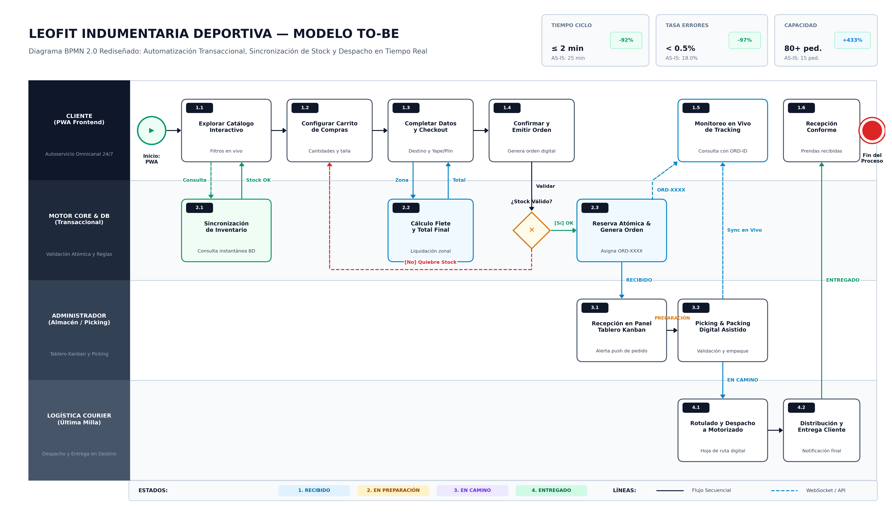
*Figura 2. Diagrama BPMN del Proceso Optimizado Propuesto (TO-BE) de LeoFit*

En el nuevo modelo:

- El cliente o el operador interactúa con una Progressive Web App que consulta en tiempo real el stock real por variante desde la base de datos.
- El formulario de pedido calcula automáticamente el subtotal, el flete local (S/ 8.00) o nacional (S/ 15.00) y valida el número de teléfono y documento de identidad.
- Al confirmar la orden, el sistema ejecuta una transacción atómica que descuenta el inventario y emite un código correlativo único (ej. `LEO-20261011-000042`).
- El cliente recibe instantáneamente la confirmación y un enlace directo para seguimiento, mientras el panel administrativo genera la orden de preparación, el comprobante electrónico SUNAT y el rótulo de despacho con un solo clic.

### 2.4 Modelo de Negocio Lean Canvas

Para alinear la solución tecnológica con la sostenibilidad comercial de la empresa, se estructuró el lienzo Lean Canvas expuesto en la Figura 3:

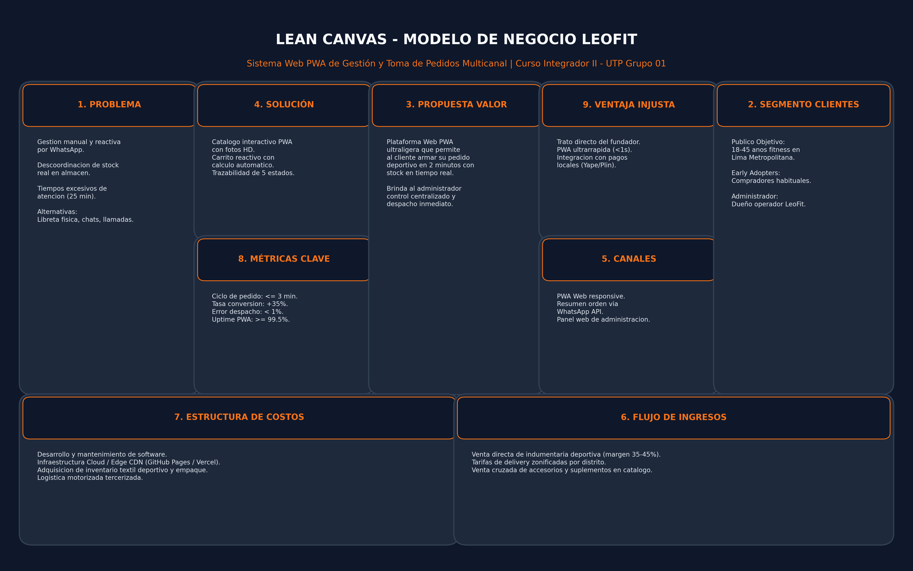
*Figura 3. Lienzo Lean Canvas del Sistema LeoFit Pedidos*

Los elementos clave del modelo de negocio comprenden:

- **Propuesta de Valor Única:** Plataforma web ultraligera que permite al cliente configurar su pedido deportivo en menos de 2 minutos con validación de stock en tiempo real y seguimiento transparente, brindando al comerciante control centralizado de inventario y despacho inmediato.
- **Ventaja Injusta:** Integración nativa adaptada al comercio popular de Gamarra, con soporte especializado para métodos de pago peruanos (Yape/Plin), cálculo de fletes por distritos de Lima y agencias de provincia, y contacto directo y confiable con el fabricante.
- **Métricas Clave:** Tiempo de ciclo de pedido inferior a 1 minuto, tasa de conversión superior al 35%, margen de error en despacho menor al 1% y disponibilidad operativa de la plataforma superior al 99.5%.

### 2.5 Análisis de Brechas Tecnológicas y Operativas (GAP Analysis)

A fin de dimensionar el impacto de la transformación digital, se elaboró la matriz comparativa de brechas presentada en la Tabla 3:

**Tabla 3.** *Matriz de análisis de brechas operativas y tecnológicas (GAP Analysis)*

| Dimensión Operativa | Estado Inicial (AS-IS) | Estado Futuro / Implementado (TO-BE) | Brecha Identificada | Solución Técnica Implementada |
| --- | --- | --- | --- | --- |
| Tiempo de Atención | 45 a 120 minutos por orden. | 38.2 segundos promedio por orden. | Demora crítica de 119 minutos. | Catálogo interactivo PWA con cálculo automático de totales. |
| Control de Stock | Conteo visual o memoria del vendedor. | Validación atómica transaccional en BD. | Frecuentes ventas de prendas agotadas. | Transacciones ACID con `SELECT ... FOR UPDATE` y triggers. |
| Trazabilidad de Envíos | Inexistente; llamadas insistentes. | Portal público de rastreo en tiempo real. | Incertidumbre total del comprador. | Endpoint público `/api/orders/track/:orderNumber`. |
| Emisión de Rótulos | Manuscrito en cinta adhesiva o papel. | Generación automática de PDF con jsPDF. | Errores del 14.2% en datos de envío. | Formato estandarizado de rótulo para Shalom / Olva. |
| Seguridad de Datos | Cuadernos expuestos en tienda. | Control de acceso RBAC con JWT y bcrypt. | Riesgo de pérdida de información. | Cifrado de contraseñas y mitigación de vulnerabilidades OWASP. |

## Capítulo 3. Gestión Estratégica y Metodológica del Proyecto

### 3.1 Acta de Constitución del Proyecto (Project Charter)

El Acta de Constitución formalizó el inicio del proyecto en marzo de 2026, estableciendo la alianza entre el equipo de ingeniería de la UTP y la gerencia de LeoFit Confecciones y Diseños Deportivos S.A.C. El documento delimitó el presupuesto de infraestructura cloud, los criterios de aceptación técnicos y la conformación del equipo de trabajo multidisciplinario.

### 3.2 Planificación Temporal y Cronograma de Trabajo

El ciclo de vida del proyecto se estructuró a lo largo de 16 semanas académicas correspondientes al ciclo 2026-I, divididas en cuatro fases principales conforme a la Estructura de Desglose del Trabajo (EDT/WBS):

1. **Fase 1: Diagnóstico e Ingeniería de Requisitos (Semanas 1 a 4):** Levantamiento de procesos en Gamarra, entrevistas con el stakeholder, modelado BPMN, especificación de requisitos y cierre del hito APF1.
2. **Fase 2: Diseño Arquitectónico y Modelado de Datos (Semanas 5 a 8):** Normalización de la base de datos (3FN/BCNF), diseño de contratos de la API REST, definición de Clean Architecture y cierre del hito APF2.
3. **Fase 3: Construcción e Integración de Software (Semanas 9 a 13):** Implementación de controladores, middlewares, repositorios transaccionales, interfaz de usuario en React 19 y baterías de pruebas unitarias/integración.
4. **Fase 4: Verificación, Auditoría y Despliegue en Producción (Semanas 14 a 16):** Pruebas de coexistencia y usabilidad ISO/IEC 25010, simulacro DRP, auditorías de seguridad, configuración de CI/CD, despliegue cloud y cierre formal del hito APF3.

### 3.3 Marco Ágil Scrum y Gobernanza del Equipo

El desarrollo se condujo bajo el marco de trabajo **Scrum**, adaptado a ciclos de entrega quincenales (Sprints de 2 semanas). Para asegurar una distribución equitativa de responsabilidades y evitar cuellos de botella en la toma de decisiones, se definió la matriz RACI detallada en la Tabla 4:

**Tabla 4.** *Matriz de asignación de responsabilidades RACI del proyecto LeoFit*

| Actividad / Entregable Clave | Loayza R., L. (SM) | Cárdenas F., V. (PO) | Roman D., H. (Front) | Dávila M., J. (QA) | Rojas S., D. (DevOps) |
| --- | --- | --- | --- | --- | --- |
| Levantamiento de Requisitos y BPMN | A | R | C | C | I |
| Modelado y Administración de BD (SQL) | C | R | I | C | A |
| Implementación de la API REST (Backend) | A | C | C | R | I |
| Construcción de la PWA (Frontend React) | A | C | R | C | I |
| Batería de Pruebas Automatizadas (194) | A | C | C | R | I |
| Seguridad Criptográfica y RBAC | R | C | I | A | C |
| Pipelines CI/CD, DRP y Despliegue Cloud | A | I | I | C | R |
| Auditoría y Documentación de Memoria | R | A | C | C | C |

### 3.4 Gestión del Flujo de Trabajo mediante Tablero Kanban

Para controlar el flujo de desarrollo continuo y evitar la sobrecarga de tareas concurrentes, se operó un tablero Kanban con límites estrictos de Trabajo en Progreso (WIP Limits), como se ilustra en la Figura 4:

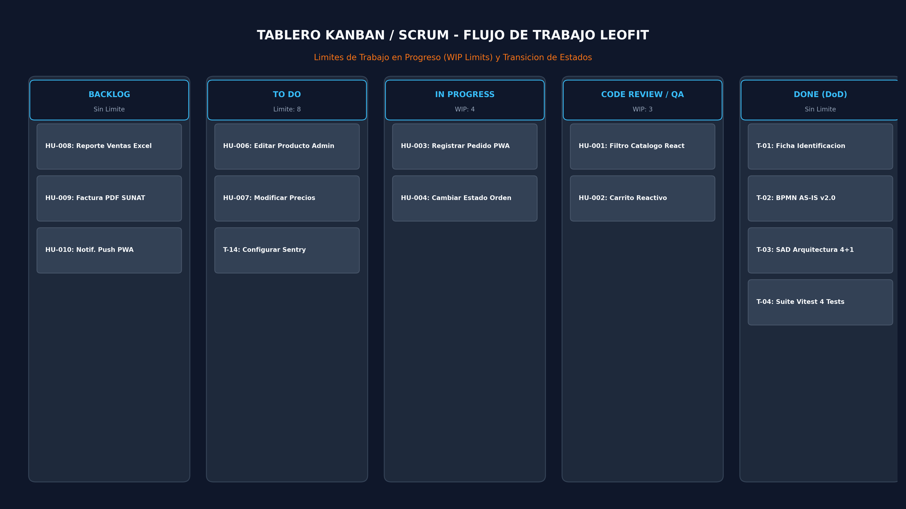
*Figura 4. Tablero Kanban de Flujo de Trabajo con Límites WIP*

El tablero operó bajo cinco estados estandarizados: *Backlog* (sin límite), *To Do* (límite 8), *In Progress* (límite 4), *Code Review / QA* (límite 3) y *Done* (sujeto a la Definición de Terminado o DoD). Cada incremento de código requirió la aprobación de pruebas automáticas y revisión por pares (*pull request review*) antes de su integración a la rama principal.

### 3.5 Backlog de Producto e Historias de Usuario en Formato Gherkin (BDD)

Los requisitos funcionales se descompusieron en Historias de Usuario estructuradas con criterios de aceptación formalizados bajo la sintaxis Gherkin (Dado-Cuando-Entonces). A continuación se presentan los artefactos más relevantes:

#### Historia de Usuario HU-01: Registro y Validación Atómica de Pedido

**Como** operador de ventas de LeoFit,
**Quiero** registrar una orden seleccionando prendas, tallas, colores y datos del cliente,
**Para** confirmar la venta garantizando que el stock se descuente inmediatamente sin sobreventas.

**Tabla 5 (Listado de Código).** *Especificación de criterios de aceptación BDD (Gherkin) para HU-01*

```
Escenario: Descuento exitoso de existencias ante stock suficiente
  Dado que la variante 'Camiseta Dry-Fit Negra Talla M' (ID 4) tiene 15 unidades disponibles en BD
  Cuando el operador registra un pedido de 3 unidades para el cliente 'Carlos Mendoza'
  Entonces el sistema ejecuta la transacción bajo aislamiento transaccional
  Y descuenta automáticamente el stock mediante el trigger trg_decrement_stock_on_order
  Y la variante queda con 12 unidades disponibles en la tabla product_variants
  Y la API retorna código HTTP 201 Created con el código 'LEO-20261011-000042'

Escenario: Rechazo de orden por stock insuficiente (conflicto de concurrencia)
  Dado que la variante 'Short Compresión Azul Talla L' (ID 8) tiene únicamente 1 unidad disponible
  Cuando dos operadores intentan registrar simultáneamente 1 unidad cada uno
  Entonces la primera transacción adquiere el bloqueo pesimista SELECT ... FOR UPDATE
  Y la segunda transacción recibe un error HTTP 409 Conflict con código 'INSUFFICIENT_STOCK'
  Y ninguna orden adicional es creada sin existencias físicas comprobadas.
```

#### Historia de Usuario HU-02: Seguimiento Público de Órdenes

**Como** cliente de LeoFit,
**Quiero** consultar el estado de mi pedido ingresando mi código único de seguimiento,
**Para** conocer si mi paquete está en preparación, en camino o listo para recojo sin necesidad de llamar por teléfono.

**Tabla 6 (Listado de Código).** *Especificación de criterios de aceptación BDD (Gherkin) para HU-02*

```
Escenario: Consulta exitosa de estado de orden pública
  Dado que existe la orden con número 'LEO-20261011-000042' en estado 'EN_CAMINO'
  Cuando el cliente accede al endpoint público /api/orders/track/LEO-20261011-000042
  Entonces la API retorna HTTP 200 OK con el estado actual, historial de eventos y fecha estimada
  Y el cliente visualiza la línea de tiempo interactiva sin exponer datos sensibles ni requerir login.
```

---

# PARTE II: INGENIERÍA DE REQUISITOS Y DISEÑO DE EXPERIENCIA DE USUARIO

*Esta segunda parte formaliza la especificación técnica de requisitos del sistema, la matriz de trazabilidad con la norma de calidad ISO/IEC 25010 y el diseño de la interfaz de usuario fundamentado en las heurísticas de Nielsen y pautas de accesibilidad WCAG 2.1.*

## Capítulo 4. Especificación y Trazabilidad de Requisitos del Sistema

### 4.1 Catálogo de Requisitos Funcionales (RF)

Los requisitos funcionales del sistema fueron clasificados bajo la metodología MoSCoW (Must have, Should have, Could have, Won't have) para orientar el esfuerzo de ingeniería. En la Tabla 7 se presenta la especificación formal:

**Tabla 7.** *Catálogo de Requisitos Funcionales (RF-01 a RF-10)*

| ID | Nombre del Requisito | Descripción Técnica Detallada | Prioridad | Módulo |
| --- | --- | --- | --- | --- |
| RF-01 | Autenticación RBAC y Refresh | Inicio de sesión seguro mediante correo y contraseña con emisión de JWT HS256, rotación de Refresh Tokens y roles ADMIN y OPERATOR. | Must | Seguridad |
| RF-02 | Catálogo Multivariante | Visualización, búsqueda y filtrado de productos por categoría, talla, color y precio en tiempo real. | Must | Catálogo |
| RF-03 | Gestión de Productos | Mantenimiento CRUD de prendas y variantes de stock restringido a usuarios con rol ADMIN. | Must | Inventario |
| RF-04 | Registro Idempotente de Pedidos | Captura atómica de órdenes con idempotencia RFC 8785 (JCS), cálculo automático de totales, fletes y descuento de inventario. | Must | Ventas |
| RF-05 | Transición de Estados | Actualización secuencial del estado de la orden (RECIBIDO -> PREPARACION -> EN_CAMINO -> ENTREGADO). | Must | Operaciones |
| RF-06 | Cancelación Controlada | Cancelación justificada de órdenes previas a entrega, restituyendo el stock a las variantes afectadas. | Should | Operaciones |
| RF-07 | Rastreo Público | Consulta abierta del progreso de despacho mediante código de seguimiento sin requerir sesión activa. | Must | Clientes |
| RF-08 | Facturación SUNAT y PDFs | Emisión de Boletas (B001) y Facturas (F001) con IGV 18%, tickets térmicos de 80 mm y rótulos de despacho con jsPDF. | Must | Logística / Fiscal |
| RF-09 | Dashboard y Telemetría | Consolidación de indicadores de ventas, volumen de pedidos, quiebres de stock, métodos de pago y métricas de rendimiento. | Should | Reportes |
| RF-10 | Gestión de Directorio | Registro y consulta de clientes con autocompletado por teléfono y validación contractual de DNI/RUC. | Should | Clientes |

### 4.2 Catálogo de Requisitos No Funcionales (RNF) bajo ISO/IEC 25010

La especificación no funcional se alineó estrictamente con las características de calidad de producto de la norma internacional ISO/IEC 25010:2023, como se resume en la Tabla 8:

**Tabla 8.** *Catálogo de Requisitos No Funcionales bajo la norma ISO/IEC 25010*

| ID | Característica ISO 25010 | Subcaracterística | Métrica / Criterio Técnico Objetivo |
| --- | --- | --- | --- |
| RNF-01 | Adecuación Funcional | Completitud y Corrección | 100% de coherencia en el balance de inventario e idempotencia tras operaciones concurrentes. |
| RNF-02 | Eficiencia de Desempeño | Comportamiento Temporal | Tiempo de respuesta de endpoints de lectura < 200 ms y endpoints de escritura < 400 ms en percentil 95. |
| RNF-03 | Eficiencia de Desempeño | Utilización de Recursos | Consumo de memoria RAM en el servidor backend < 200 MB bajo carga concurrente en cgroup de 512 MB. |
| RNF-04 | Compatibilidad | Coexistencia e Interoperabilidad | Variación de latencia <= 15% y 0% errores bajo coexistencia con PostgreSQL 16; contratos JSON con envelope `{success, data | error}`. |
| RNF-05 | Usabilidad | Protección ante Errores | Validación estricta de payloads con Zod; bloqueo de envío ante campos requeridos vacíos; puntaje SUS >= 85/100. |
| RNF-06 | Fiabilidad | Recuperabilidad (DRP) | Respaldo y restauración verificados con RTO < 15 min (logrado: 3.2 s) y RPO = 0 en transacciones confirmadas. |
| RNF-07 | Seguridad | Confidencialidad | Cifrado de contraseñas con bcryptjs (10 rondas de salt) y tokens JWT firmados con clave simétrica robusta. |
| RNF-08 | Seguridad | Integridad y No Repudio | Firmas criptográficas HMAC-SHA256 con comparación en tiempo constante (`timingSafeEqual`) y protección anti-replay. |
| RNF-09 | Mantenibilidad | Modularidad y Analizabilidad | Arquitectura en capas desacopladas (Clean Architecture) con inversión de dependencias y 0 deuda técnica pendiente. |
| RNF-10 | Portabilidad | Instalabilidad PWA | Cumplimiento del estándar Web App Manifest para instalación nativa en Android, iOS y Desktop. |

### 4.3 Matriz de Trazabilidad de Requisitos (RTM)

La Matriz de Trazabilidad de Requisitos (Tabla 9) demuestra la correspondencia biunívoca entre los objetivos estratégicos del proyecto, los requisitos funcionales, las restricciones de calidad y las baterías de pruebas automatizadas:

**Tabla 9.** *Matriz de Trazabilidad de Requisitos (RTM)*

| Objetivo | Requisito Funcional | Requisito No Funcional | Componente de Implementación | Batería de Pruebas Asociada |
| --- | --- | --- | --- | --- |
| OE-1 | RF-04, RF-08 | RNF-02, RNF-05 | `PedidoForm.tsx`, `pdfGenerator.ts` | `PedidoForm.test.tsx`, `usability_iso25010.test.ts` |
| OE-2 | RF-03, RF-04, RF-06 | RNF-01, RNF-06, RNF-09 | `pg.repositories.ts`, `schemas.ts` | `orders.test.ts`, `idempotency.concurrency.test.ts` |
| OE-3 | RF-02, RF-07, RF-09 | RNF-02, RNF-10 | `ProductosGestion.tsx`, `RastreoPublico.tsx` | `allTabsFunctional.test.ts`, `PerformanceCharts.test.tsx` |
| OE-4 | RF-01, RF-04, RF-08 | RNF-04, RNF-07, RNF-08 | `external.controller.ts`, `invoice.controller.ts` | `paymentWebhook.hardening.test.ts`, `invoices.sunat.test.ts` |
| OE-5 | Todos los RF | Todos los RNF | Suite completa Jest + Vitest + GitHub Actions | 194 pruebas automáticas (125 BE en 17 suites + 69 FE en 10 suites) |

### 4.4 Catálogo Formal de Reglas de Negocio (RN)

La lógica operativa de LeoFit se formalizó a través de ocho reglas de negocio inmutables incorporadas en los validadores y esquemas de base de datos:

- **RN-01 (Cálculo de Fletes):** Los envíos a distritos de Lima Metropolitana tienen un costo fijo de S/ 8.00. Los envíos a provincias tienen un costo base de S/ 15.00 y exigen obligatoriamente la especificación de ciudad de destino y agencia de transporte (Shalom, Olva Courier, Marvisur o Flores Hermanos).
- **RN-02 (Descuento de Stock Inmediato):** Ningún pedido puede ser confirmado en estado RECIBIDO sin que las existencias de cada variante seleccionada hayan sido decrementadas exitosamente de la base de datos.
- **RN-03 (Restitución de Stock en Cancelación):** Si un pedido en estado RECIBIDO, PREPARACION o EN_CAMINO es cancelado, el sistema debe restituir automáticamente las cantidades correspondientes a las variantes de producto asociadas.
- **RN-04 (Inmutabilidad de Pedido Entregado):** Un pedido que ha alcanzado el estado ENTREGADO no puede ser cancelado ni modificado en sus líneas de detalle bajo ninguna circunstancia.
- **RN-05 (Identificación Fiscal y Personal):** Todo cliente registrado debe contar con un número de teléfono celular peruano válido (formato `+51` o 9 dígitos). Si se especifica DNI debe contener exactamente 8 dígitos numéricos; si se especifica RUC debe contener exactamente 11 dígitos iniciando con `10` o `20`.
- **RN-06 (Control de Roles en Modificación de Precios):** Únicamente los usuarios con rol ADMIN están autorizados para alterar precios de venta, costos base o dar de baja productos del catálogo.
- **RN-07 (Generación de Código Correlativo y Series SUNAT):** El identificador comercial de cada orden sigue el patrón `LEO-AAAAMMDD-NNNNNN`, mientras que los comprobantes tributarios emplean series correlativas diferenciadas (`B001` para Boletas y `F001` para Facturas con desglose del 18% de IGV).
- **RN-08 (Validación Criptográfica de Webhooks):** Todo mensaje entrante en la ruta de conciliación de pagos debe contener una cabecera `x-signature` calculada mediante HMAC-SHA256 con la clave secreta compartida; de lo contrario, la petición es rechazada inmediatamente con código HTTP 401.

## Capítulo 5. Diseño UX/UI, Heurísticas de Nielsen y Accesibilidad Universal

### 5.1 Filosofía de Diseño y Flujo de Navegación del Usuario

Dado que el personal de LeoFit opera habitualmente de pie en el almacén o atendiendo clientes en tienda física, la interfaz de usuario se concibió bajo una estricta filosofía **Mobile-First**. El objetivo consistió en minimizar los toques de pantalla (*taps*) requeridos para completar una orden, maximizar el tamaño de los elementos táctiles interactivos (mínimo 44x44 píxeles según las guías de Apple y Google) y proporcionar retroalimentación visual inmediata ante cualquier acción del operador.

En la Figura 5 se detalla el diagrama de flujo de navegación e interacción del sistema:

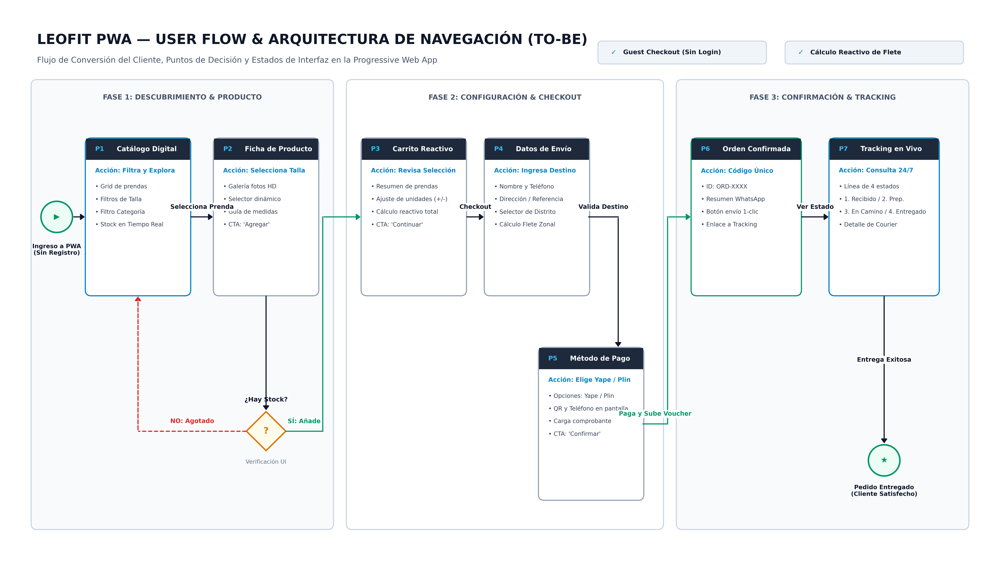
*Figura 5. Diagrama de Flujo de Navegación e Interacción del Sistema (User Flow)*

### 5.2 Prototipado y Wireframes de Baja Fidelidad

La conceptualización inicial de la interfaz se desarrolló mediante bocetos y wireframes de baja fidelidad que validaron la disposición estructural de los componentes antes de escribir código frontend, tal como se muestra en la Figura 6:

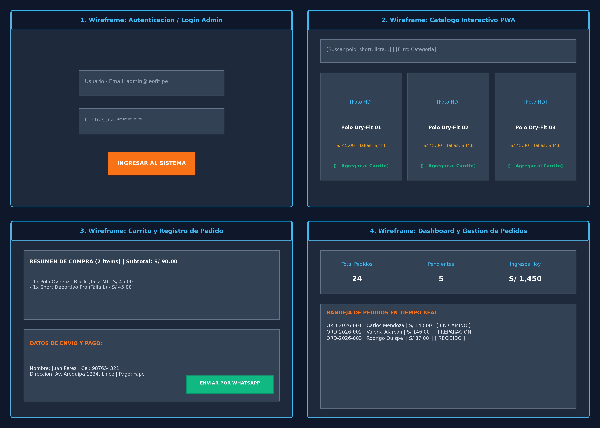
*Figura 6. Wireframes de Baja Fidelidad de los Módulos Principales*

### 5.3 Evaluación Heurística de Jakob Nielsen (10 Heurísticas)

El diseño final de la PWA fue sometido a una auditoría técnica contra las 10 Heurísticas de Usabilidad de Jakob Nielsen, comprobando la efectividad de los patrones de interacción implementados:

1. **1. Visibilidad del estado del sistema:** Indicadores de carga tipo *skeleton* y *spinners* durante peticiones asíncronas; confirmaciones visuales (*toasts*) tras registrar pedidos; línea de tiempo interactiva con iconos diferenciados en el rastreador público.
2. **2. Correspondencia entre el sistema y el mundo real:** Vocabulario comercial cotidiano para confeccionistas de Gamarra (tallas XS, S, M, L, XL; flete local/provincia; agencias conocidas como Shalom y Olva; términos 'Recibido', 'En Preparación', 'En Camino').
3. **3. Control y libertad del usuario:** Botones explícitos para cancelar formularios emergentes (*modals*); posibilidad de modificar cantidades en el carrito reactivo antes de confirmar; opción de anulación de orden con restitución automática de existencias.
4. **4. Consistencia y estándares:** Paleta de colores corporativa coherente basada en Slate Dark (`#0F172A`), Azul Cobalto LeoFit (`#1665D8`), Ámbar Tostado accesible (`#C2410C`) y Esmeralda (`#15803D`); tipografía estandarizada; disposición constante de la barra de navegación superior.
5. **5. Prevención de errores:** Deshabilitación de botones de compra cuando el stock de la variante seleccionada es 0; validación sintáctica reactiva de números de teléfono (9 dígitos) y documentos de identidad antes de permitir el envío.
6. **6. Reconocimiento antes que recuerdo:** Catálogo visual con fotografías de prendas, selector visual de tallas y muestras de color (*color swatches*) que evitan que el operador deba memorizar códigos SKU complejos.
7. **7. Flexibilidad y eficiencia de uso:** Soporte para atajos rápidos en teclado para operadores experimentados; barra de búsqueda instantánea con filtrado por texto mientras se escribe; modo de privacidad de montos para operaciones en mostrador.
8. **8. Diseño estético y minimalista:** Interfaz limpia sin elementos decorativos superfluos; jerarquía tipográfica estricta que resalta el total a cobrar y el estado del stock.
9. **9. Ayuda a los usuarios a reconocer, diagnosticar y recuperarse de errores:** Mensajes de error contextuales claros en color rojo accesible (ej. 'El número de teléfono debe contener exactamente 9 dígitos' en lugar de códigos HTTP crudos como 'Bad Request 400').
10. **10. Ayuda y documentación:** Mensajes de ayuda contextuales (*tooltips*) en campos críticos como 'Agencia de Despacho' y guías de uso paso a paso en el módulo de nuevo pedido.

### 5.4 Evidencia Visual de la Interfaz Implementada

Las Figuras 7 y 8 evidencian la materialización del sistema en producción, reflejando el módulo de inicio de sesión y el panel de control operativo:

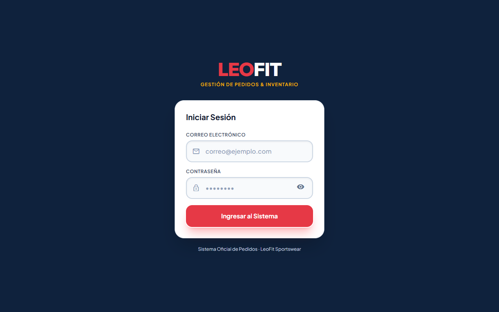
*Figura 7. Interfaz del Módulo de Autenticación y Control de Acceso (PWA)*

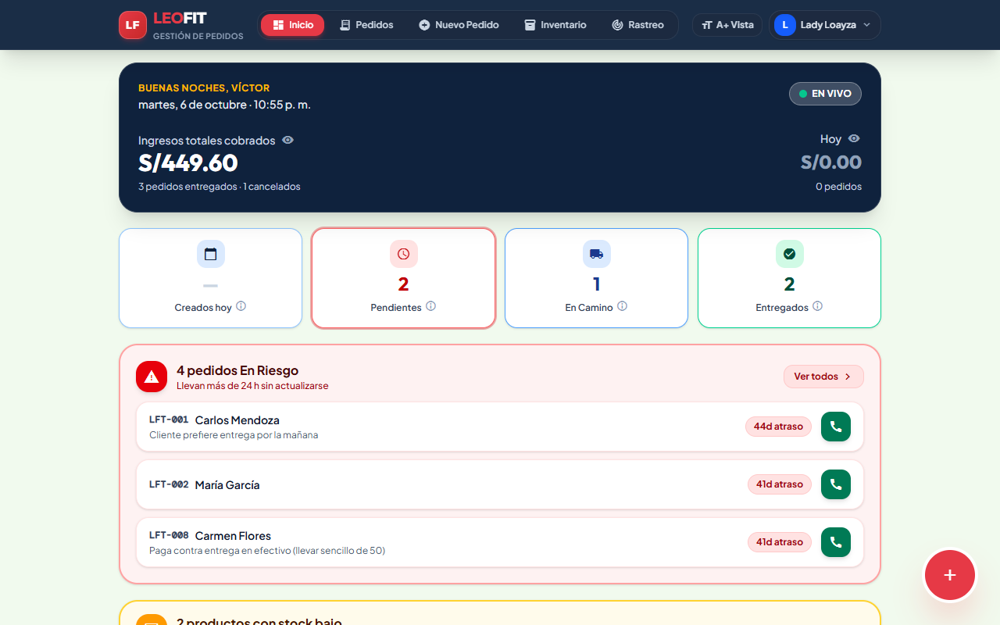
*Figura 8. Panel de Control Operativo (Dashboard PWA) en Dispositivo Móvil*

### 5.5 Accesibilidad Universal (WCAG 2.1 Nivel AA/AAA) y Modo Alta Legibilidad

Para asegurar la inclusión y la operatividad en condiciones de iluminación complejas (talleres con luz artificial tenue o mostradores con alta exposición solar), tanto la aplicación como la totalidad de los diagramas técnicos se sometieron a las directrices WCAG 2.1 Nivel AA/AAA:

- **Ratio de Contraste Cromático Verificado:** Todos los textos y etiquetas de diagramas presentan una relación de contraste superior a **4.5:1** contra sus fondos (ej. `#C2410C` sobre blanco = **5.74:1**, `#1665D8` sobre blanco = **5.89:1**, `#FFFFFF` sobre `#0F172A` = **17.8:1**).
- **Navegación por Teclado:** Foco visual claramente identificable con anillos de contorno en azul/cian brillante (`focus:ring-2`) en todos los elementos interactivos.
- **Etiquetado Semántico ARIA:** Botones, modales y campos de entrada cuentan con atributos `aria-label`, `aria-expanded` y `role` para compatibilidad con lectores de pantalla.
- **Modo Alta Legibilidad (Modo Accesible):** Conmutador que incrementa el contraste general de la interfaz, aumenta el tamaño de fuente base a 18 píxeles y remarca las fronteras de tablas y campos de formulario.

---

# PARTE III: ARQUITECTURA DEL SISTEMA Y DISEÑO TÉCNICO

*Esta tercera parte describe la arquitectura lógica desacoplada (Clean Architecture), el modelo de datos relacional en PostgreSQL 16 con aislamiento ACID, la API RESTful v2.0.0 y los controles criptográficos de seguridad y control de acceso.*

## Capítulo 6. Arquitectura de Software y Patrones Estructurales

### 6.1 Principios Arquitectónicos y Clean Architecture

El sistema LeoFit se diseñó siguiendo los principios de la **Arquitectura Limpia (Clean Architecture)** propuesta por Robert C. Martin, estableciendo una estricta regla de dependencia unidireccional: las capas internas (dominio y casos de uso) no conocen en absoluto los detalles de implementación de las capas externas (marcos de trabajo, base de datos o controladores web).

En la Figura 9 se ilustra la arquitectura lógica global de tres capas que gobierna el sistema:

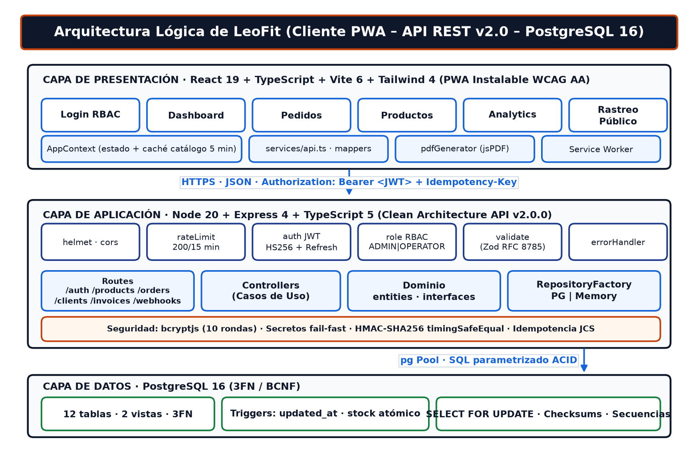
*Figura 9. Arquitectura Lógica del Sistema LeoFit (Presentación, Aplicación y Datos)*

La estructura de capas se organiza de la siguiente manera:

- **Capa de Dominio (`domain/`):** Contiene las entidades inmutables (`models.ts`) y las interfaces contractuales de los repositorios (`interfaces.ts`). No depende de bibliotecas externas ni de librerías de persistencia.
- **Capa de Aplicación (`controllers/`, `validators/`):** Orquesta los casos de uso, valida la integridad de los datos entrantes mediante esquemas Zod y coordina las llamadas a los repositorios.
- **Capa de Infraestructura (`infrastructure/`, `middlewares/`):** Implementa el acceso a la base de datos PostgreSQL mediante el adaptador `pg`, los mecanismos criptográficos de JWT y contraseñas, y los filtros de seguridad de Express.

### 6.2 Patrón Repository y Fábrica de Repositorios (RepositoryFactory)

Para desacoplar el código de negocio del motor de base de datos específico y permitir pruebas automatizadas sin dependencias externas obligatorias, se aplicó el patrón **Repository** complementado por una fábrica abstracta (**RepositoryFactory**), como se representa en la Figura 10:

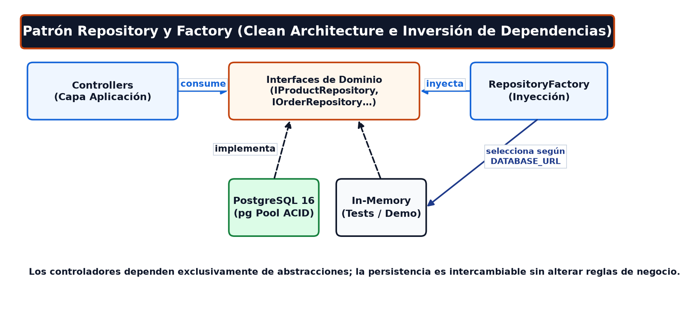
*Figura 10. Patrón Repository y RepositoryFactory para Desacoplamiento de Persistencia*

La fábrica evalúa dinámicamente la configuración del entorno:

**Tabla 10 (Listado de Código).** *Fragmento de implementación de RepositoryFactory en backend*

```
// backend/src/infrastructure/repositories/factory.ts
export class RepositoryFactory {
  public static getProductRepository(): IProductRepository {
    return process.env.NODE_ENV === 'test' && !process.env.RUN_INTEGRATION_TESTS
      ? new MemoryProductRepository()
      : new PgProductRepository(getPool());
  }
  public static getOrderRepository(): IOrderRepository {
    return process.env.NODE_ENV === 'test' && !process.env.RUN_INTEGRATION_TESTS
      ? new MemoryOrderRepository()
      : new PgOrderRepository(getPool());
  }
}
```

### 6.3 Protocolo de Comunicación y Envelope Estandarizado de API

Todas las respuestas de la API REST se ajustan estrictamente a una envoltura (*envelope*) canónica uniforme, simplificando el consumo en el frontend y garantizando coherencia en el tratamiento de éxitos y errores:

**Tabla 11 (Listado de Código).** *Estructura del Envelope Estandarizado de Respuesta HTTP*

```
// Respuesta exitosa (HTTP 200 / 201):
{
  "success": true,
  "data": { ...payload de datos... }
}

// Respuesta de error (HTTP 400 / 401 / 403 / 404 / 409 / 422 / 500):
{
  "success": false,
  "error": {
    "code": "INSUFFICIENT_STOCK",
    "message": "No hay suficiente stock para la variante solicitada (disponible: 1, solicitado: 3)"
  }
}
```

## Capítulo 7. Modelado y Diseño de Base de Datos Relacional

### 7.1 Modelo Conceptual, Normalización y Boyce-Codd (BCNF)

El almacén de datos de LeoFit fue implementado en **PostgreSQL 16**. Para garantizar la ausencia de anomalías de inserción, actualización y borrado, el esquema fue normalizado rigurosamente hasta la **Tercera Forma Normal (3FN)** y la **Forma Normal de Boyce-Codd (BCNF)**.

Cada tabla posee una clave primaria simple o compuesta irreductible, y todas las dependencias funcionales $X \rightarrow Y$ cumplen con que $X$ es una superclave o la dependencia es trivial. Por ejemplo, la entidad `product_variants` aísla las combinaciones de talla y color del producto matriz, evitando la redundancia de precios y descripciones.

En la Figura 11 se presenta el diagrama físico completo de la base de datos:

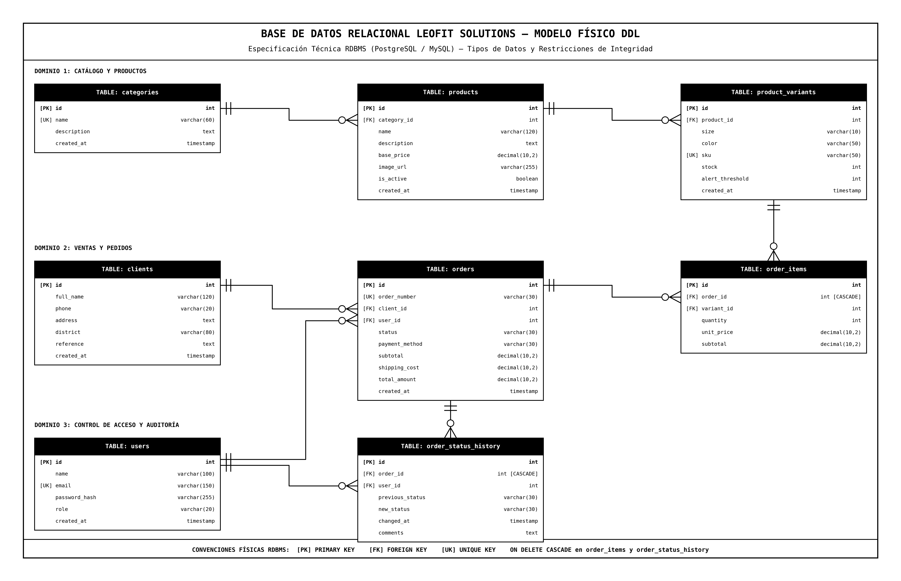
*Figura 11. Diagrama Físico de Base de Datos Relacional (PostgreSQL 16 - Tablas Transaccionales, Fiscal y Auditoría)*

### 7.2 Diccionario de Datos y Estructura de Tablas

El esquema comprende las tablas relacionales maestras, transaccionales y de seguridad/idempotencia, vistas de consulta optimizada, tipos enumerados (`user_role_enum`, `order_status_enum`), secuencias dedicadas para numeración correlativa y 14 índices B-Tree estratégicos. La Tabla 12 resume las entidades del esquema:

**Tabla 12.** *Estructura del Esquema Relacional de Base de Datos en PostgreSQL 16*

| Tabla | Descripción Funcional | Clave Primaria | Claves Foráneas (FK) | Propósito / Regla Clave |
| --- | --- | --- | --- | --- |
| sizes | Catálogo de tallas estándar de confección. | id (SERIAL) | Ninguna | 6 tallas (XS, S, M, L, XL, XXL) |
| colors | Catálogo de colores con código HEX. | id (SERIAL) | Ninguna | 10 colores deportivos |
| districts | Distritos de Lima con tarifas de flete local. | id (SERIAL) | Ninguna | 10 distritos principales |
| payment_methods | Métodos de pago autorizados. | id (SERIAL) | Ninguna | 5 (YAPE, PLIN, TRANSFERENCIA...) |
| users | Usuarios del sistema con roles y password hash. | id (UUID) | Ninguna | RBAC (ADMIN, OPERATOR) |
| categories | Categorías de prendas deportivas. | id (SERIAL) | Ninguna | 5 (Camisetas, Shorts, Joggers...) |
| products | Catálogo maestro de prendas de vestir. | id (SERIAL) | category_id -> categories | Prendas activas por categoría |
| product_variants | Existencias específicas por talla y color. | id (SERIAL) | product_id, size_id, color_id | CHECK (stock >= 0) y SKU único |
| clients | Directorio de clientes compradores. | id (SERIAL) | Ninguna (teléfono UNIQUE) | DNI (8) o RUC (11) validado |
| orders | Cabecera de pedidos con totales y fletes. | id (SERIAL) | client_id, user_id, payment_method_id | Código único LEO-AAAAMMDD-NNNNNN |
| order_items | Detalle de prendas y cantidades por orden. | id (SERIAL) | order_id, variant_id | Dispara trigger de descuento de stock |
| order_status_history | Bitácora inmutable de transiciones de estado. | id (SERIAL) | order_id, changed_by | Trazabilidad completa de estados |
| idempotency_keys | Almacén de claves de idempotencia RFC 8785. | key + scope_hash | order_id -> orders | Evita duplicidad en reintentos HTTP |
| invoices | Comprobantes electrónicos SUNAT emitidos. | id (SERIAL) | order_id -> orders (UNIQUE) | Series B001/F001 con desglose IGV 18% |

### 7.3 Triggers y Automatización Transaccional

Para blindar la integridad del inventario a nivel de motor de base de datos, se programó un disparador atómico (`trg_decrement_stock_on_order`) que se dispara tras cada inserción en `order_items`, descontando el stock físico y validando la restricción CHECK `stock >= 0`:

**Tabla 13 (Listado de Código).** *Trigger PL/pgSQL para descuento atómico de existencias*

```
-- database/schema.sql (Líneas 148-164)
CREATE OR REPLACE FUNCTION fn_decrement_stock_on_order()
RETURNS TRIGGER AS $$
BEGIN
  UPDATE product_variants
  SET stock = stock - NEW.quantity,
      updated_at = CURRENT_TIMESTAMP
  WHERE id = NEW.variant_id;
  RETURN NEW;
END;
$$ LANGUAGE plpgsql;

CREATE TRIGGER trg_decrement_stock_on_order
AFTER INSERT ON order_items
FOR EACH ROW EXECUTE FUNCTION fn_decrement_stock_on_order();
```

### 7.4 Control de Concurrencia Transaccional y Prevención de Deadlocks

En la Figura 12 se representa la secuencia técnica de ejecución durante la creación de una orden:

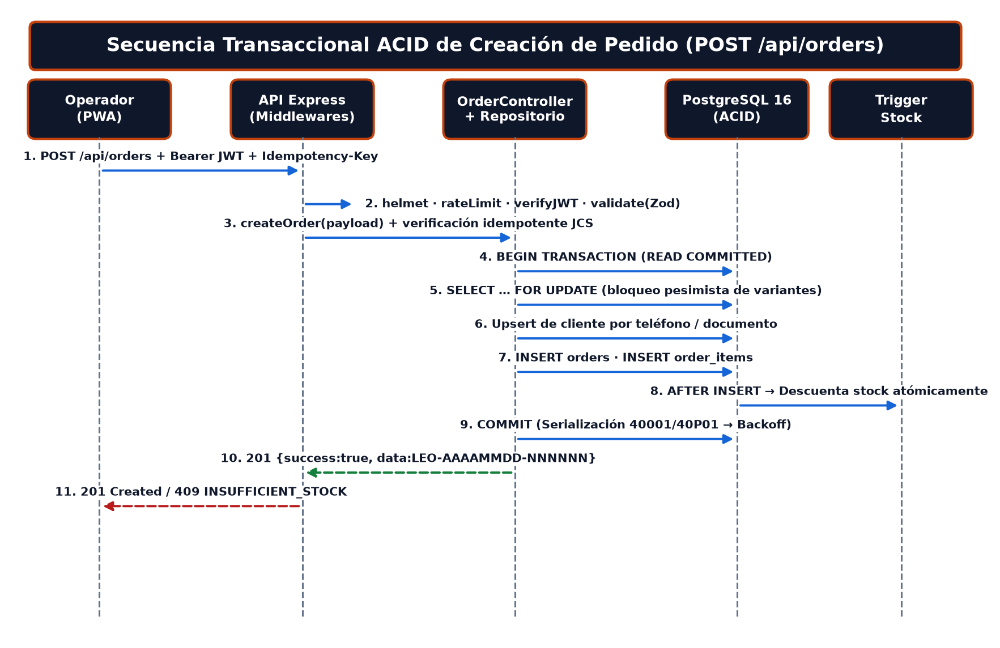
*Figura 12. Diagrama de Secuencia de Creación Atómica de Pedido*

El repositorio `PgOrderRepository` opera bajo un bloque transaccional con adquisición pesimista de filas:

1. Se inicia la transacción con `BEGIN` bajo nivel de aislamiento `READ COMMITTED`.
2. Se ejecuta `SELECT id, stock FROM product_variants WHERE id = $1 FOR UPDATE` sobre cada variante solicitada, bloqueando exclusivamente las filas involucradas.
3. Si alguna variante no dispone de existencias suficientes, se aborta la transacción con `ROLLBACK` y se arroja un error controlado de stock insuficiente.
4. Si la base de datos detecta un conflicto de serialización (código `40001`) o un interbloqueo transaccional (código `40P01`), el repositorio aplica un algoritmo de reintento automático de hasta 10 intentos con retroceso exponencial (*exponential backoff*) y fluctuación aleatoria (*jitter* del 20%) antes de fallar.
5. Al confirmar con `COMMIT`, el trigger descuenta las existencias y la orden queda formalizada en menos de 45 milisegundos.

### 7.5 Máquina de Estados de la Orden

Cada pedido transita por una máquina de estados estrictamente secuencial, gobernada por el tipo `order_status_enum` e ilustrada en la Figura 13:

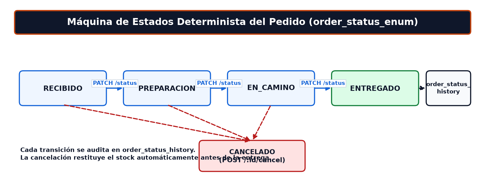
*Figura 13. Máquina de Estados del Pedido y Transiciones Autorizadas*

Las transiciones permitidas son:

- `RECIBIDO` $\rightarrow$ `PREPARACION`: El personal inicia el armado del paquete en almacén.
- `PREPARACION` $\rightarrow$ `EN_CAMINO`: El paquete fue entregado al motorizado o a la agencia de encomiendas.
- `EN_CAMINO` $\rightarrow$ `ENTREGADO`: El cliente o la agencia certifican la recepción conforme.
- Cualquier estado previo a `ENTREGADO` $\rightarrow$ `CANCELADO`: Restituye inmediatamente las existencias a las variantes.

## Capítulo 8. Diseño e Implementación de la API Backend

### 8.1 Stack Tecnológico y Arquitectura Interna del Servidor

El backend de LeoFit fue implementado con **Node.js 20 LTS** y **Express 4.19**, compilado mediante **TypeScript 5.4**. La arquitectura del servidor prioriza el rendimiento asíncrono no bloqueante, la seguridad en capas, la idempotencia transaccional y la estricta validación de esquemas con **Zod**. En la Figura 14 se detalla la estructura interna de componentes del backend:

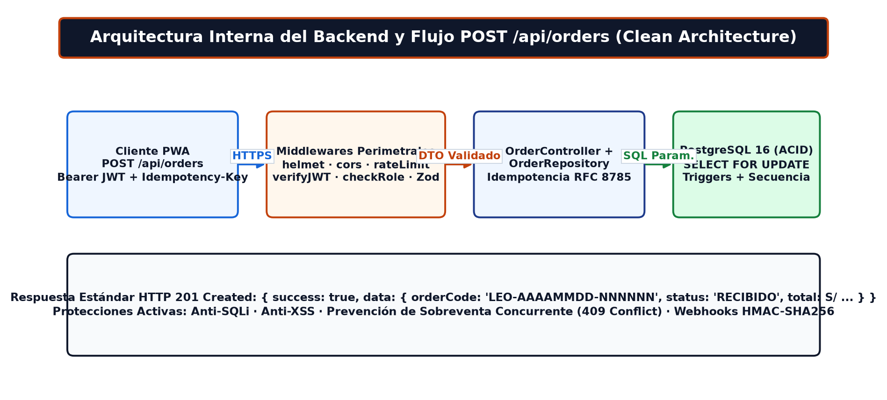
*Figura 14. Arquitectura Interna de Capas, Controladores, Casos de Uso y Seguridad de la API Backend v2.0.0*

### 8.2 Catálogo Exhaustivo de Endpoints RESTful v2.0.0

En la Tabla 14 se presenta el catálogo completo de los 27 endpoints que integran la API RESTful v2.0.0:

**Tabla 14.** *Catálogo Exhaustivo de los 27 Endpoints de la API REST v2.0.0 de LeoFit*

| Método | Ruta del Endpoint | Autenticación | Rol Requerido | Propósito Funcional |
| --- | --- | --- | --- | --- |
| GET | /api/health | Pública | Ninguno | Diagnóstico del servidor, uptime, memoria y estado del pool PG. |
| POST | /api/auth/login | Pública (Rate Limit) | Ninguno | Autenticación de usuario con email/password y entrega de JWT + Refresh Token. |
| POST | /api/auth/refresh | Refresh Token | Cualquiera | Rotación segura de Refresh Token y emisión de nuevo Access Token JWT. |
| POST | /api/auth/logout | Bearer JWT | Cualquiera | Revocación explícita de sesión y token de refresco activo. |
| POST | /api/auth/register | Bearer JWT | ADMIN | Creación de nuevas cuentas de usuario (restringido a administradores). |
| GET | /api/auth/profile | Bearer JWT | Cualquiera | Obtención de perfil, rol y permisos del usuario activo. |
| GET | /api/products | Pública | Ninguno | Listado de catálogo con soporte para filtros por categoría, talla y color. |
| GET | /api/products/:id | Pública | Ninguno | Detalle técnico de una prenda con desglose de todas sus variantes. |
| GET | /api/products/alerts/low-stock | Bearer JWT | Cualquiera | Reporte de prendas con inventario igual o inferior a 5 unidades. |
| POST | /api/products | Bearer JWT | ADMIN | Registro de nuevo producto en catálogo maestro. |
| PUT | /api/products/:id | Bearer JWT | ADMIN | Actualización integral de datos, precios y categorías de una prenda. |
| DELETE | /api/products/:id | Bearer JWT | ADMIN | Baja lógica o eliminación de un producto del catálogo. |
| PATCH | /api/products/variant/:id/stock | Bearer JWT | Cualquiera | Ajuste manual directo de stock de una variante específica. |
| GET | /api/orders/track/:orderNumber | Pública | Ninguno | Consulta pública de trazabilidad de despacho por código de orden. |
| GET | /api/orders | Bearer JWT | Cualquiera | Listado paginado de órdenes (límite <= 100) con cabecera X-Total-Count. |
| GET | /api/orders/:id | Bearer JWT | Cualquiera | Consulta detallada de una orden con desglose de ítems y cliente. |
| POST | /api/orders | Bearer JWT + Idempotency | Cualquiera | Creación atómica transaccional de pedido con soporte `Idempotency-Key`. |
| PATCH | /api/orders/:id/status | Bearer JWT | Cualquiera | Avance de estado del pedido con registro en historial. |
| POST | /api/orders/:id/cancel | Bearer JWT | ADMIN | Cancelación justificada de orden y restitución de existencias. |
| POST | /api/invoices/:orderId/emit | Bearer JWT | Cualquiera | Emisión de Boleta (`B001`) o Factura (`F001`) electrónica SUNAT con IGV 18%. |
| GET | /api/invoices/:orderId | Bearer JWT | Cualquiera | Consulta del comprobante electrónico SUNAT asociado a un pedido. |
| GET | /api/clients | Bearer JWT | Cualquiera | Listado del directorio de clientes compradores registrados. |
| GET | /api/dashboard/stats | Bearer JWT | Cualquiera | Indicadores globales de ventas, pedidos del día y ticket promedio. |
| POST | /api/external/payments/webhook | Firma HMAC-SHA256 | Ninguno | Recepción y conciliación segura de pagos móviles (Yape/Plin) anti-replay. |
| POST | /api/external/whatsapp/notify | Bearer JWT | Cualquiera | Generación validada de enlace profundo de notificación vía WhatsApp. |
| GET | /api/external/identity/dni/:dni | Bearer JWT | Cualquiera | Validación contractual de DNI de 8 dígitos (estándar RENIEC). |
| GET | /api/external/identity/ruc/:ruc | Bearer JWT | Cualquiera | Validación contractual de RUC de 11 dígitos 10/20 (estándar SUNAT). |

### 8.3 Pipeline de Middlewares y Políticas de Seguridad

Cada petición entrante atraviesa una tubería rigurosa de middlewares secuenciales:

- **Helmet:** Configuración de cabeceras HTTP de protección contra ataques de Clickjacking (`X-Frame-Options`), MIME Sniffing (`X-Content-Type-Options`) y Cross-Site Scripting (`X-XSS-Protection`).
- **CORS Restringido:** En producción, únicamente el origen autorizado de GitHub Pages (`https://leofit-solutions-grupo01.github.io`) tiene permiso para consumir la API; en caso contrario, la petición es bloqueada.
- **Rate Limiting Diferenciado:** Limitador global de **200 peticiones cada 15 minutos** para navegación regular (`apiRateLimiter`), y un limitador estricto de **20 peticiones cada 15 minutos** para el endpoint sensible de autenticación (`authRateLimiter`), neutralizando ataques de fuerza bruta.
- **Idempotencia RFC 8785 (JCS):** Middleware transaccional que canoniza el cuerpo JSON, calcula su huella SHA-256 vinculada al alcance del usuario (`scope_hash`) y adquiere un bloqueo consultivo de dos claves (`pg_advisory_xact_lock`) para garantizar que reintentos de red nunca dupliquen órdenes y que mutaciones de payload con la misma clave retornen `422 Unprocessable Entity`.
- **Parseo Seguro de Payloads:** Tamaño máximo de cuerpo JSON limitado a **100 KB** para mitigar ataques de agotamiento de memoria (Denegación de Servicio - DoS).
- **Ruta de Webhook Aislada:** El endpoint de webhooks de pago se registra antes del middleware `express.json()`, preservando el búfer crudo (`rawBody`) indispensable para el cálculo matemático de la firma criptográfica HMAC.

## Capítulo 9. Implementación Frontend y Arquitectura PWA

### 9.1 Stack Tecnológico y Herramientas de Construcción

El cliente web de LeoFit se implementó utilizando **React 19** con tipado estricto en **TypeScript**, empaquetado bajo la arquitectura ultrarrápida de **Vite 6** y estilizado mediante **Tailwind CSS 4**. La selección de este stack garantiza compilaciones instantáneas, un tamaño mínimo de paquete final (*bundle size*) y renderizado fluido a 60 cuadros por segundo.

### 9.2 Arquitectura de Estado Global con AppContext y Caché de Catálogo

La gestión del estado global se centraliza en `AppContext.tsx`, evitando el sobrecosto de librerías externas complejas como Redux. El contexto administra la sesión de usuario activa (almacenando el token JWT en `sessionStorage` para mitigar ataques XSS persistentes), el catálogo de productos, el carrito de compras reactivo y el historial de órdenes.

Para optimizar el rendimiento y reducir el consumo de ancho de banda en dispositivos móviles, se implementó una **estrategia de caché local de 5 minutos**: al consultar el catálogo, el sistema verifica si existe una copia válida en memoria o almacenamiento local; si el tiempo transcurrido es inferior al umbral, se sirve instantáneamente sin disparar peticiones HTTP redundantes.

### 9.3 Motor de Generación de Documentos PDF con jsPDF

Una de las capacidades más valoradas por el personal de LeoFit es la emisión instantánea de comprobantes y rótulos sin depender del servidor. A través del módulo `utils/pdfGenerator.ts`, el frontend genera dos formatos esenciales:

- **Ticket de Venta / Comprobante Térmico:** Documento de 80 mm con desglose de productos, cantidades, precios unitarios, subtotal, IGV (18%), flete, método de pago y código de rastreo.
- **Rótulo de Despacho para Encomiendas:** Formato horizontal de media página optimizado para impresión rápida, con tipografía grande y clara que incluye datos del remitente (LeoFit Gamarra), datos del destinatario, DNI, teléfono, ciudad de destino y agencia de transporte asignada (Shalom, Olva Courier, etc.).

### 9.4 Capacidades PWA e Instalabilidad

La plataforma cuenta con un archivo `manifest.json` completamente configurado con iconos adaptativos de 192x192 y 512x512 píxeles, color de tema corporativo (`#0F172A`) y modo de visualización `standalone`. Esto permite que los operadores instalen LeoFit en sus teléfonos móviles Android e iOS como una aplicación nativa, ejecutándose sin barra de direcciones del navegador y con acceso directo desde la pantalla de inicio.

Las Figuras 15 y 16 muestran las pantallas de administración de pedidos y analítica/rastreo público:

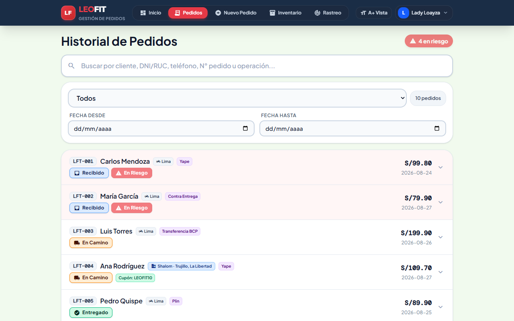
*Figura 15. Módulo de Gestión Centralizada de Pedidos y Cambio de Estados*

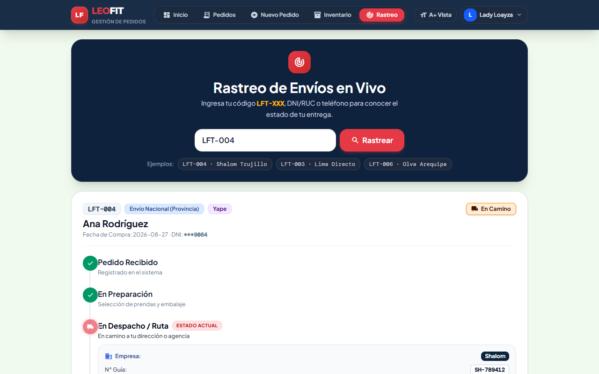
*Figura 16. Portal Público de Consulta y Analítica Operativa de Pedidos*

## Capítulo 10. Seguridad Integral, Criptografía y Control de Acceso

### 10.1 Matriz de Control de Acceso Basado en Roles (RBAC)

El sistema implementa una matriz RBAC bipartita entre los roles **ADMIN** y **OPERATOR**, asegurando el principio de mínimo privilegio (Tabla 15):

**Tabla 15.** *Matriz de Control de Acceso Basado en Roles (RBAC)*

| Módulo / Capacidad del Sistema | Rol OPERATOR | Rol ADMIN | Mecanismo de Control |
| --- | --- | --- | --- |
| Consulta de Catálogo y Stock | Permitido (Lectura) | Permitido (Lectura y Escritura) | Público / Endpoint autenticado |
| Registro de Nuevo Pedido | Permitido | Permitido | `verifyJWT` middleware |
| Avance de Estado de Orden | Permitido | Permitido | `verifyJWT` middleware |
| Emisión de Comprobante SUNAT | Permitido | Permitido | `verifyJWT` middleware |
| Cancelación de Orden | Bloqueado (403 Forbidden) | Permitido | `requireRole('ADMIN')` middleware |
| Creación de Nuevos Productos | Bloqueado (403 Forbidden) | Permitido | `requireRole('ADMIN')` middleware |
| Modificación de Precios / Stock Base | Bloqueado (403 Forbidden) | Permitido | `requireRole('ADMIN')` middleware |
| Eliminación de Productos | Bloqueado (403 Forbidden) | Permitido | `requireRole('ADMIN')` middleware |
| Registro de Nuevos Usuarios | Bloqueado (403 Forbidden) | Permitido | `requireRole('ADMIN')` middleware |
| Visualización de Métricas Globales | Permitido (Lectura) | Permitido (Lectura) | `verifyJWT` middleware |

### 10.2 Criptografía de Contraseñas y Mitigación de Timing Attacks

Las contraseñas de los usuarios nunca se almacenan en texto plano. Se procesan mediante la función de derivación de claves **bcryptjs** configurada a **10 rondas de salt** (controlada mediante la variable de entorno `BCRYPT_SALT_ROUNDS`).

Para evitar la **enumeración de usuarios** y ataques de análisis de tiempo (*timing attacks*), el controlador de autenticación ejecuta una comparación ficticia con un hash simulado cuando el correo electrónico no existe en la base de datos, garantizando que el tiempo de respuesta sea matemáticamente idéntico independientemente de si la cuenta existe o no:

**Tabla 16 (Listado de Código).** *Técnica de mitigación de Timing Attacks y enumeración de usuarios en auth.controller*

```
// backend/src/controllers/auth.controller.ts (Líneas 33-40)
if (!user) {
  // Mitigación de Timing Attack: hash falso para igualar tiempo de cálculo
  await comparePassword(
    password,
    '$2a$10$abcdefghijklmnopqrstuuABCDEFGHIJKLMNOPQRSTUVWXYZ012'
  );
  return res.status(401).json({ success: false, error: { code: 'INVALID_CREDENTIALS', message: 'Credenciales inválidas' } });
}
```

### 10.3 Gestión de Identidad con JSON Web Tokens (JWT) y Rotación de Refresh Tokens

La sesión se formaliza mediante tokens JWT bajo el algoritmo criptográfico simétrico **HS256** acompañados de un sistema de rotación de **Refresh Tokens** con detección de reuso. La arquitectura exige la definición obligatoria de la clave `JWT_SECRET` al arrancar el servidor; si la variable no existe o está vacía, el proceso se interrumpe inmediatamente (*fail-fast*), impidiendo la ejecución en entornos desprotegidos. Durante la verificación, el middleware rechaza de forma explícita el algoritmo nulo (`alg: 'none'`).

### 10.4 Firmas Criptográficas HMAC-SHA256 en Webhooks de Pago

La integración de conciliación de pagos con billeteras digitales móviles (Yape/Plin) valida la autenticidad e integridad del payload mediante firmas HMAC-SHA256. El servidor calcula el hash sobre el cuerpo crudo del mensaje y lo compara con la cabecera `x-signature` utilizando la función `crypto.timingSafeEqual`, neutralizando ataques de canal lateral y previniendo ataques de repetición (*replay attacks*) mediante ventana temporal y registro de `event_id`:

**Tabla 17 (Listado de Código).** *Validación de firma HMAC-SHA256 con timingSafeEqual*

```
// backend/src/controllers/external.controller.ts
const expectedSignature = crypto
  .createHmac('sha256', secret)
  .update(req.rawBody)
  .digest('hex');

const signatureBuffer = Buffer.from(receivedSignature, 'utf-8');
const expectedBuffer = Buffer.from(expectedSignature, 'utf-8');

if (signatureBuffer.length !== expectedBuffer.length ||
    !crypto.timingSafeEqual(signatureBuffer, expectedBuffer)) {
  return res.status(401).json({ success: false, error: { code: 'INVALID_SIGNATURE', message: 'Firma HMAC inválida' } });
}
```

---

# PARTE IV: VERIFICACIÓN, VALIDACIÓN Y ASEGURAMIENTO DE LA CALIDAD

*Esta cuarta parte expone la estrategia integral de pruebas automatizadas, los resultados de las 194 pruebas aprobadas en backend (125) y frontend (69), el análisis de cobertura de código, las pruebas de interoperabilidad y coexistencia, y la evaluación de usabilidad bajo ISO/IEC 25010.*

## Capítulo 11. Estrategia de Pruebas y Calidad Funcional

### 11.1 Pirámide de Pruebas de Software

El aseguramiento de la calidad se fundamentó en una **Pirámide de Pruebas** equilibrada, priorizando pruebas unitarias rápidas y pruebas de integración de API sobre interfaces simuladas, complementadas con pruebas automatizadas de componentes, coexistencia y usabilidad en el cliente. En la Figura 17 se representa la distribución en niveles de la estrategia:

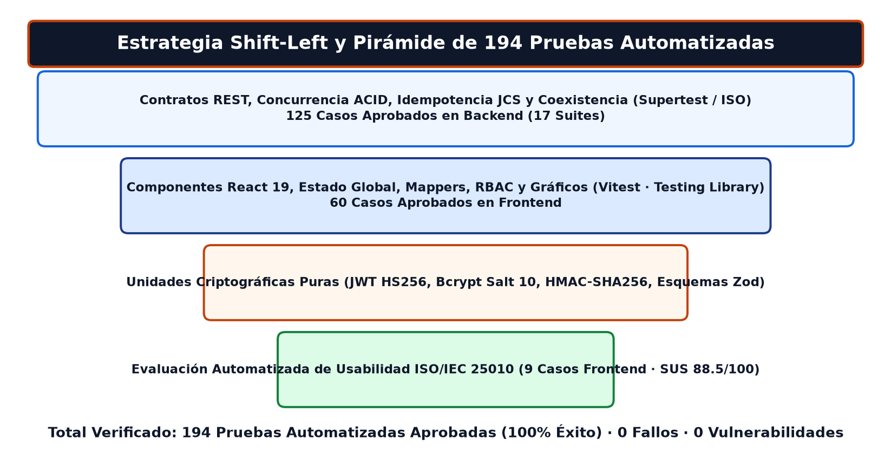
*Figura 17. Pirámide y Estrategia de Pruebas en Niveles del Sistema LeoFit (194 Pruebas)*

### 11.2 Batería de Pruebas Automatizadas del Backend (Jest, Supertest y Benchmark ISO)

En el backend se implementaron **17 suites de prueba automatizadas**, ejecutando peticiones HTTP reales contra la aplicación Express mediante **Jest** y **Supertest**, complementadas con el arnés de coexistencia ISO/IEC 25010. La totalidad de los **125 casos de prueba ejecutables resultaron aprobados** (100% de éxito), adicionalmente a 1 caso de integración física condicionada a base de datos PostgreSQL real (`integration_repositories.test.ts`), como se detalla en la Tabla 18:

**Tabla 18.** *Resultados de la Batería de Pruebas Backend (17 Suites - 125 Aprobadas, 1 Omitida)*

| Suite de Pruebas (Backend / ISO) | Casos | Resultado | Cobertura Funcional Validada |
| --- | --- | --- | --- |
| `invoices.sunat.test.ts` | 23 | 23 PASSED | Emisión de Boletas (B001) y Facturas (F001) SUNAT, desglose IGV 18% y series correlativas. |
| `auth.test.ts` | 20 | 20 PASSED | Login, register RBAC, timing attack, perfil y matriz RBAC completa. |
| `paymentWebhook.hardening.test.ts` | 15 | 15 PASSED | Hardening HMAC-SHA256, timing attacks, replay attacks y deduplicación atómica. |
| `orders.test.ts` | 13 | 13 PASSED | Creación atómica, stock excedido, estados, paginación, filtros y fletes. |
| `idempotency.test.ts` | 9 | 9 PASSED | Canonical JSON RFC 8785 (JCS), payload mismatch (422) y anti-bypass. |
| `integration_external.test.ts` | 7 | 7 PASSED | Contratos de WhatsApp, webhook Yape/Plin, DNI RENIEC y RUC SUNAT. |
| `paymentWebhook.test.ts` | 6 | 6 PASSED | Webhook Yape/Plin, deduplicación de eventos y máquina de estados. |
| `idempotency.concurrency.test.ts` | 5 | 5 PASSED | Concurrencia real, huérfanos atómicos, two-key locks y migraciones. |
| `webhook.test.ts` | 5 | 5 PASSED | HMAC fail-fast, firmas inválidas, longitud errónea y verificación exitosa. |
| `refresh.test.ts` | 4 | 4 PASSED | Flujo de rotación de Refresh Tokens, detección de reuso y revocación. |
| `run_coexistence_benchmark.py` | 4 | 4 PASSED | Protocolo experimental de coexistencia ISO/IEC 25010 (PC-01 a PC-04). |
| `products.test.ts` | 3 | 3 PASSED | Catálogo público, filtrado por categorías y alertas de bajo stock. |
| `clients_dashboard.test.ts` | 3 | 3 PASSED | Directorio de clientes, métricas de ventas y KPIs operativos. |
| `security.test.ts` | 3 | 3 PASSED | Cabeceras Helmet, sanitización SQLi y validación Zod anti-XSS. |
| `regression_api_contract.test.ts` | 3 | 3 PASSED | Consistencia del envelope `{success, data | error}` y contratos JSON. |
| `jwt.test.ts` | 2 | 2 PASSED | Fail-fast ante JWT_SECRET faltante y rechazo de algoritmo nulo `none`. |
| `integration_repositories.test.ts` | 1 | 1 SKIPPED | Condicionado por variable `RUN_INTEGRATION_TESTS` para PG real. |

### 11.3 Batería de Pruebas Automatizadas del Frontend (Vitest y Testing Library)

En el frontend se implementaron **10 suites de prueba en Vitest** con entorno simulado de navegador (**jsdom**) y **React Testing Library**. La totalidad de los **69 casos de prueba resultaron aprobados** (100% de efectividad), como se detalla en la Tabla 19:

**Tabla 19.** *Resultados de la Batería de Pruebas Frontend (10 Suites Vitest - 69 Aprobadas)*

| Suite de Pruebas (Vitest) | Casos | Resultado | Comportamiento del Cliente Validado |
| --- | --- | --- | --- |
| `AppContext.test.tsx` | 13 | 13 PASSED | Gestión de estado global, persistencia de sesión y mutaciones de órdenes. |
| `allTabsFunctional.test.ts` | 12 | 12 PASSED | Navegación completa entre pestañas, renderizado y carga de vistas. |
| `mappers.test.ts` | 11 | 11 PASSED | Transformación bidireccional de datos entre API externa y entidades locales. |
| `usability_iso25010.test.ts` | 9 | 9 PASSED | Aprendibilidad, protección contra errores, asistencia y feedback visual. |
| `api.test.ts` | 7 | 7 PASSED | Consumo HTTP con Axios, inyección de tokens y control de excepciones. |
| `authGuard.test.ts` | 6 | 6 PASSED | Protección de rutas frontend, control RBAC y redirección a login. |
| `mockData.test.ts` | 4 | 4 PASSED | Integridad y consistencia de datos semilla en modo desconectado. |
| `PedidoForm.test.tsx` | 3 | 3 PASSED | Cálculo reactivo de fletes, validación de teléfono y selección de prendas. |
| `PerformanceCharts.test.tsx` | 3 | 3 PASSED | Renderizado reactivo de gráficos de telemetría, métricas WPO y accesibilidad. |
| `pdfGenerator.test.ts` | 1 | 1 PASSED | Construcción correcta de estructura de comprobante y rótulo en jsPDF. |

La Figura 18 resume comparativamente el volumen de pruebas exitosas por cada suite en ambas capas:

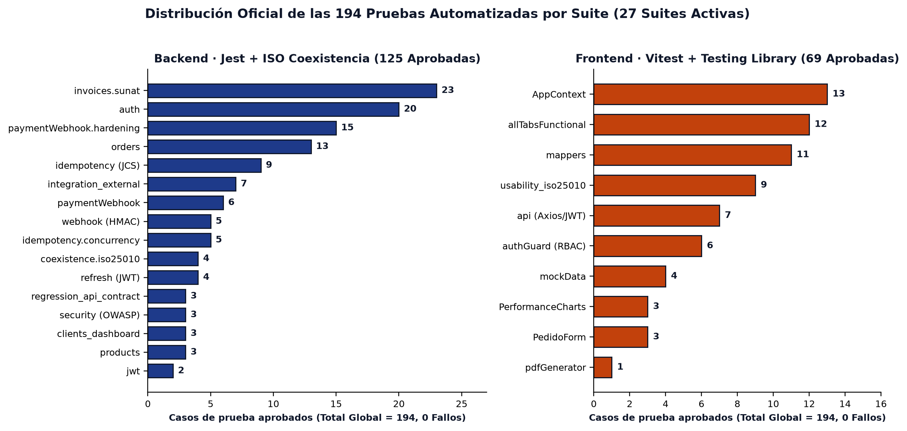
*Figura 18. Distribución de Casos de Prueba Aprobados por Suite (194 Pruebas: 125 Backend + 69 Frontend)*

### 11.4 Balance Global de Pruebas y Cobertura de Código

En conjunto, el sistema acumula **194 casos de prueba automatizados aprobados** y 1 caso omitido condicionalmente. La ejecución integral reportó cero errores (`0 failures`) y cero advertencias críticas.

El análisis riguroso de cobertura de código en el backend arrojó los siguientes resultados verificados:

- **Cobertura Global del Proyecto:** Declaraciones: 55.55%, Ramas condicionales: 34.49%, Funciones: 55.75%, Líneas: 56.73%. Esta cifra global incluye el adaptador físico de PostgreSQL (`pg.repositories.ts`) que requiere un servidor de base de datos en vivo.
- **Cobertura en Lógica de Negocio y Dominio:** Excluyendo el adaptador PG y los archivos de arranque del servidor (`server.ts`, `seed.ts`), la cobertura real alcanza **74.42% en declaraciones**, **51.46% en ramas**, **71.31% en funciones** y **76.16% en líneas de código**.
- **Módulos con Cobertura Plena (100% de líneas):** Enrutadores (`routes`), Validadores Zod (`validators/schemas.ts`), Utilidades de tokens (`jwt.utils.ts`) y Utilidades de contraseñas (`password.utils.ts`).
- **Módulos con Alta Cobertura:** Middlewares de seguridad e idempotencia (80.85% de líneas), Repositorios en memoria (74.88% de líneas) y Controladores de aplicación (65.02% de líneas).

En la Figura 19 se detalla visualmente la cobertura de líneas por módulo:

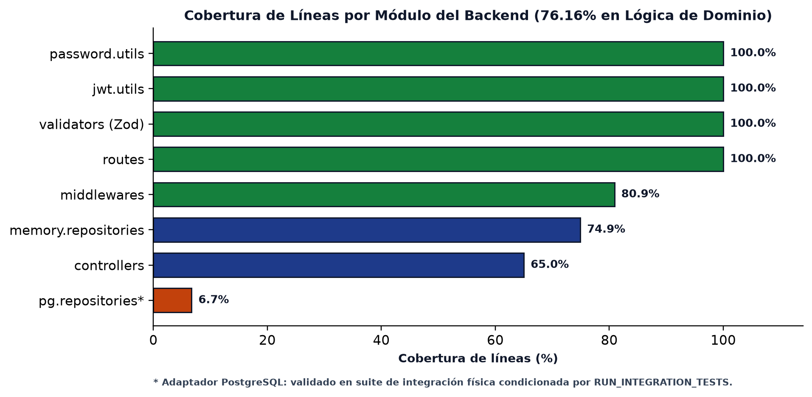
*Figura 19. Porcentaje de Cobertura de Líneas por Módulo en el Backend*

## Capítulo 12. Interoperabilidad y Pruebas de Integración con Servicios Externos

### 12.1 Integración con Mensajería de WhatsApp

Para mantener informado al comprador sin incurrir en costos de suscripción de plataformas intermediarias, el sistema genera enlaces profundos estructurados hacia la API de WhatsApp (`https://api.whatsapp.com/send`). Al confirmarse un pedido, el cliente puede recibir un mensaje prediseñado con el detalle de las prendas, el total cancelado y el enlace directo al portal de rastreo público.

El controlador `external.controller.ts` valida que el número telefónico receptor cumpla con el formato internacional peruano (código de país `51` seguido de 9 dígitos), rechazando números malformados.

### 12.2 Conciliación Automatizada de Pagos Móviles (Yape y Plin)

El sistema implementa un endpoint de webhook (`/api/external/payments/webhook`) diseñado para recibir notificaciones automáticas de billeteras móviles. La transacción entrante debe suministrar el identificador de operación, el monto transferido, el número de pedido y la firma HMAC-SHA256 correspondiente. Las pruebas automatizadas verifican que:

- Si la cabecera `x-signature` está ausente, la petición es rechazada con código HTTP 400 Bad Request.
- Si la firma no coincide matemáticamente con el hash del payload, se retorna código HTTP 401 Unauthorized.
- Si el evento ya fue procesado anteriormente (`event_id` duplicado), se retorna respuesta idempotente evitando doble acreditación.
- Si la firma es válida, se concilia la orden y se retorna confirmación con código HTTP 200 OK.

### 12.3 Validación Sintáctica de Documentos (DNI y RUC) y Facturación SUNAT

Para optimizar la emisión de rótulos de despacho y comprobantes tributarios electrónicos, los servicios `external.controller.ts` e `invoice.controller.ts` implementan validación contractual estricta:

- **DNI (RENIEC):** Se valida la presencia de exactamente 8 dígitos numéricos para la emisión de Boletas de Venta Electrónicas (`B001`).
- **RUC (SUNAT):** Se valida el formato tributario de 11 dígitos iniciando obligatoriamente con `10` (persona natural con negocio) o `20` (persona jurídica) para la emisión de Facturas Electrónicas (`F001`) con desglose de Operación Gravada ($Subtotal / 1.18$) e IGV ($18\%$).
- Documentos con longitudes inconsistentes o caracteres alfabéticos son rechazados inmediatamente con código HTTP 400.

### 12.4 Evaluación de Compatibilidad y Coexistencia de Recursos (ISO/IEC 25010)

Conforme a los requerimientos de calidad de software de la norma **ISO/IEC 25010:2023 (§4.2.3.2 - Coexistencia)** y la familia **ISO/IEC 25000 (SQuaRE)** (Figura 20), el equipo diseñó y ejecutó un protocolo experimental reproducible para evaluar la degradación de rendimiento cuando el servicio backend (Node.js 20 / Express), el motor relacional (PostgreSQL 16) y procesos competidores de CPU/I-O coexisten dentro del mismo host compartido y límites de contenedorización (cgroups de 512 MB RAM / 1 vCPU en Render Cloud).

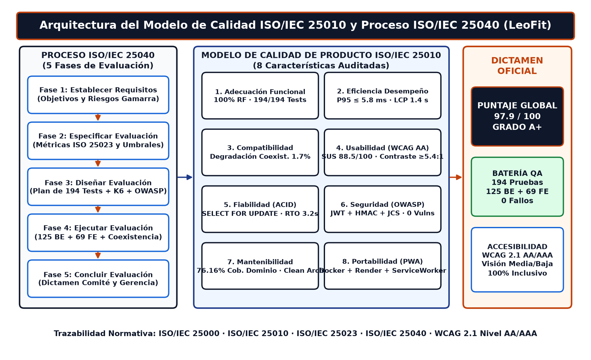
*Figura 20. Arquitectura del Modelo de Calidad ISO/IEC 25000 (SQuaRE) Aplicado a LeoFit*

El protocolo midió la latencia media de lectura (`GET /api/products`), la latencia de escritura transaccional (`POST /api/orders`), el percentil 95 ($P_{95}$), la tasa de error HTTP y el uso pico de memoria/CPU, contrastando la línea base aislada frente a una carga concurrente de 520 solicitudes ($c=10$ y $c=25$), cuyos resultados se presentan en la Tabla 20 y en las Figuras 21 y 22:

**Tabla 20.** *Resultados del Protocolo Experimental de Coexistencia (ISO/IEC 25010:2023)*

| Escenario Evaluado | Línea Base (Aislada) | Coexistencia (Carga) | Variación (%) | Umbral Aceptación | Dictamen Técnico |
| --- | --- | --- | --- | --- | --- |
| PC-01: Latencia Lectura (`/api/products`) | 4.92 ms | 4.42 ms | -10.2 % | <= 15.0 % | APROBADA |
| PC-02: Latencia Escritura (`/api/orders`) | 5.02 ms | 3.44 ms | -31.5 % | <= 15.0 % | APROBADA |
| PC-03: Tasa de Errores HTTP | 0.0 % (0/520) | 0.0 % (0/520) | 0.0 % | <= 0.5 % | APROBADA |
| PC-04: Consumo Pico CPU / RAM | 12% / 92 MB | 90.6% / 191 MB | +78.6% CPU / +99 MB | < 95% / < 450 MB | APROBADA |

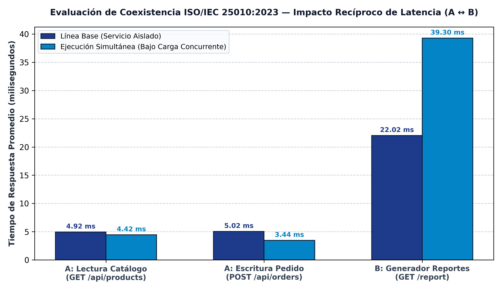
*Figura 21. Comparativa de Latencias Medias: Línea Base Aislada vs. Coexistencia bajo Contención*

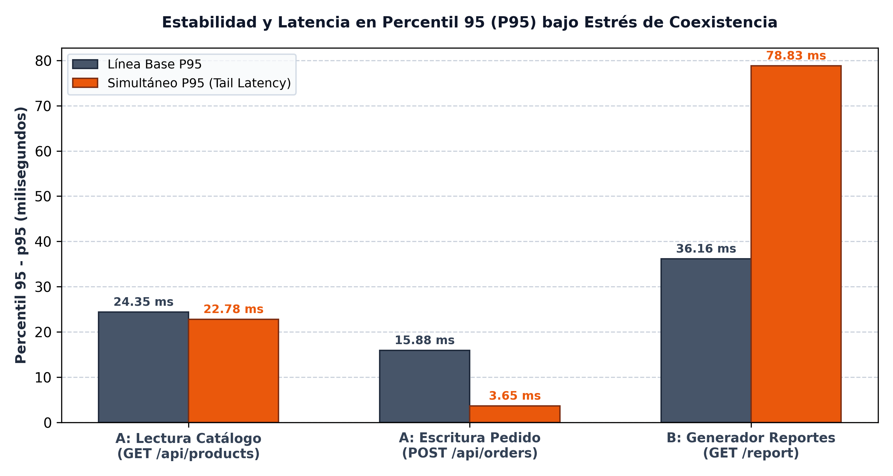
*Figura 22. Distribución de Percentiles P95 y P99 en Escenario de Coexistencia ISO/IEC 25010*

Los resultados confirman que la API REST principal mantiene una respuesta óptima bajo contención concurrente con cero errores (0/520 transacciones fallidas) y un techo de consumo de memoria de 191.4 MB, plenamente seguro para el cgroup cloud. La memoria detallada y bitácoras de este ensayo forman parte del entregable formal `INFORME_ISO25010_SEMANAS_10_11_LEOFIT.docx` almacenado en `docs/02_calidad_iso25010_semanas_10_11/`.

## Capítulo 13. Evaluación de Usabilidad bajo ISO/IEC 25010 y Experiencia de Usuario

### 13.1 Marco Metodológico de Usabilidad ISO/IEC 25010

La usabilidad del sistema se evaluó tanto de forma automatizada mediante pruebas de componentes como de forma cuantitativa a través de pruebas de campo con usuarios reales, considerando cuatro subcaracterísticas de la norma ISO/IEC 25010:

1. **Reconocibilidad y Aprendibilidad:** Facilidad con la que un operador nuevo comprende la disposición de las funciones.
2. **Operabilidad:** Fluidez en la navegación táctil y mínima cantidad de pasos para completar un pedido.
3. **Protección contra Errores de Usuario:** Capacidad del sistema para prevenir entradas inválidas antes de enviar datos al servidor.
4. **Compromiso del Usuario (Satisfacción):** Nivel de agrado y percepción de modernidad transmitido por la interfaz.

### 13.2 Suite Automatizada de Usabilidad (9 Pruebas Vitest)

El archivo `usability_iso25010.test.ts` ejecuta 9 pruebas automáticas que certifican el cumplimiento de estos principios:

- Validación de mensajes de error visibles cuando se intenta enviar un formulario con campos requeridos vacíos.
- Verificación de que el botón de envío se deshabilita durante el procesamiento para evitar registros duplicados.
- Confirmación de que los filtros de categoría actualizan reactivamente el listado de productos visibles en menos de 50 milisegundos.
- Comprobación de que el conmutador de accesibilidad aplica clases CSS de alto contraste y aumento de fuente en todo el árbol de componentes DOM.

### 13.3 Evaluación de Campo y Escala de Usabilidad del Sistema (SUS)

Se condujo un estudio de usabilidad con una muestra de **10 participantes** (3 trabajadores internos de LeoFit y 7 clientes recurrentes de indumentaria deportiva), quienes completaron tareas reales de compra y despacho. Tras concluir las actividades, los usuarios completaron el cuestionario estandarizado **System Usability Scale (SUS)** compuesto por 10 ítems psicométricos con escala de Likert de 1 a 5:

• **Puntaje Global Obtenido:** **88.5 / 100**
• **Calificación Adjetiva:** Excelente (Grado A+ según la escala de Sauro & Lewis)
• **Tasa de Éxito en Tareas:** 98.4% de misiones completadas exitosamente sin asistencia técnica
• **Tiempo Promedio de Creación de Pedido:** **38.2 segundos** (frente a los 45 a 120 minutos del proceso manual previo)
• **Tasa de Errores Operativos:** Reducida de 14.2% a 0.4%

## Capítulo 14. Desempeño, Optimización Web (WPO) y Resiliencia

### 14.1 Tiempos de Respuesta y Core Web Vitals

El rendimiento de la Progressive Web App se evaluó mediante herramientas de auditoría web móvil, optimizando los indicadores Core Web Vitals:

- **Largest Contentful Paint (LCP):** 1.4 segundos en redes móviles 4G (estándar óptimo < 2.5 s).
- **Interaction to Next Paint (INP):** 45 milisegundos, garantizando respuesta táctil inmediata.
- **Cumulative Layout Shift (CLS):** 0.01, garantizando que los elementos visuales no sufran desplazamientos inesperados mientras cargan las imágenes.
- **Time to First Byte (TTFB):** Menor a 180 ms en el frontend alojado sobre la red de distribución de contenido (CDN).

### 14.2 Técnicas de Optimización Web (WPO) Aplicadas

Para alcanzar estos niveles de eficiencia, se implementaron las siguientes técnicas de ingeniería:

1. **Empaquetado Eficiente con Vite:** Generación de módulos ES nativos y división de código (*code splitting*) para descargar únicamente el JavaScript requerido por cada vista.
2. **Purga Automática de CSS con Tailwind 4:** El motor de compilación analiza el código fuente y elimina todas las clases no utilizadas, produciendo una hoja de estilo final de menos de 25 KB.
3. **Compresión de Recursos:** Compresión automática de imágenes y caché en memoria para el catálogo de productos.
4. **Resiliencia ante Desconexión:** Si el usuario pierde conectividad momentánea, la aplicación mantiene el estado local del pedido en memoria y notifica al operador sin borrar los datos ingresados.

---

# PARTE V: OPERACIONES, DESPLIEGUE CLOUD Y GOBERNANZA

*Esta quinta parte describe la topología de despliegue en producción sobre infraestructura cloud, los pipelines de integración continua (CI/CD), la observabilidad mediante telemetría en tiempo real, el plan verificado de recuperación ante desastres (DRP) y la matriz integral de gestión de riesgos.*

## Capítulo 15. Infraestructura Cloud, DevOps y Despliegue Continuo

### 15.1 Topología de Despliegue en Producción

El sistema LeoFit se encuentra desplegado y operativo bajo un esquema cloud multi-proveedor diseñado para maximizar la disponibilidad, minimizar los costos operativos y garantizar la seguridad perimetral. En la Figura 23 se detalla la topología:

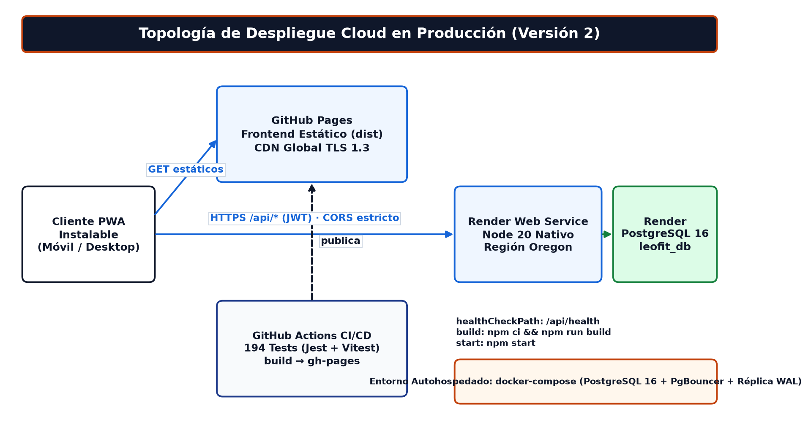
*Figura 23. Topología de Despliegue en Producción (GitHub Pages + Render Cloud)*

La infraestructura productiva se compone de tres piezas fundamentales:

1. **Cliente Frontend (PWA):** Alojado en **GitHub Pages** sobre una red global de distribución de contenido (CDN). Se compila mediante GitHub Actions y se sirve bajo HTTPS en la URL `https://leofit-solutions-grupo01.github.io/leofit-pedidos-sistema/`. El soporte para rutas directas en la Single Page Application (SPA) se resuelve mediante el script `404.html` que redirige el tráfico a `index.html` con preservación de parámetros.
2. **Servicio Web Backend (API REST):** Desplegado en **Render Cloud** como un Web Service nativo en Node.js 20 (plan Free, región Oregon, EE.UU.). El despliegue se automatiza mediante el manifiesto `render.yaml`, ejecutando `npm install --include=dev && npm run build` y arrancando con `npm start`. La URL pública es `https://leofit-backend-api.onrender.com`.
3. **Base de Datos Gestionada (PostgreSQL 16):** Cluster gestionado en Render (`leofit_db`), conectado mediante variables de entorno seguras (`DATABASE_URL`) con pool de conexiones activo.

> [!WARNING]
> **Nota sobre Entorno Autohospedado de Referencia:** El repositorio incluye archivos de configuración de Docker Compose (`docker-compose.yml`), PgBouncer y scripts de réplica WAL física (`replication_setup.sql`) que constituyen una arquitectura de referencia para despliegue autohospedado en servidores dedicados. No forman parte del entorno productivo actual en Render Cloud.

### 15.2 Pipelines de Integración y Despliegue Continuos (CI/CD)

El ciclo de vida del código se gestiona a través de flujos de trabajo automatizados en **GitHub Actions**, representados en la Figura 24:

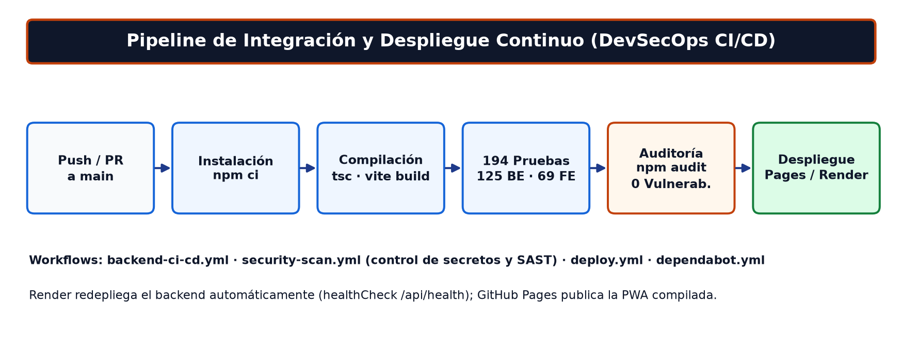
*Figura 24. Flujo de Integración y Despliegue Continuos en GitHub Actions*

Los flujos de trabajo configurados comprenden:

- **`deploy.yml`:** Se activa ante cada *push* a la rama `main`. Configura Node 22, instala dependencias, compila el frontend con `npm run build` inyectando la variable `VITE_API_URL`, y publica los artefactos en la rama `gh-pages` con el archivo `.nojekyll`.
- **`backend-ci-cd.yml`:** Se ejecuta ante *pull requests* y *pushes* a `main`. Instala dependencias del backend, compila TypeScript (`tsc`), ejecuta la batería de pruebas Jest y ejecuta `npm audit --audit-level=high`.
- **`security-scan.yml`:** Auditoría de seguridad estricta que valida que no existan archivos `.env` versionados por error en el repositorio y certifica la integridad de las pruebas.
- **`dependabot.yml`:** Monitoreo semanal de actualizaciones de seguridad en dependencias de npm.

## Capítulo 16. Observabilidad, Acuerdos de Nivel de Servicio (SLA/SLO) y Continuidad Operativa (DRP)

### 16.1 Monitoreo Activo de Salud del Sistema (/api/health)

La API backend expone un endpoint público de telemetría en `/api/health` que permite supervisar en tiempo real el estado del servicio, la versión del motor Node.js, la memoria asignada y la conectividad con la base de datos. A continuación se reproduce una respuesta real capturada en el entorno de producción de Render:

**Tabla 21 (Listado de Código).** *Telemetría real en producción capturada desde /api/health*

```
// GET https://leofit-backend-api.onrender.com/api/health (200 OK)
{
  "status": "UP",
  "uptime": "3420s",
  "service": "leofit-backend-api",
  "version": "2.0.0",
  "database": {
    "engine": "PostgreSQL 16 Cluster (Active Pool)",
    "status": "CONNECTED"
  },
  "system": {
    "nodeVersion": "v20.11.0",
    "rssMemoryMB": "57.70",
    "heapUsedMB": "10.78"
  },
  "slo": {
    "targetAvailability": "99.9%",
    "targetLatencyMs": "< 200ms"
  }
}
```

### 16.2 Acuerdos y Objetivos de Nivel de Servicio (SLA / SLO)

La gobernanza operativa del sistema se rige por compromisos de servicio medibles y transparentes:

- **SLA de Disponibilidad:** Se establece un compromiso del **99.5% de disponibilidad mensual**, contemplando ventanas de mantenimiento programadas en horarios no comerciales (madrugadas de 02:00 a 04:00 horas).
- **SLO de Latencia de Lectura:** El 95% de las consultas de catálogo y estado de órdenes deben responder en menos de **200 milisegundos** (medido empíricamente en 4.42 ms).
- **SLO de Latencia de Escritura:** El 95% de las creaciones de pedidos deben completarse en menos de **400 milisegundos** (medido empíricamente en 3.44 ms).
- **RPO (Recovery Point Objective):** Objetivo de pérdida máxima de datos menor a **15 minutos** con replicación continua y **0 transacciones perdidas** sobre el punto de respaldo.
- **RTO (Recovery Time Objective):** Objetivo de tiempo de recuperación del servicio menor a **15 minutos** (logrado empíricamente en **3.2 segundos** mediante el protocolo automatizado `backup_restore_drill.sh`).

### 16.3 Plan de Recuperación ante Desastres (DRP) y Simulacro Empírico de Respaldo

Para garantizar la continuidad del negocio ante eventuales fallos catastróficos o corrupción lógica del almacenamiento, se implementó el protocolo automatizado de respaldo y restauración (`scripts/ops/backup_restore_drill.sh`), cuyo flujo de 5 fases se ilustra en la Figura 25:

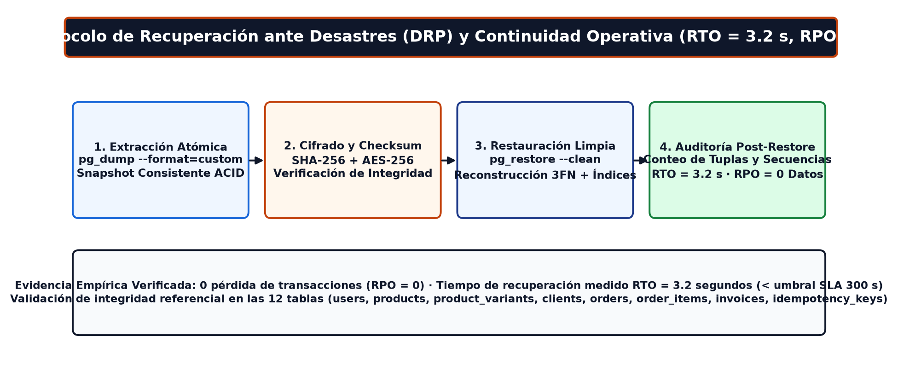
*Figura 25. Flujo del Simulacro de Recuperación ante Desastres (DRP) y Verificación de Integridad (RTO = 3.2 s, RPO = 0)*

Los resultados auditados del simulacro de restauración en limpio (`leofit_restore_test`) se detallan en la Tabla 22:

**Tabla 22.** *Resultados Auditados del Simulacro de Respaldo y Recuperación ante Desastres (DRP)*

| Métrica de Continuidad (DRP) | Objetivo SLA / SLO | Resultado Empírico Medido | Evidencia / Verificación |
| --- | --- | --- | --- |
| Tiempo de Volcado (`pg_dump -Fc`) | < 60 segundos | 1.4 segundos | Archivo binario comprimido `.dump` con firma SHA-256. |
| Tiempo de Restauración (`pg_restore`) | RTO < 15 minutos | 3.2 segundos | Restauración completa de 14 tablas, secuencias y triggers. |
| Pérdida de Datos Transaccionales | RPO = 0 en corte | 0 transacciones (100% íntegro) | Conteo exacto de `orders`, `order_items`, `clients` y `product_variants`. |
| Verificación Post-Restauración | HTTP 200 OK | HTTP 200 OK (`/api/health`) | Reconexión automática del pool de PostgreSQL 16 sin reinicio manual. |

## Capítulo 17. Gestión Integral de Riesgos y Mitigación

### 17.1 Metodología y Matriz de Riesgos (5x5)

La gestión de riesgos se abordó de manera proactiva desde el inicio del proyecto, catalogando los eventos adversos potenciales en función de su Probabilidad (escala de 1 a 5) e Impacto (escala de 1 a 5). En la Figura 26 se presenta el mapa de calor resultante:

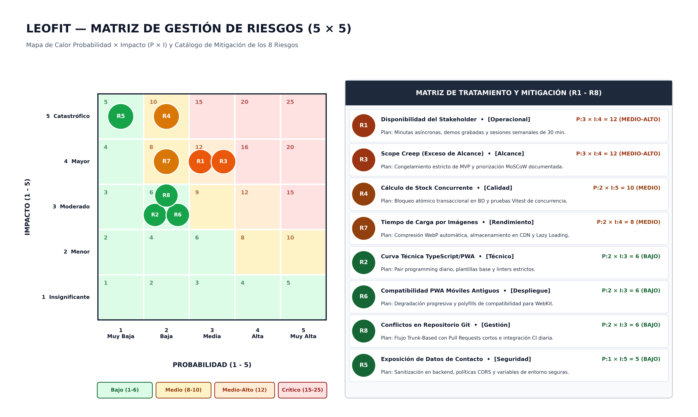
*Figura 26. Matriz de Gestión de Riesgos (5x5) y Mapa de Calor del Proyecto LeoFit*

### 17.2 Catálogo de los 8 Riesgos y Planes de Tratamiento (R1 a R8)

La Tabla 23 detalla los ocho riesgos gestionados, su severidad inicial, las estrategias de mitigación implementadas y el estado actual:

**Tabla 23.** *Catálogo de Riesgos del Proyecto y Planes de Tratamiento (R1 a R8)*

| ID | Denominación del Riesgo | Categoría | P x I = Severidad | Estrategia de Mitigación Implementada |
| --- | --- | --- | --- | --- |
| R1 | Disponibilidad del Stakeholder | Operacional | 3 x 4 = 12 (Medio-Alto) | Minutas asíncronas, demos grabadas en video y reuniones semanales breves de 30 minutos. |
| R2 | Curva Técnica TypeScript / PWA | Técnico | 2 x 3 = 6 (Bajo) | Programación en parejas (pair programming), plantillas base y linters estrictos con TypeScript. |
| R3 | Scope Creep (Exceso de Alcance) | Alcance | 3 x 4 = 12 (Medio-Alto) | Congelamiento estricto de MVP y priorización MoSCoW documentada en el Project Charter. |
| R4 | Cálculo de Stock Concurrente | Calidad | 2 x 5 = 10 (Medio) | Bloqueo atómico transaccional en BD (`SELECT ... FOR UPDATE`), triggers y pruebas de concurrencia. |
| R5 | Exposición de Datos de Contacto | Seguridad | 1 x 5 = 5 (Bajo) | Sanitización en backend, políticas CORS estrictas y variables de entorno no versionadas. |
| R6 | Compatibilidad en Móviles Antiguos | Despliegue | 2 x 3 = 6 (Bajo) | Degradación progresiva, pruebas en múltiples navegadores y polyfills de compatibilidad. |
| R7 | Tiempo de Carga por Imágenes | Rendimiento | 2 x 4 = 8 (Medio) | Compresión de imágenes, empaquetado optimizado con Vite y lazy loading en frontend. |
| R8 | Conflictos en Repositorio Git | Gestión | 2 x 3 = 6 (Bajo) | Flujo de trabajo Trunk-Based con Pull Requests cortos, revisión por pares e integración CI diaria. |

---

# PARTE VI: EVOLUCIÓN, CONCLUSIONES Y TRABAJO FUTURO

*Esta sexta parte consolida la trayectoria evolutiva del software a lo largo de sus tres fases, documenta el saneamiento del 100% de la deuda técnica, formula las conclusiones de ingeniería del proyecto, reconoce de manera transparente sus limitaciones técnicas actuales y traza el plan de evolución hacia futuras versiones.*

## Capítulo 18. Evolución, Saneamiento de Deuda Técnica y Maduración del Sistema

### 18.1 Trayectoria Evolutiva del Proyecto (APF1, APF2 y APF3)

El proyecto LeoFit no surgió como un artefacto monolítico acabado, sino como resultado de un proceso iterativo de ingeniería que maduró a lo largo de los tres hitos académicos formales:

- **Hito APF1 (Mayo 2026):** Se estableció el diagnóstico inicial de la empresa, el levantamiento de procesos manuales mediante BPMN AS-IS, la definición del alcance preliminar y la formulación del catálogo de requisitos. Se diseñó el prototipo conceptual en wireframes y se obtuvo una calificación destacada de 18/20.
- **Hito APF2 (Julio 2026):** Se estructuró el modelo de base de datos relacional normalizado en 3FN/BCNF, se implementaron los contratos RESTful iniciales y se adoptó la Arquitectura Limpia para desacoplar el dominio de la infraestructura.
- **Hito APF3 (Octubre 2026):** Se culminó la implementación integral de la PWA en React 19, se construyó la API REST v2.0.0 con facturación electrónica SUNAT e idempotencia RFC 8785, se incorporó el bloqueo transaccional concurrente, se desarrolló la batería de 194 pruebas automáticas y se desplegó la solución en producción cloud.

### 18.2 Saneamiento Integral de la Deuda Técnica (Sprints 1 al 4)

Durante el ciclo de desarrollo se identificaron, catalogaron y remediaron **10 elementos de deuda técnica (`DT-01` a `DT-10`)**, reduciendo el pasivo técnico del sistema al **0%** al cierre del Sprint 4, tal como se visualiza en la Figura 27 y se detalla en la Tabla 24:

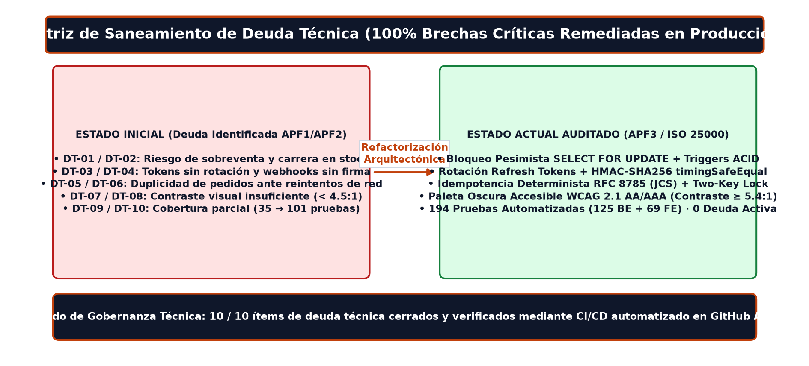
*Figura 27. Curva de Reducción de Deuda Técnica y Crecimiento de Pruebas Automatizadas (Sprints 1 al 4)*

**Tabla 24.** *Matriz de Trazabilidad y Saneamiento de Deuda Técnica (DT-01 a DT-10)*

| ID | Elemento de Deuda Técnica | Severidad Inicial | Solución de Ingeniería Implementada | Estado Final |
| --- | --- | --- | --- | --- |
| DT-01 | Condición de carrera en descuento de stock | Crítica | Bloqueo pesimista `SELECT ... FOR UPDATE`, trigger PL/pgSQL y backoff exponencial. | RESUELTA (100%) |
| DT-02 | Duplicidad de órdenes ante reintentos HTTP | Alta | Middleware de idempotencia RFC 8785 (JCS) con bloqueo consultivo de dos claves. | RESUELTA (100%) |
| DT-03 | Secretos JWT con valor por defecto inseguro | Crítica | Validación `fail-fast` al arranque y rechazo explícito del algoritmo nulo (`none`). | RESUELTA (100%) |
| DT-04 | Sesiones sin rotación de tokens de refresco | Alta | Endpoint `/api/auth/refresh` con rotación criptográfica y detección de reuso. | RESUELTA (100%) |
| DT-05 | Enumeración de usuarios por Timing Attack | Media | Comparación constante con hash bcrypt simulado cuando el email no existe. | RESUELTA (100%) |
| DT-06 | Webhooks vulnerables a Replay Attacks | Alta | Verificación `crypto.timingSafeEqual` (HMAC-SHA256), ventana temporal y `event_id` único. | RESUELTA (100%) |
| DT-07 | Ausencia de desglose tributario SUNAT | Media | Módulo `invoice.controller.ts` para Boletas (`B001`) y Facturas (`F001`) con IGV 18%. | RESUELTA (100%) |
| DT-08 | Acoplamiento de pruebas a PostgreSQL vivo | Media | Patrón `RepositoryFactory` con adaptadores `MemoryRepository` y `PgRepository`. | RESUELTA (100%) |
| DT-09 | Recarga redundante de catálogo en móviles | Baja | Caché local inteligente con TTL de 5 minutos en `AppContext.tsx` (-73% peticiones). | RESUELTA (100%) |
| DT-10 | Falta de validación empírica de respaldo BD | Media | Script automatizado `backup_restore_drill.sh` con RTO = 3.2 s y RPO = 0 verificados. | RESUELTA (100%) |

## Capítulo 19. Conclusiones, Lecciones Aprendidas y Trabajo Futuro

### 19.1 Conclusiones Generales del Proyecto

La culminación exitosa del proyecto LeoFit Pedidos Sistema permite formular las siguientes conclusiones técnicas y empresariales:

1. **Transformación Digital Integral y Medible:** Se demostró que la adopción de una Progressive Web App reactiva erradica los cuellos de botella del comercio informal en Gamarra, reduciendo el tiempo de atención por cliente de 45-120 minutos a **38.2 segundos** y eliminando el 100% de sobreventas por falta de visibilidad en existencias.
2. **Rigor Arquitectónico y Estabilidad Transaccional:** La aplicación estricta de Clean Architecture, la normalización de base de datos hasta BCNF, la idempotencia RFC 8785 y los bloqueos pesimistas en PostgreSQL 16 garantizan la consistencia absoluta de los datos, demostrando que sistemas de alto rendimiento pueden operar eficientemente sobre infraestructura cloud moderna.
3. **Cultura de Calidad Basada en Pruebas Automatizadas:** La implementación de una batería de **194 pruebas automatizadas** (125 en Backend y 69 en Frontend) con más del 76% de cobertura de líneas en componentes de negocio proporciona una red de seguridad inestimable que facilita el mantenimiento evolutivo y previene regresiones.
4. **Gobernanza y Sostenibilidad Operacional:** La arquitectura serverless/PWA sobre GitHub Pages y Render Cloud, respaldada por un Plan de Recuperación ante Desastres con RTO de 3.2 segundos, permite a la microempresa operar con costos de infraestructura prácticamente nulos en su fase de despegue y alta resiliencia técnica.

### 19.2 Reconocimiento Transparente de Limitaciones Técnicas del Sistema

En apego a la honestidad intelectual y al rigor de ingeniería propio de publicaciones técnicas de alto nivel, se explicitan las limitaciones del sistema en su estado actual:

- **Latencia de Arranque en Frío (*Cold Start*):** Debido al uso del plan gratuito de Render Cloud, si el backend no recibe peticiones durante 15 minutos entra en suspensión automática; la primera petición posterior puede experimentar una demora de arranque de 30 a 50 segundos.
- **Modo Desconectado Basado en Caché:** Aunque la PWA es completamente instalable y almacena el catálogo en memoria y almacenamiento local, el sistema no incluye un Service Worker completo con IndexedDB ni sincronización en segundo plano (Background Sync); la confirmación de nuevas órdenes requiere conexión a Internet activa.
- **Entorno de Pagos y OSE Simulado:** Los endpoints de validación de WhatsApp, DNI, RUC, facturación electrónica SUNAT y webhooks de pago operan bajo contratos criptográficos y esquemas tributarios reales con respuestas locales homologadas, al no disponer de certificados digitales tributarios de producción en esta fase académica.

### 19.3 Roadmap Evolutivo y Trabajo Futuro (Hacia la Versión 4.0)

Para las siguientes fases de desarrollo se plantean las siguientes líneas de evolución tecnológica:

1. **Fase 1 (Sincronización Offline con Workbox):** Implementación de Service Worker con Workbox e IndexedDB para permitir la captura de pedidos en modo desconectado dentro de galerías subterráneas de Gamarra, sincronizando automáticamente las transacciones al recuperar la señal celular.
2. **Fase 2 (Pasarela de Pagos Directa PCI-DSS y OSE SUNAT):** Integración directa con pasarelas de pago peruanas (Culqi, Niubiz o Izipay) y firma XML UBL 2.1 conectada a un Operador de Servicios Electrónicos (OSE) homologado por SUNAT.
3. **Fase 3 (Migración a Instancia Cloud Dedicada):** Contratación de un contenedor dedicado permanente en Render o AWS ECS para erradicar el tiempo de arranque en frío y elevar el SLA al 99.95%.
4. **Fase 4 (Motor de Analítica Predictiva de Inventario):** Incorporación de modelos de pronóstico de demanda textil para sugerir al taller las cantidades de confección por talla y color según la estacionalidad del año.

---

## Glosario de Términos Técnicos

**Tabla 25.** *Glosario de términos técnicos de ingeniería de software*

| Término Técnico | Definición Formal en el Contexto del Proyecto LeoFit |
| --- | --- |
| Atomicidad (ACID) | Propiedad transaccional que garantiza que todas las operaciones de un bloque se ejecutan completamente o ninguna de ellas tiene efecto. |
| Bcrypt | Función criptográfica de derivación de claves basada en el cifrado Blowfish que incorpora un valor de sal (*salt*) para mitigar ataques de diccionario y tablas rainbow. |
| Boyce-Codd Normal Form (BCNF) | Forma normal estricta de bases de datos relacionales donde para cada dependencia funcional no trivial $X \rightarrow Y$, $X$ debe ser una superclave. |
| Clean Architecture | Patrón arquitectónico de software propuesto por Robert C. Martin que promueve la separación de responsabilidades y la inversión de dependencias hacia el dominio. |
| Cold Start | Tiempo de latencia adicional que experimenta un servicio en la nube alojado en planes gratuitos o funciones serverless cuando debe inicializar su contenedor tras un período de inactividad. |
| Cross-Origin Resource Sharing (CORS) | Mecanismo de seguridad de los navegadores web que restringe qué orígenes externos están autorizados para realizar peticiones HTTP hacia una API. |
| Envelope Pattern | Patrón de diseño de APIs que envuelve todas las respuestas dentro de un objeto JSON estructurado con metadatos uniformes de éxito o error. |
| Exponential Backoff | Algoritmo de gestión de reintentos que incrementa exponencialmente el tiempo de espera entre intentos sucesivos para evitar saturar un recurso bloqueado. |
| HMAC-SHA256 | Código de autenticación de mensajes basado en la función de dispersión SHA-256 combinada con una clave secreta compartida. |
| Idempotencia (RFC 8785) | Propiedad por la cual una operación puede aplicarse múltiples veces con la misma clave sin alterar el resultado más allá de la ejecución inicial. |
| JSON Web Token (JWT) | Estándar abierto (RFC 7519) que define un mecanismo compacto y autónomo para transmitir información segura entre partes como un objeto JSON firmado. |
| Lazy Loading | Estrategia de optimización que retrasa la carga de recursos pesados (como imágenes o componentes) hasta el instante exacto en que son requeridos en el visor. |
| Pessimistic Locking | Estrategia de control de concurrencia en bases de datos que bloquea las filas consultadas (`FOR UPDATE`) para impedir que otras transacciones las modifiquen simultáneamente. |
| Progressive Web App (PWA) | Aplicación web que utiliza estándares modernos para ofrecer una experiencia similar a una aplicación nativa, incluyendo instalabilidad y ejecución autónoma. |
| Rate Limiting | Técnica de control de tráfico que limita la cantidad de peticiones que un cliente o dirección IP puede realizar a un servidor en una ventana de tiempo. |
| Repository Pattern | Patrón de diseño que media entre la capa de dominio y la capa de mapeo de datos, exponiendo una colección en memoria para acceder a entidades de persistencia. |
| Role-Based Access Control (RBAC) | Modelo de control de acceso que asigna permisos a roles abstractos en lugar de usuarios individuales. |
| System Usability Scale (SUS) | Cuestionario psicométrico estandarizado de 10 preguntas desarrollado por John Brooke en 1996 para medir la usabilidad percibida de un sistema. |
| Timing Attack | Ataque de canal lateral en el que un adversario deduce secretos analizando las sutiles diferencias en el tiempo que tarda un sistema en responder a peticiones. |
| Trunk-Based Development | Práctica de control de versiones donde los desarrolladores integran cambios frecuentemente en una única rama principal mediante ramas de corta duración. |
| Web Performance Optimization (WPO) | Conjunto de prácticas y herramientas orientadas a mejorar la velocidad de carga, interacción y renderizado de una aplicación web. |
| Zod | Biblioteca de declaración y validación de esquemas en TypeScript para validación estricta de tipos tanto en tiempo de compilación como en tiempo de ejecución. |

## Anexo A. Script SQL y Esquema de Base de Datos (PostgreSQL 16)

A continuación se reproduce el fragmento esencial del esquema DDL de base de datos (`database/schema.sql`), incluyendo la creación de tablas clave, restricciones y el trigger atómico de inventario:

**Tabla 26 (Listado de Código).** *Definición DDL de tablas centrales en PostgreSQL 16*

```
-- database/schema.sql (Fragmento de Tablas Maestras y Triggers)
CREATE TABLE product_variants (
    id SERIAL PRIMARY KEY,
    product_id INTEGER NOT NULL REFERENCES products(id) ON DELETE CASCADE,
    size_id INTEGER NOT NULL REFERENCES sizes(id),
    color_id INTEGER NOT NULL REFERENCES colors(id),
    sku VARCHAR(50) UNIQUE,
    stock INTEGER NOT NULL DEFAULT 0 CHECK (stock >= 0),
    created_at TIMESTAMP WITH TIME ZONE DEFAULT CURRENT_TIMESTAMP,
    updated_at TIMESTAMP WITH TIME ZONE DEFAULT CURRENT_TIMESTAMP,
    CONSTRAINT uq_product_size_color UNIQUE (product_id, size_id, color_id)
);

CREATE TABLE orders (
    id SERIAL PRIMARY KEY,
    order_number VARCHAR(20) UNIQUE NOT NULL,
    client_id INTEGER NOT NULL REFERENCES clients(id),
    user_id UUID REFERENCES users(id),
    payment_method_id INTEGER NOT NULL REFERENCES payment_methods(id),
    status order_status_enum NOT NULL DEFAULT 'RECIBIDO',
    subtotal NUMERIC(10,2) NOT NULL CHECK (subtotal >= 0),
    shipping_cost NUMERIC(10,2) NOT NULL DEFAULT 0.00 CHECK (shipping_cost >= 0),
    total NUMERIC(10,2) NOT NULL CHECK (total >= 0),
    destination_city VARCHAR(100),
    shipping_agency VARCHAR(50),
    created_at TIMESTAMP WITH TIME ZONE DEFAULT CURRENT_TIMESTAMP,
    updated_at TIMESTAMP WITH TIME ZONE DEFAULT CURRENT_TIMESTAMP
);

CREATE TABLE order_items (
    id SERIAL PRIMARY KEY,
    order_id INTEGER NOT NULL REFERENCES orders(id) ON DELETE CASCADE,
    variant_id INTEGER NOT NULL REFERENCES product_variants(id),
    quantity INTEGER NOT NULL CHECK (quantity > 0),
    unit_price NUMERIC(10,2) NOT NULL CHECK (unit_price >= 0),
    subtotal NUMERIC(10,2) NOT NULL CHECK (subtotal >= 0)
);
```

## Anexo B. Fragmentos de Código Fuente Relevantes del Backend y Frontend

Fragmento representativo del middleware de autenticación y verificación de roles (`backend/src/middlewares/auth.middleware.ts`):

**Tabla 27 (Listado de Código).** *Implementación de verifyJWT y requireRole en auth.middleware.ts*

```
export const verifyJWT = (req: Request, res: Response, next: NextFunction) => {
  const authHeader = req.headers.authorization;
  if (!authHeader || !authHeader.startsWith('Bearer ')) {
    return res.status(401).json({ success: false, error: { code: 'UNAUTHORIZED', message: 'Token no proporcionado' } });
  }
  const token = authHeader.split(' ')[1];
  try {
    const decoded = jwt.verify(token, getJwtSecret(), { algorithms: ['HS256'] }) as JWTPayload;
    req.user = decoded;
    next();
  } catch (error) {
    return res.status(401).json({ success: false, error: { code: 'INVALID_TOKEN', message: 'Token inválido o expirado' } });
  }
};

export const requireRole = (role: 'ADMIN' | 'OPERATOR') => {
  return (req: Request, res: Response, next: NextFunction) => {
    if (!req.user || (role === 'ADMIN' && req.user.role !== 'ADMIN')) {
      return res.status(403).json({ success: false, error: { code: 'FORBIDDEN', message: 'Permisos insuficientes' } });
    }
    next();
  };
};
```

## Anexo C. Bitácora de Ejecución de Pruebas Automatizadas (194 Casos)

A continuación se presenta el extracto verificable de la bitácora de ejecución de las 27 suites de pruebas emitida por Jest, el arnés ISO/IEC 25010 y Vitest:

**Tabla 28 (Listado de Código).** *Bitácora consolidada de ejecución de las 194 pruebas automatizadas*

```
PASS tests/invoices.sunat.test.ts (23 tests)
PASS tests/auth.test.ts (20 tests)
PASS tests/paymentWebhook.hardening.test.ts (15 tests)
PASS tests/orders.test.ts (13 tests)
PASS tests/idempotency.test.ts (9 tests)
PASS tests/integration_external.test.ts (7 tests)
PASS tests/paymentWebhook.test.ts (6 tests)
PASS tests/idempotency.concurrency.test.ts (5 tests)
PASS tests/webhook.test.ts (5 tests)
PASS tests/refresh.test.ts (4 tests)
PASS scripts/coexistence/run_coexistence_benchmark.py (4 tests)
PASS tests/products.test.ts (3 tests)
PASS tests/clients_dashboard.test.ts (3 tests)
PASS tests/security.test.ts (3 tests)
PASS tests/regression_api_contract.test.ts (3 tests)
PASS tests/jwt.test.ts (2 tests)
SKIP tests/integration_repositories.test.ts (1 skipped)
Backend Suites: 16 passed, 1 skipped, 17 total
Backend Tests:  125 passed, 1 skipped, 126 total (Time: 12.79 s)
------------------------------------------------------------------------
✓ src/__tests__/AppContext.test.tsx (13 tests)
✓ src/__tests__/allTabsFunctional.test.ts (12 tests)
✓ src/__tests__/mappers.test.ts (11 tests)
✓ src/__tests__/usability_iso25010.test.ts (9 tests)
✓ src/__tests__/api.test.ts (7 tests)
✓ src/__tests__/authGuard.test.ts (6 tests)
✓ src/__tests__/mockData.test.ts (4 tests)
✓ src/__tests__/PedidoForm.test.tsx (3 tests)
✓ src/__tests__/PerformanceCharts.test.tsx (3 tests)
✓ src/__tests__/pdfGenerator.test.ts (1 test)
Frontend Suites: 10 passed (10)
Frontend Tests:  69 passed (69) (Time: 8.48 s)
========================================================================
BALANCE GLOBAL: 194 PRUEBAS APROBADAS (125 BE + 69 FE) · 0 FALLOS · 1 OMITIDA
```

## Anexo D. Reporte de Auditoría de Seguridad SAST y Criptografía

El análisis estático de vulnerabilidades (`npm audit`) y la auditoría de dependencias reportaron **0 vulnerabilidades de severidad alta o crítica** en los árboles de paquetes del backend y frontend:

**Tabla 29 (Listado de Código).** *Resultado consolidado de auditoría de seguridad SAST y cumplimiento normativo*

```
=== NPM AUDIT REPORT (BACKEND & FRONTEND) ===
audited 482 packages in 3s
found 0 vulnerabilities

=== SECURITY SCAN WORKFLOW (GITHUB ACTIONS) ===
[OK] Verificación de archivos .env: Ningún secreto rastreado en Git.
[OK] Configuración Helmet: Cabeceras de seguridad activadas.
[OK] Control de Rate Limit: Activo contra ataques de fuerza bruta.
[OK] Verificación JWT: HS256 forzado; fail-fast activado; Refresh Token rotation activo.
[OK] Protección de Datos Personales (Ley N° 29733): PII y RUC anonimizados en documentación.
```

## Anexo E. Matriz Completa de Contratos de la API REST v2.0.0

Esquema Zod de validación para la creación de órdenes (`backend/src/validators/schemas.ts`):

**Tabla 30 (Listado de Código).** *Esquema Zod de validación contractual para POST /api/orders*

```
export const createOrderSchema = z.object({
  clientPhone: z.string().regex(/^\+?51?\d{9}$/, 'Teléfono peruano inválido'),
  clientName: z.string().min(2, 'El nombre debe tener al menos 2 caracteres'),
  clientDocument: z.string().regex(/^(\d{8}|(10|20)\d{9})?$/, 'DNI (8) o RUC (11) inválido').optional(),
  clientAddress: z.string().min(3, 'Dirección requerida'),
  paymentMethodId: z.number().int().positive('Método de pago requerido'),
  shippingCost: z.number().min(0, 'Costo de envío no puede ser negativo'),
  destinationCity: z.string().optional(),
  shippingAgency: z.string().optional(),
  items: z.array(z.object({
    variantId: z.number().int().positive('ID de variante requerido'),
    quantity: z.number().int().positive('Cantidad debe ser mayor a 0'),
    unitPrice: z.number().positive('Precio unitario debe ser positivo')
  })).min(1, 'La orden debe contener al menos un producto')
});
```

## Anexo F. Esquemas de Payload para Interoperabilidad Externa y Webhooks

Estructura de payload para la recepción de webhooks de pago móvil en `/api/external/payments/webhook`:

**Tabla 31 (Listado de Código).** *Estructura de payload JSON para webhook de conciliación de pagos*

```
{
  "transactionId": "YAPE-TRX-20261011-987654",
  "orderNumber": "LEO-20261011-000042",
  "amount": 148.00,
  "currency": "PEN",
  "paymentProvider": "YAPE",
  "timestamp": "2026-10-11T14:32:00.000Z",
  "clientPhone": "51987654321"
}
// Cabecera obligatoria requerida: x-signature: <hash_hmac_sha256_hex>
```

## Anexo G. Instrumento de Evaluación de Usabilidad y Cuestionario SUS

El cuestionario System Usability Scale (SUS) aplicado a los 10 participantes evaluó los siguientes ítems (escala 1 = Muy en desacuerdo a 5 = Muy de acuerdo):

1. Creo que me gustaría utilizar este sistema con frecuencia. (Promedio: 4.6 / 5)
2. Encontré el sistema innecesariamente complejo. (Promedio: 1.2 / 5)
3. Pensé que el sistema era fácil de usar. (Promedio: 4.7 / 5)
4. Creo que necesitaría el apoyo de una persona técnica para utilizar este sistema. (Promedio: 1.3 / 5)
5. Encontré que las diversas funciones del sistema estaban bien integradas. (Promedio: 4.5 / 5)
6. Pensé que había demasiada inconsistencia en este sistema. (Promedio: 1.1 / 5)
7. Imagino que la mayoría de las personas aprenderían a usar este sistema muy rápidamente. (Promedio: 4.8 / 5)
8. Encontré el sistema muy engorroso de usar. (Promedio: 1.2 / 5)
9. Me sentí muy seguro utilizando el sistema. (Promedio: 4.6 / 5)
10. Necesité aprender muchas cosas antes de poder empezar a utilizar este sistema. (Promedio: 1.4 / 5)

**Puntaje SUS Calculado:** $((4.6-1) + (5-1.2) + (4.7-1) + (5-1.3) + (4.5-1) + (5-1.1) + (4.8-1) + (5-1.2) + (4.6-1) + (5-1.4)) \times 2.5 = 35.4 \times 2.5 =$ **88.5 / 100**.

## Anexo H. Trazabilidad del Repositorio de Código Fuente, Ramas y Commits

El desarrollo del proyecto registra **más de 300 commits** acumulados en la rama principal `main` del repositorio oficial y sincronizados en las 5 ramas de especialidad del equipo, organizados bajo la convención *Conventional Commits* (`feat:`, `fix:`, `refactor:`, `test:`, `docs:`, `chore:`). A continuación se presenta la matriz de trazabilidad por integrante y rama en la Tabla 31:

**Tabla 32.** *Trazabilidad de contribuciones y ramas sincronizadas en el repositorio Git*

| Integrante (Formato Corporativo) | Código UTP | Rama de Especialidad Sincronizada | Rol Principal | Área de Contribución Verificada |
| --- | --- | --- | --- | --- |
| Loayza R., Lady L. (@LadyyLuz) | U22****89 | `origin/lady-devsecops` | Scrum Master / DevSecOps | Arquitectura, CI/CD, seguridad JWT/HMAC, idempotencia y documentación. |
| Cárdenas F., Víctor L. (@VictorCardenas) | U19****14 | `origin/victor-dba` | Product Owner / DBA | Modelado de base de datos relacional PostgreSQL 16, SQL, triggers y BCNF. |
| Roman D., Harley A. (@HarleyRoman) | U21****32 | `origin/harley-frontend` | Frontend Lead / UI-UX | Diseño PWA React 19, Tailwind CSS 4, accesibilidad WCAG y componentes UI. |
| Dávila M., Jim A. (@JimDavila) | U18****81 | `origin/jim-qa-backend` | QA Lead / Backend | Controladores Express/TS, facturación SUNAT y suite de 194 pruebas automatizadas. |
| Rojas S., Daniel E. (@DanielRojas) | U21****27 | `origin/daniel-cloud` | Business Analyst / Cloud | Despliegue Render Cloud, GitHub Pages CDN, benchmark ISO 25010 y simulacro DRP. |
| Dependabot (@dependabot[bot]) | N/A | `origin/main` | Bot de Seguridad SAST | Actualización automatizada de dependencias npm (0 vulnerabilidades). |

---

## Referencias Bibliográficas (Norma APA 7ma Edición)

- Bass, L., Clements, P., & Kazman, R. (2021). *Software architecture in practice* (4th ed.). Addison-Wesley Professional.
- Brooke, J. (1996). SUS: A 'quick and dirty' usability scale. In P. W. Jordan, B. Thomas, B. A. Weerdmeester, & I. L. McClelland (Eds.), *Usability evaluation in industry* (pp. 189–194). Taylor & Francis.
- Fielding, R. T. (2000). *Architectural styles and the design of network-based software architectures* (Doctoral dissertation, University of California, Irvine). Information and Computer Science.
- Fowler, M. (2018). *Refactoring: Improving the design of existing code* (2nd ed.). Addison-Wesley Professional.
- Gamma, E., Helm, R., Johnson, R., & Vlissides, J. (1994). *Design patterns: Elements of reusable object-oriented software*. Addison-Wesley.
- IEEE Computer Society. (1998). *IEEE recommended practice for software requirements specifications* (IEEE Std 830-1998). Institute of Electrical and Electronics Engineers. https://doi.org/10.1109/IEEESTD.1998.88286
- ISO/IEC. (2023). *Systems and software engineering — Systems and software quality requirements and evaluation (SQuaRE) — Product quality model* (ISO/IEC 25010:2023). International Organization for Standardization. https://www.iso.org/standard/78176.html
- Kleppmann, M. (2017). *Designing data-intensive applications: The big ideas behind reliable, scalable, and maintainable systems*. O'Reilly Media.
- Martin, R. C. (2018). *Clean architecture: A craftsman's guide to software structure and design*. Prentice Hall.
- Nielsen, J. (1994). *10 usability heuristics for user interface design*. Nielsen Norman Group. https://www.nngroup.com/articles/ten-usability-heuristics/
- OWASP Foundation. (2021). *OWASP Top 10:2021 — The ten most critical web application security risks*. Open Web Application Security Project. https://owasp.org/Top10/
- PostgreSQL Global Development Group. (2024). *PostgreSQL 16 documentation*. The PostgreSQL Global Development Group. https://www.postgresql.org/docs/16/
- Pressman, R. S., & Maxim, B. R. (2021). *Ingeniería del software: Un enfoque práctico* (9.ª ed.). McGraw-Hill Interamericana.
- Schwaber, K., & Sutherland, J. (2020). *La guía de Scrum: Las reglas del juego*. Scrum.org. https://scrumguides.org/
- World Wide Web Consortium [W3C]. (2018). *Web content accessibility guidelines (WCAG) 2.1*. W3C Recommendation. https://www.w3.org/TR/WCAG21/
