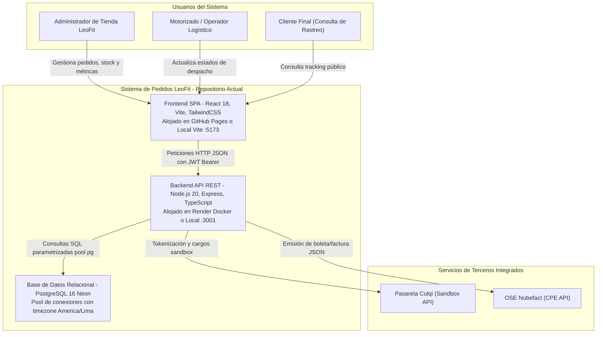
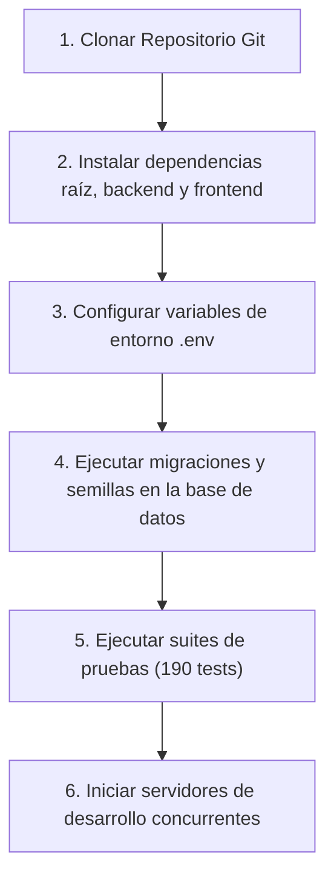

# Arquitectura del Repositorio, Estándares de Ingeniería y Guía de Incorporación

- **Código:** DOC-ARCH-001
- **Versión:** 1.0.0
- **Fecha:** 2026-11-06
- **Autores:** Equipo de Arquitectura e Ingeniería LeoFit
- **Contexto:** LeoFit - Sistema de Gestión de Pedidos y Despacho Multicanal (UTP Proyecto Final - Semana 18)

---

## 1. Diagrama C4 del Repositorio Actual (Nivel Contexto y Contenedor)

A diferencia de la arquitectura objetivo en la nube (ADR-002), este diagrama describe con fidelidad la topología real que se ejecuta hoy en el repositorio y en los servidores de validación:



---

## 2. Auditoría de Estructura de Directorios y Responsabilidades

El repositorio adopta una estructura modular desacoplada basada en principios de **Clean Architecture** y separación por capas:

| Carpeta / Módulo | Responsabilidad Principal | ¿Cumple Estándar? | Observaciones Técnicas y Evidencia |
| :--- | :--- | :--- | :--- |
| `backend/src/controllers/` | Manejo de peticiones HTTP, validación de entrada con Zod y serialización de respuestas. | Sí | Controladores delgados que delegan en servicios (`order.controller.ts`, `auth.controller.ts`). |
| `backend/src/services/` | Lógica de negocio pura, cálculo de promociones, despacho y llamadas a terceros. | Sí | Desacoplamiento de pasarelas (`culqi.ts:57`) y facturación (`nubefact.service.ts:1-295`). |
| `backend/src/routes/` | Declaración de endpoints REST y aplicación de middlewares de autenticación y rate limit. | Sí | Enrutamiento semántico (`/api/orders`, `/api/inventory`, `/api/auth`). |
| `backend/src/middlewares/` | Interceptores de seguridad, validación de tokens JWT y control de errores centralizado. | Sí | `auth.ts` implementa control de roles (`admin`, `operator`); `rateLimiter.ts` previene abusos. |
| `backend/src/migrations/` | Definición versionable del esquema relacional DDL en TypeScript. | Sí | 11 migraciones secuenciales ejecutadas con scripts reproducibles (`backend/src/migrations/`). |
| `backend/src/config/` | Carga de variables de entorno y configuración del pool de conexiones. | Sí | `database.ts:16-55` con pool de conexiones y configuración explícita de timezone de Lima. |
| `backend/tests/` | Pruebas unitarias y de integración del backend. | Sí | 121 tests ejecutados con Jest y Supertest (100% aprobados). |
| `frontend/src/pages/` | Vistas principales de la aplicación SPA (Dashboard, Nuevo Pedido, Rastreo, Stock). | Sí | Diseñadas para interfaces responsivas desktop y mobile. |
| `frontend/src/components/` | Componentes visuales reutilizables (tablas, modales, formularios, métricas). | Sí | Cumple principio de responsabilidad única en UI. |
| `frontend/src/services/` | Clientes HTTP de consumo de API backend (`api.ts`). | Sí | Centraliza cabeceras de autorización y manejo de errores de red. |
| `frontend/src/tests/` | Pruebas de renderizado y lógica de interfaz. | Sí | 69 tests ejecutados con Vitest (100% aprobados). |
| `docs/` | Documentación técnica, anexos de sustentación, diagramas y auditorías. | Sí | Organizado por entregables y anexos formales de arquitectura. |

---

## 3. Estándares de Ingeniería Adoptados

El proyecto LeoFit se fundamenta en los siguientes estándares de la industria del software:

1. **C4 Model (Context, Containers, Components, Code):** Diseñado por Simon Brown [1]. Permite visualizar la arquitectura en diferentes niveles de zoom evitando diagramas ambiguos.
2. **arc42 Architectural Template:** Estructura de documentación técnica reconocida internacionalmente para registrar contexto, metas de calidad y restricciones [2].
3. **MADR (Markdown Architectural Decision Records):** Estándar abierto para documentar decisiones técnicas clave (ADR-001 y ADR-002) de forma versionable junto al código [3].
4. **Clean Architecture / N-Tier Architecture:** Aislamiento estricto entre el motor de base de datos, los controladores HTTP y las reglas de negocio de despacho e inventario.
5. **Conventional Commits 1.0.0:** Convención semántica para mensajes de control de versiones (`feat:`, `fix:`, `docs:`, `test:`, `refactor:`) [4].
6. **Semantic Versioning 2.0.0 (SemVer):** Esquema `MAJOR.MINOR.PATCH` para la evolución del sistema [5].

---

## 4. Guía de Incorporación para Desarrolladores (Onboarding < 1 Día)

Un nuevo desarrollador puede clonar el proyecto y tener el entorno completo operativo en menos de 15 minutos siguiendo esta lista de pasos verificables:



### Comandos de Ejecución Verificables:

```bash
# 1. Clonar e ingresar al directorio
git clone https://github.com/Leofit-Solutions-Grupo01/leofit-pedidos-sistema.git
cd leofit-pedidos-sistema

# 2. Instalar dependencias en backend y frontend
cd backend && npm install
cd ../frontend && npm install
cd ..

# 3. Configurar variables de entorno desde plantillas
cp backend/.env.example backend/.env
# (Configurar DATABASE_URL de Neon o PostgreSQL local en backend/.env)

# 4. Ejecutar migraciones del esquema relacional
cd backend && npm run db:migrate && cd ..

# 5. Ejecutar suite de pruebas completa (121 backend + 69 frontend)
cd backend && npm test
cd ../frontend && npm test
cd ..

# 6. Iniciar servidores de desarrollo concurrentes
# Terminal 1: Backend API (:3001)
cd backend && npm run dev
# Terminal 2: Frontend PWA (:5173)
cd frontend && npm run dev
```

---

## 5. Auditoría del README.md Raíz y Plan de Mejora

La auditoría técnica identificó las siguientes oportunidades de mejora en el `README.md` principal:

| Componente | Estado Previo | Acción de Mejora Implementada |
| :--- | :--- | :--- |
| **Instrucciones de Instalación** | Presentes de forma básica. | Se estandarizan comandos unificados desde la raíz con `npm run dev`. |
| **Documentación de `.env.example`** | Existente en backend. | Se referencia de forma explícita en el README raíz con explicación de flags. |
| **Diagrama de Arquitectura** | Parcial. | Se enlaza el índice de anexos técnicos (`docs/01_PROYECTO_FINAL_SEMANA_18/01_ANEXOS_TECNICOS/`). |
| **Evidencia de Pruebas Unitarias** | Mencionado como texto. | Se consolida la métrica oficial: 190 tests (121 backend + 69 frontend) 100% aprobados. |
| **Enlaces de Despliegue en Vivo** | Dispersos en subcarpetas. | Se consolidan los enlaces de Render API y GitHub Pages en el encabezado del README. |

---

## 6. Fuentes y Referencias Técnicas

1. Brown, Simon, "The C4 Model for Visualising Software Architecture", [https://c4model.com/](https://c4model.com/), consultado en noviembre de 2026.
2. Starke, Gernot y Peter Hruschka, "arc42: Template for Architecture Documentation", [https://arc42.org/](https://arc42.org/), consultado en noviembre de 2026.
3. MADR Project, "Markdown Any Decision Record", [https://adr.github.io/madr/](https://adr.github.io/madr/), consultado en noviembre de 2026.
4. Conventional Commits Specification, "A specification for adding human and machine readable meaning to commit messages", [https://www.conventionalcommits.org/en/v1.0.0/](https://www.conventionalcommits.org/en/v1.0.0/), consultado en noviembre de 2026.
5. Preston-Werner, Tom, "Semantic Versioning 2.0.0", [https://semver.org/](https://semver.org/), consultado en noviembre de 2026.
