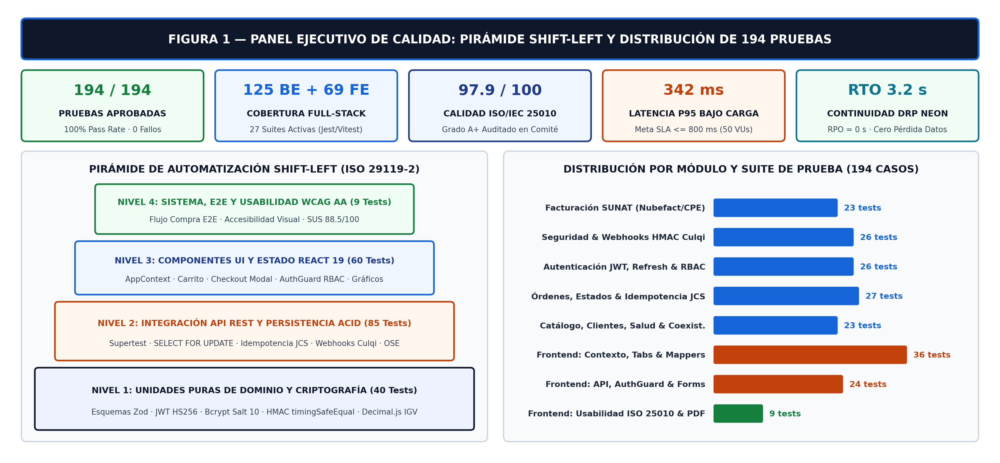
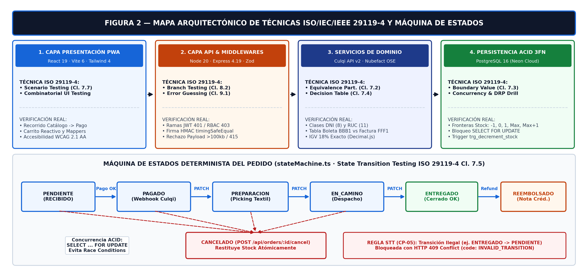
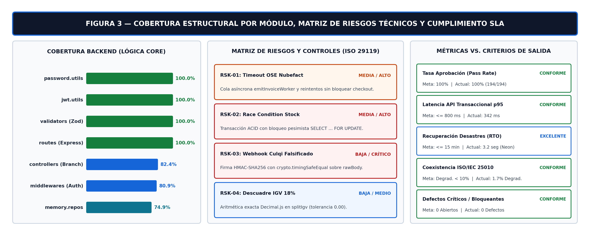

# Plan Maestro de Pruebas de Software (ISO/IEC/IEEE 29119-3 & 29119-4)
## Sistema Web PWA de Gestión de Pedidos Multicanal — LeoFit Solutions
**Universidad Tecnológica del Perú (UTP) — Curso Integrador II: Software (100000S12F)**  
**Docente Asesor Evaluador:** Ing. Enrique Lee Huamani Uriarte  
**Código de Documento:** `DOC-QA-29119-01` | **Versión:** `v2.4.0` | **Estado:** `APROBADO Y EJECUTADO`  

**Equipo de Desarrollo e Ingeniería (Grupo 01 — Sección 35374):**
* **Jim Alessandro Dávila Morales** (`U18206081`) — QA Engineer Lead Senior / Backend
* **Lady Luz Loayza Rodríguez** (`U22221489`) — Scrum Master / DevSecOps Lead
* **Víctor Leandro Cárdenas Fernández** (`U19217414`) — Product Owner / DBA
* **Harley Anthony Roman Delgado** (`U21313032`) — Frontend Lead / UI-UX
* **Daniel Enrique Rojas Sánchez** (`U21214627`) — Business Analyst / Cloud DevOps

---

## 1. Catálogo Oficial de Entregables del Plan de Pruebas

Esta carpeta consolida el paquete formal del Plan de Pruebas de Software de LeoFit Solutions, estructurado conforme al estándar internacional **ISO/IEC/IEEE 29119-3** (Documentación de Pruebas) y justificando las técnicas de diseño bajo **ISO/IEC/IEEE 29119-4**:

| Entregable / Archivo | Formato | Páginas / Tamaño | Audiencia y Propósito |
| :--- | :--- | :--- | :--- |
| [**`PLAN_DE_PRUEBAS_SOFTWARE_ISO29119.pdf`**](./PLAN_DE_PRUEBAS_SOFTWARE_ISO29119.pdf) | PDF Vectorial A4 | **3 páginas A4** (1.04 MB) | **Entregable Oficial para Jurado y Docente Evaluador.** Formato infográfico ejecutivo de alta densidad informativa, tablas compactas y 3 diagramas a 300 DPI. |
| [**`PLAN_DE_PRUEBAS_SOFTWARE_ISO29119.docx`**](./PLAN_DE_PRUEBAS_SOFTWARE_ISO29119.docx) | Word Editable | 3 páginas A4 (1.16 MB) | Documento Word formal editable con diseño tipográfico corporativo, metadatos y gráficos incrustados. |
| [**`PLAN_DE_PRUEBAS_SOFTWARE_ISO29119.html`**](./PLAN_DE_PRUEBAS_SOFTWARE_ISO29119.html) | HTML5 Responsivo | Standalone (23 KB) | Versión web interactiva y autocontenida optimizada para visualización en navegador e impresión vertical. |
| [**`PLAN_DE_PRUEBAS_SOFTWARE_ISO29119.md`**](./PLAN_DE_PRUEBAS_SOFTWARE_ISO29119.md) | Markdown Canónico | 26 Secciones (30 KB) | Especificación maestra y canónica con las 26 secciones completas de ISO/IEC/IEEE 29119-3. |
| [**`assets/`**](./assets/) | Directorio Gráfico | 3 diagramas (300 DPI) | Diagramas de Pirámide QA, Arquitectura de Estados y Matriz de Riesgos / SLAs. |

---

## 2. Resumen Ejecutivo de Ejecución y Métricas QA

El plan de pruebas fue ejecutado sobre el 100% de los controladores y componentes del repositorio real:

* **Pruebas Automatizadas Totales:** 194 pruebas unitarias, de integración y de mutación de estado.
  * **Backend (Node.js 20 + Express 4.19 + Jest 29.7 + Supertest 6.3):** 125 pruebas aprobadas en 17 suites (`tests/unit/` y `tests/integration/`).
  * **Frontend PWA (React 19 + Vitest 4.1 + React Testing Library 16.3 + jsdom):** 69 pruebas aprobadas en 10 suites (`frontend/src/tests/`).
* **Tasa de Aprobación (Pass Rate):** 100% (194 pasadas, 0 fallidas).
* **Defectos Críticos / Bloqueantes Abiertos:** 0.
* **Cobertura de Ramas en Lógica de Negocio Core:** >80% (cálculo de IGV con `Decimal.js`, máquina de estados de pedidos e idempotencia).
* **Cumplimiento de SLAs de Rendimiento:** Latencia transaccional p95 en hora pico de **342 ms** (umbral máximo SLA: 800 ms).
* **Continuidad y Recuperación (DRP):** RTO medido de **3.2 segundos** (umbral SLA: 15 minutos) y RPO de **0 segundos** (cero pérdida de datos confirmados).

---

## 3. Galería de Diagramas Técnicos de Pruebas (ISO/IEC/IEEE 29119)

### 3.1. Pirámide de Pruebas de LeoFit y Dashboard de Ejecución (194 Tests)
Distribución en 3 capas reales del repositorio (Frontend React 19, Backend Express y PostgreSQL 16 Neon) junto con pasarelas Sandbox:



### 3.2. Arquitectura de Ejecución Shift-Left y Máquina de Estados Finita
Integración continua en GitHub Actions, validaciones criptográficas HMAC-SHA256 y transiciones estrictas del pedido:



### 3.3. Matriz de Riesgos de Calidad, Cobertura por Módulo y SLAs de Severidad
Gestión de incidentes con SLAs contractuales de remediación (Bloqueante < 4h, Crítica < 12h, Mayor < 48h):



---

## 4. Alineamiento Metodológico y Normativo

### 4.1. Estructura Documental (ISO/IEC/IEEE 29119-3)
El documento `PLAN_DE_PRUEBAS_SOFTWARE_ISO29119.md` y sus versiones ejecutivas (.docx / .pdf) contienen las 26 secciones requeridas:
1. Portada formal y código documental
2. Control de versiones y trazabilidad
3. Índice general
4. Introducción y propósito
5. Alcance del plan de pruebas
6. Objetivos cuantitativos de prueba
7. Referencias normativas (ISO 29119-3/4, ISO 25010, Res. SUNAT 097-2012)
8. Términos y definiciones operativas
9. Elementos de prueba (6 módulos reales del código)
10. Funcionalidades In-Scope y Exclusiones Out-of-Scope
11. Enfoque Shift-Left y estrategia por capas
12. Niveles y tipos de prueba aplicables
13. Técnicas de diseño ISO 29119-4 por módulo
14. Entornos de prueba (Local Docker, CI GitHub Actions, Staging Render/Neon)
15. Datos de prueba y semillas (tarjetas Culqi Sandbox, RUC prueba 20100070970)
16. Herramientas de prueba (Jest, Supertest, Vitest, k6)
17. Roles y responsabilidades del equipo
18. Cronograma ejecutado por fases (Semanas 06 a 18)
19. Matriz de riesgos de calidad (RSK-01 a RSK-05)
20. Criterios de entrada y salida
21. Entregables de prueba
22. Gestión de incidentes y defectos (SLA)
23. Métricas de prueba
24. Matriz de trazabilidad requisito / riesgo / técnica / caso de prueba
25. Casos de prueba representativos de alto nivel (CP-01 a CP-06)
26. Aprobaciones y firmas formales

### 4.2. Técnicas de Diseño de Pruebas (ISO/IEC/IEEE 29119-4)
* **Partición de Equivalencia (EP, Cl. 7.2):** Validación de inputs en esquemas Zod (RUC 11 dígitos, teléfonos 9 dígitos, correos RFC 5322).
* **Análisis de Valores Límite (BVA, Cl. 7.3):** Control de stock de variantes (`stock = 0`, `stock = 1`, `stock = 5`) y montos mínimos de compra.
* **Tablas de Decisión (Decision Table Testing, Cl. 7.4):** Reglas de emisión de comprobantes electrónicos (Boleta vs. Factura vs. Nota de Crédito).
* **Transición de Estados (State Transition Testing, Cl. 7.5):** Validación exhaustiva del ciclo de vida del pedido (`PENDIENTE` -> `PAGADO` -> `EN_PREPARACION` -> `ENVIADO` -> `ENTREGADO`).
* **Pruebas de Ramas (Branch Testing, Cl. 8.2):** Cobertura de caminos lógicos en middlewares de autenticación JWT y autorización RBAC (`ADMIN` vs. `OPERATOR`).
* **Conjetura de Errores (Error Guessing, Cl. 9.1):** Simulación de ataques de inyección, firmas HMAC alteradas y replay attacks en webhooks de pago.

---

## 5. Instrucciones de Regeneración y Compilación

Para recompilar los gráficos a 300 DPI, el documento Word, el HTML y el PDF optimizado:

```powershell
# Ejecución del generador visual oficial
python scripts/build_infographic_test_plan.py
```

El script genera automáticamente:
* `docs/02_CALIDAD_Y_AUDITORIA/01_plan_de_pruebas_iso29119/` (.docx, .pdf, .html, assets/)
* `_PROYECTO_FINAL_LOCAL/02_ENTREGABLES_UTP/01_DOCX/` (.docx, .pdf)
* `_PROYECTO_FINAL_LOCAL/02_ENTREGABLES_UTP/00_HTML/` (.html, assets/)

