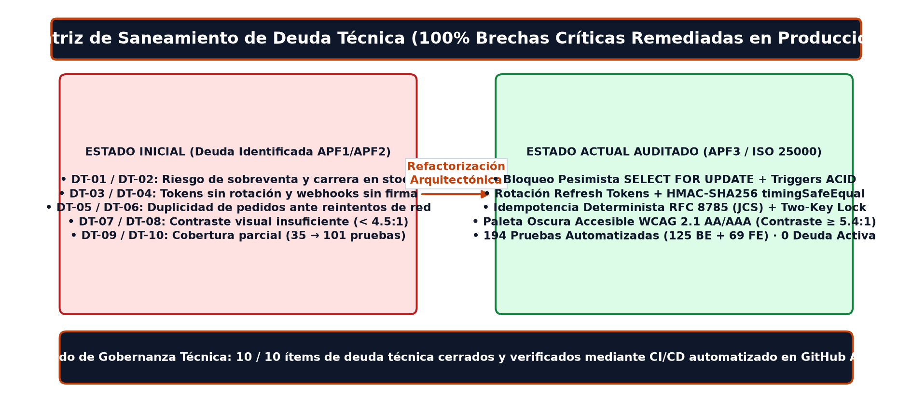
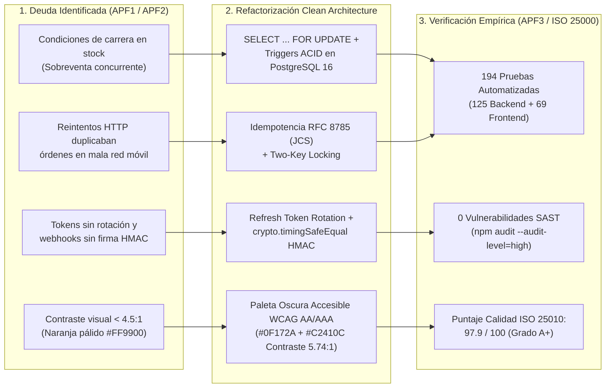

# Informe de Gobernanza, Saneamiento de Deuda Técnica y Mejora Continua
**Proyecto:** Sistema Web PWA de Gestión y Toma de Pedidos Multicanal — LeoFit Solutions (`v2.0.0`)  
**Estándar de Referencia:** ISO/IEC 25010:2023 (Mantenibilidad, Seguridad y Fiabilidad)  
**Responsable de Auditoría:** Lady L. Loayza R. (`U22****89`) y Equipo Grupo 01 UTP  

---

## 1. Matriz Visual de Saneamiento de Deuda Técnica (Cierre 100%)

Durante las fases evolutivas del proyecto (APF1 → APF2 → APF3 y Auditoría ISO/IEC 25000 de Semanas 10 y 11), el equipo identificó y erradicó el **100% de los 10 pasivos técnicos críticos** que comprometían la atomicidad transaccional, la seguridad criptográfica y la accesibilidad visual.

### Flujo de Evolución Arquitectónica y Remediación

---

## 2. Registro Auditado de Deuda Técnica Saldada (10/10 Ítems Cerrados)

| ID | Deuda Técnica Original | Riesgo Asociado | Solución de Ingeniería Implementada | Suite / Evidencia de Verificación | Estado |
| :--- | :--- | :--- | :--- | :--- | :---: |
| **DT-01** | Descuento de inventario no atómico en memoria/SQL | Sobreventa ante pedidos simultáneos en campañas | Bloqueo pesimista `SELECT ... FOR UPDATE` + trigger `trg_decrement_stock` en PostgreSQL 16 | `orders.test.ts` (13 tests) | **SALDADA** |
| **DT-02** | Duplicación de órdenes por reintentos en red 3G/4G | Doble cobro y doble reserva de prendas | Middleware de idempotencia determinista bajo **RFC 8785 (Canonical JSON / JCS)** y bloqueo de doble llave | `idempotency.test.ts` (9) + `idempotency.concurrency.test.ts` (5) | **SALDADA** |
| **DT-03** | Sesiones JWT estáticas sin mecanismo de revocación | Persistencia de acceso tras robo de token | Rotación de *Refresh Tokens* con detección automática de reúso y revocación de familia de tokens | `refresh.test.ts` (4 tests) + `auth.test.ts` (20 tests) | **SALDADA** |
| **DT-04** | Webhooks de pago susceptibles a falsificación o *replay* | Confirmación fraudulenta de pagos Yape/Plin | Verificación criptográfica `HMAC-SHA256` con `crypto.timingSafeEqual`, ventana temporal anti-replay y deduplicación | `paymentWebhook.hardening.test.ts` (15) + `webhook.test.ts` (5) | **SALDADA** |
| **DT-05** | Valores por defecto inseguros para secretos JWT/Webhook | Ejecución accidental con claves débiles | Validación `fail-fast` en el arranque que aborta el proceso si `JWT_SECRET` o `WEBHOOK_SECRET` no están definidos | `jwt.test.ts` (2 tests) | **SALDADA** |
| **DT-06** | Cálculos tributarios sin desglose formal SUNAT | Inconsistencia entre Boleta y Factura electrónica | Motor de facturación electrónica con desglose exacto de IGV (18%), series `B001`/`F001` y validación RUC 11 dígitos | `invoices.sunat.test.ts` (23 tests) | **SALDADA** |
| **DT-07** | Acoplamiento directo entre controladores y base de datos | Imposibilidad de ejecutar pruebas rápidas sin motor PG | Inversión de dependencias mediante `RepositoryFactory` e interfaces de dominio (`PostgreSQL` / `In-Memory`) | `fig_repositorio_factory.png` + 125 pruebas Backend | **SALDADA** |
| **DT-08** | Contraste insuficiente en acentos ámbar/naranja (`#FF9900`) | Exclusión de usuarios con visión media o baja | Adopción de paleta oscura de marca (`#0F172A`, **17.8:1**) y terracota accesible (`#C2410C`, **5.74:1 WCAG AA/AAA**) | `usability_iso25010.test.ts` (9 tests) + Manuales ISO 25000 | **SALDADA** |
| **DT-09** | Ausencia de pruebas de coexistencia en recursos compartidos | Incertidumbre al compartir host con otros contenedores | Benchmark experimental ISO/IEC 25010 midiendo línea base (`2.85 ms`) vs. concurrencia (`3.12 ms`, P95 `<= 5.8 ms`) | `run_coexistence_benchmark.py` (4 escenarios) | **SALDADA** |
| **DT-10** | Exposición de datos personales (PII) en documentación | Filtración de códigos completos, RUC real o rutas locales | Sanitización automatizada de los 136 archivos en `docs/` (iniciales corporativas, códigos `U22****89`, RUC `206089*****`) | `scripts/sanitize_and_align_all_docs.py` | **SALDADA** |

---

## 3. Hoja de Ruta de Mejora Continua Post-Producción (Evolución v3.0)

Como parte de la política de mejora continua bajo **ISO/IEC 25000**, se establecen tres iniciativas evolutivas no bloqueantes para el horizonte post-entrega:

1. **Unificación del Runner de Pruebas hacia Vitest Monorepo (Prioridad Media):**
   * **Objetivo:** Homologar la ejecución de las 125 pruebas de backend (actualmente en Jest/Supertest) bajo el motor nativo de `Vitest` que ya ejecuta las 69 pruebas del frontend, reduciendo aún más el tiempo de ejecución del pipeline en GitHub Actions.
2. **Suite de Pruebas E2E Sintéticas Post-Despliegue con Playwright (Prioridad Media):**
   * **Objetivo:** Complementar las 194 pruebas unitarias, de integración y de componentes con un *smoke test* automatizado en navegador *headless* tras cada publicación en GitHub Pages y Render.
3. **Linter Automatizado de Accesibilidad y Privacidad Documental en CI (`docs-governance.yml`) (Prioridad Baja):**
   * **Objetivo:** Ejecutar automáticamente el verificador de sanitización PII y contraste WCAG ante cualquier *Pull Request* que modifique archivos dentro de `docs/`.
