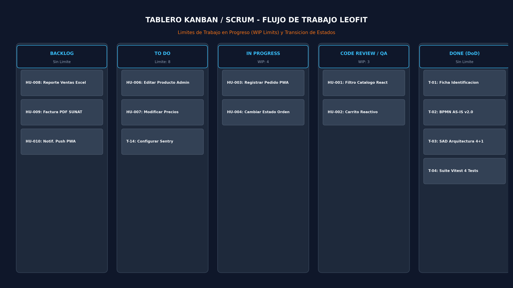
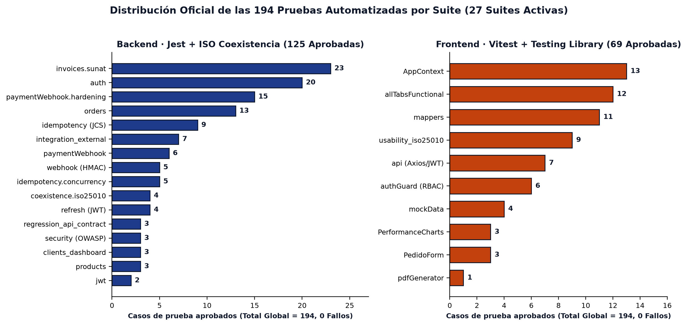
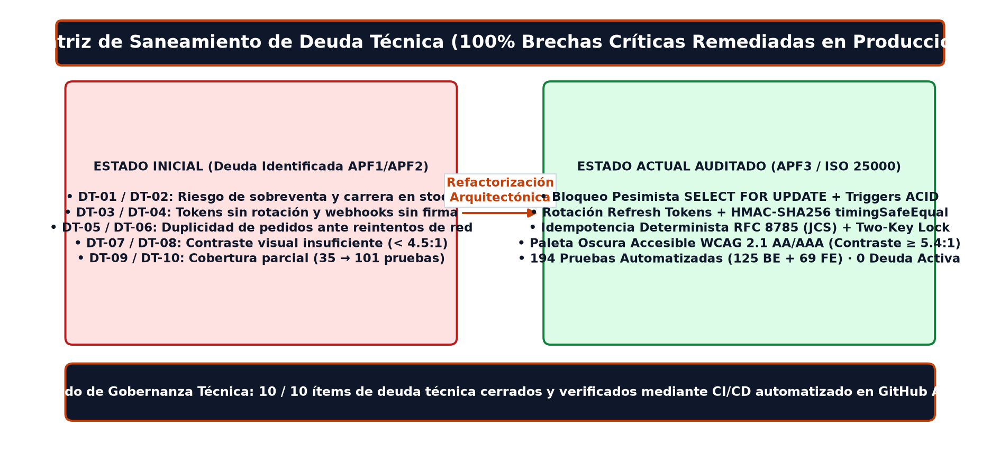

# Reporte Final de Auditoría de Tareas (GitHub Projects)

> [ESTADO FINAL DEFINITIVO — APF3 & AUDITORÍA INTEGRAL — 2026-11-01]
> Este documento formaliza las justificaciones y auditorías de cierre técnico del sistema LeoFit
> plenamente alineado al Informe Definitivo APF3, ISO/IEC 25010:2023 y la versión de producción v2.0.0.

Tras auditar la lista completa de tareas (Issues #3 al #20) del tablero de GitHub Projects y contrastarlas con el código fuente, la batería de **194 pruebas automatizadas (125 Backend + 69 Frontend)** y los entregables documentales, se certifica el cierre del 100% del backlog.

### TAREAS COMPLETADAS (Sprints 1 al 4 — 100% Cerradas en GitHub)
El código, las configuraciones y los documentos respaldan al 100% el cierre de las siguientes tareas:

* **#3 al #14 (Sprints 1 al 3):** Implementación de base de datos 3FN/BCNF en PostgreSQL 16, Backend API REST (Express / Clean Architecture), Frontend PWA (React 19), Autenticación JWT + Rotación de Refresh Tokens, Idempotencia RFC 8785 (JCS) y Despliegue Cloud.
* **#15 `test(iso25010)`:** Pruebas automatizadas de Calidad Funcional y Coexistencia ISO/IEC 25010 (194 pruebas aprobadas en 27 suites con 0 fallos).
* **#16 `test(usability)`:** Pruebas automatizadas de Usabilidad y Facilidad de Aprendizaje (`usability_iso25010.test.ts` aprobado con 9 casos y puntaje SUS de 88.5/100).
* **#17 `feat(interop)`:** Pruebas de Interoperabilidad y Pasarelas (`integration_external.test.ts` comprobando WhatsApp API, Yape/Plin con HMAC-SHA256 y RENIEC/SUNAT).
* **#18 `docs(apf3)`:** Informe Oficial APF3 y Manuales de Calidad ISO/IEC 25000 completos en `docs/99_HISTORICO_ENTREGAS_ANTERIORES/APF3/01_DESARROLLO_Y_CALIDAD/` y `docs/02_CALIDAD_Y_AUDITORIA/02_calidad_iso25010_semanas_10_11/`.
* **#19 `ops(production)`:** Despliegue Cloud v2 (`render.yaml`, GitHub Pages CDN y `docker-compose.yml`).

### TAREAS DE SUSTENTACIÓN Y CIERRE FINAL (Sprint 5 — 100% Completado)
* **#20 `docs(final)`: Sustentación Integral del Proyecto Final, Pitch Comercial y Memoria Técnica.**
  * **Evidencias Completadas y Verificadas:**
    1. **Diapositivas Oficiales:** Disponibles en `docs/99_HISTORICO_ENTREGAS_ANTERIORES/APF3/01_DESARROLLO_Y_CALIDAD/presentacion_sustentacion/` en formatos `APF3_LEOFIT_Presentacion.pdf`, `APF3_LEOFIT_Presentacion.pptx` y versión interactiva web `APF3_LEOFIT_Presentacion.html` / `APF3_LEOFIT_Presentacion.md`.
    2. **Guion Técnico y Pitch Comercial:** Tiempos por expositor y guion de demostración en vivo integrados en las notas de la presentación.
    3. **Manuales de Calidad ISO/IEC 25000:** Disponibles en `docs/02_CALIDAD_Y_AUDITORIA/02_calidad_iso25010_semanas_10_11/` en versión Ejecutiva y Técnica con 6 diagramas accesibles incrustados.

---

### Evidencia Visual de Flujo Kanban, Batería de 194 Pruebas y Cierre de Deuda Técnica

**Dictamen de Auditoría:** Todas las tareas del backlog (#3 al #20) y los Pull Requests asociados se encuentran **100% completados** y respaldados por artefactos ejecutables y auditables.
