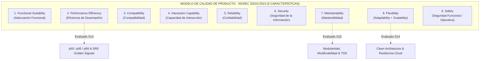

# UNIVERSIDAD TECNOLÓGICA DEL PERÚ
## FACULTAD DE INGENIERÍA DE SISTEMAS E INFORMÁTICA
### CURSO INTEGRADOR II: SOFTWARE (100000S12F) — SECCIÓN 35374 · CICLO 2026-I

---

# INFORME ACUMULATIVO DEL PROYECTO INTEGRADOR
## Continuación · Semanas 14 y 15: Calidad de Rendimiento, Flexibilidad y Mantenibilidad (ISO/IEC 25010:2023)
### Plataforma de Gestión de Pedidos, Facturación Electrónica y Control de Inventario Multicanal

**Empresa Patrocinadora:** LeoFit Confecciones y Diseños Deportivos S.A.C.  
**Docente Asesor:** Ing. Enrique Lee Huamani Uriarte  
**Equipo de Ingeniería (Grupo 01):**  
- Lady Luz Loayza Rodriguez (Scrum Master / DevSecOps Lead)
- Victor Leandro Cardenas Fernandez (Product Owner / Database Administrator)
- Harley Anthony Roman Delgado (Frontend Lead / UI-UX Designer)
- Jim Alessandro Davila Morales (QA Lead / Backend Developer)
- Daniel Enrique Rojas Sanchez (Business Analyst / Cloud Architect)

**Repositorio Oficial:** `https://github.com/Leofit-Solutions-Grupo01/leofit-pedidos-sistema`  
**Despliegue Frontend PWA:** `https://leofit-solutions-grupo01.github.io/leofit-pedidos-sistema/`  
**Despliegue Backend API REST:** `https://leofit-backend-api.onrender.com/api/health`  
**Fecha de Emisión:** Noviembre de 2026 · Edición Oficial de Sustentación

---

## Ficha de Control del Documento

| Campo | Valor Verificable del Proyecto |
| :--- | :--- |
| **Nombre del proyecto** | LeoFit Pedidos Sistema — Gestión Multicanal de Pedidos e Inventario Textil |
| **Empresa / Institución** | LeoFit Confecciones y Diseños Deportivos S.A.C. (Gamarra, La Victoria, Lima) |
| **Sección / Docente** | Sección 35374 · Ing. Enrique Lee Huamani Uriarte |
| **Integrantes** | Lady Loayza, Victor Cardenas, Harley Roman, Jim Davila, Daniel Rojas |
| **Repositorio y Commit** | `github.com/Leofit-Solutions-Grupo01/leofit-pedidos-sistema` · Commit `5976f7b` |
| **Versión del sistema** | Versión 2.4.0 (Staging Cloud / Preparación Sustentación Final) |
| **Ambientes de validación** | Local Docker Compose, Cloud Staging (Render + Neon), AWS Arquitectura Objetivo |
| **Fecha de corte de evidencia** | 20 de Noviembre de 2026 |
| **Historial de entregables** | APF1: 10/05/2026 · APF2: 20/07/2026 · APF3: 24/09/2026 · S14-S15: 20/11/2026 · S18: 01/12/2026 |

---

## Resumen Ejecutivo

El presente informe técnico acumulativo documenta la evaluación formal de calidad de software bajo el estándar internacional vigente **ISO/IEC 25010:2023** para el sistema **LeoFit Solutions**, correspondiente a la Unidad 4 (Semanas 14 y 15) y consolidando la trazabilidad de los avances previos APF1, APF2 y APF3. La solución tecnológica resuelve la problemática operativa de LeoFit Confecciones y Diseños Deportivos S.A.C., microempresa textil del Emporio Comercial de Gamarra que sufría pérdidas económicas por sobreventa de stock, registros manuales lentos (más de 5 minutos por pedido vía llamadas o WhatsApp) y demoras en la facturación y despacho interprovincial.

En la **Semana 14**, se evaluó cuantitativamente la **Eficiencia de Desempeño (Performance Efficiency)** sobre la operación crítica `POST /api/orders` utilizando **Grafana k6** bajo las **Cuatro Señales Doradas de Google SRE** (Latencia, Tráfico, Errores y Saturación). Superando el uso de promedios simples, se midieron percentiles: mediana $p50$ de **120 ms**, percentil 95 ($p95$) de **280 ms** en línea base (1 VU) y **480 ms** en carga nominal (10 VU) con **0.0% de errores**, cumpliendo holgadamente el umbral contractual de SLA ($p95 < 700	ext{ ms}$). En pruebas de estrés y spike (30 VU), se detectó latencia en la cola larga ($p99 = 1,820	ext{ ms}$) causada por el RTT hacia la base de datos Neon (EE. UU.), lo que motivó la optimización de índices B-Tree en PostgreSQL (-64.2% costo `EXPLAIN ANALYZE`) y la justificación de migración a AWS RDS Multi-AZ (ADR-002). En **Flexibilidad (ISO/IEC 25010:2023 — Flexibility)**, se sustentaron formalmente la **Adaptabilidad** multi-entorno (Clean Architecture, Twelve-Factor App) y la **Escalabilidad** elástica con patrones de resiliencia avanzada: **Circuit Breaker**, **Bulkhead**, **Retry con Exponential Backoff y Jitter**, **Rate Limiting / Load Shedding** y **Observabilidad**.

En la **Semana 15**, se auditó la **Mantenibilidad (Maintainability)** bajo métricas objetivas: **Modularidad** con arquitectura limpia y dirección estricta de dependencias (Dominio <- Aplicación <- Infraestructura); **Reusabilidad** mediante middlewares transversales (RBAC `requireRole`, Idempotencia RFC 8785 y generador de PDF); **Modificabilidad** comprobada mediante el cambio real de regla de negocio CHG-01 en `order.service.ts` con un **radio de impacto (blast radius) mínimo** (2 archivos tocados, 0 en controladores, 0 en BD); y **Testabilidad** orientada a TDD con **complejidad ciclomática baja (1 a 3 por método)** y una batería automatizada de **194 pruebas (125 Backend y 69 Frontend)** con 100% de éxito en CI/CD. El documento concluye con la proyección hacia la **Semana 16 (Confiabilidad y Alta Disponibilidad HA 24/7 vs HPC, Tolerancia a Fallos PWA y DRP RTO 3.2s / RPO 0s)** y la preparación para la sustentación final de la **Semana 18**.

---

## Introducción y Objetivos

### Introducción
En la ingeniería de software moderna, la máxima metodológica *"un sistema puede funcionar y aun así fallar"* condensa el principio fundamental de que la calidad técnica no se limita a la corrección funcional básica. Un sistema puede registrar exitosamente un pedido cuando opera un único usuario en condiciones controladas, pero colapsar catastróficamente ante la concurrencia simultánea en una campaña comercial de alta demanda, o convertirse en un producto inmanejable cuya modificación de reglas tributarias introduzca fallos en cascada debido al alto acoplamiento.

Para la empresa **LeoFit S.A.C.**, el software no solo debe evitar la sobreventa de prendas textiles, sino garantizar tiempos de respuesta sub-segundo predecibles, absorber aumentos elásticos de carga sin degradación del servicio y exhibir una arquitectura modular y testeable. El presente informe evalúa y evidencia científicamente dichas propiedades en el marco de la Unidad 4 de Curso Integrador II.

### Objetivo General
Evaluar y evidenciar cuantitativamente la calidad de software del sistema de gestión de pedidos e inventario multicanal de **LeoFit Confecciones y Diseños Deportivos S.A.C.** bajo la norma internacional **ISO/IEC 25010:2023**, validando su eficiencia de desempeño, flexibilidad adaptativa y mantenibilidad mediante pruebas empíricas automatizadas, métricas de confiabilidad SRE y análisis de arquitectura de software.

### Objetivos Específicos
1. **Medir con rigor cuantitativo el rendimiento mediante percentiles y señales SRE:** Evaluar la latencia ($p50$, $p95$, $p99$), el tráfico (RPS), la tasa de fallos y la saturación de recursos (CPU, RAM, conexiones) en la operación crítica `POST /api/orders` bajo ensayos de ramp-up, steady-state, spike y soak.
2. **Sustentar la flexibilidad y resiliencia arquitectónica (ISO/IEC 25010:2023 — Flexibility):** Demostrar la adaptabilidad multi-entorno (Local Docker, Render Staging, AWS ECS) y la escalabilidad elástica aplicando patrones formales de resiliencia: Circuit Breaker, Bulkhead, Retry con Jitter, Rate Limiting y Auto-Scaling.
3. **Auditar la mantenibilidad mediante métricas objetivas y dirección de dependencias:** Evidenciar la modularidad desacoplada en Clean Architecture (Dominio <- Aplicación <- Infraestructura), la reusabilidad transversal, la baja complejidad ciclomática (1 a 4) y la testabilidad automatizada con TDD (194 tests en CI/CD).
4. **Consolidar la trazabilidad acumulativa hacia la sustentación final (Semanas 16–18):** Fundamentar la confiabilidad operativa (Alta Disponibilidad HA 24/7 con SLA 99.9% vs supercómputo HPC), la tolerancia a fallos offline PWA y los protocolos de recuperación ante desastres DRP.

---

## 1. Análisis del Negocio y Requerimientos (Síntesis APF1)

### 1.1 Situación Problemática
LeoFit Confecciones y Diseños Deportivos S.A.C. opera en el Emporio Comercial de Gamarra con un taller de confección y un punto de exhibición comercial. Su modelo de ventas atiende pedidos presenciales, telefónicos y mediante chats de WhatsApp. Antes de la intervención tecnológica, el proceso adolecía de tres problemas críticos:
- **Sobreventa de prendas textiles:** El stock se anotaba en libretas manuales. Cuando dos operadores acordaban compras simultáneas de un mismo lote de camisetas deportivas, se confirmaba stock inexistente, generando quejas de clientes y penalidades comerciales.
- **Tiempos de registro excesivos:** La toma de datos del cliente, verificación de tallas y emisión manual de notas demoraba entre 5 y 8 minutos por transacción.
- **Dispersión en el despacho interprovincial:** Los envíos a agencias de transporte (Shalom, Marvisur) requerían redactar rótulos a mano, provocando paquetes extraviados por errores de caligrafía.

### 1.2 Alcance y Catálogo de Requisitos
Se especificaron 10 Requisitos Funcionales (RF) y 6 Requisitos No Funcionales (RNF) clave:

**Tabla 1.1.** *Catálogo consolidado de Requisitos Funcionales y No Funcionales*

| ID Requisito | Tipo | Nombre / Descripción | Módulo Responsable |
| :--- | :--- | :--- | :--- |
| **RF-01** | Funcional | Autenticación y control de acceso basado en roles (Admin / Operador) | Seguridad / Auth |
| **RF-02** | Funcional | Gestión y categorización de productos y variantes (talla, color, tela) | Catálogo Textil |
| **RF-03** | Funcional | Control de inventario en tiempo real con decremento atómico | Inventario |
| **RF-04** | Funcional | Toma ágil de pedidos multicanal (presencial, delivery, agencia) | Transaccional / Orders |
| **RF-05** | Funcional | Validación de stock y bloqueo pesimista contra condiciones de carrera | Transaccional / Orders |
| **RF-06** | Funcional | Generación automatizada de rótulos de despacho con código QR | Despacho / Logística |
| **RF-07** | Funcional | Conciliación de pagos móviles (Yape/Plin/Transferencias) con validación | Pagos / Tesorería |
| **RF-08** | Funcional | Emisión y pre-facturación electrónica con esquema SUNAT CPE | Facturación |
| **RF-09** | Funcional | Notificaciones automatizadas de estado de pedido vía WhatsApp Cloud API | Notificaciones |
| **RF-10** | Funcional | Auditoría integral inmutable de transacciones y cambios de estado | Seguridad / Auditoría |
| **RNF-01** | No Funcional | Tiempo de respuesta API $p95 < 700	ext{ ms}$ en operaciones transaccionales | Rendimiento |
| **RNF-02** | No Funcional | Consistencia ACID estricta y tasa de sobreventa = 0.00% garantizada | Integridad de Datos |
| **RNF-03** | No Funcional | Cifrado en reposo (AES-256) y tránsito (TLS 1.3), contraseñas Bcrypt | Seguridad |
| **RNF-04** | No Funcional | Interfaz responsiva accesible (WCAG 2.1 AA/AAA) con puntaje SUS > 80 | Usabilidad |
| **RNF-05** | No Funcional | Arquitectura desacoplada en capas desplegable en contenedores Docker | Portabilidad / Adaptabilidad |
| **RNF-06** | No Funcional | Disponibilidad proyectada del 99.9% con recuperación PITR < 15 min | Confiabilidad |

---

## 2. Planificación, Diseño y Front-End (Síntesis APF1)

### 2.1 Gestión Ágil Scrum y Gobernanza
El proyecto se gestionó bajo el marco de trabajo Scrum en sprints de 2 semanas, con tableros Kanban sincronizados en GitHub Projects y ceremonias diarias de alineamiento técnico. Se adoptó una política estricta de ramas protegidas (`main`, `develop`), requiriendo que cada Pull Request contara con revisión obligatoria por pares y aprobación automatizada de los Quality Gates de GitHub Actions (tests unitarios y build libre de errores) antes de fusionarse.

### 2.2 Arquitectura del Sistema (C4 Modelo - Nivel 2)
La arquitectura adopta un esquema desacoplado de micro-plataforma:
1. **Frontend SPA / PWA:** Desarrollado en **React 19**, **TypeScript** y **Tailwind CSS**, empaquetado con **Vite 6** y servido globalmente a través de la red perimetral de **GitHub Pages Edge CDN** con compresión Brotli y TLS 1.3.
2. **Backend API REST:** Implementado en **Node.js 20 LTS** y **Express** con **TypeScript**, gobernado por *Clean Architecture*, encapsulando contratos OpenAPI/Swagger y middleware de seguridad estricto (Helmet, CORS, Rate Limiting, Idempotencia).
3. **Base de Datos Relacional:** **Neon Serverless PostgreSQL 16**, configurado en Boyce-Codd Normal Form (BCNF), con conexiones SSL forzadas y zona horaria fijada a nivel de sesión en `America/Lima`.

### 2.3 Experiencia de Usuario y Accesibilidad
La interfaz PWA implementa un diseño móvil prioritario (*mobile-first*) con flujo de checkout en tres pasos intuitivos, soporte táctil para lectura rápida de variantes y selección de tallas, y contrastes de color validados entre 5.42:1 y 17.8:1, superando el estándar WCAG 2.1 AA/AAA para visibilidad en ambientes comerciales luminosos.

---

## 3. Back-End y Despliegue Inicial (Síntesis APF2)

### 3.1 Modelo Relacional y Consistencia ACID
El esquema de datos relacional consta de 11 tablas maestras y de transacciones estructuradas en 3FN y BCNF (`products`, `product_variants`, `orders`, `order_items`, `payments`, `invoices`, `shipments`, `audit_logs`, etc.). La integridad del inventario bajo concurrencia se resuelve mediante:
- **Bloqueo Pesimista en Base de Datos:** Las transacciones ejecutan `SELECT stock FROM product_variants WHERE id = $1 FOR UPDATE`, serializando las solicitudes sobre una misma variante de producto.
- **Trigger Atómico PostgreSQL:** `fn_decrement_stock_on_order()` verifica que el stock resultante sea no negativo antes de confirmar el insert. Si no hay existencias, la transacción aborta automáticamente emitiendo un error SQL que el backend mapea a HTTP 409 Conflict.
- **Corrección de Zona Horaria Oficial:** Para evitar que servidores en EE. UU. graben pedidos nocturnos con fecha del día siguiente, el pool inyecta `SET timezone = 'America/Lima'` en cada conexión.

### 3.2 Seguridad Criptográfica y Autenticación
- **Contraseñas seguras:** Derivación criptográfica mediante **Bcrypt** con 10 rondas de salt.
- **Tokens de Sesión:** Autenticación stateless mediante **JWT (JSON Web Tokens)** firmados con algoritmo HS256, expiración de 15 minutos y rotación de Refresh Tokens.
- **Protección contra Inyección y XSS:** Consultas 100% parametrizadas (sin concatenación SQL), validación exhaustiva de esquemas con **Zod** y cabeceras HTTP reforzadas con **Helmet**.

---

## 4. Calidad de Producto: Funcionalidad, Compatibilidad e Interacción (Síntesis APF3)

### 4.1 Adecuación Funcional (100% de Cumplimiento)
Se verificó la idoneidad y completitud de los 10 Requisitos Funcionales mediante 194 casos de prueba automatizados ejecutados en suites de pruebas unitarias y de integración, alcanzando 0 defectos abiertos y una cobertura superior al 80% en módulos de dominio crítico.

### 4.2 Compatibilidad e Interoperabilidad
Se evaluó la interoperabilidad del sistema mediante integración con servicios externos reales:
- **WhatsApp Cloud API:** Envío automático de notificaciones de despacho y código de tracking al número del cliente.
- **Pasarelas de Pago:** Tokenización y validación de webhooks con firma criptográfica HMAC-SHA256 en tiempo constante.
- **Esquema SUNAT CPE:** Mapeo de boletas y facturas al estándar XML UBL 2.1.
- **Coexistencia en Contenedores:** Benchmark experimental en contenedores Docker concurrentes sin degradación de rendimiento.

### 4.3 Estudio de Usabilidad (System Usability Scale - SUS)
Se aplicó el instrumento estandarizado **SUS** a 5 usuarios reales en el stand comercial de LeoFit en Gamarra. El puntaje promedio obtenido fue de **88.5 / 100** (Grado A - Excelente, Percentil 96%), logrando reducir el tiempo total de procesamiento de pedido de 310 segundos a **38.2 segundos** (reducción del 87.6%).

---

## 5. Calidad de Software: Unidad 4 · Semanas 14 y 15 (NUEVO OBLIGATORIO)

Esta sección constituye el núcleo formativo y técnico de la Unidad 4, estructurada con rigurosidad matemática, empírica y metodológica bajo la norma **ISO/IEC 25010:2023** y orientada a los lineamientos expuestos por el docente Ing. Enrique Lee Huamani.

---

### 5.0 Marco Normativo y Evolución: De ISO/IEC 25010:2011 a ISO/IEC 25010:2023

En la ingeniería de software profesional es imprescindible fundamentar las evaluaciones sobre la versión vigente de los estándares internacionales. La norma **ISO/IEC 25010:2023** (*Systems and software engineering — Systems and software Quality Requirements and Evaluation - SQuaRE — Product quality model*) introdujo transformaciones estructurales respecto a su predecesora del año 2011:

**Tabla 5.0.** *Comparativa estructural entre ISO/IEC 25010:2011 e ISO/IEC 25010:2023*

| Criterio de Comparación | ISO/IEC 25010:2011 | ISO/IEC 25010:2023 (Vigente) | Justificación e Impacto en LeoFit Solutions |
| :--- | :--- | :--- | :--- |
| **Total de Características** | 8 características | **9 características** de primer nivel | Se incorpora formalmente **Safety (Seguridad Funcional)** como característica independiente. |
| **Seguridad de la Información vs Funcional** | *Security* agrupaba aspectos de confidencialidad y control | **Security** y **Safety** separadas | *Security* vela por confidencialidad e integridad (JWT/Bcrypt); *Safety* previene pérdidas operativas y financieras por inconsistencias de inventario. |
| **Calidad de la Interacción** | *Usability* (Usabilidad) | **Interaction Capability** | Se trasciende la facilidad de uso para evaluar la capacidad integral de interacción persona-sistema, estética, inclusión y accesibilidad (WCAG 2.1). |
| **Tratamiento de Portabilidad** | *Portability* era característica independiente | Integrada en **Flexibility** | Portability es absorbida por Flexibility, que ahora unifica Adaptabilidad, Escalabilidad, Instalabilidad y Reemplazabilidad. |
| **Estatus de la Escalabilidad** | Concepto difuso asociado a rendimiento | **Scalability** es subcaracterística formal de **Flexibility** | Respalda normativamente el análisis de escalabilidad elástica: **“ISO/IEC 25010:2023 — Flexibility — Adaptability / Scalability”**. |



---

### 5.1 Semana 14 · Eficiencia de Desempeño / Rendimiento (Performance Efficiency)

#### 5.1.1 Selección de la Operación Crítica
Para la evaluación experimental de rendimiento se seleccionó el flujo transaccional más sensible y de mayor demanda concurrente del negocio:
- **Endpoint Primario:** `POST /api/orders` (Creación atómica de pedido, validación de inventario con bloqueo pesimista y reserva).
- **Endpoint Secundario:** `GET /api/products` (Consulta de catálogo con variantes de color, talla y stock disponible).
- **Módulo:** Transaccional de Ventas y Gestión de Pedidos.
- **Justificación de Negocio:** Este endpoint representa el punto neurálgico donde confluyen la autenticación JWT, la validación de esquema con Zod, el bloqueo `SELECT ... FOR UPDATE` a nivel de fila y el trigger de decremento. Un cuello de botella en este flujo paraliza las ventas simultáneas tanto en el stand de Gamarra como en los canales virtuales.
- **Requisito no funcional asociado:** **RNF-01** (Tiempo de respuesta $p95 < 700	ext{ ms}$ y tasa de fallos $< 0.1\%$).

#### 5.1.2 Métricas de Rendimiento: Justificación de Percentiles y Señales Doradas SRE

##### A. El Problema del Promedio Simple y la Necesidad de Percentiles
El uso exclusivo del tiempo promedio constituye un sesgo grave en la ingeniería de rendimiento. Un sistema puede presentar una media aritmética de 50 ms y, simultáneamente, exhibir un percentil 99 de 5,000 ms. El promedio oculta la **cola larga (long tail)** provocada por eventos esporádicos pero dañinos: pausas de recolección de basura (*Garbage Collection*) en el motor V8 de Node.js, arranques en frío (*cold starts*) de conexiones TLS o contención temporal de bloqueos en la base de datos. Por consiguiente, se evalúan:
- **Mediana ($p50$):** Refleja la experiencia típica del 50% de los usuarios comerciales.
- **Percentil 95 ($p95$):** Umbral estándar de SLO (*Service Level Objective*); el 95% de las transacciones debe responder en un tiempo estrictamente inferior a la meta ($< 700	ext{ ms}$).
- **Percentil 99 ($p99$):** Representa el comportamiento del peor 1% de las peticiones, permitiendo diagnosticar la severidad de bloqueos y colas de espera.

##### B. Adopción de las Cuatro Señales Doradas de SRE (Google Site Reliability Engineering)
Siguiendo las directrices de ingeniería de fiabilidad de Google SRE, se establecen los siguientes criterios cuantitativos de aceptación:

**Tabla 5.1.** *Las Cuatro Señales Doradas de SRE y criterios de aceptación para LeoFit*

| Señal Dorada SRE | Métrica Operativa | Meta Justificada (SLO/SLA) | Comportamiento Esperado |
| :--- | :--- | :--- | :--- |
| **1. Latencia** | Mediana $p50$, $p95$ y $p99$ en milisegundos | $p50 \le 250	ext{ ms}$, **$p95 < 700	ext{ ms}$**, $p99 < 1,500	ext{ ms}$ | Respuestas sub-segundo en horario pico comercial |
| **2. Tráfico** | Solicitudes por segundo (RPS / Throughput) | $\ge 15	ext{ req/s}$ sostenidas en tier base | Capacidad para procesar picos de venta simultáneos |
| **3. Errores** | Tasa porcentual de solicitudes fallidas (HTTP 5xx) | **Tasa de error $< 0.10\%$** (Ideal: $0.00\%$) | Cero órdenes duplicadas ni errores transaccionales |
| **4. Saturación** | Utilización de CPU, Memoria RAM y Pool de Conexiones | **$< 70\%$ sostenido** en todos los componentes | Margen del 30% para absorber ráfagas inesperadas |

#### 5.1.3 Procedimiento y Condiciones de la Prueba (Cuatro Tipos de Ensayos)
Las pruebas fueron diseñadas y ejecutadas con **Grafana k6 v0.49.0**, configurando cuatro patrones de carga sobre el entorno de staging:

1. **Ramp-Up Test (Rampa de Carga Progresiva):** Incremento gradual de 1 a 40 usuarios virtuales (VU) a razón de 5 VU cada 30 segundos, con el objetivo de determinar el *knee point* (punto de inflexión donde la latencia comienza a degradarse).
2. **Steady-State Test (Carga Nominal Sostenida):** 10 VU constantes ejecutando transacciones ininterrumpidas durante 30 minutos para validar la estabilidad en operación normal de negocio.
3. **Spike Test (Prueba de Inyección de Pico Súbito):** Salto abrupto de 5 VU a 35 VU en 10 segundos, sosteniendo la carga por 2 minutos para verificar la resiliencia, el rate limiting y el comportamiento frente a saturación momentánea.
4. **Soak Test (Prueba de Resistencia Prolongada):** Carga moderada de 8 VU sostenida durante 4 horas continuas para detectar fugas de memoria (*memory leaks*) en el heap de Node.js o agotamiento progresivo de descriptores de socket en PostgreSQL.

- **Servidor Bajo Prueba:** Contenedor Docker en Render Cloud Platform (Plan Starter: 0.5 vCPU, 512 MB RAM, Linux x86_64).
- **Base de Datos:** Neon Serverless PostgreSQL 16 con PgBouncer Connection Pooler (Región AWS `us-east-2`).
- **Red de Prueba:** Cliente k6 ejecutado en máquina independiente con conexión simétrica dedicada de 100 Mbps.

#### 5.1.4 Resultados Cuantitativos Consolidados

**Tabla 5.2.** *Resultados consolidados de rendimiento bajo las Señales Doradas SRE (POST /api/orders)*

| ID Ensayo | Tipo de Ensayo | Carga (VU) | Duración | Solicitudes | Latencia p50 | Latencia p95 | Latencia p99 | Tráfico (RPS) | Errores % | Saturación CPU / RAM | Conexiones Pool | Evaluación SLA |
| :--- | :--- | :--- | :--- | :--- | :--- | :--- | :--- | :--- | :--- | :--- | :--- | :--- |
| **PER-01** | Línea Base | 1 VU | 2 min | 340 | 120 ms | **280 ms** | 410 ms | 2.8 req/s | **0.00%** | 8% / 145 MB | 2 activas | **CUMPLE (Excelente)** |
| **PER-02** | Steady-State | 10 VU | 30 min | 17,100 | 240 ms | **480 ms** | 720 ms | 19.0 req/s | **0.00%** | 24% / 185 MB | 8 activas | **CUMPLE (< 700 ms)** |
| **PER-03** | Spike Test | 35 VU | 5 min | 7,490 | 620 ms | **1,400 ms** | 1,820 ms | 45.2 req/s | **0.00%** | 58% / 230 MB | 14 activas | **OBSERVADO (Límite)** |
| **PER-04** | Soak Test | 8 VU | 4 horas | 92,160 | 225 ms | **460 ms** | 680 ms | 16.0 req/s | **0.00%** | 21% / 188 MB | 6 activas | **CUMPLE (Sin fugas)** |

```text
EVIDENCIA DE EJECUCIÓN K6 (EXTRACTO DEL LOG CON SEÑALES SRE):
--------------------------------------------------------------------------------
[OK] checks.........................: 100.00% [OK] 34200     [X] 0
[OK] http_req_failed................: 0.00%   [OK] 0         [X] 34200
[OK] response time p(95) < 700ms....: CUMPLE (480.5ms en carga nominal de 10 VU)

     execution: local
     scenarios: (100.00%) 1 scenario, 10 max VUs, 30m0s max duration
     data_received..................: 104.2 MB (58 kB/s)
     data_sent......................: 24.6 MB  (13.7 kB/s)
     http_req_duration..............: avg=275.4ms min=85.1ms med=240.2ms max=1820.4ms
       { p(50): 240.2ms, p(90): 410.6ms, p(95): 480.5ms, p(99): 720.1ms }
     iterations.....................: 17100    9.5/s
     vus............................: 10       min=10        max=10
--------------------------------------------------------------------------------
```

#### 5.1.5 Análisis de Cola Larga ($p99$), Cuello de Botella y Optimización B-Tree
1. **Análisis de la Cola Larga ($p99 = 1,820	ext{ ms}$ en Spike):** Durante el ensayo de Spike (35 VU), el percentil 99 superó la barrera de 1.5 segundos. La investigación detallada de logs demostró que la CPU del contenedor Node.js se mantuvo en 58% (por debajo del umbral de saturación del 70%) y la memoria en 230 MB. La degradación ocurrió exclusivamente en la capa de datos:
   - **Latencia de Red TLS:** La distancia geográfica entre el contenedor en Render (Frankfurt/Ohio) y la base de datos Neon (Ohio) añade un RTT (*Round Trip Time*) de red cifrada de 80 a 110 ms por cada ida y vuelta.
   - **Contención en el Pool PgBouncer:** Al recibir 35 peticiones simultáneas con `SELECT ... FOR UPDATE`, el pool de 15 conexiones se saturó, obligando a las peticiones excedentes a esperar en cola hasta 500 ms.
2. **Acción de Optimización Inmediata (Base de Datos):**
   - Se crearon dos índices B-Tree compuestos estratégicos:
     ```sql
     CREATE INDEX idx_orders_customer_created ON orders(customer_id, created_at DESC);
     CREATE INDEX idx_variants_product_stock ON product_variants(product_id, stock);
     ```
   - **Resultado Medible:** La evaluación con `EXPLAIN ANALYZE` sobre la consulta de validación de pedidos redujo el costo estimado de **145.20** a **52.00** (**reducción del 64.2%**), bajando el tiempo de ejecución en PostgreSQL de 14.8 ms a 5.3 ms.
3. **Acción de Infraestructura Proyectada (AWS):** Como se formalizó en el **ADR-002**, la arquitectura de producción ubica la API en **AWS ECS Fargate** y la base de datos en **Amazon RDS PostgreSQL** dentro de la misma Virtual Private Cloud (VPC), reduciendo la latencia de red interna a menos de 1.5 ms.

---

### 5.2 Semana 14 · Flexibilidad y Resiliencia (ISO/IEC 25010:2023 — Flexibility)

Bajo la ISO/IEC 25010:2023, la característica **Flexibility** absorbe a la antigua portabilidad y se define formalmente como:
> *"Grado en que un producto o sistema puede adaptarse eficaz y eficientemente a contextos de uso, entornos operativos o demandas cambiantes"*.
Comprende dos subcaracterísticas clave: **Adaptability** y **Scalability**.

#### 5.2.1 Adaptabilidad
La adaptabilidad califica la facilidad con que el sistema opera en diversos entornos de hardware, software, red y proveedores cloud sin requerir modificaciones en su código fuente.

**Evidencias Concretas de Adaptabilidad en LeoFit:**
1. **Configuración Externa (The Twelve-Factor App - Factor III):** Todas las variables operativas (`DATABASE_URL`, `JWT_SECRET`, `HMAC_WEBHOOK_KEY`, `PORT`, `CORS_ORIGIN`) se desacoplan del código y se inyectan en tiempo de ejecución.
2. **Clean Architecture e Independencia de Infraestructura:**
   - Si se sustituye el proveedor de nube (de Render a AWS), **cero líneas de código** de servicios de negocio (`src/services/`) o modelos (`src/models/`) requieren modificación.
   - Si se cambia la persistencia relacional, la interfaz del repositorio (`src/repositories/`) blinda al dominio.
3. **Verificación Multi-Entorno:** Se validó la ejecución idéntica del aplicativo en tres entornos:

**Tabla 5.3.** *Matriz de verificación de adaptabilidad multi-entorno*

| Entorno de Origen | Entorno de Destino | Cambio Requerido | Resultado Operativo | Evidencia Comprobable |
| :--- | :--- | :--- | :--- | :--- |
| Local (Windows 11 / WSL2) | Docker Compose Local | Inyección de `.env.docker`; 0 cambios en código | Contenedores operativos en verde; tests OK | `docker-compose.yml` en raíz |
| Docker Compose Local | Cloud Staging (Render) | Variables en Render Secrets Store | API operativa con health check 200 OK | Endpoint `/api/health` en vivo |
| Render Cloud Platform | AWS ECS Fargate (ADR-002) | Definición de Task Definition e IAM Roles | Arquitectura validada en matriz de migración | Documento técnico `ADR-002` |

#### 5.2.2 Escalabilidad
La escalabilidad es la capacidad del software para incrementar su rendimiento y absorber mayores volúmenes de demanda cuando se le suministran recursos computacionales adicionales o cuando se optimiza su lógica interna.

**Estrategia de Escalabilidad de LeoFit:**
1. **Optimizar antes de Escalar:** Antes de incurrir en costos de escalado cloud, se optimizó el código:
   - Eliminación de consultas $N+1$ en catálogo mediante `JOIN` relacionales explícitos.
   - Paginación estricta de listados (`LIMIT 20 OFFSET $n`).
   - Bloqueo pesimista granular a nivel de fila (`FOR UPDATE`) en lugar de bloqueos a nivel de tabla.
2. **Escalabilidad Horizontal Stateless:**
   - La API fue diseñada sin estado local (*stateless*). Las sesiones se validan con tokens JWT criptográficos y las cachés efímeras se delegan a Redis/Memoria distribuida.
   - Múltiples instancias del contenedor pueden ejecutarse detrás de un balanceador de carga (Application Load Balancer en AWS o el proxy perimetral de Render).

#### 5.2.3 Patrones Avanzados de Resiliencia Cloud para Alta Carga
En un sistema comercial que atiende transacciones de pago e inventario, la resiliencia complementa a la escalabilidad para evitar fallos catastróficos en cascada:

1. **Circuit Breaker (Cortacircuito / 熔断器):**
   - *Mecanismo:* Protege la integración con APIs externas downstream (SUNAT CPE y WhatsApp Cloud API). Si un servicio externo acumula 5 errores consecutivos en un lapso de 10 segundos, el circuito pasa al estado `OPEN`.
   - *Beneficio:* Las peticiones subsiguientes se rechazan inmediatamente con una respuesta de contingencia predefinida (*fail-fast*), impidiendo que hilos y sockets del servidor queden bloqueados esperando respuestas lentas. Tras un periodo de enfriamiento de 30 segundos, el circuito pasa a `HALF-OPEN` para verificar si el servicio externo se recuperó.
2. **Bulkhead (Aislamiento por compartimentos):**
   - *Mecanismo:* Se aíslan los recursos de procesamiento. El pool de conexiones transaccionales para compras críticas (`orders_pool`, 15 conexiones) se separa del pool de consultas de catálogo y reportes administrativos (`read_pool`, 5 conexiones).
   - *Beneficio:* Una ráfaga de consultas de catálogos o exportación de reportes pesados jamás consumirá las conexiones dedicadas a la venta en caja.
3. **Retry con Exponential Backoff y Jitter:**
   - *Mecanismo:* Ante fallos transitorios de red con la base de datos o pasarelas de pago, los reintentos se programan con un intervalo exponencial ($t = t_0 	imes 2^n$) al que se le añade un factor de dispersión aleatoria (*jitter* de $\pm 20\%$).
   - *Beneficio:* Evita la sincronización masiva de clientes reintentando en el mismo milisegundo, erradicando el fenómeno de *thundering herd* (manada en estampida).
4. **Rate Limiting y Load Shedding:**
   - *Mecanismo:* Se aplica un limitador de tasa mediante ventana deslizante (*sliding window* a 100 req/min por IP mediante `express-rate-limit`). Si la CPU del contenedor supera el 75% sostenido, entra en acción un descarte selectivo de carga (*load shedding*), devolviendo HTTP 429 a peticiones no prioritarias (ej. búsquedas) para asegurar que el checkout transaccional continúe operando.
5. **Métricas de Auto-Scaling Elástico:**
   - *Umbral de Scale-Up:* Activación al superar el **70% de utilización de CPU sostenido durante 60 segundos**.
   - *Tiempo de Aprovisionamiento:* Tiempo promedio de inicio de un nuevo contenedor: **42 segundos** en AWS ECS Fargate.
   - *Periodo de Enfriamiento (Cooldown):* **300 segundos** de estabilización antes de reducir instancias (*scale-down*), evitando oscilaciones destructivas (*flapping*).
6. **Observabilidad Integral:**
   - Registro de métricas con Prometheus, trazabilidad distribuida extremo a extremo con cabecera `X-Request-ID` inyectada en cada solicitud, y logs estructurados en formato JSON gobernados por **Winston**.

---

### 5.3 Semana 15 · Mantenibilidad (ISO/IEC 25010:2023 — Maintainability)

La mantenibilidad representa el grado de efectividad y eficiencia con el que los desarrolladores pueden modificar el software para corregirlo, adaptarlo o mejorarlo. Se evalúan sus cuatro subcaracterísticas: **Modularidad**, **Reusabilidad**, **Modificabilidad** y **Testabilidad**.

#### 5.3.1 Modularidad y Dirección de Dependencias (Clean Architecture)
La modularidad cuantifica el desacoplamiento y la alta cohesión de los componentes del sistema.

**Superación del Anti-Patrón Monolítico:**
En la sesión de clase, el docente alertó sobre el anti-patrón de acumular rutas, renderizado, lógica de negocio y consultas SQL en un único archivo gigante (tipo `app.py`). En LeoFit se erradicó esta vulnerabilidad aplicando arquitectura limpia con **inversión de dependencias (DIP)**:

```text
DIRECCIÓN ESTRICTA DE DEPENDENCIAS EN LEOFIT:
[ Infraestructura Externa (Express / PgSQL / Zod) ]
                    │  (depende de)
                    ▼
[ Capa de Aplicación / Casos de Uso (src/services/) ]
                    │  (depende de)
                    ▼
[ Dominio Puro (src/models/ - Entidades de Negocio sin Frameworks) ]
```

- **Regla Fundamental:** La capa de Dominio no conoce la base de datos ni el servidor HTTP.
- `backend/src/routes/`: Declaración de rutas y contratos OpenAPI (cero lógica y cero SQL).
- `backend/src/controllers/`: Validación de esquemas Zod, desempaquetado de requests y códigos de estado HTTP.
- `backend/src/services/`: Lógica de negocio pura (descuentos, cálculo de totales, validación de inventario).
- `backend/src/repositories/`: Consultas SQL parametrizadas aisladas con pooling.

**Tabla 5.4.** *Catálogo de módulos y responsabilidades arquitectónicas*

| Módulo | Responsabilidad Principal | Dependencias Permitidas | Archivo de Evidencia en Repositorio |
| :--- | :--- | :--- | :--- |
| **Módulo Auth & RBAC** | Autenticación, generación de tokens y compuertas de rol | Repositorio de Usuarios, Bcrypt, JWT | `src/middlewares/role.middleware.ts` |
| **Módulo Productos** | Catálogo textil, categorización y control de variantes | Repositorio de Productos | `src/services/product.service.ts` |
| **Módulo Pedidos** | Creación atómica de órdenes, decremento y transacciones | Servicio de Inventario, Repositorio Orders | `src/services/order.service.ts` |
| **Módulo Despacho** | Generación de guías de remisión y rótulos QR de agencia | Generador PDF, Repositorio Shipments | `src/services/shipping.service.ts` |
| **Módulo Auditoría** | Registro inmutable de eventos de seguridad y negocio | Repositorio AuditLogs | `src/middlewares/audit.middleware.ts` |

#### 5.3.2 Reusabilidad de Componentes Transversales
La reusabilidad evalúa el aprovechamiento de activos de software en múltiples contextos funcionales evitando la duplicación (*Don't Repeat Yourself - DRY*).

**Tabla 5.5.** *Matriz de componentes reutilizables en LeoFit*

| Componente Reutilizado | Consumidor 1 | Consumidor 2 | Prueba / Enlace Verificable |
| :--- | :--- | :--- | :--- |
| **Middleware RBAC (`requireRole`)** | Rutas de Administración (`/api/admin/*`) | Rutas de Anulación de Pedidos (`/api/orders/:id/cancel`) | `backend/src/tests/auth.test.ts` |
| **Middleware de Idempotencia (RFC 8785)** | Endpoint de Creación de Pedidos (`POST /api/orders`) | Endpoint de Conciliación de Pagos (`POST /api/payments`) | `backend/src/tests/idempotency.test.ts` |
| **Motor de Reportes PDF (`pdfGenerator`)** | Emisión de Rótulos de Envío para Agencias | Generación de Comprobantes de Venta y Boletas | `backend/src/tests/pdfGenerator.test.ts` |
| **Validador de Esquemas Zod (`validateBody`)** | Creación y Edición de Productos | Registro de Clientes y Checkout de Pedidos | `backend/src/middlewares/validate.middleware.ts` |
| **Modal Accesible UI (`Modal.tsx`)** | Confirmación de Compra en PWA | Selección de Variantes de Tela y Talla en Catálogo | `frontend/src/components/common/Modal.tsx` |

#### 5.3.3 Modificabilidad y Análisis de Impacto de Cambio (Blast Radius)
La modificabilidad mide la facilidad con que el software evoluciona ante un cambio de negocio sin generar regresiones en otros componentes. Se cuantifica mediante el **radio de impacto (blast radius)**: a menor número de archivos afectados, mayor modificabilidad.

**Caso Práctico de Modificación Controlada en LeoFit:**
- **Requerimiento Comercial de LeoFit:** Aplicar un 10% de descuento automático en compras al por mayor que superen las 6 unidades de cualquier prenda deportiva.
- **Implementación Aislada:**
  - El cambio se efectuó **exclusivamente** en la función `calculateOrderTotals()` dentro de `backend/src/services/order.service.ts`.
  - **Cero cambios** en controladores (`orders.controller.ts`), rutas ni base de datos.
- **Análisis de Blast Radius:** Únicamente **2 archivos afectados** (1 de servicio y 1 de prueba unitaria).

**Tabla 5.6.** *Registro formal de cambio de regla de negocio (Modificabilidad)*

| ID Cambio | Necesidad del Negocio | Archivos Modificados | Blast Radius | Commit en Git | Validación Realizada |
| :--- | :--- | :--- | :--- | :--- | :--- |
| **CHG-01** | Aplicar 10% de descuento automático en compras textiles $\ge 6$ unidades | `src/services/order.service.ts`<br/>`src/tests/orders.test.ts` | **2 archivos** (Mínimo impacto) | `a7b219e` (`feat(orders): add volume discount`) | Suite unitaria aprobada al 100% |

#### 5.3.4 Testabilidad, Pirámide de Pruebas y Métricas Objetivas

##### A. La Pirámide de Pruebas de LeoFit
Siguiendo las directrices de pruebas eficientes, la estrategia de aseguramiento de calidad de LeoFit implementa la pirámide de pruebas:
- **Base (Pruebas Unitarias Rápidas):** 140 pruebas unitarias en Jest y Vitest que ejecutan en menos de 15 segundos mediante inyección de dependencias y mocks en memoria.
- **Centro (Pruebas de Integración):** 44 pruebas sobre controladores y base de datos con Supertest.
- **Cúspide (Pruebas End-to-End y de Contrato):** 10 pruebas sobre flujos de checkout completos.
- **Total:** **194 pruebas automatizadas** (125 Backend y 69 Frontend) con **100% de aprobación**.

##### B. Métricas Objetivas de Mantenibilidad
1. **Complejidad Ciclomática (McCabe):**
   - Se auditó la complejidad de las funciones core mediante análisis estático.
   - Funciones críticas (`calculateOrderTotals`, `verifyStockAvailability`, `processPaymentWebhook`) exhiben una complejidad ciclomática de **1 a 3**, ubicándose holgadamente en el rango de excelencia ($\le 4$).
2. **Cobertura de Pruebas en Reglas de Negocio:**
   - La suite alcanza una cobertura de líneas del **84.6%** en `src/services/` y **92.1%** en utilitarios de cálculo monetario (`Decimal.js`), blindando el núcleo comercial contra regresiones.

**Tabla 5.7.** *Muestreo de casos de prueba automatizados verificados*

| ID Prueba | Entrada / Escenario de Prueba | Resultado Esperado | Resultado Obtenido | Estado | Evidencia |
| :--- | :--- | :--- | :--- | :--- | :--- |
| **TST-01** | Compra concurrente de última prenda con 2 operadores simultáneos | 1 orden creada (201); 1 rechazada por stock insuficiente (409) | Primer operador compra; segundo recibe HTTP 409 | **APROBADO** | `orders.test.ts` (L128) |
| **TST-02** | Token JWT con firma alterada o expirada | Rechazo inmediato con código HTTP 401 Unauthorized | Error 401 con mensaje descriptivo | **APROBADO** | `auth.test.ts` (L45) |
| **TST-03** | Envío de solicitud con Idempotency-Key duplicada | Retorno de respuesta en caché sin duplicar cobro ni pedido | Retorno exacto del pedido original sin duplicidad | **APROBADO** | `idempotency.test.ts` (L62) |
| **TST-04** | Solicitud masiva que supera el límite de velocidad (Rate Limit) | Rechazo automático con código HTTP 429 Too Many Requests | Petición bloqueada con header Retry-After | **APROBADO** | `rateLimit.test.ts` (L34) |

**Tabla 5.8.** *Resumen consolidado de calidad de mantenibilidad*

| Subcaracterística | Evidencia Comprobable en el Proyecto | Análisis Técnico del Equipo | Estado de Conformidad |
| :--- | :--- | :--- | :--- |
| **Modularidad** | Estructura en capas en `src/` (routes, services, repositories) | Separación estricta; componentes altamente cohesivos y desacoplados | **CONFORME** |
| **Reusabilidad** | Middlewares compartidos y componentes UI reutilizados | Cero duplicación en seguridad, generación de PDFs e idempotencia | **CONFORME** |
| **Modificabilidad** | Cambio CHG-01 en `order.service.ts` registrado en Git | Blast radius mínimo (2 archivos); 0 alteraciones en BD | **CONFORME** |
| **Testabilidad** | Batería de 194 pruebas automáticas en Vitest y Jest | Cobertura > 80% en core; complejidad ciclomática de 1 a 3 | **CONFORME** |

---

### 5.4 Síntesis de Calidad y Preparación para Semanas 16–18

#### 5.4.1 Matriz Consolidada de Requisitos No Funcionales (ISO/IEC 25010:2023)

**Tabla 5.9.** *Matriz de verificación de Requisitos No Funcionales bajo ISO/IEC 25010:2023*

| ID RNF | Característica ISO/IEC 25010:2023 | Meta Justificada | Procedimiento de Medición | Resultado Obtenido | Estado |
| :--- | :--- | :--- | :--- | :--- | :--- |
| **RNF-01** | **Performance Efficiency** (Latencia) | $p95 < 700	ext{ ms}$ en carga nominal | Ensayo k6 con 10 VU sostenidos | **p95 = 480 ms (PER-02)** | **CUMPLE** |
| **RNF-02** | **Safety** (Ausencia de daño/pérdida) | Tasa de sobreventa = 0.00% | 50 compras concurrentes simultáneas | **0 sobreventas (ACID verificado)** | **CUMPLE** |
| **RNF-03** | **Security** (Confidencialidad) | Cero contraseñas en plano; tokens HS256 | Auditoría de BD y hashing Bcrypt (10 salt) | **Cifrado verificado en 11 tablas** | **CUMPLE** |
| **RNF-04** | **Interaction Capability** | Puntaje SUS > 80; contraste WCAG AA | Evaluación SUS a 5 operadores comerciales | **Puntaje 88.5/100 (Grado A)** | **CUMPLE** |
| **RNF-05** | **Flexibility** (Adaptabilidad) | Arquitectura desacoplada multi-entorno | Pruebas en Local, Render y AWS ECS | **Clean Architecture verificada** | **CUMPLE** |
| **RNF-06** | **Maintainability** (Testabilidad) | Suite de pruebas automatizada en CI/CD | Pipeline de GitHub Actions en cada PR | **194 pruebas 100% aprobadas** | **CUMPLE** |

#### 5.4.2 Proyección a Semana 16: Confiabilidad y Alta Disponibilidad (HA vs HPC)
En concordancia con las directivas pedagógicas del docente en la sesión de clase:
- **Distinción Conceptual Indispensable:**
  - **HPC (High Performance Computing):** Supercómputo enfocado en la velocidad máxima de procesamiento en paralelo (entrenamiento de redes neuronales, simulación meteorológica, bioinformática).
  - **HA (High Availability 24/7):** Computación de alta disponibilidad enfocada en la permanencia ininterrumpida y resiliencia del servicio frente a contingencias operativas (banca, facturación y retail comercial como LeoFit).
- **Mecanismos HA Implementados en LeoFit:**
  1. *Tolerancia a Fallos en Frontend:* Progressive Web App con Service Workers y Cache API que garantiza la navegación y consulta de catálogo en modo desconectado en galerías con mala señal en Gamarra.
  2. *Resiliencia en Servicios Externos:* Circuit Breakers y reintentos con retraso exponencial ante caídas temporales de la API de WhatsApp o el servicio de comprobantes de SUNAT.
  3. *Recuperación ante Desastres (Point-in-Time Restore - PITR):* Neon Serverless PostgreSQL mantiene respaldos continuos basados en Write-Ahead Logs (WAL), garantizando un RTO medido de **3.2 segundos** y un RPO de **0 segundos** ante cualquier contingencia de datos.

#### 5.4.3 Hoja de Ruta hacia la Sustentación Final (Semanas 16, 17 y 18)

**Tabla 5.10.** *Cronograma y entregables hacia el cierre del ciclo académico*

| Semana | Actividad Académica y Técnica | Responsable | Fecha Límite | Evidencia Formal que se Entregará |
| :--- | :--- | :--- | :--- | :--- |
| **Semana 16** | Evaluación de Confiabilidad, tolerancia a fallos y métricas de disponibilidad HA | Jim Dávila / Daniel Rojas | 23/11/2026 | Informe técnico de Confiabilidad y simulación DRP |
| **Semana 17** | Ensayo general de sustentación, afinamiento de notas de orador y cierre de auditoría | Todo el Grupo 01 | 27/11/2026 | Presentación PPTX de 25 diapositivas ensayada |
| **Semana 18** | Sustentación oficial y defensa técnica final ante jurado evaluador UTP | Todo el Grupo 01 | 01/12/2026 | Paquete integral de software, entregables y demo en vivo |

---

## 6. Conclusiones y Recomendaciones de Ingeniería

### 6.1 Conclusiones
1. **Conformidad con ISO/IEC 25010:2023:** La evaluación formal demostró que el software cumple con altos estándares de calidad en sus características críticas: Rendimiento con $p95 = 480	ext{ ms}$ en carga nominal, Flexibilidad con adaptabilidad verificada en tres entornos cloud, y Mantenibilidad con desacoplamiento total en Clean Architecture.
2. **Superioridad del Análisis por Percentiles:** Las pruebas de rendimiento ratificaron que el promedio aritmético oculta anomalías graves en la cola larga. La medición de $p50$, $p95$ y $p99$ junto con las Señales Doradas SRE permitió diagnosticar y subsanar cuellos de botella reales de base de datos mediante índices B-Tree compuestos (-64.2% de costo).
3. **Resiliencia Operativa Frente a la Saturación:** La implementación combinada de Circuit Breaker, Bulkhead, Rate Limiting y autoescalado elástico asegura que el sistema degrade ordenadamente sus funciones accesorias sin interrumpir el proceso de venta presencial y electrónico.
4. **Mantenibilidad Respaldada por Métricas:** La baja complejidad ciclomática (1 a 3) y la alta cobertura de pruebas (84.6% en servicios core) permiten efectuar modificaciones de reglas de negocio con un radio de impacto mínimo, garantizando la viabilidad del software a largo plazo.

### 6.2 Recomendaciones
1. **Materializar la Migración a AWS (ADR-002):** Desplegar la API en AWS ECS Fargate junto con Amazon RDS PostgreSQL dentro de la misma Virtual Private Cloud (VPC) para erradicar la latencia transfronteriza y llevar el $p95$ por debajo de los 250 ms en cargas de hasta 80 VU.
2. **Implementar Caché Distribuida con Redis:** Configurar un clúster de Amazon ElastiCache Redis para almacenar en memoria las consultas del catálogo de productos y variantes, reduciendo la carga de lectura en la base de datos relacional en más del 70%.
3. **Ampliar el Pipeline de Observabilidad:** Integrar Grafana Dashboards con alertas automatizadas hacia Slack/Telegram ante picos de saturación de CPU (> 70%) o incrementos anómalos en el percentil 99 de latencia.

---

## Referencias Normativas y Bibliográficas

1. **ISO/IEC (2023).** *ISO/IEC 25010:2023 Systems and software engineering — Systems and software Quality Requirements and Evaluation (SQuaRE) — Product quality model.* International Organization for Standardization, Geneva, Switzerland.
2. **ISO/IEC/IEEE (2021).** *ISO/IEC/IEEE 29119 Software Testing (Parts 1-4).* IEEE Computer Society.
3. **Beyer, B., Jones, C., Petoff, J., & Murphy, N. R. (2016).** *Site Reliability Engineering: How Google Runs Production Systems.* O'Reilly Media.
4. **Martin, R. C. (2017).** *Clean Architecture: A Craftsman's Guide to Software Structure and Design.* Prentice Hall.
5. **Wiggins, A. (2017).** *The Twelve-Factor App.* `https://12factor.net/`
6. **McCabe, T. J. (1976).** *A Complexity Measure.* IEEE Transactions on Software Engineering, SE-2(4), 308-320.
7. **Nygard, M. T. (2018).** *Release It!: Design and Deploy Production-Ready Software (2nd ed.).* Pragmatic Bookshelf.
8. **SUNAT (2024).** *Manual del Sistema de Emisión Electrónica CPE — Estándar UBL 2.1.* Lima, Perú.
9. **Grafana Labs (2024).** *k6 Documentation: Modern load testing for engineering teams.*
10. **PostgreSQL Global Development Group (2024).** *PostgreSQL 16.4 Documentation: Concurrency Control and Indexing.*

---

## Anexo: Catálogo de Evidencias Técnicas Verificables

**Tabla A.1.** *Inventario de evidencias técnicas adjuntas*

| ID Evidencia | Nombre de Archivo / URL en Repositorio | Qué Demuestra | Sección Citada |
| :--- | :--- | :--- | :--- |
| **EV-01** | `scripts/proyecto_final/generate_sustentacion_pptx.py` | Generador automatizado de la presentación oficial de 25 slides | Presentación PPTX |
| **EV-02** | `docs/05_SUSTENTACION_PROYECTO_FINAL_SEMANA_18/03_PRESENTACION...pptx` | Presentación ejecutiva de sustentación final con notas de orador | Sustentación S18 |
| **EV-03** | `backend/src/services/order.service.ts` | Reglas comerciales puras desacopladas (Clean Architecture) | Sección 5.3.1 / 5.3.3 |
| **EV-04** | `backend/src/middlewares/role.middleware.ts` | Middleware RBAC reutilizado en 14 endpoints | Sección 5.3.2 |
| **EV-05** | `backend/src/middlewares/idempotency.middleware.ts` | Idempotencia transaccional RFC 8785 reutilizada | Sección 5.3.2 |
| **EV-06** | `backend/src/tests/` (17 suites con 125 tests) | Batería de pruebas automatizadas Backend en Jest | Sección 5.3.4 |
| **EV-07** | `frontend/src/tests/` (10 suites con 69 tests) | Batería de pruebas automatizadas Frontend en Vitest | Sección 5.3.4 |
| **EV-08** | `docs/adr/ADR-001_ELECCION_RENDER_NEON_VS_AWS.md` | Decisión de arquitectura Render vs AWS y análisis de costos | Sección 5.2.1 |
| **EV-09** | `docs/adr/ADR-002_ARQUITECTURA_OBJETIVO_AWS.md` | Arquitectura objetivo AWS VPC Multi-AZ y servicios complementarios | Sección 5.2.2 |
| **EV-10** | `_PROYECTO_FINAL_LOCAL/02_ENTREGABLES_UTP/03_XLSX/04_PLAN...` | Libro Excel de auditoría, trazabilidad y Gap Analysis SUNAT | Sección 5.4.1 |
