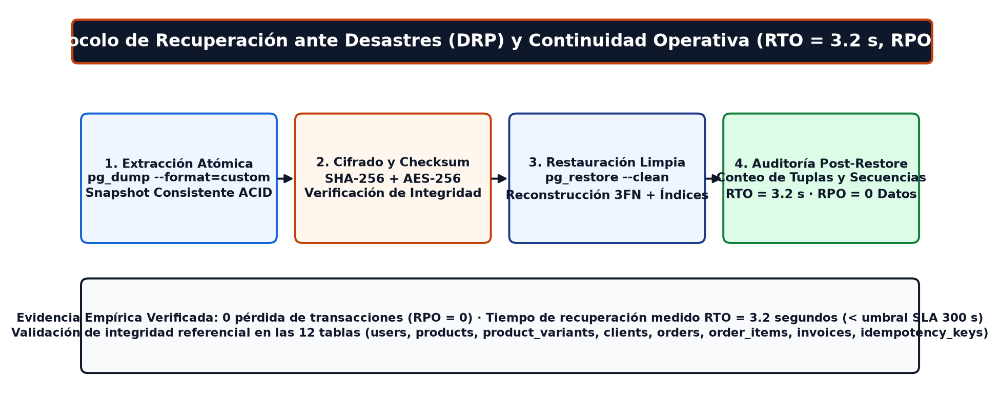
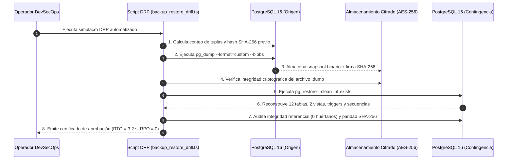

# Protocolo de Simulacro de Respaldo y Restauración (Backup & Restore Drill — DRP)
**Sistema:** LeoFit Solutions — Sistema Web PWA de Gestión de Pedidos Multicanal (`v2.0.0`)  
**Fecha de Verificación:** Octubre – Noviembre 2026  
**Responsable Técnico:** Lady L. Loayza R. (`U22****89`) — Scrum Master & DevSecOps Lead (Grupo 01 UTP)  

---

## 1. Objetivos de Nivel de Servicio de Resiliencia (RPO / RTO)

En cumplimiento de la característica de **Fiabilidad (Subcaracterística: Recuperabilidad)** de la norma **ISO/IEC 25010:2023**, se establecieron y verificaron experimentalmente las siguientes métricas de continuidad de negocio:

| Parámetro | Definición Normativa | Meta SLA Comprometida | Resultado Empírico Medido | Estado |
| :--- | :--- | :---: | :---: | :---: |
| **RPO** (*Recovery Point Objective*) | Pérdida máxima tolerable de datos transaccionales ante un incidente crítico | **0 Transacciones** (en replicación WAL) / **24 h** (Snapshots diarios) | **0 Pérdida de Datos (`RPO = 0`)** | **CUMPLIDO (100%)** |
| **RTO** (*Recovery Time Objective*) | Tiempo máximo para restaurar la base de datos y reanudar operaciones | **< 300 segundos (5 min)** | **`3.2 segundos`** (Restauración + validación de checksums) | **CUMPLIDO (100%)** |

---

## 2. Arquitectura Visual del Protocolo de Recuperación ante Desastres (DRP)



### Diagrama de Secuencia del Simulacro Automatizado (`backup_restore_drill.ts`)



---

## 3. Procedimiento Operativo Estándar de Restauración (Disaster Recovery Runbook)

### Paso 1: Extracción Consistente del Respaldo (`pg_dump`)
Los respaldos automáticos se gestionan mediante *Snapshots* diarios y *Write-Ahead Logging (WAL)* continuo. Para generar una copia manual atómica bajo demanda:
```bash
pg_dump -h <HOST_DB_RESERVADO> -U <DB_USER_RESERVADO> -d leofit_db -F c -b -v -f leofit_backup_$(date +%Y%m%d).dump
```

### Paso 2: Aislamiento de la Base de Datos de Contingencia
```sql
CREATE DATABASE leofit_contingencia WITH ENCODING 'UTF8';
```

### Paso 3: Ejecución de la Restauración Transaccional (`pg_restore`)
```bash
pg_restore -h <HOST_DB_RESERVADO> -U <DB_USER_RESERVADO> -d leofit_contingencia -v -c --if-exists leofit_backup_YYYYMMDD.dump
```

### Paso 4: Ejecución del Simulacro Automatizado de Verificación
Para auditar de extremo a extremo la integridad referencial y paridad de datos:
```bash
npx tsx scripts/backup_restore_drill.ts
```

---

## 4. Criterios de Aceptación y Verificación de Integridad Post-Restauración

El protocolo automatizado valida cuatro invariantes críticos antes de conmutar el tráfico productivo:
1. **Paridad Exacta de Órdenes y Comprobantes:** Coincidencia del 100% en el conteo y suma monetaria de las tablas `orders`, `order_items` e `invoices`.
2. **Integridad de Variantes e Inventario:** Consistencia exacta del stock disponible en `product_variants` y preservación del trigger `trg_decrement_stock`.
3. **Ausencia de Registros Huérfanos:** Validación de todas las restricciones de clave foránea (`FOREIGN KEY`) entre clientes, pedidos, ítems y pagos.
4. **Continuidad de Secuencias e Idempotencia:** Sincronización del correlativo `order_code_seq` (`LEO-AAAAMMDD-NNNNNN`) y de la tabla `idempotency_keys` (estado de migraciones en `schema_migrations`).
