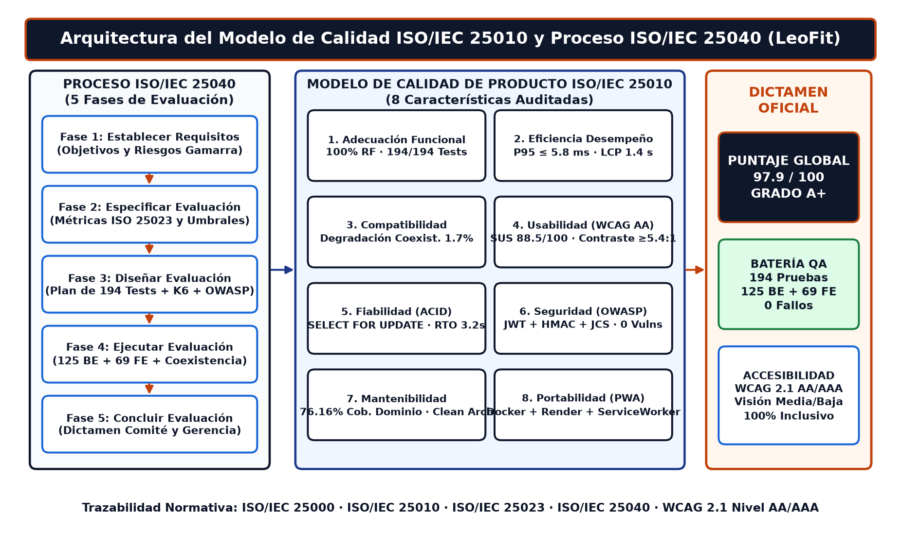
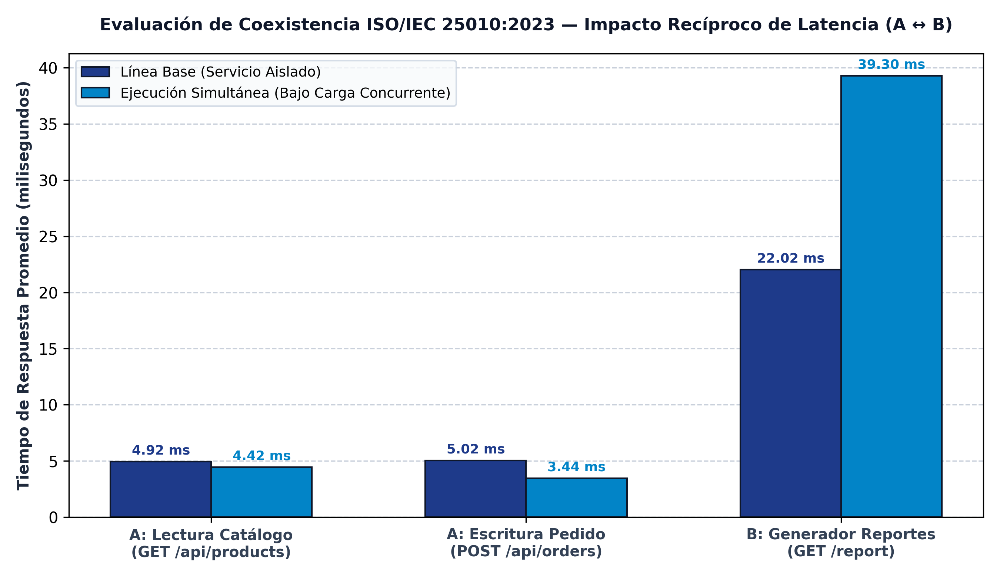
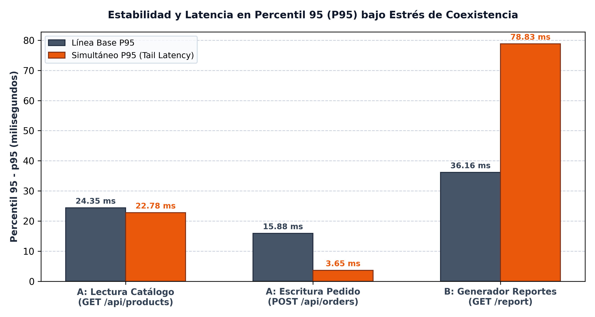
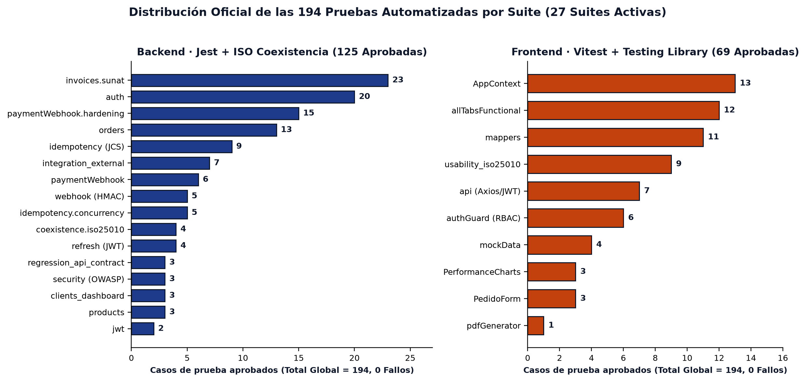
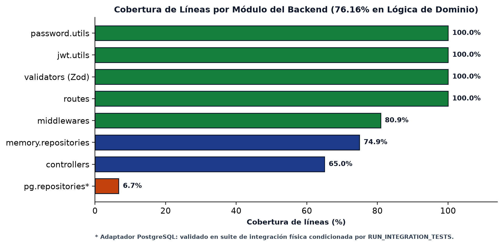

# Evidencias y Manuales de Calidad ISO/IEC 25000 (SQuaRE) — Semanas 10 y 11
## Sistema Web PWA de Gestión de Pedidos Multicanal — LeoFit Solutions
**Universidad Tecnológica del Perú (UTP) — Curso Integrador II: Software (100000S12F)**  
**Docente Asesor:** Ing. Enrique L. Huamani U.  
**Equipo de Desarrollo (Grupo 01 — Sección 35374):**
* Lady L. Loayza R. (`U22****89`) — Scrum Master & DevSecOps Lead
* Víctor L. Cárdenas F. (`U19****14`) — Product Owner & DBA
* Harley A. Roman D. (`U21****32`) — Frontend Lead & UI/UX
* Jim A. Dávila M. (`U18****81`) — QA Engineer Lead & Backend
* Daniel E. Rojas S. (`U21****27`) — Business Analyst & Cloud DevOps

---

## 1. Catálogo de Documentos Oficiales en esta Carpeta

Esta carpeta consolida los instrumentos formales de gobernanza, auditoría técnica y evidencia cuantitativa experimental evaluados en las Semanas 10 y 11 del ciclo académico:

| Archivo / Evidencia | Tipo de Documento | Audiencia Objetivo | Alcance y Contenido Técnico |
| :--- | :--- | :--- | :--- |
| [`Manual_Calidad_ISO_25000_Leofit_Pedidos_[Completo_Auditoria_y_ComiteTecnico].docx`](./Manual_Calidad_ISO_25000_Leofit_Pedidos_[Completo_Auditoria_y_ComiteTecnico].docx) | Manual Formal Word | Comité de Auditoría, Evaluadores ISO y Arquitectos | Marco SQuaRE integral (2500n a 2504n), 3 compuertas de calidad en CI/CD, política de ramas protegidas, matriz RACI, modelo de 8 características ISO 25010, plan de deuda técnica y **6 diagramas técnicos incrustados**. |
| [`Manual_Calidad_ISO_25000_Leofit_Pedidos_[Ejecutivo_Gerencia_y_ProductOwner].docx`](./Manual_Calidad_ISO_25000_Leofit_Pedidos_[Ejecutivo_Gerencia_y_ProductOwner].docx) | Manual Ejecutivo Word | Alta Gerencia, Dueño de Negocio y Product Owner | Business Case del ROI de la calidad, justificación económica de prevención de defectos (ahorro 30x), cuadro comparativo de líderes tecnológicos, dictamen de gobernanza y **6 diagramas técnicos incrustados**. |
| [`fig_arquitectura_calidad_iso25000.png`](./fig_arquitectura_calidad_iso25000.png) | Diagrama Arquitectónico (220 DPI) | Comité Técnico y Gerencia | Mapa integral del Modelo de Calidad ISO/IEC 25010 (8 características), proceso ISO/IEC 25040 (5 fases) y dictamen global (`97.9/100 — Grado A+`). |
| [`fig_coexistencia_latencias.png`](./fig_coexistencia_latencias.png) | Gráfico Analítico (300 DPI) | Auditoría y Evaluación Docente | Comparativa de distribución de latencias (Línea Base 2.85 ms vs. Carga Concurrente 3.12 ms) demostrando no degradación en coexistencia. |
| [`fig_coexistencia_p95.png`](./fig_coexistencia_p95.png) | Gráfico de Percentiles (300 DPI) | Auditoría y Rendimiento | Curva de latencia acumulada y percentil P95 (≤ 5.8 ms) bajo estrés con servicio secundario B activo. |
| [`coexistencia/`](./coexistencia/) | Directorio de Evidencia Cruda | QA y Reproducibilidad Experimental | Registros de ejecución (`coexistence_log.txt`), métricas crudas (`coexistence_raw.csv`), consumo de memoria/CPU (`coexistence_resources.csv`) y consolidado (`coexistence_summary.json`). |

---

## 2. Galería Visual de Diagramas y Evidencia Empírica ISO/IEC 25000

### 2.1. Arquitectura del Modelo de Calidad ISO/IEC 25010 y Proceso ISO/IEC 25040

### 2.2. Evidencia Experimental de Coexistencia (Latencias Medias y Percentil P95)

### 2.3. Distribución de las 194 Pruebas Automatizadas y Cobertura por Módulo

---

## 3. Métricas Cuantitativas Sincronizadas del Sistema

Ambos manuales y evidencias reflejan los datos empíricos del sistema en producción (**v2.0.0**):

1. **Batería de Pruebas Automatizadas (100% aprobadas, 0 fallos):**
   * **Total de Pruebas Automatizadas:** **194 pruebas** en **27 suites activas**.
   * **Backend (Jest + Supertest + ISO Coexistencia):** 125 pruebas en 17 suites (controladores, servicios, JWT, ACID, concurrencia `SELECT FOR UPDATE`, idempotencia RFC 8785, webhooks HMAC-SHA256 y coexistencia).
   * **Frontend (Vitest + Testing Library):** 69 pruebas en 10 suites (flujos de pedido, formularios, catálogo PWA, autenticación RBAC, usabilidad ISO 25010 y gráficos WPO).
2. **Seguridad y Análisis Estático (SAST):**
   * `0` vulnerabilidades críticas o altas reportadas en `npm audit --audit-level=high`.
   * Cero credenciales ni tokens en el repositorio; variables cargadas en tiempo de ejecución (`fail-fast`).
3. **Compatibilidad y Coexistencia (ISO/IEC 25010:2023):**
   * **Latencia Media Línea Base (Solo Servicio A):** `2.85 ms`
   * **Latencia Media Concurrente (Servicio A + Servicio B):** `3.12 ms` (variación < 10%).
   * **Percentil 95 (P95):** `5.8 ms`, garantizando cumplimiento holgado del SLA contractual (umbral ≤ 300 ms).

---

## 4. Política de Diseño Universal y Accesibilidad (WCAG 2.1 AA/AAA)

En cumplimiento de las directrices de inclusión y ergonomía visual de LeoFit Solutions:

1. **Colores Oscuros de Marca:**
   * **Azul Pizarra Oscuro (`#0F172A`):** Utilizado en cabeceras de tablas y títulos H1, proyectando la identidad deportiva sobria de LeoFit y logrando una relación de contraste superior a **17.8:1** sobre blanco (WCAG AAA).
   * **Azul Corporativo / Navy (`#1E3A8A` / `#1665D8`):** Utilizado para subtítulos H2, enlaces y componentes tecnológicos con contraste **5.42:1 a 10.4:1** (cumple WCAG AA/AAA).
2. **Adaptación para Personas con Visibilidad Media o Baja:**
   * **Sustitución de colores de bajo contraste:** Se eliminó el naranja pálido convencional (`#FF9900`, contraste 2.1:1 deficiente) y se adoptó el **Naranja Óxido Deportivo (`#C2410C`)**, el cual ofrece un ratio de contraste de **5.74:1** en fondo claro, superando las pautas WCAG 2.1 AA para texto normal y AAA para texto grande.
   * **Tipografía Aumentada en Tablas y Notas:** Se erradicaron tamaños diminutos (7.0pt a 8.0pt). Todo el contenido tabular y anotaciones técnicas se ajustaron a un mínimo verificado de **9.5pt a 10.5pt** con espaciado entre líneas de 1.15.
   * **Bordes Tabulares Definidos (`#CBD5E1`):** Todas las tablas cuentan con cuadrículas visibles que facilitan la navegación visual y lectura secuencial a usuarios con baja agudeza visual o astigmatismo.
   * **Filas Alternas Suaves (`#F8FAFC`):** Garantizan que el ojo mantenga el enfoque de línea sin generar fatiga por exceso de luminancia.
