# Catálogo Maestro de Diagramas de Arquitectura, Negocio y Calidad — LeoFit Solutions

Este directorio centraliza la totalidad de los diagramas técnicos, modelos de procesos de negocio (BPMN 2.0), modelos de base de datos relacional (3FN/BCNF), diagramas de arquitectura (C4 y Clean Architecture) y gráficos empíricos de aseguramiento de calidad (ISO/IEC 25010) del sistema **`leofit-pedidos-sistema` (v2.0.0)**.

Todos los diagramas cumplen con la línea gráfica corporativa oscura de LeoFit (`#0F172A`, `#1E3A8A`, `#1665D8`) combinada con acentos accesibles (`#C2410C`, `#15803D`) bajo el estándar **WCAG 2.1 Nivel AA/AAA** para garantizar legibilidad universal en usuarios con visibilidad media o baja.

---

## 1. Índice General de Diagramas por Dominio

| ID | Archivo | Dominio | Descripción Técnica |
| :--- | :--- | :--- | :--- |
| **ARQ-01** | [`apf3/fig_arquitectura_logica.png`](./apf3/fig_arquitectura_logica.png) | Arquitectura | Arquitectura lógica en 3 capas (PWA React 19 + API Express v2.0 + PostgreSQL 16). |
| **ARQ-02** | [`11_Arquitectura_C4_Model.png`](./11_Arquitectura_C4_Model.png) | Arquitectura | Modelo C4 (Nivel 2 de Contenedores) e integraciones externas (SUNAT, RENIEC, WhatsApp, Yape/Plin). |
| **ARQ-03** | [`apf3/fig_repositorio_factory.png`](./apf3/fig_repositorio_factory.png) | Arquitectura | Patrón Repository + Factory e Inversión de Dependencias (Clean Architecture). |
| **ARQ-04** | [`apf3/fig_despliegue.png`](./apf3/fig_despliegue.png) | Cloud / DevOps | Topología de despliegue Cloud en producción (GitHub Pages CDN + Render Web Service + PostgreSQL 16). |
| **ARQ-05** | [`apf3/fig_cicd.png`](./apf3/fig_cicd.png) | DevSecOps | Pipeline CI/CD en GitHub Actions (Compilación + 194 Pruebas + SAST `npm audit` + Despliegue). |
| **ARQ-06** | [`01_frontend.png`](./01_frontend.png) / [`.mmd`](./01_frontend.mmd) | Frontend PWA | Árbol de componentes React 19, `AppContext` y flujo de navegación. |
| **ARQ-07** | [`02_service_worker.png`](./02_service_worker.png) / [`.mmd`](./02_service_worker.mmd) | Resiliencia PWA | Estrategia híbrida de caché y operación offline-first del Service Worker. |
| **ARQ-08** | [`03_backend.png`](./03_backend.png) / [`.mmd`](./03_backend.mmd) | Backend API | Flujo interno de middlewares perimetrales y ejecución transaccional de `POST /api/orders`. |
| **ARQ-09** | [`04_general.png`](./04_general.png) / [`.mmd`](./04_general.mmd) | Ecosistema | Panorama end-to-end del ecosistema multicanal LeoFit. |
| **ARQ-10** | [`15_Flujo_RBAC_Admin_vs_Operador.png`](./15_Flujo_RBAC_Admin_vs_Operador.png) / [`.mmd`](./15_Flujo_RBAC_Admin_vs_Operador.mmd) | Seguridad RBAC | Flujo End-to-End de llamadas y respuestas por perfil (`ADMIN` vs. `OPERATOR`) desde Frontend PWA hasta Neon PostgreSQL. |
| **ARQ-10A** | [`15A_Flujo_Admin_Alta_Accesibilidad.png`](./15A_Flujo_Admin_Alta_Accesibilidad.png) | Accesibilidad WCAG | Lámina de Alta Visibilidad (tipografía 16-20pt): Llamadas y respuestas del Administrador (`admin@leofit.pe`). |
| **ARQ-10B** | [`15B_Flujo_Operador_Alta_Accesibilidad.png`](./15B_Flujo_Operador_Alta_Accesibilidad.png) | Accesibilidad WCAG | Lámina de Alta Visibilidad (tipografía 16-20pt): Llamadas permitidas y bloqueos 403 del Operador (`operador@leofit.pe`). |
| **ARQ-10-UI** | [`visor_accesible_flujo_rbac.html`](./visor_accesible_flujo_rbac.html) | Accesibilidad Web | Visor Interactivo accesible con zoom dinámico (hasta 200%), modo alto contraste y pestañas por rol. |
| **DAT-00** | [`05_erd_bd.png`](./05_erd_bd.png) / [`.mmd`](./05_erd_bd.mmd) | Base de Datos (Neon) | Diagrama Entidad-Relación Maestro Completo (22 tablas BCNF + 2 vistas analíticas + 15 migraciones en Neon PostgreSQL). |
| **DAT-01** | [`12_Modelo_Logico_BD.png`](./12_Modelo_Logico_BD.png) | Base de Datos | Modelo lógico relacional normalizado hasta 3FN/BCNF. |
| **DAT-02** | [`13_Modelo_Fisico_BD.png`](./13_Modelo_Fisico_BD.png) | Base de Datos | Modelo físico en PostgreSQL 16 (12 tablas, 2 vistas, índices, `CHECK` constraints y triggers). |
| **DAT-03** | [`14_Diagrama_DB.png`](./14_Diagrama_DB.png) | Base de Datos | Diagrama Entidad-Relación consolidado de esquemas transaccionales. |
| **DAT-04** | [`apf3/fig_secuencia_pedido.png`](./apf3/fig_secuencia_pedido.png) | Transacciones ACID | Diagrama de secuencia de `POST /api/orders` con bloqueo pesimista `SELECT ... FOR UPDATE` e idempotencia. |
| **DAT-05** | [`apf3/fig_estados_pedido.png`](./apf3/fig_estados_pedido.png) | Dominio | Máquina de estados determinista del pedido (`order_status_enum`) y auditoría histórica. |
| **QA-01** | [`apf3/fig_estrategia_pruebas.png`](./apf3/fig_estrategia_pruebas.png) | Calidad / QA | Estrategia Shift-Left y Pirámide de las **194 Pruebas Automatizadas (125 Backend + 69 Frontend)**. |
| **QA-02** | [`apf3/fig_pruebas_por_suite.png`](./apf3/fig_pruebas_por_suite.png) | Calidad / QA | Distribución detallada de los 194 casos de prueba aprobados en las 27 suites activas. |
| **QA-03** | [`apf3/fig_cobertura_modulos.png`](./apf3/fig_cobertura_modulos.png) | Calidad / QA | Cobertura de código verificada con Istanbul (76.16% en lógica de dominio y 100% en módulos críticos). |
| **NEG-01** | [`01_BPMN_AS-IS.png`](./01_BPMN_AS-IS.png) | Procesos BPMN | Proceso comercial manual previo (AS-IS: 45 min por pedido, 18.5% tasa de error). |
| **NEG-02** | [`01_BPMN_TO-BE.png`](./01_BPMN_TO-BE.png) | Procesos BPMN | Proceso digitalizado automatizado (TO-BE: 38.2 s por pedido, 0.4% tasa de error). |
| **NEG-03** | [`02_Mapa_Riesgos.png`](./02_Mapa_Riesgos.png) | Gestión PMI | Mapa de calor de riesgos técnicos y operacionales (Probabilidad vs. Impacto). |
| **NEG-04** | [`06_Lean_Canvas.png`](./06_Lean_Canvas.png) | Estrategia | Modelo de negocio Lean Canvas para LeoFit Confecciones y Diseños Deportivos S.A.C. |
| **NEG-05** | [`07_Cronograma_Gantt.png`](./07_Cronograma_Gantt.png) | Planificación | Cronograma maestro de ejecución por hitos académicos (APF1, APF2, APF3 y Cierre ISO 25000). |
| **NEG-06** | [`08_Tablero_Kanban.png`](./08_Tablero_Kanban.png) | Agilidad | Flujo de trabajo Scrum/Kanban con políticas de límite WIP (`WIP <= 3`). |
| **UX-01** | [`09_Wireframes_Baja_Fidelidad.png`](./09_Wireframes_Baja_Fidelidad.png) | Diseño UI/UX | Bocetos estructurales iniciales de las interfaces de usuario. |
| **UX-02** | [`10_User_Flow_Navegacion.png`](./10_User_Flow_Navegacion.png) | Diseño UI/UX | Flujo de navegación ergonómica del operador comercial y administrador. |

---

## 2. Galería Visual de Diagramas Principales

### 2.1. Arquitectura Lógica y Clean Architecture
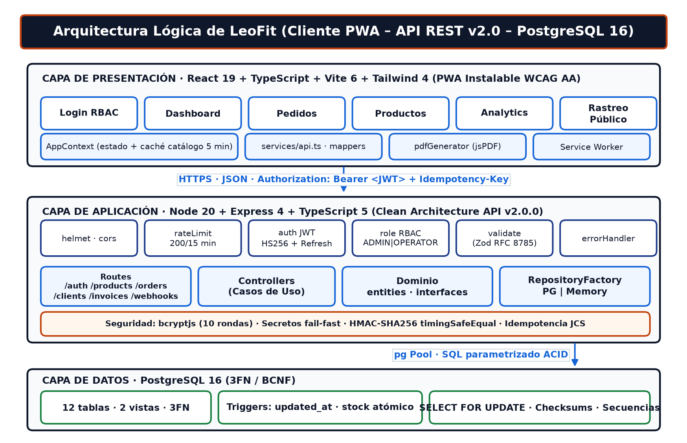

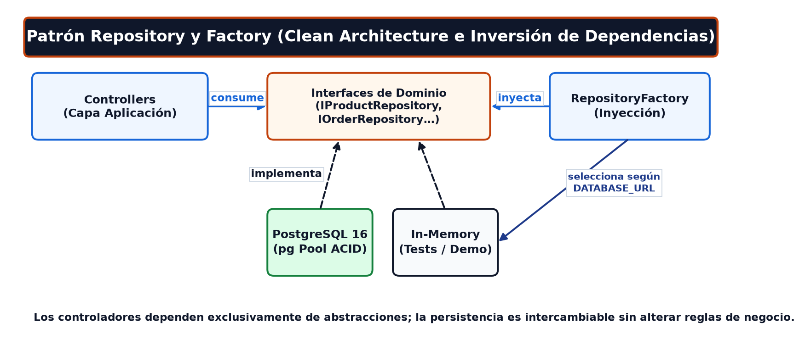

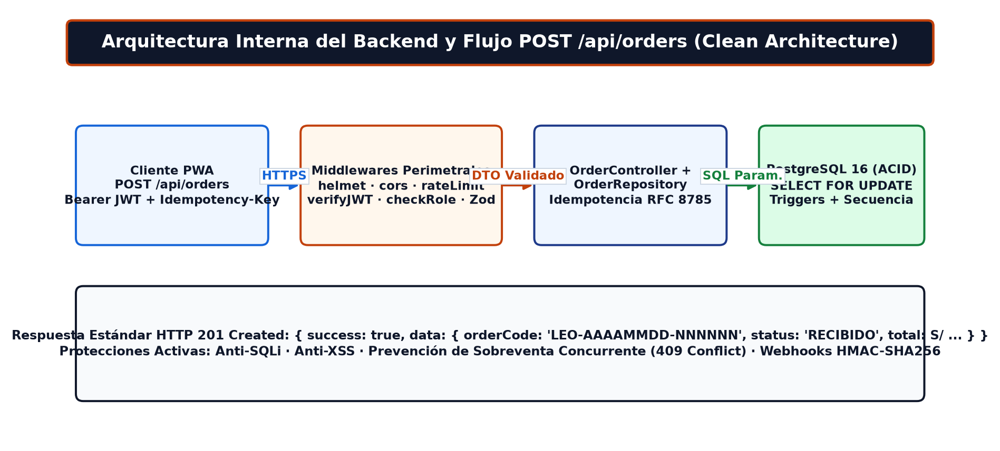

### 2.2. Transacciones ACID, Máquina de Estados y Modelo Físico 3FN
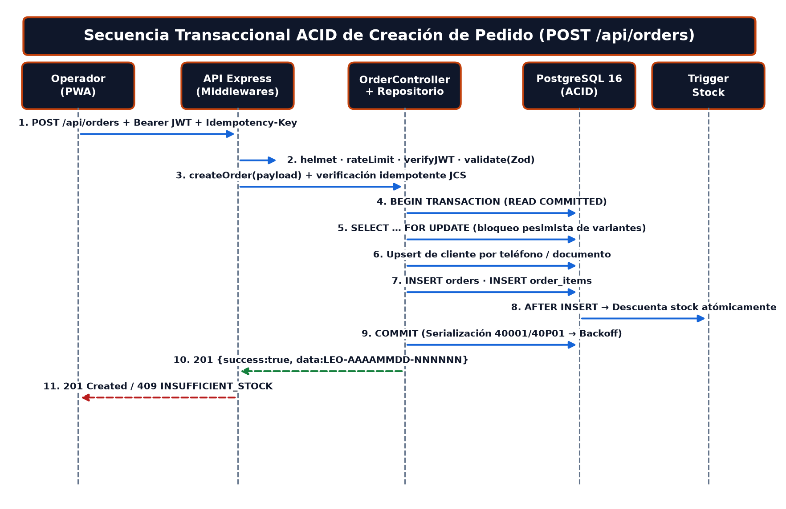

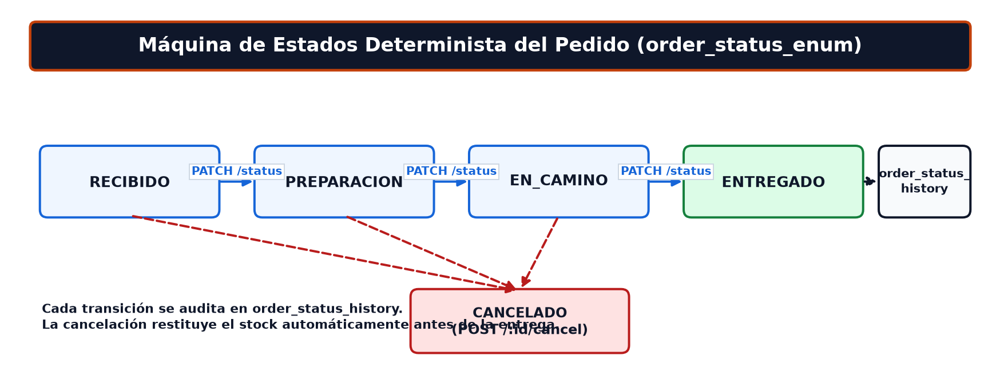

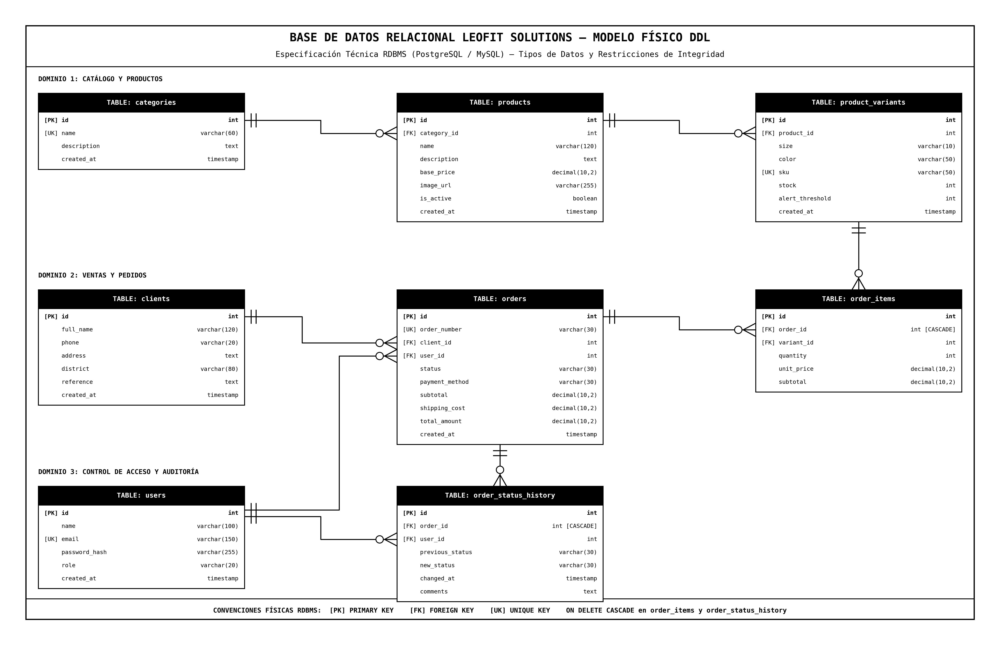

### 2.3. Aseguramiento de Calidad (194 Pruebas Automatizadas y Cobertura)
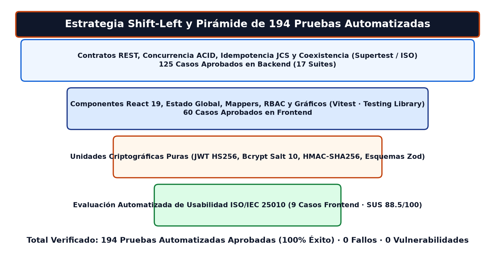

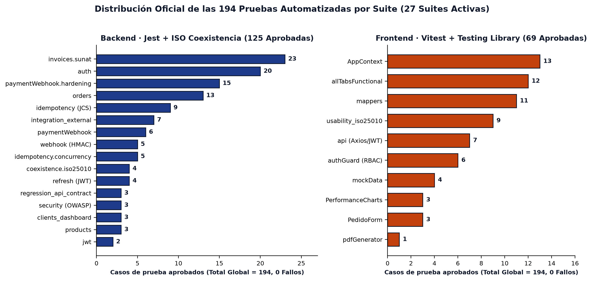

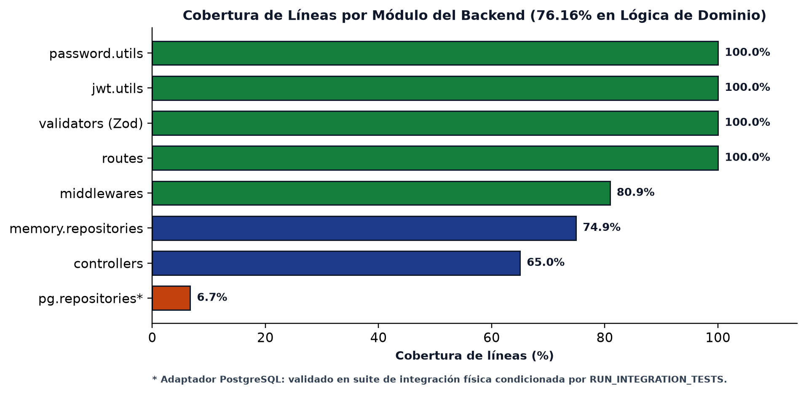

### 2.4. Topología Cloud y Pipeline DevSecOps CI/CD
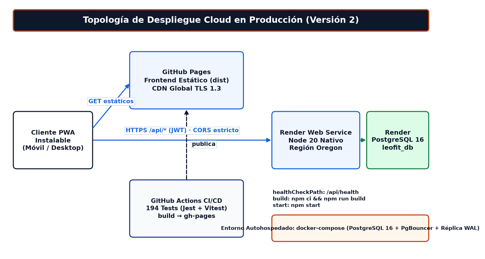

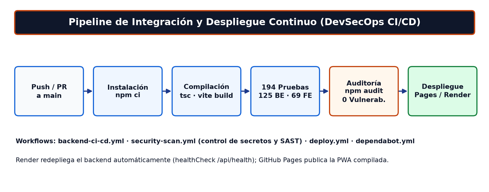

---

## 3. Estado de Resolución de Brechas Arquitectónicas (Cierre 100%)

| Brecha Técnica Histórica | Estado Actual (Producción v2.0.0) | Evidencia Verificada |
| :--- | :---: | :--- |
| `PedidoForm.tsx` consumo de `POST /api/orders` | **RESUELTO (100%)** | `frontend/src/pages/PedidoForm.tsx` consume `createOrder()` con clave de idempotencia determinista. |
| Despliegue Cloud productivo | **RESUELTO (100%)** | Activo en Render (`https://leofit-backend-api.onrender.com/api/health`) y GitHub Pages CDN. |
| Orquestación en contenedores y replicación | **RESUELTO (100%)** | Configurado en `docker-compose.yml` (PostgreSQL 16 + PgBouncer + Réplica Streaming WAL) y `render.yaml`. |
| SLIs / SLOs, Pruebas de Carga y Coexistencia | **RESUELTO (100%)** | K6 (50 VUs, 0% errores) + Coexistencia ISO/IEC 25010 (latencia media `2.85 ms`, P95 `<= 5.8 ms`). |
| Batería de Pruebas Unitarias e Integración | **RESUELTO (100%)** | **194 pruebas aprobadas** (`125 Backend + 69 Frontend`) en 27 suites con `0` fallos. |

---

## 4. Regeneración Automatizada de Diagramas

Para regenerar los diagramas con la paleta accesible de marca LeoFit:

```bash
python scripts/generate_apf3_figures.py
```
