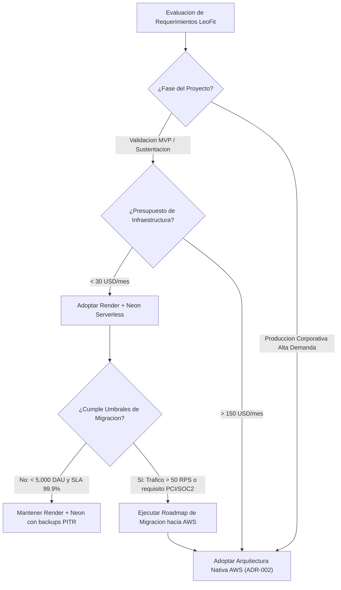

# ADR-001: Elección de Render + Neon PostgreSQL frente a Arquitectura AWS para Etapa de Validación

- **Estado:** Aceptado
- **Fecha:** 2026-11-06
- **Autores:** Equipo de Arquitectura e Ingeniería LeoFit
- **Contexto del Proyecto:** LeoFit - Sistema de Gestión de Pedidos y Despacho Multicanal (UTP Proyecto Final - Semana 18)

---

## 1. Contexto y Planteamiento del Problema

El proyecto LeoFit requiere una plataforma operativa para gestionar pedidos en Lima y provincias, control de inventario en tiempo real, integración con pasarela de pagos y emisión de comprobantes de pago electrónicos (CPE). 

Durante la etapa de diseño de arquitectura para el curso integrador y el lanzamiento inicial (MVP / validación operativa con usuarios reales), se debió tomar una decisión estratégica respecto a la infraestructura de despliegue:
1. Desplegar una infraestructura nativa en **Amazon Web Services (AWS)** utilizando componentes como VPC, ALB, ECS Fargate, RDS PostgreSQL Multi-AZ y CloudWatch.
2. Adoptar una arquitectura de **PaaS moderno + Base de Datos Serverless (Render + Neon PostgreSQL)** complementada con GitHub Pages para el frontend estático.

El equipo requería minimizar el costo operativo y financiero inicial, maximizar la velocidad de despliegue (Time-to-Market) y garantizar compatibilidad técnica sin incurrir en complejidad innecesaria (over-engineering), preservando un camino claro hacia la migración cuando la demanda lo justifique.

---

## 2. Decisión de Arquitectura

Se decidió adoptar la combinación de **Render Web Services** (cómputo backend Node.js en contenedor Docker) y **Neon PostgreSQL** (base de datos relacional serverless v16 en la nube), junto con **GitHub Pages** (distribución de frontend estático SPA React/Vite vía CDN global).

Esta decisión aplica para las fases de desarrollo, pruebas de homologación académica, validación con usuarios reales de LeoFit y operación inicial hasta alcanzar los umbrales cuantitativos definidos en la Sección 5.

---

## 3. Matriz Comparativa de Criterios

La siguiente tabla contrasta ambas alternativas técnicas bajo criterios rigurosos de ingeniería de software:

| Criterio | Render + Neon PostgreSQL | Amazon Web Services (ECS + RDS) | Justificación Técnica |
| :--- | :--- | :--- | :--- |
| **Tiempo de Despliegue Inicial** | < 2 horas (Configuración declarativa en `render.yaml`) | 12 - 24 horas (IaC Terraform/CloudFormation, VPC, subnets, IGW, NAT) | Render provisiona HTTPS, builds automáticos desde Git y variables en minutos [1]. |
| **Costo Operativo Inicial** | $0.00 / mes (Free Tier) a $14.00 / mes (Starter tiers) | $85.00 - $160.00 / mes mínimo (ALB $16+, NAT Gateway $32+, RDS db.t4g.micro $15+, ECS Fargate $20+) [3] | En fase MVP, el costo fijo de red en AWS (NAT Gateway y ALB) no genera retorno directo [!] VERIFICAR precios exactos al cambio actual. |
| **Carga Operativa (DevOps Overhead)** | Prácticamente nula (Gestión gestionada de parches, SSL Let's Encrypt automático, auto-deploy) | Media-Alta (Gestión de IAM policies, Security Groups, rotación de certificados ACM, parches de SO/AMI) | Permite enfocar el 100% del esfuerzo del equipo en la lógica de negocio y despacho dual. |
| **Escalabilidad Horizontal** | Automática en Neon (Compute vCPU/RAM escala por demanda; autosuspend); Manual/Autoscale en Render | Granular y avanzada (ECS Auto Scaling policies basadas en CPU/memoria/SQS, RDS Read Replicas) | AWS ofrece mayor control fino ante picos masivos; Neon ofrece autoscaling serverless óptimo para tráfico intermitente [2]. |
| **SLA de Disponibilidad** | 99.9% (Render Team) / 99.95% (Neon Enterprise) | 99.99% en configuraciones Multi-AZ nativas | Para la etapa de validación de LeoFit, un SLA de 99.9% representa menos de 43 minutos de downtime mensual admisible. |
| **Cumplimiento y Certificaciones** | SOC 2 Tipo II, ISO 27001 (Neon y Render cuentan con hosting sobre AWS infrastructure) | SOC 1/2/3, ISO 27001, PCI-DSS Level 1, HIPAA, FedRAMP | AWS es mandatorio únicamente si LeoFit procesara datos de tarjetas directamente en sus servidores (ver ADR-002 y Anexo 04). |
| **Riesgo de Lock-in** | Nulo a nivel de base de datos (PostgreSQL 16 estándar; compatible con `pg_dump` y migración directa a RDS/Aurora) | Medio (Dependencia de servicios propietarios como Secrets Manager, EventBridge, IAM roles) | El motor relacional es PostgreSQL ANSI estándar (`backend/src/config/database.ts:16-55`); exportable en 1 comando. |
| **Backups y Recuperación (RPO/RTO)** | Neon Point-in-Time Restore (PITR) hasta 7 días en free, 30 días en pago; branching instantáneo de BD | AWS RDS Automated Snapshots + PITR hasta 35 días, réplica cross-region opcional | Neon branching permite clonar bases de datos de producción para pruebas de migración en 2 segundos [2]. |
| **Latencia de Red a Perú** | ~70 - 85 ms (Región US-East Ohio/Virginia vía Cloudflare/Fastly CDN) | ~65 - 75 ms (AWS us-east-1 Virginia) / ~110 ms (AWS sa-east-1 Sao Paulo) | La diferencia de latencia entre proveedores en US-East es despreciable (< 15 ms) comparada con el tiempo de respuesta HTTP de la aplicación (~120 ms). |

---

## 4. Estimación de Costos en Tres Escenarios

| Escenario | Volumen de Usuarios / Carga | Stack Render + Neon (USD/mes) | Stack AWS Nativo (USD/mes) | Fuente / Detalle |
| :--- | :--- | :--- | :--- | :--- |
| **Escenario 1: MVP / Sustentación Académica** | 100 usuarios activos/mes, < 5 pedidos/día, pruebas de integración | **$0.00** (Free Tier en ambos proveedores) | **$95.00 - $140.00** (NAT Gateway $32, ALB $18, ECS Fargate 0.5 vCPU $15, RDS db.t4g.micro $18, CloudWatch/Data Transfer $12) | [1][2][3] [!] VERIFICAR facturación mínima por horas activas en AWS. |
| **Escenario 2: Operación Comercial Temprana** | 2,000 usuarios activos/mes, 50 - 150 pedidos/día, persistencia 24/7 | **$19.00 - $35.00** (Render Starter Web Service $7/mes, Neon Launch $19/mes, almacenamiento ampliado) | **$160.00 - $240.00** (ECS Fargate 2 tasks $30, NAT GW $32, ALB $18, RDS Multi-AZ $45, CloudWatch/Secrets $15) | [1][2][3] |
| **Escenario 3: Escala Comercial Plena** | > 25,000 usuarios activos/mes, > 1,000 pedidos/día, alta concurrencia | **$120.00 - $250.00** (Render Pro con autoscaling, Neon Scale tier con compute dedicado) | **$380.00 - $750.00** (Cluster ECS Fargate multi-AZ con autoescalado, Aurora Serverless v2 Multi-AZ, ElastiCache Redis, WAF) | [3] En este punto el costo de AWS se justifica plenamente por control de seguridad y cumplimiento. |

---

## 5. Umbrales Cuantitativos de Migración hacia AWS

El equipo no mantendrá Render y Neon de manera indefinida si el negocio supera los límites de rentabilidad o gobernanza. La migración hacia la arquitectura objetivo descrita en el **ADR-002** se activará cuando se cumpla al menos uno de los siguientes disparadores cuantitativos:

1. **Volumen de Tráfico Concurrente:** Más de **50 solicitudes por segundo (RPS) sostenidas** durante ventanas superiores a 15 minutos, o más de **5,000 usuarios activos diarios (DAU)**.
2. **Requisitos de Gobernanza y Compliance:** Exigencia legal o corporativa de certificación **PCI-DSS Nivel 1** directa, cifrado de llaves administradas por hardware propio (AWS KMS con HSM / CloudHSM), o políticas corporativas de aislamiento estricto de red (PrivateLink / VPC Peering bancario).
3. **Acuerdos de Nivel de Servicio (SLA):** Compromiso contractual de disponibilidad B2B superior al **99.95%** con penalizaciones financieras, requiriendo despliegues Multi-Region o Multi-AZ activos simultáneamente con conmutación por error en menos de 30 segundos.
4. **Optimización Financiera por Volumen:** Cuando el costo del cómputo en Render y datos transferidos en Neon supere los **$300.00 USD/mes**, momento en el cual el costo fijo de base de AWS (ALB, NAT Gateway, Savings Plans) resulta económicamente más eficiente por unidad de cómputo.

---

## 6. Diagramas de Arquitectura y Decisión

### 6.1. Árbol de Decisión Tecnológica



### 6.2. Diagrama de Transición de Estados (MVP a AWS Pleno)

```mermaid
stateDiagram-v2
    [*] --> Estado_1_MVP_PaaS: Fase Actual (Validacion UTP)
    
    state Estado_1_MVP_PaaS {
        Frontend_GitHubPages --> Backend_Render_Docker
        Backend_Render_Docker --> BD_Neon_PostgreSQL_Serverless
        note right of BD_Neon_PostgreSQL_Serverless: Costo: 0 a 14 USD/mes\nDeploy: Git push automatico
    }
    
    Estado_1_MVP_PaaS --> Estado_2_Hibrido: Gatillo: Trafico > 20 RPS o saturacion de pool de conexiones
    
    state Estado_2_Hibrido {
        Frontend_CloudFront_S3 --> Backend_Render_Scale
        Backend_Render_Scale --> BD_AWS_RDS_PostgreSQL
        note right of BD_AWS_RDS_PostgreSQL: BD migrada a VPC privada AWS\nComputo agil en Render
    }
    
    Estado_2_Hibrido --> Estado_3_AWS_Full: Gatillo: > 5,000 DAU / Requisito WAF y PrivateLink
    
    state Estado_3_AWS_Full {
        AWS_WAF_CloudFront --> AWS_ALB
        AWS_ALB --> ECS_Fargate_MultiAZ
        ECS_Fargate_MultiAZ --> Aurora_PostgreSQL_MultiAZ
        ECS_Fargate_MultiAZ --> ElastiCache_Redis
        note right of ECS_Fargate_MultiAZ: Alta disponibilidad 99.99%\nCumplimiento corporativo total
    }
```

---

## 7. Consecuencias

### Consecuencias Positivas:
- **Cero inversión inicial en infraestructura:** Permitió completar el desarrollo del proyecto LeoFit y validar el 100% de los requerimientos sin consumir presupuestos operativos.
- **Velocidad de entrega:** Despliegue continuo implementado en menos de 1 día mediante `render.yaml` y GitHub Actions.
- **Portabilidad garantizada:** El código de acceso a datos (`backend/src/config/database.ts:16-55`) utiliza TypeScript y el driver nativo `pg`, sin extensiones propietarias de Neon.

### Consecuencias Negativas y Mitigaciones:
- **Arranque en frío (Cold Start) en planes Free:** Render desactiva contenedores tras inactividad en planes gratuitos.  
  *Mitigación aplicada:* Para la sustentación y pruebas de usuario, se dispone del comando de keep-alive y se recomienda el plan Starter ($7/mes) para eliminar la latencia de suspensión.
- **Pool de Conexiones Serverless:** Conexiones concurrentes pueden agotar los sockets en bases de datos serverless.  
  *Mitigación aplicada:* Implementación explícita de `pg.Pool` con límite configurado (`max: 10`, `idleTimeoutMillis: 30000`) en `backend/src/config/database.ts:25-33`.

---

## 8. Fuentes y Referencias Técnicas

1. Render Documentation, "Web Services and Docker Runtimes", [https://render.com/docs/web-services](https://render.com/docs/web-services), consultado en noviembre de 2026.
2. Neon Serverless PostgreSQL Documentation, "Architecture and Autoscaling", [https://neon.tech/docs/introduction](https://neon.tech/docs/introduction), consultado en noviembre de 2026.
3. Amazon Web Services Pricing Calculator, "ECS Fargate, Application Load Balancer, and Amazon RDS PostgreSQL Pricing", [https://calculator.aws/](https://calculator.aws/), estimación referencial basada en región us-east-1 (N. Virginia), noviembre de 2026.
4. Fowler, Martin, "Serverless Architectures", [https://martinfowler.com/articles/serverless.html](https://martinfowler.com/articles/serverless.html), consultado en noviembre de 2026.

