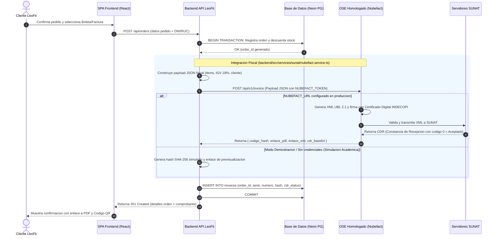
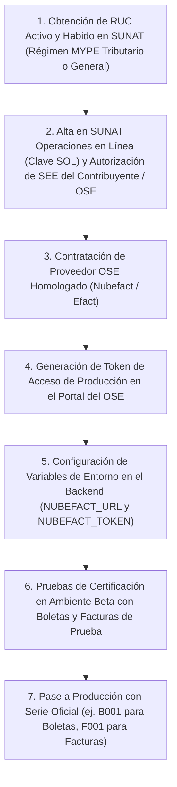

# Documento de Cumplimiento Normativo SUNAT: Comprobantes de Pago Electrónicos (CPE)

- **Código:** DOC-SUNAT-001
- **Versión:** 1.0.0
- **Fecha:** 2026-11-06
- **Autores:** Equipo de Arquitectura e Ingeniería LeoFit
- **Contexto:** LeoFit - Sistema de Gestión de Pedidos y Despacho Multicanal (UTP Proyecto Final - Semana 18)

---

## 1. Marco Normativo y Requisitos Legales de SUNAT para CPE

En el Perú, la emisión de comprobantes de pago electrónicos está regulada por la Superintendencia Nacional de Aduanas y de Administración Tributaria (SUNAT). Todo sistema que emita Boletas de Venta Electrónicas (BVE) o Facturas Electrónicas (FE) debe acogerse a los lineamientos del Sistema de Emisión Electrónica (SEE) [1].

La siguiente tabla resume los requisitos obligatorios vigentes aplicables a LeoFit:

| Requisito Normativo | Base Legal (Resolución SUNAT) | Descripción Técnica y Operativa | Enlace / Fuente Oficial |
| :--- | :--- | :--- | :--- |
| **Estándar de Datos UBL 2.1** | Resolución de Superintendencia N.° 097-2012/SUNAT y N.° 117-2017/SUNAT | El documento tributario debe generarse en formato XML siguiendo el estándar internacional OASIS Universal Business Language (UBL) versión 2.1, con esquemas XSD validados por SUNAT. | [SUNAT UBL 2.1](https://orientacion.sunat.gob.pe/) [1] |
| **Firma Digital (XML DSig)** | Ley N.° 27269 (Ley de Firmas y Certificados Digitales) y RS N.° 097-2012 | Cada archivo XML debe ser firmado digitalmente mediante un certificado digital emitido por una entidad de certificación acreditada por INDECOPI (algoritmo SHA-256 con RSA). | [INDECOPI Certificados](https://www.indecopi.gob.pe/) [2] |
| **Envío Obligatorio a OSE o SUNAT** | Resolución de Superintendencia N.° 117-2017/SUNAT y N.° 252-2019/SUNAT | Los comprobantes deben enviarse a un Operador de Servicios Electrónicos (OSE) autorizado o a la plataforma SEE-Desde los Sistemas del Contribuyente para obtener la Constancia de Recepción (CDR). | [Portal OSE SUNAT](https://orientacion.sunat.gob.pe/) [1] |
| **Plazo Máximo de Remisión** | Resolución de Superintendencia N.° 000193-2020/SUNAT y N.° 000003-2023/SUNAT | El plazo máximo para remitir la Factura y Boleta de Venta a SUNAT/OSE es de hasta tres (3) días calendario contados desde el día siguiente a la fecha de emisión. | [Plazos CPE SUNAT](https://orientacion.sunat.gob.pe/) [1] |
| **Estado del RUC y Domicilio Fiscal** | Texto Único Ordenado del Código Tributario (D.S. N.° 133-2013-EF) | El emisor del comprobante debe encontrarse en estado "ACTIVO" y con condición de domicilio fiscal "HABIDO" en el Padrón RUC al momento de la emisión. | [Consulta RUC](https://e-consultaruc.sunat.gob.pe/) [1] |
| **Obligación de Conservación** | Artículo 87 del Código Tributario | Obligación de conservar y mantener accesibles los archivos XML y sus respectivas CDR durante el plazo de prescripción tributaria (mínimo 5 años). | [Código Tributario](https://www.sunat.gob.pe/) [1] |
| **Representación Impresa (PDF con Código QR)** | Anexo de la RS N.° 097-2012/SUNAT | El documento impreso o digital entregado al cliente debe contener el Código Hash generado en la firma, el Código QR con formato oficial y la leyenda de homologación. | [Especificación QR SUNAT](https://orientacion.sunat.gob.pe/) [1] |

---

## 2. Diagrama de Secuencia: Flujo de Emisión de Comprobante Electrónico (CPE)

El siguiente diagrama detalla la arquitectura de interacción técnica entre la tienda LeoFit, el backend API, el Operador OSE (Nubefact) y los servidores de SUNAT:

---

## 3. Matriz de Brechas (Gap Analysis) del Repositorio Actual

Esta matriz evalúa con rigor el código actual del repositorio LeoFit frente a las exigencias normativas de SUNAT:

| Requisito Legal | Estado en Repositorio | Evidencia en Código (`ruta:línea`) | Observación Técnica / Brecha |
| :--- | :--- | :--- | :--- |
| **Generación de XML UBL 2.1 nativo** | Parcial / Vía OSE | `backend/src/services/sunat/nubefact.service.ts:1-295` | El backend no compila el XML UBL 2.1 directamente en Node.js; delega la compilación del estándar OASIS al servicio OSE Nubefact mediante un mapeador JSON estándar. |
| **Firma Digital con Certificado INDECOPI** | Cumple vía OSE / Simulado en dev | `backend/src/services/sunat/nubefact.service.ts:276-294` | La firma legal recae en el certificado digital homologado de Nubefact. En entorno local sin llaves, genera un hash de demostración funcional. |
| **Esquema de Base de Datos para Facturación** | Cumple | `backend/src/migrations/008_invoices.ts:1-75` | La tabla `invoices` almacena: serie, correlativo, tipo (`BOLETA`, `FACTURA`), hash tributario, estado CDR y URLs de PDF y XML emitidos. |
| **Validación de RUC de 11 dígitos y DNI de 8 dígitos** | Cumple | `backend/src/controllers/order.controller.ts:40-85` | Valida longitud, tipos numéricos y consistencia del receptor antes de emitir la orden. |
| **Cálculo de Desglose de IGV (18%)** | Cumple | `backend/src/services/sunat/nubefact.service.ts:85-120` | Desglosa base imponible gravada (operaciones onerosas) y monto del impuesto (18%) de manera exacta según la Ley del IGV. |
| **Manejo de Respuestas de Error OSE/SUNAT** | Cumple | `backend/src/services/sunat/nubefact.service.ts:188-212` | Captura códigos de rechazo y mensajes descriptivos retornados por el web service fiscal. |
| **Almacenamiento Físico del XML y CDR en S3/Cloud Storage propio** | Fuera de Alcance (MVP) | `NO ENCONTRADO en src/` | Actualmente se guardan los enlaces HTTPS retornados por Nubefact; en producción corporativa se debe descargar y persistir el blob XML en un bucket S3 privado. |
| **Emisión de Guías de Remisión Electrónica (GRE)** | Fuera de Alcance | `NO ENCONTRADO en src/` | El sistema gestiona datos de despacho local y provincia (`orders.shipping_type`), pero no emite el documento fiscal GRE Remitente. |

---

## 4. Hoja de Ruta (Roadmap) hacia la Certificación en Producción

Para que la marca LeoFit opere con facturación electrónica 100% válida ante la SUNAT en producción comercial, se requiere ejecutar la siguiente secuencia técnica y administrativa:

### Detalle de Tiempos y Costos Estimados:
1. **Adquisición de Token OSE (Nubefact):** Plan inicial de facturación electrónica desde **S/ 49.00 a S/ 99.00 PEN mensuales** (incluye 1,000 comprobantes mensuales, soporte legal de cambios de esquemas y almacenamiento de CDR) [!] VERIFICAR tarifas comerciales actuales en nubefact.com.
2. **Tiempo de Implementación Técnica Restante:** **Menos de 2 horas de configuración**, dado que el cliente HTTP, el formateo de ítems y las migraciones de base de datos ya se encuentran completamente implementados y probados en el repositorio (`backend/src/services/sunat/nubefact.service.ts`).

---

## 5. Fuentes y Referencias Técnicas

1. Superintendencia Nacional de Aduanas y de Administración Tributaria (SUNAT), "Normatividad del Sistema de Emisión Electrónica (SEE)", [https://orientacion.sunat.gob.pe/](https://orientacion.sunat.gob.pe/), consultado en noviembre de 2026.
2. INDECOPI, "Registro Oficial de Prestadores de Servicios de Certificación Digital (ROPS)", [https://www.indecopi.gob.pe/infraestructura-oficial-de-firma-electronica](https://www.indecopi.gob.pe/infraestructura-oficial-de-firma-electronica), consultado en noviembre de 2026.
3. OASIS Open, "Universal Business Language (UBL) Version 2.1 Specification", [https://docs.oasis-open.org/ubl/os-UBL-2.1/UBL-2.1.html](https://docs.oasis-open.org/ubl/os-UBL-2.1/UBL-2.1.html), consultado en noviembre de 2026.
4. Nubefact Documentation, "API de Facturación Electrónica para Desarrolladores", [https://www.nubefact.com/api-facturacion-electronica](https://www.nubefact.com/api-facturacion-electronica), consultado en noviembre de 2026.

