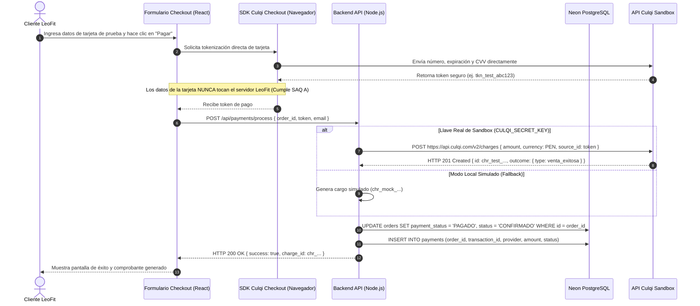
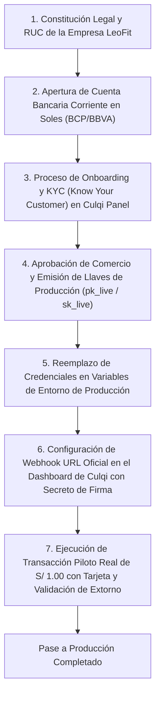

# Integración de Pasarela de Pagos: Operación en Sandbox frente a Producción Comercial

- **Código:** DOC-PAY-001
- **Versión:** 1.0.0
- **Fecha:** 2026-11-06
- **Autores:** Equipo de Arquitectura e Ingeniería LeoFit
- **Contexto:** LeoFit - Sistema de Gestión de Pedidos y Despacho Multicanal (UTP Proyecto Final - Semana 18)

---

## 1. Diferencias Operativas: Ambiente Sandbox vs. Producción

El procesamiento de transacciones financieras digitales en el Perú exige cumplir con rigurosos protocolos técnicos, bancarios y normativos. En el desarrollo del proyecto LeoFit, el módulo de pagos en línea se implementó integrando la pasarela peruana **Culqi**, operando actualmente en ambiente de pruebas (**Sandbox**) para la sustentación académica.

La siguiente tabla detalla las diferencias operativas y normativas entre ambos ambientes:

| Dimensión Técnica / Operativa | Ambiente Sandbox (Pruebas - Estado Actual) | Ambiente Producción (Comercial en Vivo) | Impacto / Riesgo |
| :--- | :--- | :--- | :--- |
| **Flujo de Dinero y Débito Bancario** | Simulado. No existe débito real en cuentas de tarjetas ni crédito en cuenta de LeoFit. | Real. El cargo se descuenta de la tarjeta del cliente y se abona a la cuenta recaudadora (interbancario BCP/BBVA). | Cero riesgo financiero durante la sustentación académica. |
| **Instrumentos de Pago Válidos** | Tarjetas de prueba provistas por Culqi (ej. `4111 2222 3333 4444`) con CVV y fecha futura arbitraria. | Tarjetas reales Visa, Mastercard, Diners, Amex emitidas por bancos locales o internacionales. | En Sandbox no se rechaza por fondos insuficientes reales salvo que se usen números de prueba específicos de error [1]. |
| **Prefijo de Credenciales API** | Llaves públicas `pk_test_...` y llaves privadas `sk_test_...`. | Llaves públicas `pk_live_...` y llaves secretas `sk_live_...`. | `culqi.ts:85` valida programáticamente si la llave inicia con `sk_` o si opera en fallback local. |
| **Seguridad y Webhooks** | Recepción de payloads JSON con firma HMAC simulada o real de Culqi Sandbox. | Recepción estricta de eventos HTTPS firmados con `culqi-signature` (HMAC-SHA256) verificado de forma timing-safe. | El backend ya cuenta con la verificación segura implementada en `paymentWebhook.controller.ts:61-114`. |
| **Alcance y Cumplimiento PCI-DSS** | Cero exposición de datos de tarjeta en el backend gracias a la tokenización vía Culqi JS en el cliente (SAQ A). | Obligación de mantener el alcance reducido bajo el cuestionario SAQ A de PCI-DSS v4.0 [2]. | El servidor de LeoFit jamás toca ni almacena el PAN (Primary Account Number) ni el CVV de las tarjetas. |
| **Efecto Tributario** | Los cobros no generan retención tributaria ni liquidación fiscal bancaria. | Se aplican comisiones comerciales de adquirencia (ej. 3.44% + $0.30 USD + IGV) y retenciones de ley. | [!] VERIFICAR tasas comerciales vigentes en Culqi para microempresas. |

---

## 2. Evidencia de Implementación en el Repositorio

El módulo de pagos del repositorio no es un prototipo estático; contiene la lógica completa de tokenización, cobro y confirmación asíncrona:

| Componente | Archivo en Repositorio (`ruta:línea`) | Detalle de la Implementación Detectada |
| :--- | :--- | :--- |
| **Servicio de Cobro Culqi** | `backend/src/services/payments/culqi.ts:57-87` | Implementa método `crearCargo(token, monto, email)`. Si la variable `CULQI_SECRET_KEY` no está configurada o no inicia con `sk_`, conmuta transparentemente a un modo simulador que genera IDs ficticios con prefijo `chr_mock_` para permitir la prueba continua sin bloquear el flujo. |
| **Recepción de Webhooks Seguros** | `backend/src/controllers/paymentWebhook.controller.ts:61-114` | Endpoint `POST /api/webhooks/payment`. Implementa validación criptográfica HMAC-SHA256 utilizando `crypto.timingSafeEqual` para prevenir ataques de temporización (timing attacks). |
| **Persistencia Transaccional** | `backend/src/controllers/paymentWebhook.controller.ts:100-115` | Al confirmarse el pago por webhook, ejecuta una transacción SQL que actualiza el estado del pedido a `CONFIRMADO` y registra la transacción en la tabla `payments`. |
| **Variables de Entorno** | `backend/.env.example:27-31` | Define `CULQI_PUBLIC_KEY`, `CULQI_SECRET_KEY`, `CULQI_WEBHOOK_SECRET` y el flag `PAYMENTS_SANDBOX_MODE=true`. |

---

## 3. Diagrama de Secuencia: Flujo de Pago Actual en Sandbox

---

## 4. Limitaciones Explícitas y Consideraciones de Seguridad (PCI-DSS)

### 4.1. Limitaciones del Entorno Actual:
1. **Ausencia de Débito Bancario Real:** No es posible validar la conciliación con extractos bancarios de LeoFit en el BCP o BBVA, dado que las pasarelas en sandbox no dispersan fondos.
2. **Webhooks Locales:** Para recibir webhooks de Culqi en desarrollo local se requiere un túnel seguro (ngrok / Cloudflare Tunnel), mientras que en producción se exponen directamente sobre el dominio con TLS 1.3.

### 4.2. Estrategia de Reducción de Alcance PCI-DSS:
LeoFit implementa la estrategia de **Tokenización en el Cliente (Client-Side Tokenization)** recomendada por el estándar PCI-DSS v4.0:
- El formulario de tarjeta no envía datos confidenciales a través del backend de LeoFit.
- La aplicación clasifica dentro del cuestionario de autoevaluación **SAQ A (Self-Assessment Questionnaire A)**, lo que exime al equipo de certificar servidores, firewalls de cómputo y bases de datos bajo los controles más pesados de PCI-DSS, delegando la carga de cumplimiento en la infraestructura certificada de Culqi [2].

---

## 5. Hoja de Ruta para Activación en Producción Comercial

Para activar el cobro con dinero real en la tienda LeoFit, el equipo debe seguir los siguientes pasos formales:

---

## 6. Fuentes y Referencias Técnicas

1. Culqi Developers, "Documentación Oficial de Integración y Entornos de Prueba (Sandbox)", [https://docs.culqi.com/](https://docs.culqi.com/), consultado en noviembre de 2026.
2. PCI Security Standards Council, "Payment Card Industry (PCI) Data Security Standard - Self-Assessment Questionnaire A and Attestation of Compliance v4.0", [https://www.pcisecuritystandards.org/](https://www.pcisecuritystandards.org/), consultado en noviembre de 2026.
3. Node.js Documentation, "Crypto Module - timingSafeEqual Method", [https://nodejs.org/api/crypto.html#cryptotimingsafeequala-b](https://nodejs.org/api/crypto.html#cryptotimingsafeequala-b), consultado en noviembre de 2026.

