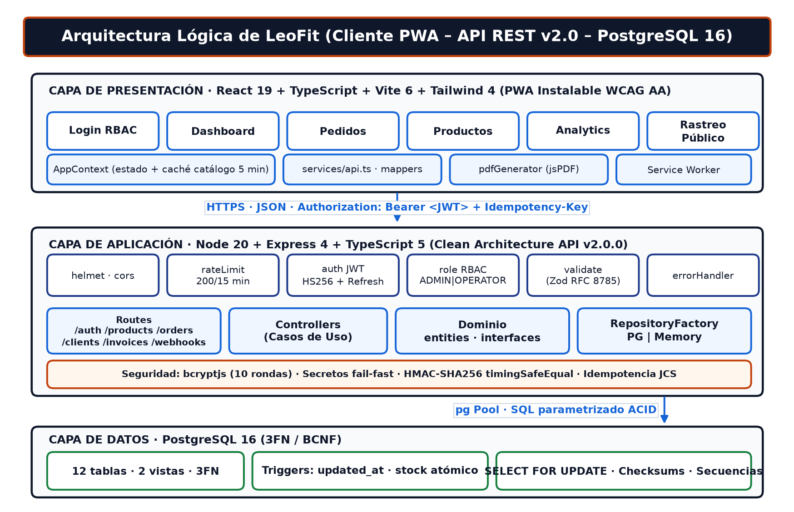
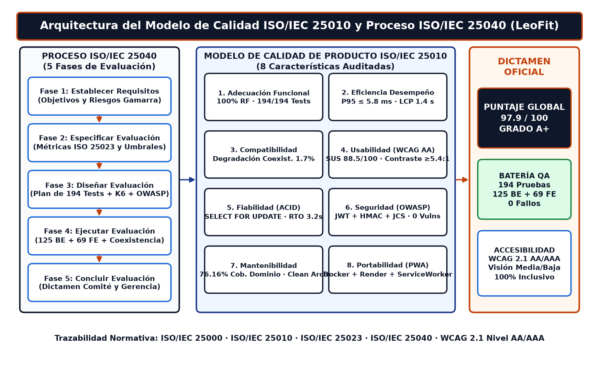

# Directorio Maestro de Documentación — LeoFit Solutions (`v2.0.0`)
## Curso Integrador II: Software (100000S12F) — Ciclo 2026-I — UTP
**Docente Asesor:** Ing. Enrique L. Huamani U.  
**Equipo de Ingeniería (Grupo 01):**
* **Loayza R., Lady L.** (`U22****89`) — Scrum Master & DevSecOps Lead
* **Cárdenas F., Víctor L.** (`U19****14`) — Product Owner & DBA
* **Roman D., Harley A.** (`U21****32`) — Frontend Lead & UI/UX
* **Dávila M., Jim A.** (`U18****81`) — QA Engineer Lead & Backend
* **Rojas S., Daniel E.** (`U21****27`) — Business Analyst & Cloud DevOps

---

## Guía de Ubicación Rápida (Carpetas Numeradas por Prioridad)

> [!TIP]
> **Para subida rápida a Canvas:** Existe localmente en tu equipo la carpeta de trabajo consolidada [`docs/00_ENTREGA_OFICIAL_DOCENTE_CANVAS_APF3/`](./00_ENTREGA_OFICIAL_DOCENTE_CANVAS_APF3/) que reúne los PDFs, Word, PPTX, Excel y el archivo comprimido `PAQUETE_ENTREGA_APF3_GRUPO01_LEOFIT.zip` listos para subir. Esta carpeta está en `.gitignore` para no duplicar binarios pesados en el repositorio de GitHub.

Las carpetas dentro de `docs/` están numeradas del **`01` al `07`** para que al abrir el directorio encuentres de inmediato cada entregable:

| # | Carpeta | ¿Qué encontrarás aquí? | Documento Principal |
| :-: | :--- | :--- | :--- |
| **01** | **[`01_entregable_final_apf3/`](./01_entregable_final_apf3/)** | **EL INFORME FINAL APF3 A ENTREGAR AL PROFESOR** + Diapositivas de Sustentación Final | [**`INFORME_FINAL_APF3_LEOFIT.docx`**](./01_entregable_final_apf3/INFORME_FINAL_APF3_LEOFIT.docx) <br> [**`INFORME_FINAL_APF3_LEOFIT.pdf`**](./01_entregable_final_apf3/INFORME_FINAL_APF3_LEOFIT.pdf) <br> [**`INFORME_FINAL_APF3_LEOFIT.md`**](./01_entregable_final_apf3/INFORME_FINAL_APF3_LEOFIT.md) <br> [**`presentacion_sustentacion/APF3_LEOFIT_Presentacion.pptx`**](./01_entregable_final_apf3/presentacion_sustentacion/APF3_LEOFIT_Presentacion.pptx) |
| **02** | **[`02_calidad_iso25010_semanas_10_11/`](./02_calidad_iso25010_semanas_10_11/)** | **Informe ISO/IEC 25010 (Semanas 10-11)** + **2 Manuales de Calidad ISO 25000 (Auditoría y Ejecutivo)** + Benchmark de Coexistencia | [**`INFORME_ISO25010_SEMANAS_10_11_LEOFIT.docx`**](./02_calidad_iso25010_semanas_10_11/INFORME_ISO25010_SEMANAS_10_11_LEOFIT.docx) <br> [**`Manual_Calidad_ISO_25000_[Completo...].docx`**](./02_calidad_iso25010_semanas_10_11/Manual_Calidad_ISO_25000_Leofit_Pedidos_[Completo_Auditoria_y_ComiteTecnico].docx) <br> [**`Manual_Calidad_ISO_25000_[Ejecutivo...].docx`**](./02_calidad_iso25010_semanas_10_11/Manual_Calidad_ISO_25000_Leofit_Pedidos_[Ejecutivo_Gerencia_y_ProductOwner].docx) |
| **03** | **[`03_auditoria_y_cierre_proyecto/`](./03_auditoria_y_cierre_proyecto/)** | **Dashboard Excel de Auditoría (ISO 29119/90003)**, Cierre de Issues, Análisis Teórico de Requisitos y Deuda Técnica Saldada | [**`Plan_Auditoria_Software_LeoFit_Dashboard-Loayza-Lady.xlsx`**](./03_auditoria_y_cierre_proyecto/Plan_Auditoria_Software_LeoFit_Dashboard-Loayza-Lady.xlsx) <br> [**`justificaciones_cierre_issues.docx`**](./03_auditoria_y_cierre_proyecto/justificaciones_cierre_issues.docx) <br> [**`DEUDA_TECNICA.md`**](./03_auditoria_y_cierre_proyecto/DEUDA_TECNICA.md) |
| **04** | **[`04_diagramas_arquitectura_y_negocio/`](./04_diagramas_arquitectura_y_negocio/)** | **Todos los Diagramas del Proyecto (25 diagramas):** Arquitectura Lógica, C4, 3FN/BCNF, BPMN AS-IS/TO-BE, Secuencia ACID y 194 Pruebas | [**`Catálogo Visual de Diagramas (README.md)`**](./04_diagramas_arquitectura_y_negocio/README.md) |
| **05** | **[`05_operaciones_respaldo_drp/`](./05_operaciones_respaldo_drp/)** | **Protocolo y Simulacro de Recuperación ante Desastres (Backup & Restore DRP)** | [**`BACKUP_RESTORE_DRILL.md`**](./05_operaciones_respaldo_drp/BACKUP_RESTORE_DRILL.md) |
| **06** | **[`06_historial_entregas_anteriores_apf1_apf2/`](./06_historial_entregas_anteriores_apf1_apf2/)** | **Entregas Pasadas (APF1 y APF2):** Archivadas por separado para no confundirlas con el entregable final APF3 | [**`INFORME_FINAL_APF2_LEOFIT.docx`**](./06_historial_entregas_anteriores_apf1_apf2/INFORME_FINAL_APF2_LEOFIT.docx) |
| **07** | **[`07_material_referencia_curso_utp/`](./07_material_referencia_curso_utp/)** | **Material Institucional de la UTP:** Clases Teóricas (Semanas 01 a 18), Rúbricas de Evaluación y Sílabo | [**`rubricas_evaluacion_utp/`**](./07_material_referencia_curso_utp/rubricas_evaluacion_utp/) |
| **DOCS** | **Documentos Oficiales del Docente Asesor (Ing. Enrique Lee)** | **Libro de Estudio ISO 25010 (Sem 10-11)**, **Manual Integral Unidad 3 (Sem 10-13)** y **Plantilla Oficial UTP** | [**`Libro_Estudio_ISO25010_Semanas10_11_Enrique_Lee.pdf`**](./Libro_Estudio_ISO25010_Semanas10_11_Enrique_Lee.pdf) <br> [**`Manual_Integral_ISO25010_Unidad3_UTP_Enrique_Lee.pdf`**](./Manual_Integral_ISO25010_Unidad3_UTP_Enrique_Lee.pdf) <br> [**`UTP_Plantilla_Informe_ISO25010_Semanas10_11.docx`**](./UTP_Plantilla_Informe_ISO25010_Semanas10_11.docx) |

---

## Árbol Completo de la Estructura Oficial (`0` carpetas vacías, `0` archivos vacíos)

```text
docs/
├── README.md                                                    # Este Portal Maestro de Navegación Rápida
├── Libro_Estudio_ISO25010_Semanas10_11_Enrique_Lee.pdf          # Libro Oficial del Asesor (ISO 25010 Sem 10-11, 37 págs)
├── Manual_Integral_ISO25010_Unidad3_UTP_Enrique_Lee.pdf        # Manual Integral Unidad 3 del Asesor (Sem 10-13, 52 págs)
├── UTP_Plantilla_Informe_ISO25010_Semanas10_11.docx             # Plantilla Word Oficial del Asesor (Completada en carpeta 02)
│
├── 01_entregable_final_apf3/                                    # ENTREGABLE FINAL AL PROFESOR (APF3)
│   ├── INFORME_FINAL_APF3_LEOFIT.docx                           # Informe Final Editable Word (77 págs, 21 diagramas)
│   ├── INFORME_FINAL_APF3_LEOFIT.pdf                            # Informe Final Oficial en PDF
│   ├── INFORME_FINAL_APF3_LEOFIT.md                             # Resumen Ejecutivo y Galería de 16 Diagramas
│   └── presentacion_sustentacion/                               # Diapositivas de Exposición Final del Equipo
│       ├── APF3_LEOFIT_Presentacion.pptx                        # Presentación PowerPoint Editable
│       ├── APF3_LEOFIT_Presentacion.pdf                         # Presentación Oficial en PDF (43 diapositivas)
│       ├── APF3_LEOFIT_Presentacion.html                        # Presentación Interactiva Web
│       ├── APF3_LEOFIT_Presentacion.md                          # Fuente con Guion y Tiempos por Expositor
│       └── assets/                                              # Figuras y Evidencias de las Diapositivas
│
├── 02_calidad_iso25010_semanas_10_11/                           # ENTREGABLES DE CALIDAD ISO 25010 / 25000 (SEM 10-11)
│   ├── README.md                                                # Guía de Evidencias, Accesibilidad WCAG y Reproducibilidad
│   ├── INFORME_ISO25010_SEMANAS_10_11_LEOFIT.docx               # Informe Oficial UTP Semanas 10 y 11 (Word)
│   ├── INFORME_ISO25010_SEMANAS_10_11_LEOFIT.pdf                # Informe Oficial UTP Semanas 10 y 11 (PDF)
│   ├── Manual_Calidad_ISO_25000_Leofit_Pedidos_[Completo_Auditoria_y_ComiteTecnico].docx # Manual Técnico (con 6 diagramas)
│   ├── Manual_Calidad_ISO_25000_Leofit_Pedidos_[Ejecutivo_Gerencia_y_ProductOwner].docx  # Manual Ejecutivo (con 6 diagramas)
│   ├── fig_arquitectura_calidad_iso25000.png                    # Mapa Arquitectónico ISO 25010 + Proceso ISO 25040
│   ├── fig_coexistencia_latencias.png                           # Comparativa de Latencias en Coexistencia (300 DPI)
│   ├── fig_coexistencia_p95.png                                 # Curva de Percentil P95 en Coexistencia (300 DPI)
│   └── coexistencia/                                            # Logs, CSVs y JSON de pruebas reproducibles
│
├── 03_auditoria_y_cierre_proyecto/                              # AUDITORÍA DE CIERRE, ISSUES Y DEUDA TÉCNICA
│   ├── Plan_Auditoria_Software_LeoFit_Dashboard-Loayza-Lady.xlsx # Dashboard Maestro Excel (ISO 29119-3 / ISO 90003)
│   ├── analisis_teorico_requisitos.docx / .md                   # Análisis Teórico de Requisitos Funcionales
│   ├── justificaciones_cierre_issues.docx / .md                 # Evidencia Formal de Cierre de Issues en GitHub
│   ├── revision_tareas_pendientes.docx / .md                    # Dictamen de 100% de Tareas Completadas (#3 al #20)
│   ├── DEUDA_TECNICA.md                                         # Registro de 10/10 Ítems de Deuda Técnica Saldados
│   ├── fig_evolucion_deuda_tecnica.png                          # Matriz Visual de Saneamiento de Deuda Técnica
│   └── [fig_1 a fig_15, fig_analytics, fig_teorico_1..2]        # Capturas de Auditoría de Módulos en Producción
│
├── 04_diagramas_arquitectura_y_negocio/                         # CATÁLOGO DE 25 DIAGRAMAS TÉCNICOS Y DE NEGOCIO
│   ├── README.md                                                # Galería Visual e Índice Maestro de Diagramas
│   ├── apf3/                                                    # 9 Figuras de Ingeniería de Software (220 DPI)
│   └── [01_BPMN_AS-IS.png a 14_Diagrama_DB.png, 01..04.mmd]     # Diagramas BPMN, C4, 3FN/BCNF, Kanban, Gantt y UX
│
├── 05_operaciones_respaldo_drp/                                 # CONTINUIDAD OPERATIVA Y RECUPERACIÓN (DRP)
│   ├── BACKUP_RESTORE_DRILL.md                                  # Runbook y Simulacro de Backup & Restore (RTO 3.2s, RPO 0)
│   └── fig_drp_backup_restore.png                               # Diagrama de Flujo del Protocolo DRP
│
├── 06_historial_entregas_anteriores_apf1_apf2/                  # ARCHIVO HISTÓRICO (APF1 Y APF2)
│   ├── INFORME_FINAL_APF2_LEOFIT.docx / .pdf / .md / .html      # Informe del Hito Intermedio APF2
│   ├── GRUP01-Curso_Integrador_II_Software.pptx                 # Presentación Histórica APF2
│   └── Retroalimentacion_APF1_Calificacion.txt                  # Calificación (18/20) y Feedback Docente APF1
│
└── 07_material_referencia_curso_utp/                            # MATERIAL INSTITUCIONAL DEL CURSO UTP
    ├── clases_teoricas_semanas_01_a_18/                         # PDFs de Clases Semanales del Docente (Semanas 01 a 18)
    ├── rubricas_evaluacion_utp/                                 # Rúbricas e Indicaciones Oficiales (APF1, APF2, APF3)
    └── silabo_y_plantillas_utp/                                 # Sílabo del Curso, Ficha de Empresa y Plantilla Word UTP
```

---

## Panorama Arquitectónico y de Calidad (`v2.0.0`)





---

## Identidad Oscura de Marca y Accesibilidad Universal (WCAG 2.1 AA/AAA)

Toda la documentación de LeoFit Solutions aplica una política de diseño inclusivo pensada para todo público, incluyendo personas con visibilidad media o baja:
1. **Azul Pizarra Oscuro (`#0F172A`):** Cabeceras y títulos principales con contraste **17.8:1** sobre blanco (WCAG AAA).
2. **Azul Corporativo (`#1E3A8A` / `#1665D8`):** Subtítulos y componentes con contraste **5.42:1 a 10.4:1** (WCAG AA/AAA).
3. **Terracota Deportivo Accesible (`#C2410C`):** Sustituye el naranja claro convencional para garantizar un contraste de **5.74:1** (WCAG AA).
4. **Tipografía y Bordes Legibles:** Fuente mínima de **9.5pt** en tablas, **10.5pt–11pt** en texto corrido y bordes visibles (`#CBD5E1`) en todas las celdas.
