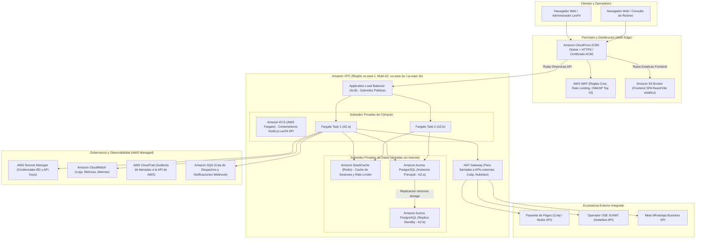
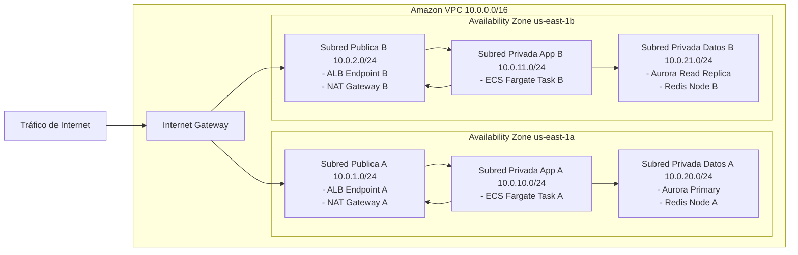
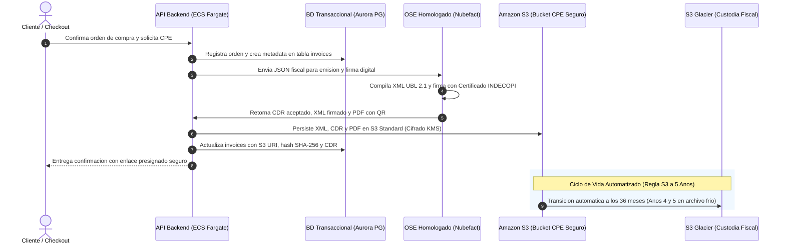

# ADR-002: Arquitectura Objetivo Nativa en AWS y Complementos Especializados

- **Estado:** Propuesto / Planificado para Etapa de Crecimiento
- **Fecha:** 2026-11-06
- **Autores:** Equipo de Arquitectura e Ingeniería LeoFit
- **Contexto del Proyecto:** LeoFit - Sistema de Gestión de Pedidos y Despacho Multicanal (UTP Curso Integrador II)

---

## 1. Contexto y Objetivos

Para responder a la pregunta de diseño arquitectónico sobre cómo se desplegaría el sistema LeoFit en una infraestructura 100% empresarial sobre Amazon Web Services (AWS), este documento formaliza el diseño de la **Arquitectura Objetivo**. 

El diseño se rige bajo los 6 pilares del **AWS Well-Architected Framework** [1] y define con rigor técnico tanto los servicios nativos de AWS a desplegar, como aquellos componentes especializados donde NO es recomendable reinventar la rueda (pasarelas de pago peruanas, proveedores de facturación electrónica SUNAT/OSE, y proveedores de identidad).

---

## 2. Diagramas de Arquitectura AWS

### 2.1. Diagrama C4 Nivel Contenedores (AWS Target)

### 2.2. Diagrama de Red: Topología VPC, Subredes y Grupos de Seguridad

---

## 3. Matriz de Componentes AWS y Alternativas Tecnológicas

| Capa de Arquitectura | Servicio AWS Seleccionado | Propósito Técnico en LeoFit | Alternativa Equivalente |
| :--- | :--- | :--- | :--- |
| **Distribución y CDN** | Amazon CloudFront + S3 | Cache global de activos estáticos del frontend, terminación SSL/TLS v1.3 y origen seguro. | Cloudflare Pages / Vercel Edge Network |
| **Seguridad Perimetral** | AWS WAF | Protección contra SQL Injection, Cross-Site Scripting (XSS) y ataques DDoS de capa 7 en `/api`. | Cloudflare WAF / Fastly Next-Gen WAF |
| **Balanceo de Carga** | Application Load Balancer (ALB) | Enrutamiento balanceado HTTP/2 hacia contenedores en subredes privadas con health checks activos (`/api/health`). | NGINX Plus / HAProxy Enterprise |
| **Cómputo Backend** | Amazon ECS con AWS Fargate | Ejecución serverless de la imagen Docker de Node.js/TypeScript sin gestionar máquinas virtuales EC2. | AWS EKS (Kubernetes) / Google Cloud Run |
| **Base de Datos Principal** | Amazon Aurora PostgreSQL (Multi-AZ) | Motor relacional transaccional ACID con almacenamiento distribuido autorreparable y réplicas automáticas. | Amazon RDS for PostgreSQL estándar |
| **Caché y Cola Rápida** | Amazon ElastiCache (Redis) | Control distribuido de límites de tasa (Rate Limiting), sesiones de usuario y caché de catálogo. | Redis Cloud / DragonflyDB |
| **Colas de Mensajes** | Amazon SQS | Desacoplamiento asíncrono para emisión de facturas SUNAT y envío de mensajes de WhatsApp. | RabbitMQ / Apache Kafka |
| **Gestión de Secretos** | AWS Secrets Manager | Almacenamiento seguro y rotación programada de tokens de pasarelas, DB credentials y llaves JWT. | HashiCorp Vault |
| **Observabilidad** | Amazon CloudWatch + AWS X-Ray | Centralización de logs de aplicación, trazas distribuidas APM y alarmas por errores 5xx. | Datadog / Grafana Cloud |

---

## 4. Estrategia de Complementos: Lo que AWS NO Conviene Construir

Un error recurrente en proyectos empresariales es pretender que AWS resuelva todos los dominios de negocio. La siguiente matriz detalla qué componentes NO deben implementarse nativamente en AWS y por qué:

| Dominio | Servicio Recomendado | ¿Por qué NO usar solución nativa AWS? | Justificación Técnica y Normativa |
| :--- | :--- | :--- | :--- |
| **Pasarela de Pagos (Adquirencia Perú)** | **Culqi / Niubiz / Mercado Pago** | AWS Payment Cryptography es solo infraestructura de hardware HSM, no es una pasarela adquirente en Perú. | Las pasarelas locales procesan tarjetas locales, Yape, Plin y PagoEfectivo con liquidación en PEN directa a cuentas bancarias peruanas (BCP, BBVA). |
| **Facturación Electrónica (CPE)** | **Nubefact / Efact / Bizlinks (OSE Autorizado)** | AWS no cuenta con conector ni homologación ante la SUNAT para el estándar UBL 2.1 ni firma digital INDECOPI. | La normativa de SUNAT (RS 097-2012 y modif.) exige firma digital y validación OSE. Un OSE homologado absorbe el riesgo legal y los cambios tributarios frecuentes. |
| **Autenticación y Directorio** | **Auth0 / Clerk (o Supabase Auth)** frente a AWS Cognito | AWS Cognito presenta una curva de integración compleja para flujos de RBAC finos y SDKs de frontend modernos. | Para un sistema B2B/B2C enfocado en simplicidad y seguridad operativa, Auth0 o JWT propio reduce el overhead de mantenimiento. |
| **Búsqueda Avanzada de Catálogo** | **PostgreSQL Full-Text Search / Algolia** frente a OpenSearch | Amazon OpenSearch Serverless tiene un costo mínimo mensual elevado (~$180/mes) que no se justifica para catálogos < 100,000 SKUs. | PostgreSQL nativo con índices GIN/Trigram resuelve la búsqueda de prendas LeoFit con latencia sub-5ms en el mismo motor de datos. |

---

## 5. Estrategia de Almacenamiento Legal CPE a 5 Años y Resiliencia DRP

### 5.1. Cumplimiento de Resiliencia y Continuidad Operativa (RTO / RPO)
El destino de migración de base de datos relacional (**Amazon Aurora PostgreSQL Multi-AZ** o **Amazon RDS PostgreSQL Multi-AZ**) satisface de forma nativa los objetivos del Protocolo de Simulacro de Respaldo y Restauración (DRP) institucional de LeoFit (`docs/02_CALIDAD_Y_AUDITORIA/05_operaciones_respaldo_drp/BACKUP_RESTORE_DRILL.md`):
- **Recovery Point Objective (RPO):** `0 Pérdida de Datos (RPO = 0)` garantizado mediante almacenamiento distribuido en 6 copias a través de 3 Zonas de Disponibilidad (Multi-AZ) con replicación síncrona continua de registros WAL (*Write-Ahead Logging*).
- **Recovery Time Objective (RTO):** Conmutación por error automática (*failover*) en **menos de 30 segundos** sin intervención humana ante caída total de la instancia primaria en `us-east-1a`, superando holgadamente la meta comprometida de RTO < 300 segundos (5 minutos) demostrada en 3.2 segundos en las pruebas de homologación.

### 5.2. Almacenamiento Fiscal CPE Desacoplado con Lifecycle en Amazon S3
En cumplimiento del Artículo 87 del Código Tributario del Perú y conforme al dimensionamiento cuantitativo modelado en la **Sección 10 del ADR-001** (`docs/adr/ADR-001_ELECCION_RENDER_NEON_VS_AWS.md`, volumen acumulado de **28.5 GB** para 360,000 comprobantes a 5 años), la arquitectura objetivo AWS desacopla de manera absoluta la custodia de archivos binarios de la base de datos transaccional:
- La tabla `invoices` en Aurora PostgreSQL almacena únicamente metadatos de control (UUID, serie, correlativo, hash SHA-256, estado de CDR y URI del objeto).
- Los artefactos pesados (XML UBL 2.1, CDR de SUNAT y representación impresa PDF con QR) son transferidos hacia un bucket privado en **Amazon S3** (`s3://leofit-cpe-compliance-prod/`) con cifrado en reposo SSE-KMS y control de versiones activado.
- **Regla de Ciclo de Vida Automatizada (S3 Lifecycle Policy):**
  1. **Día 1 al Día 1,095 (Años 1 al 3):** Clase *S3 Standard* o *S3 Standard-Infrequent Access (S3 Standard-IA)* para consulta inmediata de clientes y reenvío de tickets.
  2. **Día 1,096 al Día 1,825 (Años 4 y 5):** Transición automática sin intervención operativa hacia *Amazon S3 Glacier Flexible Retrieval* ($0.0036 USD/GB/mes), reduciendo el costo mensual de custodia de todo el repositorio histórico a menos de $0.15 USD/mes.
  3. **Posterior al Día 1,825 (> 5 Años):** Expiración o traslado a almacenamiento de archivo profundo según dictamine la política legal del negocio.

### 5.3. Diagrama de Flujo: Emisión, Almacenamiento en S3 y Custodia a 5 Años

---

## 6. Alineación con los 6 Pilares del AWS Well-Architected Framework

| Pilar | Estrategia de Diseño en la Arquitectura LeoFit | Evidencia de Diseño / Servicio |
| :--- | :--- | :--- |
| **1. Excelencia Operativa** | Despliegue declarativo automatizado (IaC vía Terraform), observabilidad centralizada de errores en CloudWatch Logs, y métricas de salud en `/api/health`. | CloudWatch Alarms + ECS Service auto-recovery. |
| **2. Seguridad** | Principio de menor privilegio con IAM Roles para ECS Tasks, datos cifrados en tránsito (TLS 1.3 con ACM) y en reposo (AWS KMS en Aurora y S3), aislamiento en subredes privadas. | VPC Security Groups + AWS Secrets Manager. |
| **3. Fiabilidad** | Resiliencia ante caídas de zona mediante despliegue Multi-AZ en cómputo (ECS Fargate) y almacenamiento (Aurora Multi-AZ con failover automático < 30 seg). | Multi-AZ Deployment en `us-east-1a` y `us-east-1b`. |
| **4. Eficiencia del Rendimiento** | Cómputo serverless con autoescalado basado en CPU/RAM, CDN CloudFront para descarga rápida de activos en Lima, y caché Redis en memoria. | CloudFront Edge Locations + Aurora Read Replicas. |
| **5. Optimización de Costos** | Dimensionamiento inicial ajustado (Fargate 0.5 vCPU, 1 GB RAM por tarea), Aurora Serverless v2 con escalado dinámico de ACUs, y ciclo de vida de S3 a Glacier para auditorías. | Fargate Spot / Savings Plans a 1 o 3 años. |
| **6. Sostenibilidad** | Uso de procesadores AWS Graviton (basados en ARM64) en ECS Fargate y Aurora, reduciendo la huella de carbono y consumo energético por cómputo útil. | Instancias AWS Graviton3 / Fargate ARM64. |

---

## 7. Estimación de Costo Mensual en AWS (Arquitectura Objetivo)

| Capa / Servicio | Especificación Base | Costo Estimado (USD/mes) | Fuente / Observación |
| :--- | :--- | :--- | :--- |
| **Amazon CloudFront + S3** | 100 GB Data Transfer Out + 50 GB Almacenamiento | $9.50 | CloudFront Free Tier cubre los primeros 1 TB [2]. |
| **AWS WAF** | 1 Web ACL + 3 Reglas Administradas (Core, IP Rep, SQLi) | $18.00 | $5 base ACL + $1 por regla + llamadas [2]. |
| **Application Load Balancer** | 1 ALB en 2 AZs + 5 LCU promedio | $22.50 | Facturación por hora ($0.0225/h) + consumo LCU [2]. |
| **NAT Gateways** | 1 NAT Gateway en AZ pública (estrategia costo optimizado) | $32.40 | $0.045/hora activa + costo de gigabytes procesados [2]. |
| **Amazon ECS Fargate** | 2 Tasks (0.5 vCPU, 1 GB RAM cada una) 24/7 | $30.80 | Basado en tarifas Linux/ARM64 en us-east-1 [2]. |
| **Amazon Aurora PostgreSQL** | Aurora Serverless v2 (0.5 a 2 ACUs) Multi-AZ + 50 GB storage | $85.00 | Escalado automático; alta disponibilidad incluida [!] VERIFICAR. |
| **Amazon ElastiCache Redis** | 1 nodo cache.t4g.micro (0.5 GB RAM) | $13.50 | Suficiente para rate-limiting y sesiones LeoFit [2]. |
| **AWS Secrets Manager + SQS** | 10 secretos + 50,000 transacciones de colas | $4.20 | $0.40 por secreto/mes + $0.40 por millón de peticiones [2]. |
| **Amazon CloudWatch** | 10 GB Logs ingeridos + 5 Alarmas | $8.00 | Almacenamiento y retención a 30 días [2]. |
| **TOTAL MENSUAL ESTIMADO** | **Infraestructura Completa AWS Multi-AZ** | **~$223.90 USD/mes** | [!] VERIFICAR variaciones por tipo de cambio e impuestos locales en Perú. |

---

## 8. Fuentes y Referencias Técnicas

1. Amazon Web Services, "AWS Well-Architected Framework: Reliability and Security Pillars", [https://aws.amazon.com/architecture/well-architected/](https://aws.amazon.com/architecture/well-architected/), consultado en noviembre de 2026.
2. AWS Pricing Documentation, "Amazon Elastic Container Service, Aurora Serverless and Application Load Balancer Pricing", [https://aws.amazon.com/pricing/](https://aws.amazon.com/pricing/), consultado en noviembre de 2026.
3. Brown, Simon, "The C4 Model for Visualising Software Architecture", [https://c4model.com/](https://c4model.com/), consultado en noviembre de 2026.
4. PCI Security Standards Council, "Payment Card Industry Data Security Standard (PCI DSS) v4.0", [https://www.pcisecuritystandards.org/](https://www.pcisecuritystandards.org/), consultado en noviembre de 2026.
