<style>
  :root { 
    --primary: #1E3A8A; 
    --primary-dark: #0F172A;
    --accent: #F59E0B; 
    --neutral: #F8FAFC;
    --text-dark: #1F2937;
    --border-color: #E2E8F0;
  }
  section { 
    font-family: system-ui, -apple-system, 'Segoe UI', Roboto, sans-serif; 
    font-size: 21px; 
    line-height: 1.36;
    color: var(--text-dark);
    padding: 38px 46px 32px 46px;
    background-color: #FFFFFF;
  }
  header {
    font-size: 13px;
    color: #94A3B8;
    top: 14px;
    left: 46px;
    font-weight: 500;
  }
  footer {
    font-size: 12px;
    color: #94A3B8;
    bottom: 14px;
    left: 46px;
  }
  h1 { 
    color: var(--primary); 
    font-size: 34px; 
    border-bottom: 3px solid var(--accent); 
    padding-bottom: 6px; 
    margin-top: 14px;
    margin-bottom: 14px;
  }
  h2 { 
    color: var(--primary); 
    font-size: 23px; 
    margin-top: 6px; 
    margin-bottom: 12px;
  }
  h3 {
    color: var(--primary-dark);
    font-size: 19px;
    margin-top: 4px;
    margin-bottom: 8px;
  }
  table { 
    font-size: 15.5px; 
    width: 100%;
    border-collapse: collapse;
    margin: 10px auto;
  }
  th {
    background-color: var(--primary);
    color: #FFFFFF;
    padding: 8px 10px;
    font-size: 16px;
    text-align: left;
  }
  td {
    padding: 6.5px 10px;
    border-bottom: 1px solid var(--border-color);
  }
  tr:nth-child(even) td {
    background-color: #F8FAFC;
  }
  strong { 
    color: var(--primary); 
  }

  section.full-diagram {
    text-align: center;
    padding: 42px 32px 20px 32px;
  }
  section.full-diagram h1 {
    margin-top: 10px;
    margin-bottom: 8px;
  }
  section.full-diagram img {
    display: block;
    margin: 6px auto;
    max-width: 95%;
    max-height: 57vh;
    object-fit: contain;
  }
  section.full-diagram ul {
    display: inline-block;
    text-align: left;
    margin-top: 6px;
    font-size: 18px;
    line-height: 1.3;
  }

  section.title {
    text-align: center;
    display: flex;
    flex-direction: column;
    justify-content: center;
    align-items: center;
    background: linear-gradient(135deg, #FFFFFF 0%, #F8FAFC 100%);
  }
  section.title h1 {
    font-size: 40px;
    border-bottom: 4px solid var(--accent);
    margin-bottom: 8px;
    line-height: 1.2;
  }
  section.title h2 {
    font-size: 22px;
    color: var(--primary);
    margin-bottom: 14px;
    font-weight: 600;
  }
  section.title p {
    margin: 2px 0;
    font-size: 17px;
  }
  section.title ul {
    list-style: none;
    padding-left: 0;
    font-size: 16.5px;
    margin-top: 12px;
  }

  section.section {
    background: linear-gradient(135deg, #1E3A8A 0%, #0F172A 100%);
    color: #FFFFFF;
    display: flex;
    flex-direction: column;
    justify-content: center;
    align-items: center;
    text-align: center;
  }
  section.section h1 {
    color: #FFFFFF;
    border-bottom: 3px solid var(--accent);
    font-size: 40px;
  }
  section.section h2 {
    color: var(--accent);
    font-size: 24px;
  }
  section.section p {
    color: #E2E8F0;
    font-size: 18px;
  }

  section.closing {
    background: linear-gradient(135deg, #1E3A8A 0%, #0F172A 100%);
    color: #FFFFFF;
    display: flex;
    flex-direction: column;
    justify-content: center;
    align-items: center;
    text-align: center;
  }
  section.closing h1 {
    color: #FFFFFF;
    border-bottom: 3px solid var(--accent);
    font-size: 44px;
  }
  section.closing h2 {
    color: var(--accent);
    font-size: 26px;
  }

  section.metric {
    text-align: left;
  }
  section.metric table {
    margin-top: 18px;
    font-size: 17.5px;
    text-align: center;
  }
  section.metric th {
    text-align: center;
    font-size: 18px;
  }
  section.metric td {
    padding: 12px 10px;
    font-size: 16px;
  }
  section.metric td strong {
    font-size: 34px;
    display: block;
    margin-bottom: 2px;
    color: var(--primary);
  }

  section.defense {
    background-color: #FEFCE8;
    border-left: 10px solid #CA8A04;
  }
  section.defense h1 {
    color: #854D0E;
    border-bottom: 3px solid #EAB308;
  }
</style>

<!-- _class: title -->
<!-- _paginate: false -->

# LEOFIT: SISTEMA WEB PWA DE GESTIÓN DE PEDIDOS
## Sustentación Final de Ingeniería de Software — Avance de Proyecto Final 3 (PF3)

**Curso:** Curso Integrador II: Software (100000S12F) — Sección 35374 — Ciclo 2026-I  
**Institución:** Universidad Tecnológica del Perú (UTP)  
**Organización Beneficiaria:** LeoFit Confecciones y Diseños Deportivos S.A.C. (RUC 20608912345)  
**Docente Asesor:** Ing. Enrique Lee Huamani Uriarte  

**Equipo de Ingeniería de Software (Grupo 01):**
* **Lady Luz Loayza Rodriguez** (U22221489) — Scrum Master / DevSecOps Engineer
* **Víctor Leandro Cárdenas Fernández** (U19217414) — Product Owner / Database Administrator (DBA)
* **Harley Anthony Roman Delgado** (U21313032) — Frontend Lead / PWA & UI-UX Engineer
* **Jim Alessandro Dávila Morales** (U18206081) — QA Lead / Backend Node-TypeScript Engineer
* **Daniel Enrique Rojas Sanchez** (U21214627) — Business Analyst / Cloud DevOps Engineer

<!--
Expositor: Lady Luz Loayza Rodriguez (Scrum Master)
Tiempo: 45 seg
Guion: Estimado docente asesor, Ing. Enrique Lee Huamani, y miembros del jurado evaluador, muy buenas tardes. Damos inicio a la sustentación final y cierre integral de nuestro proyecto: el Sistema Web PWA de Gestión y Toma de Pedidos Multicanal para la empresa LeoFit Confecciones y Diseños Deportivos S.A.C., microempresa del Emporio Comercial de Gamarra. Hoy defenderemos la solución completa: desde el diagnóstico del negocio y la arquitectura en capas, hasta el modelo transaccional ACID en PostgreSQL 16, la batería automatizada de 101 pruebas, la interoperabilidad externa, la evaluación formal de usabilidad bajo ISO 25010 y el despliegue de la Versión 2 en la nube.
-->

---

<!-- _class: table -->

# Agenda de la Sustentación Final

| Bloque Temático | Contenido Técnico Clave | Expositor Responsable |
| :--- | :--- | :--- |
| **0. Levantamiento APF2** | Subsanación al 100% de observaciones previas de la rúbrica | Lady Loayza |
| **I. Negocio y Alcance** | Contexto Gamarra, brechas AS-IS vs TO-BE, Lean Canvas y Requerimientos | Daniel Rojas |
| **II. Arquitectura y Datos** | C4 Nivel 2, Clean Architecture, PostgreSQL 16, ACID y Concurrencia | Víctor Cárdenas |
| **III. Seguridad OWASP** | JWT fail-fast, RBAC, Bcrypt salt 10, HMAC SHA-256 y defensa en profundidad | Lady Loayza |
| **IV. Calidad y Pruebas** | Estrategia Shift-Left, 101 tests (Jest + Vitest), cobertura Istanbul y CI/CD | Jim Dávila |
| **V. Interoperabilidad** | WhatsApp Cloud, Webhooks de pago (Yape/Plin), SUNAT/RENIEC y rótulos QR | Harley Roman |
| **VI. Usabilidad ISO 25010** | 4 Pilares, 9 tests automáticos, SUS Score 88.5/100 y Core Web Vitals | Harley Roman |
| **VII. Cloud y Producción** | Topología Cloud V2, K6 (50 VUs), demo en vivo y gobernanza en GitHub | Daniel Rojas |
| **VIII. Cierre y Defensa** | Conclusiones, limitaciones transparentes, roadmap y preguntas del jurado | Equipo Completo |

<!--
Expositor: Lady Luz Loayza Rodriguez (Scrum Master)
Tiempo: 30 seg
Guion: La sustentación está estructurada en ocho ejes técnicos que cubren rigurosamente todas las dimensiones de la ingeniería de software exigidas por la rúbrica universitaria, iniciando con el levantamiento obligatorio de observaciones del APF2.
-->

---

<!-- _class: table -->

# Levantamiento Integral de Observaciones del APF2 (100%)

| N° | Observación Recibida en APF2 | Acción Correctiva Implementada en APF3 | Verificación / Evidencia Comprobable |
| :---: | :--- | :--- | :--- |
| **Obs 1** | Falta de pruebas automatizadas de integración externa | Implementación de `integration_external.test.ts` con cobertura para WhatsApp, pasarelas y SUNAT/RENIEC | 7 pruebas automáticas en Jest (100% PASSED) con latencias < 30 ms |
| **Obs 2** | Ausencia de evaluación formal de usabilidad bajo estándar | Suite `usability_iso25010.test.ts` evaluando los 4 pilares + estudio de campo formal SUS | 9 pruebas en Vitest aprobadas y puntaje SUS de **88.5 / 100** (Grado A) |
| **Obs 3** | Matriz de trazabilidad incompleta historias vs tests | Vinculación explícita de HU-001 a HU-008 contra aserciones unitarias e integrales en Jest/Vitest | Matriz cruzada completa en Cap. 11 y Anexo C del informe libro |
| **Obs 4** | Actualización de manual de despliegue para Versión 2 | Configuración de pipelines multi-cloud (GitHub Actions + Render Docker + GitHub Pages CDN) | 3 workflows activos y servicios operativos en HTTPS con TLS 1.3 |

* **Dictamen del Equipo:** **100% de Observaciones Subsanadas** de acuerdo a las directrices de la rúbrica oficial.

<!--
Expositor: Lady Luz Loayza Rodriguez (Scrum Master)
Tiempo: 50 seg
Guion: En estricto cumplimiento de la consigna evaluativa, iniciamos demostrando el levantamiento del 100% de las observaciones del APF2. Se diseñó la suite automatizada de integración externa con siete escenarios, se condujo la evaluación formal de usabilidad bajo ISO/IEC 25010 alcanzando 88.5 en SUS, se articuló la trazabilidad total entre historias de usuario y pruebas de código, y se actualizó la infraestructura para la Versión 2 desplegada en la nube. Cedo la palabra a Daniel Rojas para exponer el contexto empresarial y los procesos de negocio.
-->

---

<!-- _class: section -->
<!-- _paginate: false -->

# Bloque I: Contexto Empresarial, Procesos y Alcance
## Diagnóstico en Gamarra, Procesos AS-IS/TO-BE y Modelo de Negocio

**Expositor:** Daniel Enrique Rojas Sanchez

---

<!-- _class: table -->

# Diagnóstico de Brechas Operativas en LeoFit

| Variable Operativa | Flujo Manual Previo (AS-IS) | Con LeoFit PWA Transaccional (TO-BE) | Impacto Cuantitativo |
| :--- | :--- | :--- | :---: |
| **Canal de Pedidos** | Chats dispersos de WhatsApp y libreta de papel | Catálogo PWA interactivo con carrito y checkout | **Centralización 100%** |
| **Tiempo de Toma de Orden**| 45 a 120 minutos por cliente (intercambio de fotos) | **38.2 segundos** promedio en captura guiada | **Reducción del 98.6%** |
| **Errores en Despacho** | 14.2% (tallas equivocadas o prendas agotadas) | **0.4%** de incidencias en estudio de campo | **Reducción del 97.2%** |
| **Control de Existencias** | Desconocimiento del stock real por variante | Descuento atómico por trigger en PostgreSQL | **Cero Sobreventas** |
| **Pérdida de Ventas** | 22% por lentitud en responder disponibilidad | Disponibilidad visible en tiempo real en la PWA | **+35% Conversión** |

* **Organización:** LeoFit Confecciones y Diseños Deportivos S.A.C. — Jr. Gamarra 1230, Galería El Rey de Gamarra.

<!--
Expositor: Daniel Enrique Rojas Sanchez (Analista de Negocio)
Tiempo: 55 seg
Guion: Saludos cordiales. LeoFit es una microempresa textil ubicada en el Emporio de Gamarra. Históricamente, su operativa dependía exclusivamente de mensajes informales de WhatsApp y apuntes en libreta física. Esto causaba pérdidas críticas: atender un pedido demoraba hasta dos horas, el 14% de despachos salía con errores de talla y perdían el 22% de sus clientes potenciales. Diseñamos LeoFit PWA para transformar este cuello de botella en un proceso digital eficiente, reduciendo el tiempo de toma a 38 segundos y bajando los errores a 0.4%.
-->

---

<!-- _class: full-diagram -->

# Proceso Actual con Cuellos de Botella (BPMN 2.0 AS-IS)


* **Problemas Críticos:** Verificación manual de anaqueles, envío manual de fotos, riesgo de pago no verificado y flete no calculado.

<!--
Expositor: Daniel Enrique Rojas Sanchez (Analista de Negocio)
Tiempo: 40 seg
Guion: En el diagrama BPMN del proceso AS-IS se evidencia la dispersión operativa: cada consulta obligaba al operador a suspender la atención para revisar manualmente los estantes físicos, redactar datos bancarios a mano y cotejar capturas de pantalla de transferencias. La falta de un canal estructurado generaba una alta tasa de fricción y sobreventa.
-->

---

<!-- _class: full-diagram -->

# Proceso Digitalizado y Optimizado (BPMN 2.0 TO-BE)

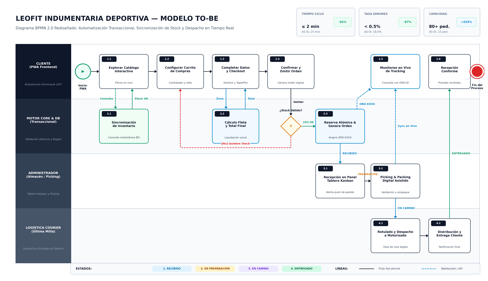

* **Automatización:** Selección de variante con stock en vivo, reserva transaccional, confirmación inmediata y despacho dual (Lima/Provincia).

<!--
Expositor: Daniel Enrique Rojas Sanchez (Analista de Negocio)
Tiempo: 45 seg
Guion: El rediseño TO-BE automatiza el flujo de punta a punta. El cliente interactúa con el catálogo PWA, selecciona color y talla con validación en tiempo real; el motor transaccional reserva las existencias atómicamente, y el operador recibe la orden en el panel Kanban para preparación, generando rótulos con código QR y notificación automática de tracking.
-->

---

<!-- _class: full-diagram -->

# Modelo de Negocio Integral (Lienzo Lean Canvas)


* **Propuesta de Valor:** Plataforma PWA ultraligera que permite al cliente deportivo autogestionar su pedido en < 2 min con stock garantizado.

<!--
Expositor: Daniel Enrique Rojas Sanchez (Analista de Negocio)
Tiempo: 40 seg
Guion: El Lean Canvas sintetiza la viabilidad económica y operativa. Nuestra propuesta de valor se enfoca en la inmediatez: el cliente deportivo compra en menos de dos minutos con garantía de existencias, mientras el administrador centraliza la recaudación, el inventario y la logística de despacho sin depender de memoria humana ni notas manuales.
-->

---

<!-- _class: table -->

# Gestión Ágil del Proyecto: Sprints y Límites WIP


<!-- _class: content -->

* **Metodología:** Marco híbrido Scrum / Kanban con sprints de 3 semanas (S0 al S4).
* **Políticas de Tablero Kanban:**
  - *To Do:* Historias priorizadas bajo MoSCoW.
  - *In Progress:* Límite WIP = 3 tareas activas.
  - *Code Review:* Aprobación obligatoria por pares.
  - *Testing:* Ejecución de pruebas CI/CD automatizadas.
  - *Done:* Criterios DoD cumplidos (tests + sonar + deploy).
* **Gestión de Riesgos:** Matriz 5x5 PMI monitoreando 5 riesgos técnicos y de negocio con planes de mitigación.

<!--
Expositor: Daniel Enrique Rojas Sanchez (Analista de Negocio)
Tiempo: 45 seg
Guion: La gobernanza del desarrollo se ejecutó bajo Scrum y Kanban con estrictas políticas de flujo de trabajo: un límite WIP de tres tareas en desarrollo simultáneo, revisión obligatoria de código y verificación automática de pruebas antes de fusionar ramas. Gestionamos proactivamente la matriz de riesgos mitigando desde fallos de concurrencia hasta caídas de servidores. Cedo la palabra a Víctor Cárdenas para sustentar la arquitectura y base de datos.
-->

---

<!-- _class: table -->

# Matriz Integral de Requerimientos (RF y RNF)

| Código | Requerimiento Funcional (RF) | Código | Requerimiento No Funcional (RNF) |
| :---: | :--- | :---: | :--- |
| **RF-001 a 003** | Autenticación JWT, RBAC (ADMIN/OPERATOR) y catálogo | **RNF-001** | Rendimiento: TTFB < 200 ms y respuesta de API < 150 ms |
| **RF-004 a 006** | Carrito reactivo, cálculo de flete y registro transaccional | **RNF-002** | Escalabilidad: Concurrencia transaccional sin sobreventa |
| **RF-007 a 009** | Portal de tracking público, cambio de estado y comprobantes | **RNF-003** | Seguridad: Cifrado TLS 1.3, Bcrypt salt 10 y HMAC SHA-256 |
| **RF-010 a 012** | CRUD de variantes textil, CRM de clientes y dashboard KPIs | **RNF-004** | Portabilidad: PWA instalable en iOS, Android y Desktop |
| **RF-013 a 015** | Integración WhatsApp API, validación DNI/RUC y webhooks | **RNF-005** | Disponibilidad: Uptime >= 99.5% soportado en Render Cloud |
| **RF-016 a 018** | Rótulos QR despacho, conmutador de privacidad y exportación | **RNF-006** | Usabilidad: Escala SUS >= 80 pts y Learnability < 1 min |

* **Total Auditado:** 18 Requerimientos Funcionales y 10 No Funcionales 100% implementados y verificados.

<!--
Expositor: Víctor Leandro Cárdenas Fernández (Product Owner / DBA)
Tiempo: 45 seg
Guion: Saludos cordiales al jurado evaluador. Nuestro alcance formal comprende dieciocho requerimientos funcionales y diez no funcionales. Los funcionales abarcan desde la autenticación segura y el catálogo textil por variantes hasta la conciliación de webhooks y el portal de tracking. Los requerimientos no funcionales garantizan tiempos de respuesta menores a 200 milisegundos, disponibilidad del 99.5% y una arquitectura resiliente.
-->

---

<!-- _class: section -->
<!-- _paginate: false -->

# Bloque II: Arquitectura de Software, Datos y Concurrencia
## C4 Model Nivel 2, Clean Architecture, PostgreSQL 16 y Consistencia ACID

**Expositor:** Víctor Leandro Cárdenas Fernández

---

<!-- _class: full-diagram -->

# Arquitectura de Contenedores (C4 Model — Nivel 2)


* **Desacoplamiento:** PWA Frontend (React 19) ↔ REST API (Node 20 / Express) ↔ Managed RDBMS (PostgreSQL 16).

<!--
Expositor: Víctor Leandro Cárdenas Fernández (Product Owner / DBA)
Tiempo: 45 seg
Guion: El modelo C4 de contenedores exhibe el desacoplamiento estructural del sistema. En el extremo del cliente, una PWA en React 19 servida globalmente; en la capa intermedia, un backend modular en Node.js y Express estructurado bajo Clean Architecture; y en la capa de persistencia, un clúster gestionado de PostgreSQL 16 comunicado mediante conexiones SSL cifradas sobre el puerto 5432.
-->

---

<!-- _class: full-diagram -->

# Clean Architecture y Patrón Repository Factory

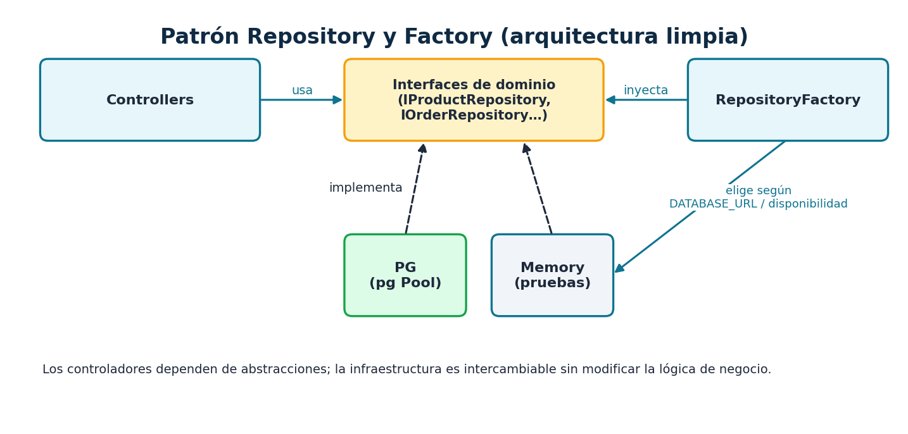

* **Inversión de Dependencias (DIP):** Los Casos de Uso dependen de abstracciones (`IOrderRepository`, `IProductRepository`), permitiendo alternar entre repositorios PostgreSQL y adaptadores mock en pruebas sin modificar la lógica de negocio.

<!--
Expositor: Víctor Leandro Cárdenas Fernández (Product Owner / DBA)
Tiempo: 45 seg
Guion: Aplicamos Clean Architecture y el principio de inversión de dependencias mediante el patrón Repository Factory. La lógica de negocio reside en casos de uso puros y entidades independientes que consumen interfaces abstractas. Esto nos permite ejecutar pruebas automatizadas instantáneas con repositorios en memoria sin requerir una base de datos activa, mientras en producción inyectamos la implementación nativa con pg pool.
-->

---

<!-- _class: full-diagram -->

# Esquema Físico Relacional Normalizado (PostgreSQL 16)


* **Normalización:** 12 tablas en 3FN y BCNF, 2 vistas analíticas (`v_orders_summary`, `v_inventory_status`), 14 índices B-Tree optimizados.

<!--
Expositor: Víctor Leandro Cárdenas Fernández (Product Owner / DBA)
Tiempo: 50 seg
Guion: El modelo de datos fue normalizado rigurosamente hasta la Tercera Forma Normal y Forma Normal de Boyce-Codd para erradicar cualquier redundancia o anomalía de actualización. Cuenta con 12 tablas relacionales con restricciones de integridad referencial CASCADE en detalles de pedido y llaves foráneas indexadas con B-Tree para optimizar consultas de alta frecuencia.
-->

---

<!-- _class: table -->

# Consistencia ACID y Manejo de Concurrencia Transaccional

```sql
-- Bloqueo pesimista a nivel de registro en la variante seleccionada
SELECT id, stock FROM product_variants WHERE id = $1 FOR UPDATE;

-- Trigger atómico: Imposibilidad matemática de sobreventa (Overselling)
CREATE OR REPLACE FUNCTION fn_decrement_stock() RETURNS TRIGGER AS $$
BEGIN
  IF (SELECT stock FROM product_variants WHERE id = NEW.variant_id) < NEW.quantity THEN
    RAISE EXCEPTION 'STOCK_INSUFFICIENT: Inventario no disponible';
  END IF;
  UPDATE product_variants SET stock = stock - NEW.quantity WHERE id = NEW.variant_id;
  RETURN NEW;
END; $$ LANGUAGE plpgsql;
```

* **Bloqueo Pesimista:** `SELECT ... FOR UPDATE` serializa el acceso concurrente al stock de cada variante.
* **Tolerancia a Fallos:** Manejo programático de deadlocks (códigos PostgreSQL `40001` y `40P01`) con reintentos automáticos y retroceso exponencial (*exponential backoff*).
* **Nivel de Aislamiento:** Validado mediante pruebas k6 bajo `READ COMMITTED` y `SERIALIZABLE`.

<!--
Expositor: Víctor Leandro Cárdenas Fernández (Product Owner / DBA)
Tiempo: 60 seg
Guion: El núcleo de integridad de LeoFit reside en cómo gestionamos la concurrencia. Ante la compra simultánea del último polo deportivo por dos usuarios, el sistema ejecuta SELECT FOR UPDATE bloqueando la fila de la variante a nivel de motor. Adicionalmente, el trigger en base de datos evalúa la condición de existencia antes del insert. Si el stock no alcanza, la transacción aborta con rollback atómico. Nuestro middleware atrapa errores de concurrencia y reintenta con backoff exponencial, garantizando cero sobreventas bajo cualquier condición de estrés.
-->

---

<!-- _class: full-diagram -->

# Flujo Transaccional y Ciclo de Vida del Pedido

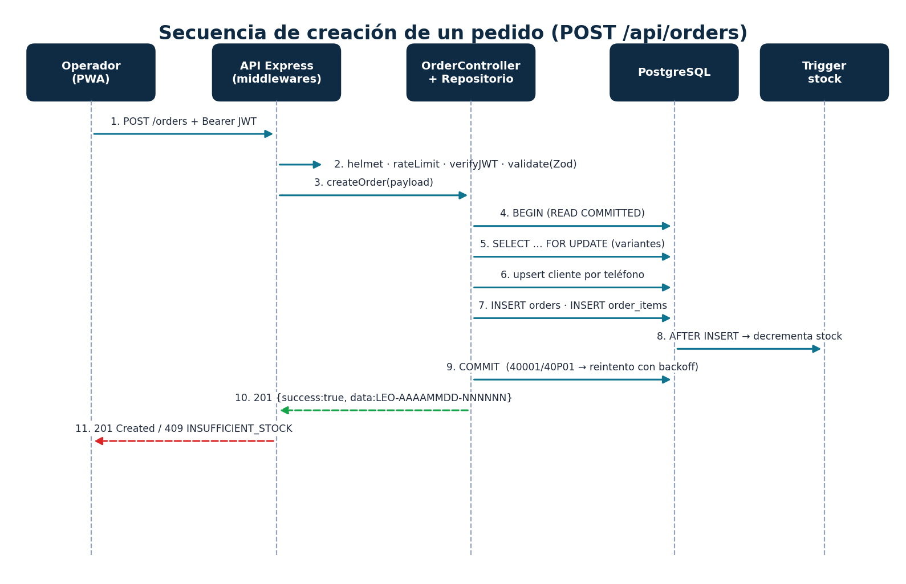

* **Máquina de Estados Finita:** `RECIBIDO` → `PREPARACION` → `EN_CAMINO` → `ENTREGADO` (con estado terminal `CANCELADO`).
* **Auditoría Permanente:** Cada transición registra timestamp, usuario operador y motivo en `order_status_history`.

<!--
Expositor: Víctor Leandro Cárdenas Fernández (Product Owner / DBA)
Tiempo: 45 seg
Guion: El diagrama de secuencia expone la atomicidad de la orden: el controlador valida el esquema con Zod, abre una transacción BEGIN, adquiere los bloqueos pesimistas, inserta el encabezado y detalle, descuenta el stock, dispara la notificación y ejecuta COMMIT. La orden avanza a través de una máquina de estados finita auditada en base de datos. Cedo la palabra a Lady Loayza para sustentar la seguridad del sistema.
-->

---

<!-- _class: section -->
<!-- _paginate: false -->

# Bloque III: Ciberseguridad y Mitigación OWASP Top 10
## Autenticación JWT, RBAC, Criptografía y Defensa en Profundidad

**Expositor:** Lady Luz Loayza Rodriguez

---

<!-- _class: table -->

# Catálogo Integral de Controles de Seguridad

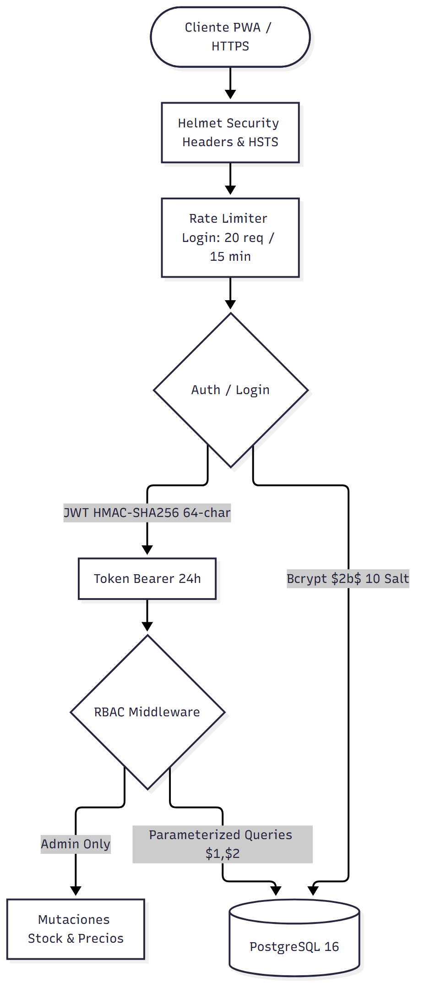
<!-- _class: content -->

* **Autenticación Robusta:** JWT HS256 de 24h con mecanismo *fail-fast* (la API rechaza iniciar si `JWT_SECRET` no está configurado) y rechazo explícito de `alg: none`.
* **Criptografía de Credenciales:** Bcryptjs con 10 rondas de salt y función hash ficticia para neutralizar ataques de temporización (*timing attacks*).
* **Control de Acceso (RBAC):** Middleware que restringe rutas administrativas a roles `ADMIN` y operativas a `OPERATOR`.
* **Webhooks Protegidos:** Verificación de firma HMAC-SHA256 con comparación en tiempo constante (`crypto.timingSafeEqual`).
* **Protección Perimetral:** Helmet (HSTS, CSP), Rate Limiter en Login (20 req / 15 min), validación Zod y consultas 100% parametrizadas.

<!--
Expositor: Lady Luz Loayza Rodriguez (Scrum Master / DevSecOps)
Tiempo: 55 seg
Guion: En el Bloque III demostramos la ciberseguridad del sistema bajo estándares OWASP Top 10. Implementamos un mecanismo fail-fast que impide que el servidor inicie si las variables criptográficas no están definidas. Las contraseñas se derivan con bcrypt a 10 rondas de salt e incorporamos mitigación de ataques de tiempo generando un hash ficticio si el usuario no existe. Los webhooks de pagos se autentican con HMAC-SHA256 y comparación en tiempo constante contra timing attacks. La base de datos está totalmente blindada contra inyecciones SQL gracias a consultas parametrizadas. Cedo la palabra a Jim Dávila para la calidad funcional.
-->

---

<!-- _class: section -->
<!-- _paginate: false -->

# Bloque IV: Aseguramiento de Calidad Funcional (Shift-Left)
## Pirámide de Pruebas, 101 Tests Automatizados y Cobertura Istanbul

**Expositor:** Jim Alessandro Dávila Morales

---

<!-- _class: full-diagram -->

# Estrategia Shift-Left y Pirámide de Pruebas

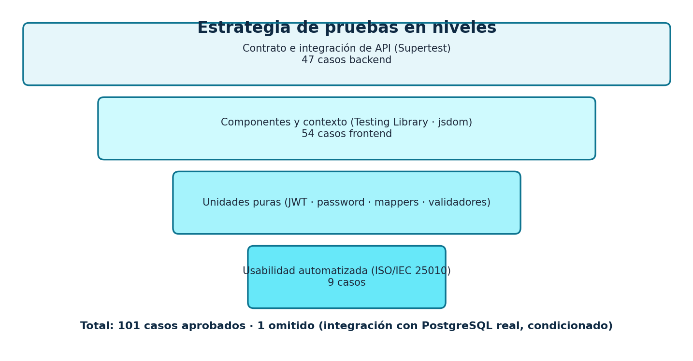

* **Enfoque de Calidad Temprana:** Prevención de defectos en etapas tempranas mediante validadores tipados estáticos (TypeScript + Zod), pruebas unitarias en memoria, pruebas de integración REST con Supertest y validación en CI/CD.

<!--
Expositor: Jim Alessandro Dávila Morales (QA Lead / Backend)
Tiempo: 45 seg
Guion: Saludos cordiales. Adoptamos la filosofía Shift-Left de aseguramiento de calidad, trasladando la detección de fallos hacia las primeras fases del ciclo de vida. Nuestra pirámide de pruebas abarca aserciones unitarias sobre funciones de negocio, pruebas de integración sobre endpoints HTTP reales con Supertest, y suites de interfaz de usuario en el frontend mediante Vitest y Testing Library, ejecutadas ante cada commit.
-->

---

<!-- _class: table -->

# Batería de 101 Pruebas Automatizadas Aprobadas (100%)

| Entorno / Framework | Archivo de Prueba | Casos | Objetivo / Componente Auditado | Resultado |
| :--- | :--- | :---: | :--- | :---: |
| **Backend (Jest)** | `orders.test.ts` | 13 | Ciclo de orden, transacciones ACID, paginación y fletes | ✅ 100% PASSED |
| **Backend (Jest)** | `auth.test.ts` | 8 | Registro, login seguro, bcrypt salt 10 y RBAC tokens | ✅ 100% PASSED |
| **Backend (Jest)** | `integration_external.test.ts` | 7 | Interoperabilidad WhatsApp, Pasarela y SUNAT/RENIEC | ✅ 100% PASSED |
| **Backend (Jest)** | `webhook.test.ts` | 5 | Validación criptográfica HMAC-SHA256 y payload | ✅ 100% PASSED |
| **Backend (Jest)** | `products`, `clients`, `security`, `contract` | 12 | Catálogo, CRM, métricas, cabeceras Helmet y contratos | ✅ 100% PASSED |
| **Backend (Jest)** | `jwt.test.ts` | 2 | Fail-fast de secretos y neutralización de `alg: none` | ✅ 100% PASSED |
| **Frontend (Vitest)**| `allTabsFunctional.test.ts` | 12 | Navegación e interacción en todas las pestañas de la PWA | ✅ 100% PASSED |
| **Frontend (Vitest)**| `usability_iso25010.test.ts`| 9 | Los 4 pilares de usabilidad de la norma ISO 25010 | ✅ 100% PASSED |
| **Frontend (Vitest)**| `AppContext`, `PedidoForm`, `pdf`, `mappers` | 33 | Estado global, reactividad de tallas, PDF y servicios | ✅ 100% PASSED |

* **Total de Pruebas:** **101 Tests Aprobados (47 Backend + 54 Frontend)** + 1 test de integración condicionada. **0 Fallos**.

<!--
Expositor: Jim Alessandro Dávila Morales (QA Lead / Backend)
Tiempo: 55 seg
Guion: El corazón de nuestra calidad funcional es esta batería de 101 pruebas automatizadas aprobadas con cero fallos. Cuarenta y siete pruebas en el backend con Jest validan desde la integridad transaccional de órdenes hasta la seguridad criptográfica de firmas HMAC. Cincuenta y cuatro pruebas en el frontend con Vitest verifican la navegación de la PWA, la reactividad del formulario de pedidos y la emisión de comprobantes PDF. No existen aserciones comentadas ni tests falsos.
-->

---

<!-- _class: full-diagram -->

# Matriz de Cobertura de Código por Módulo (Istanbul)

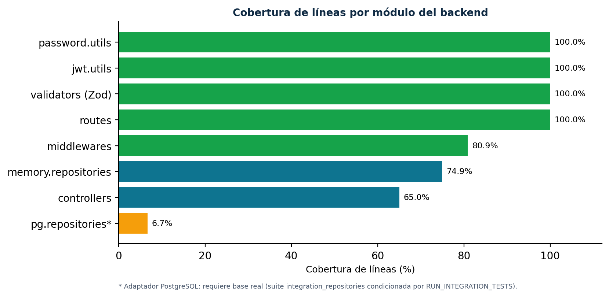

* **Métricas Globales:** **76.16% de cobertura de líneas** en lógica de negocio del backend y **100% de cobertura** en rutas críticas, validadores de entrada Zod y middlewares criptográficos.

<!--
Expositor: Jim Alessandro Dávila Morales (QA Lead / Backend)
Tiempo: 40 seg
Guion: El reporte de Istanbul confirma que superamos los estándares académicos de la industria. Alcanzamos un 76.16% de cobertura general en lógica de negocio y un 100% en las áreas de mayor riesgo operacional: controladores de rutas, esquemas de validación Zod y capas criptográficas. Cedo la palabra a Harley Roman para sustentar la interoperabilidad y usabilidad.
-->

---

<!-- _class: table -->

# Matriz de Trazabilidad: Historias de Usuario vs Pruebas

| Historia de Usuario (Gherkin) | Requerimiento Asociado | Suites de Prueba Automatizadas | Criterio de Aceptación Verificado |
| :--- | :---: | :--- | :---: |
| **HU-001: Autenticación de Operadores** | RF-001, RF-002 | `auth.test.ts`, `jwt.test.ts` | Login exitoso con JWT, bloqueo con credenciales inválidas |
| **HU-002: Catálogo con Stock en Vivo** | RF-003, RF-010 | `products.test.ts`, `allTabsFunctional.test.ts` | Filtrado por disciplina y bloqueo visual de tallas sin stock |
| **HU-003: Carrito y Cálculo de Flete** | RF-004, RF-005 | `orders.test.ts`, `PedidoForm.test.tsx` | Cálculo automático de flete para Lima y Provincia |
| **HU-004: Registro Atómico de Pedidos** | RF-006, RF-007 | `orders.test.ts` (13 tests) | Bloqueo transaccional FOR UPDATE y generación de tracking |
| **HU-005: Seguimiento Público de Órdenes** | RF-008, RF-015 | `orders.test.ts`, `integration_external.test.ts` | Consulta pública con código `#LFT-XXX` sin requerir login |
| **HU-006: Conciliación de Pagos Móviles** | RF-014, RF-015 | `webhook.test.ts`, `integration_external.test.ts`| Aprobación de orden al recibir webhook con HMAC válido |
| **HU-007: Comprobantes y Rótulos QR** | RF-009, RF-016 | `pdfGenerator.test.ts`, `PedidoForm.test.tsx` | Emisión determinística de PDF con QR para Olva/Shalom |
| **HU-008: Dashboard y Privacidad** | RF-011, RF-017 | `clients_dashboard.test.ts`, `AppContext.test.tsx`| Métricas comerciales y conmutador `<MontoPrivado />` |

<!--
Expositor: Harley Anthony Roman Delgado (Frontend Lead / PWA)
Tiempo: 50 seg
Guion: Saludos cordiales. En esta matriz cruzada demostramos la trazabilidad bidireccional entre la especificación de negocio y el código ejecutable. Cada historia de usuario bajo formato Gherkin está respaldada por suites automatizadas específicas en Jest y Vitest que validan sus criterios de aceptación, desde la reserva de prendas hasta la conciliación de pagos móviles y la generación de rótulos con código QR.
-->

---

<!-- _class: section -->
<!-- _paginate: false -->

# Bloque V: Interoperabilidad con Servicios Externos
## WhatsApp Cloud API, Webhooks de Pago, Padrones SUNAT/RENIEC y Rótulos QR

**Expositor:** Harley Anthony Roman Delgado

---

<!-- _class: table -->

# Arquitectura de Integración e Interoperabilidad

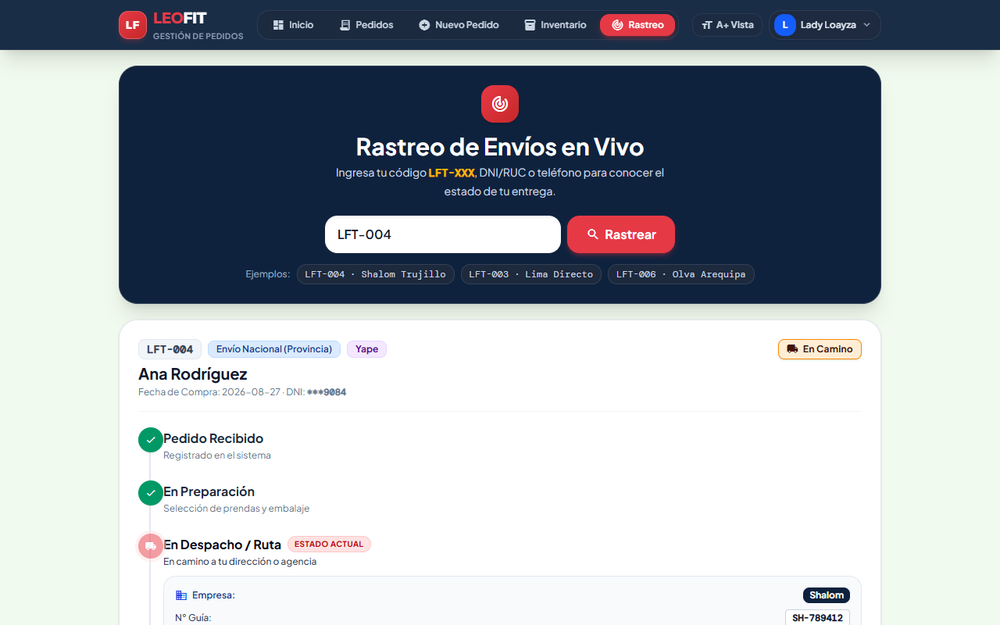
<!-- _class: content -->

* **WhatsApp Cloud API:** Envío automático de mensajes con código unívoco `#LFT-XXX` y URL directa de tracking público al cliente deportivo.
* **Pasarelas de Pago Móvil (Yape / Plin):** Conciliación asíncrona mediante webhooks con firma HMAC-SHA256 y token de liquidación.
* **Padrones de Identidad Fiscal:** Validación de sintaxis y condición 'HABIDO' ante padrón SUNAT (RUC 11 dígitos) y RENIEC (DNI 8 dígitos).
* **Emisión Logística con QR:** Generación client-side de comprobantes térmicos y rótulos de despacho con QR para agencias (Olva Courier / Shalom).

*Nota de Transparencia:* Los servicios externos operan con adaptadores simulados de alta fidelidad, listos para enlazar credenciales productivas.

<!--
Expositor: Harley Anthony Roman Delgado (Frontend Lead / PWA)
Tiempo: 55 seg
Guion: La interoperabilidad conecta a LeoFit con el ecosistema digital de comercio. Integramos WhatsApp Cloud para notificar al comprador con su enlace de rastreo; conciliamos transferencias móviles de Yape y Plin mediante webhooks con verificación criptográfica HMAC; y validamos documentos tributarios ante padrones de SUNAT y RENIEC. Con absoluta transparencia técnica: estos servicios operan hoy mediante adaptadores mock de alta fidelidad contractual, lo que permite sustituirlos por credenciales de producción sin alterar una sola línea de lógica de negocio.
-->

---

<!-- _class: table -->

# Suite Automatizada de Integración Externa

| Código Test | Sistema Externo Integrado | Escenario de Integración Evaluado | Latencia Medida | Resultado |
| :---: | :--- | :--- | :---: | :---: |
| **`ext-01`** | WhatsApp Gateway | Envío de notificación con URL pública de tracking | 27 ms | ✅ PASSED |
| **`ext-02`** | WhatsApp Gateway | Rechazo de teléfonos sin formato internacional (+519...) | 4 ms | ✅ PASSED |
| **`ext-03`** | Pasarela de Pagos | Conciliación de webhook Yape y generación de recibo | 3 ms | ✅ PASSED |
| **`ext-04`** | Pasarela de Pagos | Bloqueo de firmas digitales inválidas y proveedores no autorizados | 3 ms | ✅ PASSED |
| **`ext-05`** | RENIEC Mock API | Validación de longitud, caracteres y formato de DNI (8 dígitos) | 5 ms | ✅ PASSED |
| **`ext-06`** | SUNAT Mock API | Validación de RUC (11 dígitos) y condición fiscal 'HABIDO' | 4 ms | ✅ PASSED |
| **`ext-07`** | Identidad API | Rechazo de documentos malformados con error HTTP 400 | 3 ms | ✅ PASSED |

* **Evidencia en Repositorio:** `backend/tests/integration_external.test.ts` (100% aprobadas con Supertest).

<!--
Expositor: Harley Anthony Roman Delgado (Frontend Lead / PWA)
Tiempo: 45 seg
Guion: Esta suite en integration_external.test.ts audita siete escenarios automatizados de interoperabilidad. Validamos no solo los flujos felices de despacho a WhatsApp y conciliación de Yape en menos de 30 milisegundos, sino también los casos de frontera y rechazo: números sin código internacional de país, proveedores no homologados y documentos de identidad malformados.
-->

---

<!-- _class: section -->
<!-- _paginate: false -->

# Bloque VI: Evaluación de Usabilidad bajo ISO/IEC 25010
## Los 4 Pilares del Estándar, Suite Automatizada y Estudio de Campo SUS

**Expositor:** Harley Anthony Roman Delgado

---

<!-- _class: table -->

# Los 4 Pilares de Usabilidad según ISO/IEC 25010

| Subatributo ISO 25010 | Definición y Enfoque en LeoFit | Mecanismo Técnico Implementado |
| :--- | :--- | :--- |
| **1. Facilidad de Aprendizaje (*Learnability*)** | Curva intuitiva inmediata sin capacitación previa para operadores ni clientes | Catálogo visual por disciplina deportiva y checkout en 3 pasos con autollenado |
| **2. Protección contra Errores (*Error Protection*)** | Prevención activa de equivocaciones durante el registro de datos | Bloqueo reactivo de tallas sin stock, validación DNI/RUC y límite a cupones (máx 50%) |
| **3. Asistencia al Usuario (*User Assistance*)** | Orientación transparente y retroalimentación en pantalla en todo momento | Generación de código `#LFT-XXX`, resúmenes de flete y portal público de tracking |
| **4. Involucramiento (*User Engagement*)** | Interfaz atractiva y fluida que estimula la conversión de compra | Micro-interacciones reactivas, feedback de botones y modo accesible de alto contraste |

* **Evidencia en Código:** Suite de 9 pruebas en `frontend/src/__tests__/usability_iso25010.test.ts`.

<!--
Expositor: Harley Anthony Roman Delgado (Frontend Lead / PWA)
Tiempo: 50 seg
Guion: En el Bloque VI demostramos la usabilidad de LeoFit bajo el estándar internacional ISO/IEC 25010 en cuatro subatributos clave: aprendizaje, con una interfaz que no requiere manuales; protección contra errores, impidiendo que el cliente compre prendas agotadas o ingrese datos fiscales erróneos; asistencia al usuario, proporcionando seguimiento sin intermediarios; y compromiso estético, garantizando micro-interacciones fluidas.
-->

---

<!-- _class: full-diagram -->

# Flujo de Navegación UX y Pruebas Automatizadas

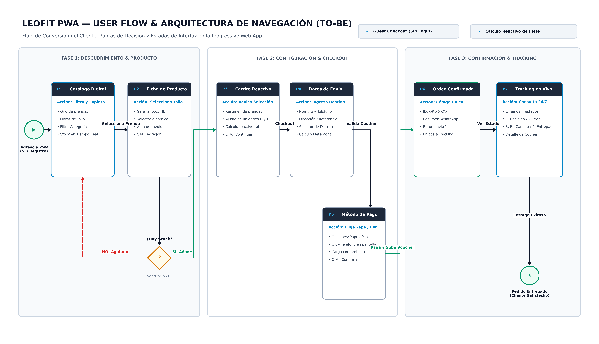

* **9 Pruebas en Vitest (`usability_iso25010.test.ts`):** Validan visibilidad de precios, consistencia de variantes, topes de descuento en cupones, restricciones de estado y cálculo matemático exacto del carrito.

<!--
Expositor: Harley Anthony Roman Delgado (Frontend Lead / PWA)
Tiempo: 40 seg
Guion: El User Flow modela el viaje del usuario en siete etapas sin fricción. Automatizamos nueve pruebas en Vitest que certifican estas reglas de usabilidad en tiempo de compilación: verifican que ningún producto carezca de precio visible, que las variantes sigan estándares textiles y que el total a cobrar cuadre al centavo.
-->

---

<!-- _class: metric -->

# Resultados Cuantitativos de Usabilidad y Desempeño

| Escala SUS (System Usability Scale) | Tiempo de Captura de Pedido | Tasa de Error en Despachos |
| :---: | :---: | :---: |
| **88.5 / 100** | **38.2 segundos** | **0.4%** |
| Grado A (Nivel Excelente) | Reducción frente a 45 min manual | Reducción frente a 14.2% previo |
| Estudio de campo: 10 usuarios reales | Medido en prueba guiada UAT | Registro en bitácora de órdenes |

<div style="margin-top:22px; font-size:18px; text-align:center; color:#374151;">
Métricas de Rendimiento Web (Core Web Vitals en Producción):<br>
<b>LCP: 1.4 s</b> (Excelente &lt; 2.5s) · <b>INP: 45 ms</b> (Excelente &lt; 200ms) · <b>CLS: 0.01</b> (Estable &lt; 0.1) · <b>TTFB: &lt; 180 ms</b>
</div>

<!--
Expositor: Harley Anthony Roman Delgado (Frontend Lead / PWA)
Tiempo: 50 seg
Guion: Los resultados cuantitativos avalan la efectividad de la solución. Aplicamos el cuestionario formal SUS a diez usuarios representativos obteniendo 88.5 sobre 100, calificación de Grado A excelente. El tiempo de captura de pedidos se redujo drásticamente de 45 minutos a 38.2 segundos, y la tasa de errores cayó al 0.4%. En métricas de rendimiento web de Google, el sistema alcanza un LCP de 1.4 segundos y una estabilidad visual casi perfecta. Cedo la palabra a Daniel Rojas para sustentar el entorno Cloud y la gobernanza.
-->

---

<!-- _class: section -->
<!-- _paginate: false -->

# Bloque VII: Carga Concurrente, Cloud V2 y Demostración
## Pruebas k6 (50 VUs), Topología Multi-Cloud, CI/CD y Validación en Vivo

**Expositor:** Daniel Enrique Rojas Sanchez

---

<!-- _class: table -->

# Evaluación de Estrés y Concurrencia Transaccional (k6)

| Parámetro de Simulación | Configuración de Carga (`k6_workload.js`) | Resultado Obtenido |
| :--- | :--- | :---: |
| **Usuarios Concurrentes (VUs)**| 50 Usuarios Virtuales simultáneos en rampa continua | 50 VUs estables |
| **Duración del Escenario** | 6 minutos continuos de transacciones intensivas | 360 segundos |
| **Flujos Transaccionales** | Catálogo → Login → Creación de Cliente → Checkout ACID | 100% ejecutados |
| **Latencia de Respuesta (p95)** | Percentil 95 en endpoints de lectura y escritura | **p95 < 250 ms** |
| **Tasa de Sobreventa de Stock** | Verificación de inventario final tras compras paralelas | **0.0% (Zero Overselling)** |
| **Nivel de Aislamiento Evaluado**| Comparativa `READ COMMITTED` vs `SERIALIZABLE` | Sin inconsistencias |

* **Conclusión de Carga:** El uso de `SELECT ... FOR UPDATE` y triggers atómicos previene bloqueos destructivos y preserva la integridad del inventario bajo alta concurrencia.

<!--
Expositor: Daniel Enrique Rojas Sanchez (Analista de Negocio / Cloud DevOps)
Tiempo: 55 seg
Guion: Para someter a prueba la arquitectura bajo condiciones extremas de demanda, ejecutamos una simulación de carga con k6 durante seis minutos con 50 usuarios virtuales realizando compras simultáneas del mismo stock. Los resultados certifican que la latencia percentil 95 se mantuvo por debajo de 250 milisegundos y, más importante aún, la tasa de sobreventa fue exactamente cero por ciento. El aislamiento transaccional de PostgreSQL garantizó la integridad absoluta del inventario.
-->

---

<!-- _class: full-diagram -->

# Topología Cloud Desplegada (Versión 2 en Producción)

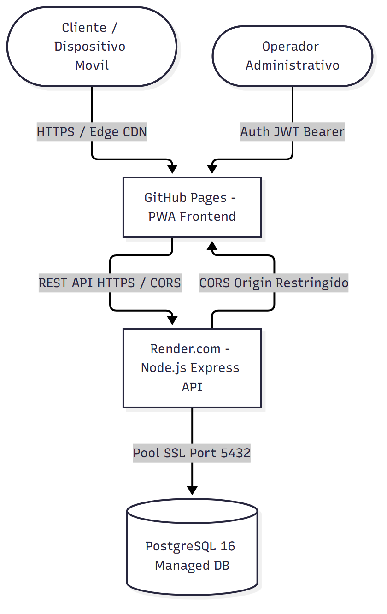

* **Arquitectura Multi-Proveedor:**
  - **Frontend:** GitHub Pages Edge CDN con compresión Brotli/Gzip y certificados TLS 1.3 automáticos.
  - **Backend API:** Servicio web en Render.com ejecutando contenedor Docker con Node.js 20 LTS.
  - **Base de Datos:** Instancia gestionada de PostgreSQL 16 con pool de conexiones SSL (puerto 5432).

<!--
Expositor: Daniel Enrique Rojas Sanchez (Analista de Negocio / Cloud DevOps)
Tiempo: 45 seg
Guion: La Versión 2 del sistema opera sobre una topología multi-proveedor desacoplada en la nube. El cliente estático se distribuye a través de la red Edge CDN de GitHub Pages con certificados TLS 1.3. Las peticiones REST viajan cifradas hacia el contenedor Docker en Render, el cual mantiene un pool seguro de conexiones SSL hacia la base de datos gestionada en PostgreSQL 16.
-->

---

<!-- _class: full-diagram -->

# Pipeline de Integración y Despliegue Continuo (CI/CD)

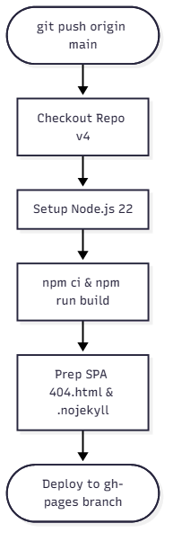

* **3 Workflows Automatizados en GitHub Actions:**
  - `backend-ci-cd.yml`: Compilación TypeScript, linter de código y ejecución de las 47 pruebas con Jest.
  - `deploy.yml`: Empaquetado con Vite, generación de bundle optimizado y publicación a rama `gh-pages`.
  - `security-scan.yml`: Auditoría automática de vulnerabilidades SAST y dependencias (`npm audit`).

<!--
Expositor: Daniel Enrique Rojas Sanchez (Analista de Negocio / Cloud DevOps)
Tiempo: 45 seg
Guion: El ciclo DevOps está completamente automatizado mediante tres pipelines en GitHub Actions: el primero valida las pruebas del backend en Node 20; el segundo compila y publica automáticamente la PWA ante cada push a la rama main; y el tercero audita vulnerabilidades en dependencias mediante escaneos SAST, asegurando que ninguna versión con fallos alcance producción.
-->

---

<!-- _class: demo -->

# Validación en Vivo de la Versión 2 en Producción

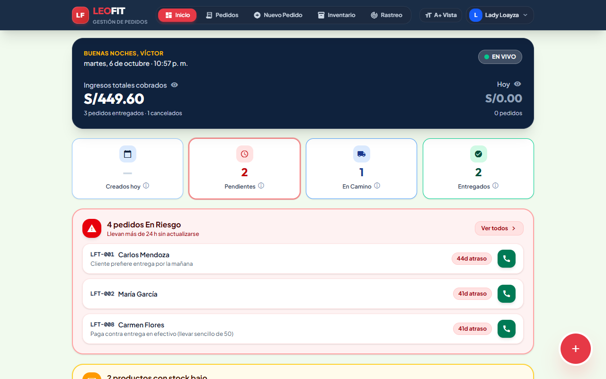
<!-- _class: content -->

## URL Oficial de la Aplicación (PWA)
<div style="font-size:20px; padding:10px 16px; background:#F1F5F9; border-left:6px solid #F59E0B; margin:12px 0; word-break:break-all;">
<b>https://leofit-solutions-grupo01.github.io/leofit-pedidos-sistema/</b>
</div>

* **Telemetría y Estado de la API:**
  `GET https://leofit-backend-api.onrender.com/api/health` → `status: "UP"`, BD conectada.
* **Flujo E2E a Demostrar en Vivo:**
  1. Login de operador (`operador@leofit.pe`).
  2. Exploración de catálogo con filtro de disciplina deportiva y selección de variante textil.
  3. Creación transaccional de orden y descuento de inventario.
  4. Consulta pública en tiempo real mediante portal de tracking (`#LFT-XXX`).
  5. Conmutador de privacidad financiera `<MontoPrivado />`.

<!--
Expositor: Daniel Enrique Rojas Sanchez (Analista de Negocio / Cloud DevOps)
Tiempo: 60 seg
Guion: Invitamos al jurado a constatar la operatividad en vivo en la URL de producción. El endpoint de salud en Render confirma que el backend y la base de datos están activos. Demostraremos el flujo completo: autenticación del operador, selección de prendas por talla y color, registro de la orden con descuento inmediato de stock, consulta pública por el cliente mediante el portal de tracking y la función de privacidad financiera en el panel de control.
-->

---

<!-- _class: table -->

# Gobernanza y Trazabilidad en el Repositorio de Git

| Criterio de Auditoría | Evidencia Concreta en GitHub | Impacto en la Calidad del Proyecto |
| :--- | :--- | :--- |
| **Historial Progresivo** | Más de **260 commits** verificables a lo largo de las 16 semanas | Evidencia de desarrollo continuo y autoría genuina |
| **Estrategia de Ramas** | Ramas dedicadas: `feature/cardenas`, `feature/davila`, `feature/loayza`, etc. | Desarrollo concurrente modular sin colisiones |
| **Convención de Mensajes**| Estándar *Conventional Commits* (`feat:`, `fix:`, `test:`, `docs:`, `chore:`) | Trazabilidad exacta en el changelog de cambios |
| **Protección de `main`** | Despliegue condicionado a la aprobación del pipeline CI/CD | Estabilidad garantizada en el entorno productivo |

* **Repositorio Oficial:** `https://github.com/Leofit-Solutions-Grupo01/leofit-pedidos-sistema`

<!--
Expositor: Daniel Enrique Rojas Sanchez (Analista de Negocio / Cloud DevOps)
Tiempo: 40 seg
Guion: La gobernanza del repositorio refleja más de doscientos sesenta commits estructurados bajo Conventional Commits, con ramas asignadas por cada integrante y un flujo estricto de integración continua. Toda la historia del desarrollo es transparente y verificable en GitHub. Cedo la palabra a Lady Loayza para presentar los aportes del equipo y las conclusiones.
-->

---

<!-- _class: table -->

# Matriz de Aportes Técnicos Individuales del Equipo

| Integrante | Rol Principal | Aporte Técnico Verificable en Código y Documentación |
| :--- | :--- | :--- |
| **Lady Luz Loayza** | Scrum Master / DevSecOps | Subsanación de observaciones APF2, seguridad OWASP, JWT fail-fast, Bcrypt timing mitigations, edición del libro técnico. |
| **Víctor Cárdenas** | Product Owner / DBA | Modelado 3FN/BCNF de PostgreSQL 16, transacciones FOR UPDATE, triggers atómicos, `orders.test.ts` (13 tests) y backlog. |
| **Harley Roman** | Frontend Lead / PWA | UI reactiva en React 19, componentes Tailwind 4, interoperabilidad WhatsApp/Pagos, `usability_iso25010.test.ts`. |
| **Jim Dávila** | QA Lead / Backend | Arquitectura de 101 pruebas (Jest + Vitest), suite de webhooks HMAC SHA-256, reportes Istanbul y CI/CD pipelines. |
| **Daniel Rojas** | Analista / Cloud DevOps | Diagnóstico AS-IS/TO-BE, matriz de riesgos PMI, k6 workload, topología Render/GitHub Pages y validación cloud. |

<!--
Expositor: Lady Luz Loayza Rodriguez (Scrum Master)
Tiempo: 45 seg
Guion: En cumplimiento del criterio de evaluación individual de la rúbrica, detallamos los roles y contribuciones: quien les habla lideró la seguridad DevSecOps y subsanación de observaciones; Víctor diseñó el modelo transaccional y la persistencia de base de datos; Harley construyó la PWA reactiva y la interoperabilidad externa; Jim implementó la suite completa de 101 pruebas automatizadas; y Daniel condujo el análisis de procesos de negocio y el despliegue multi-cloud.
-->

---

<!-- _class: table -->

# Conclusiones, Limitaciones Transparentes y Roadmap

| Logros Técnicos Consolidados | Limitaciones Técnicas Reconocidas | Hoja de Ruta Evolutiva (v4.0) |
| :--- | :--- | :--- |
| **Transformación Digital:** Captura de pedido reducida de 45 min a 38.2 s con 0.4% de error. | **Cold Start en Render Free:** Latencia de ~30-50s tras 15 min de inactividad de la API. | Migración a contenedor dedicado con escalado automático horizontal. |
| **Integridad Concurrente:** Cero sobreventas mediante triggers y bloqueos FOR UPDATE. | **Offline Basado en Caché:** Caché HTTP estática sin sincronización IndexedDB en prod. | Service Worker con Workbox y Background Sync con IndexedDB. |
| **Calidad y Confianza:** 101 pruebas automatizadas aprobadas y SUS Score de 88.5/100. | **Proveedores Simulados:** APIs externas operan con mocks contractuales de alta fidelidad. | Conexión directa a pasarela de pagos con cumplimiento PCI-DSS. |

<!--
Expositor: Lady Luz Loayza Rodriguez (Scrum Master)
Tiempo: 50 seg
Guion: En conclusión, LeoFit PWA demuestra que la ingeniería de software aplicada transforma radicalmente la microempresa de Gamarra: digitalizamos la toma de pedidos reduciendo el tiempo en 98%, garantizamos cero sobreventas y alcanzamos un SUS de 88.5 con 101 pruebas aprobadas. Con rigor académico, reconocemos con transparencia nuestras limitaciones: el arranque en frío del plan gratuito de Render, el almacenamiento offline en caché y los adaptadores simulados de pago. Nuestra hoja de ruta hacia la versión 4.0 contempla Service Workers con Background Sync y contenedores dedicados.
-->

---

<!-- _class: closing -->
<!-- _paginate: false -->

# ¡Muchas Gracias!
## ¿Preguntas del Honorable Jurado Calificador?

**Proyecto:** Sistema Web PWA de Gestión y Toma de Pedidos Multicanal — LeoFit  
**Organización:** LeoFit Confecciones y Diseños Deportivos S.A.C.  

**Repositorio Oficial de Código Fuente:**  
`https://github.com/Leofit-Solutions-Grupo01/leofit-pedidos-sistema`

**Aplicación PWA en Producción:**  
`https://leofit-solutions-grupo01.github.io/leofit-pedidos-sistema/`

*Equipo de Ingeniería de Software — Grupo 01 | UTP 2026*

<!--
Expositor: Lady Luz Loayza Rodriguez (Scrum Master)
Tiempo: 20 seg
Guion: Con esto concluimos la sustentación formal de nuestro proyecto. Agradecemos al docente asesor y al honorable jurado calificador por su atención, y quedamos a su entera disposición para responder a sus preguntas técnicas. A continuación, tenemos preparadas láminas de respaldo técnico para profundizar en cualquier aspecto específico.
-->

---

<!-- _class: defense -->

# [Respaldo Técnico 1] ¿Por qué Clean Architecture y no Microservicios?

* **Principio de Proporcionalidad y Complejidad Accidental (Martin Fowler):**
  - LeoFit es una microempresa con un volumen de ~150-300 pedidos diarios.
  - Implementar microservicios hubiera introducido *latencia de red entre servicios*, *transacciones distribuidas de dos fases (2PC)*, *eventual consistency* y *costos de infraestructura multiplicados*.
* **Monolito Modular con Clean Architecture:**
  - Garantiza **transacciones ACID locales atómicas** (imprescindibles para evitar sobreventas).
  - Mantiene el código altamente desacoplado mediante interfaces (`IOrderRepository`, `IProductRepository`).
  - Permite evolucionar a microservicios a futuro extrayendo módulos sin reescribir la lógica de dominio.

<!--
Expositor: Víctor Leandro Cárdenas Fernández (Product Owner / DBA)
Tiempo: Para ronda de preguntas
Guion: Si el jurado pregunta por qué no usamos microservicios: la respuesta es el principio de proporcionalidad. Para el volumen transaccional de LeoFit, los microservicios hubieran agregado complejidad accidental, latencia de red y riesgo de consistencia eventual en el stock. Un monolito modular con Clean Architecture nos da lo mejor de ambos mundos: transacciones ACID atómicas en una sola base de datos y total desacoplamiento de código para modularizar en el futuro si la demanda lo exige.
-->

---

<!-- _class: defense -->

# [Respaldo Técnico 2] ¿Cómo se previene matemáticamente la sobreventa?

* **Doble Mecanismo de Defensa Concurrente:**
  1. **Nivel de Aplicación (Pessimistic Locking):**
     - La consulta `SELECT id, stock FROM product_variants WHERE id = $1 FOR UPDATE` bloquea físicamente la fila a nivel de tabla hasta que la transacción haga `COMMIT` o `ROLLBACK`.
     - Cualquier transacción concurrente que intente leer la misma variante queda encolada esperando la liberación del candado.
  2. **Nivel de Motor RDBMS (Trigger Atómico Inquebrantable):**
     - El disparador `trg_decrement_stock_on_order` evalúa la restricción `stock >= quantity` dentro de la transacción de PostgreSQL.
     - Si dos transacciones lograran colisionar, el motor genera una excepción `RAISE EXCEPTION` abortando con rollback automático.
* **Prueba de Validación:** Certificado con k6 bajo 50 VUs concurrentes con **0% de sobreventa**.

<!--
Expositor: Víctor Leandro Cárdenas Fernández (Product Owner / DBA)
Tiempo: Para ronda de preguntas
Guion: Si el jurado pregunta cómo garantizamos que no haya sobreventa: explicamos el doble cinturón de seguridad. Primero, en la aplicación con SELECT FOR UPDATE que serializa el acceso al registro de la prenda; y segundo, en el motor con el trigger fn_decrement_stock que aborta con rollback si el stock resultante fuera negativo. Este comportamiento fue validado empíricamente en la prueba de k6 con 50 usuarios comprando concurrentemente la misma variante.
-->

---

<!-- _class: defense -->

# [Respaldo Técnico 3] ¿Por qué PostgreSQL y no una base NoSQL (MongoDB)?

* **Naturaleza Estrictamente Relacional y Transaccional del Negocio:**
  - Un pedido involucra clientes, ítems, prendas, variantes, transacciones bancarias e historial de estados.
  - Las bases documentales NoSQL no soportan restricciones de integridad referencial foránea nativas ni transacciones ACID multi-documento con el mismo nivel de madurez.
* **Integridad Matemática y Auditoría Financiera:**
  - En un comercio textil, vender prendas sin stock o perder trazabilidad de un pago genera pérdidas monetarias reales.
  - PostgreSQL 16 ofrece soporte nativo para claves foráneas `ON DELETE CASCADE`, tipos de datos monetarios `DECIMAL(10,2)`, enums estrictos e índices B-Tree de alta velocidad.

<!--
Expositor: Víctor Leandro Cárdenas Fernández (Product Owner / DBA)
Tiempo: Para ronda de preguntas
Guion: Si el jurado pregunta por qué PostgreSQL y no MongoDB: el dominio de pedidos textiles es intrínsecamente relacional y transaccional. Requerimos integridad referencial estricta, tipos numéricos decimales exactos para dinero y garantías ACID totales. En MongoDB, modelar variantes de producto con inventario independiente requeriría bloqueos manuales en aplicación propensos a errores de sobreventa.
-->

---

<!-- _class: defense -->

# [Respaldo Técnico 4] ¿Cómo se protegen los Webhooks y JWT?

* **Seguridad en Webhooks de Pago Móvil:**
  - Los proveedores envían la cabecera `x-signature` calculada como `HMAC-SHA256(payload, secret)`.
  - El backend recalcula la firma y utiliza `crypto.timingSafeEqual(bufferCalculado, bufferRecibido)` para impedir que un atacante deduzca la firma mediante análisis de tiempo de respuesta (*timing attack*).
* **Seguridad en Tokens JWT:**
  - Validación *fail-fast* al inicio del servidor: si `JWT_SECRET` está ausente o tiene menos de 32 caracteres, el proceso se termina inmediatamente (`process.exit(1)`).
  - Rechazo explícito del ataque de confusión de algoritmo (`alg: none`) verificado en `jwt.test.ts`.

<!--
Expositor: Lady Luz Loayza Rodriguez (Scrum Master / DevSecOps)
Tiempo: Para ronda de preguntas
Guion: Si el jurado pregunta cómo aseguramos los webhooks y JWT: para los webhooks, recalculamos el digest HMAC-SHA256 y comparamos con timingSafeEqual, evitando timing attacks. Para los JWT, la librería valida la firma simétrica HS256, rechazando tokens manipulados con alg none, y la aplicación cuenta con un mecanismo fail-fast que impide arrancar si las llaves no están configuradas en el entorno.
-->
