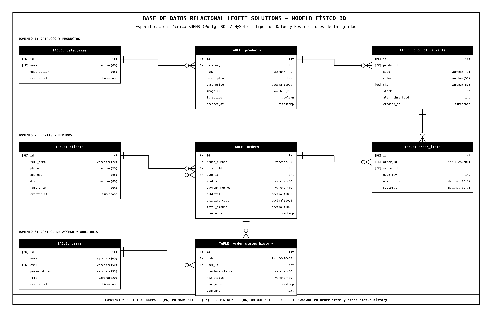

<!-- _class: title -->
<!-- _paginate: false -->

# LEOFIT: SISTEMA WEB PWA DE GESTIÓN DE PEDIDOS
## Sustentación Final — Arquitectura, Calidad, Interoperabilidad, Usabilidad y Cloud

**Curso:** Curso Integrador II: Software (100000S12F) — Ciclo 2026-I  
**Institución:** Universidad Tecnológica del Perú (UTP)  
**Organización Beneficiaria:** LeoFit Confecciones y Diseños Deportivos S.A.C.  

**Equipo de Ingeniería (Grupo 01):**
* **Lady Luz Loayza Rodriguez** — Scrum Master / DevSecOps
* **Víctor Leandro Cárdenas Fernández** — Product Owner / DBA
* **Harley Anthony Roman Delgado** — Frontend Lead / PWA
* **Jim Alessandro Dávila Morales** — QA Lead / Backend
* **Daniel Enrique Rojas Sanchez** — Analista de Negocio / Cloud DevOps

<!--
Expositor: Lady Luz Loayza Rodriguez (Scrum Master)
Tiempo: 40 seg
Guion: Muy buenas tardes, estimado docente y miembros del jurado. Presentamos LeoFit, un sistema web progresivo para la gestión de pedidos de una microempresa de Gamarra. Hoy recorreremos el proyecto completo: el problema que resolvimos, la arquitectura, cómo garantizamos su calidad, su interoperabilidad con servicios externos, su usabilidad medida bajo ISO 25010 y, finalmente, el sistema funcionando en la nube.
-->

---

<!-- _class: section -->
<!-- _paginate: false -->

# I. El Problema y la Solución
## Contexto operativo de LeoFit en Gamarra

**Expositor:** Daniel Enrique Rojas Sanchez

---

<!-- _class: table -->

# De un Flujo Manual a un Sistema Transaccional

| Dimensión | Situación Inicial (AS-IS) | Con LeoFit PWA |
| :--- | :--- | :--- |
| **Canal de pedidos** | Chats de WhatsApp no estructurados y libreta física | Catálogo PWA con carrito y pedido estructurado |
| **Tiempo de atención** | 45 a 120 minutos por orden | **38.2 segundos** de captura de pedido |
| **Error en despachos** | 14.2% | **0.4%** de errores operativos |
| **Visibilidad de stock** | Inexistente por talla y color | Stock por variante con descuento atómico |
| **Intención de compra perdida** | 22% por falta de disponibilidad visible | Disponibilidad en tiempo real para el cliente |

* **Empresa:** LeoFit Confecciones y Diseños Deportivos S.A.C. — Emporio Comercial de Gamarra, La Victoria, Lima.

<!--
Expositor: Daniel Enrique Rojas Sanchez (Analista de Negocio)
Tiempo: 55 seg
Guion: LeoFit atendía sus pedidos por chats y una libreta. Eso significaba entre 45 y 120 minutos por orden, 14.2% de errores en despacho y un 22% de intención de compra perdida porque el cliente no veía qué tallas quedaban. Con la PWA, la captura de un pedido toma 38 segundos y el error operativo bajó a 0.4%, medido en el estudio de campo con usuarios.
-->

---

<!-- _class: full-diagram -->

# Proceso Rediseñado (BPMN 2.0 TO-BE)

<!--
Expositor: Daniel Enrique Rojas Sanchez (Analista de Negocio)
Tiempo: 40 seg
Guion: Este es el proceso rediseñado. El pedido nace en la PWA, el stock se valida y descuenta de forma transaccional, el operador gestiona el despacho y el cliente consulta el estado por su código de seguimiento, sin intermediarios manuales. Cedo la palabra a Víctor Cárdenas para explicar la arquitectura.
-->

---

<!-- _class: section -->
<!-- _paginate: false -->

# II. Arquitectura, Datos y Seguridad
## Clean Architecture sobre PostgreSQL 16

**Expositor:** Víctor Leandro Cárdenas Fernández

---

<!-- _class: full-diagram -->

# Arquitectura de Contenedores (C4 — Nivel 2)

<!--
Expositor: Víctor Leandro Cárdenas Fernández (Product Owner / DBA)
Tiempo: 50 seg
Guion: La arquitectura está desacoplada: una PWA estática en el cliente, una API REST en Node.js y una base de datos PostgreSQL. El backend sigue Clean Architecture, separando controladores, casos de uso y repositorios, de modo que la lógica de negocio no depende del framework ni de la base de datos.
-->

---

<!-- _class: table -->

# Stack Tecnológico

| Capa | Tecnología | Decisión de Diseño |
| :--- | :--- | :--- |
| **Frontend** | React 19, TypeScript, Vite 6, Tailwind CSS 4 | PWA reactiva, catálogo con validación de variantes y comprobantes con jsPDF |
| **Backend** | Node.js 20 LTS, Express 4.19, TypeScript 5.4 | Contratos validados con Zod y respuesta uniforme `{success, data \| error}` |
| **Base de datos** | PostgreSQL 16 | 12 tablas, 2 vistas, 14 índices B-Tree; normalización 3FN/BCNF |
| **Calidad** | Jest, Supertest, Vitest, Testing Library | 101 pruebas automatizadas aprobadas |
| **DevOps** | GitHub Actions, GitHub Pages, Render | CI/CD automatizado y despliegue multi-proveedor |

<!--
Expositor: Víctor Leandro Cárdenas Fernández (Product Owner / DBA)
Tiempo: 40 seg
Guion: El stack es TypeScript de punta a punta. React 19 con Vite en el cliente, Express con Zod en el servidor para validar cada contrato, y PostgreSQL 16 como fuente transaccional. Las pruebas con Jest y Vitest y los pipelines de GitHub Actions cierran el ciclo de calidad.
-->

---

<!-- _class: content -->

# Modelo de Datos y Consistencia Transaccional

* **12 tablas, 2 vistas, 2 enums y 14 índices B-Tree**, normalizados en 3FN y BCNF.
* **Descuento atómico de stock** mediante el trigger `trg_decrement_stock_on_order`.
* **Concurrencia:** bloqueo pesimista `SELECT ... FOR UPDATE` con reintentos y retroceso exponencial ante deadlocks (códigos 40001 / 40P01).
* **Máquina de estados** del pedido: `RECIBIDO` → `PREPARACION` → `EN_CAMINO` → `ENTREGADO` (o cancelado).

<!--
Expositor: Víctor Leandro Cárdenas Fernández (Product Owner / DBA)
Tiempo: 55 seg
Guion: El problema técnico central es que dos clientes no pueden comprar la última unidad al mismo tiempo. Lo resolvimos en la base de datos: un trigger descuenta el stock de forma atómica y las transacciones usan bloqueo pesimista con reintentos ante deadlocks. El modelo está normalizado hasta BCNF y el pedido sigue una máquina de estados finita. Cedo la palabra a Lady Loayza para la seguridad.
-->

---

<!-- _class: content -->

# Seguridad por Diseño

* **RBAC** con roles `ADMIN` y `OPERATOR`.
* **Contraseñas:** bcryptjs con 10 rondas y hash ficticio para mitigar *timing attacks*.
* **JWT HS256** con validación *fail-fast*: la API no arranca sin `JWT_SECRET`.
* **Webhooks de pago:** firma HMAC-SHA256 con `timingSafeEqual`.
* **Defensa en profundidad:** cabeceras Helmet, validación Zod y consultas parametrizadas.

<!--
Expositor: Lady Luz Loayza Rodriguez (Scrum Master / DevSecOps)
Tiempo: 50 seg
Guion: La seguridad se aplicó desde el diseño. Roles con control de acceso, contraseñas con bcrypt y mitigación de ataques de tiempo, tokens JWT que rechazan el algoritmo none y una API que se niega a arrancar sin sus secretos. Los webhooks de pago se verifican con HMAC y comparación en tiempo constante. Todo esto está cubierto por pruebas automatizadas.
-->

---

<!-- _class: table -->

# Evolución desde el APF2

| Aspecto | Estado en APF2 | Resultado en esta Entrega |
| :--- | :--- | :--- |
| **Interoperabilidad** | Integraciones sin pruebas automatizadas | Suite `integration_external.test.ts` con 7 casos aprobados |
| **Usabilidad** | Sin evaluación formal | Pruebas `usability_iso25010.test.ts` (9) y estudio SUS con 10 usuarios: **88.5 / 100** |
| **Trazabilidad** | Historias sin vínculo explícito a pruebas | Matriz HU-001 a HU-008 contra suites de Jest y Vitest |
| **Despliegue** | Despliegue inicial | Versión 2 en GitHub Pages y Render con 3 workflows de GitHub Actions |

<!--
Expositor: Lady Luz Loayza Rodriguez (Scrum Master / DevSecOps)
Tiempo: 40 seg
Guion: Desde el avance anterior cerramos las brechas: pruebas automáticas de interoperabilidad, evaluación formal de usabilidad, trazabilidad entre historias de usuario y pruebas, y una segunda versión desplegada con pipelines automáticos. Jim Dávila presenta ahora la calidad funcional.
-->

---

<!-- _class: section -->
<!-- _paginate: false -->

# III. Calidad Funcional
## Pruebas automatizadas y cobertura

**Expositor:** Jim Alessandro Dávila Morales

---

<!-- _class: table -->

# Suites de Prueba del Backend

| Suite | Casos | Alcance |
| :--- | :---: | :--- |
| **`orders.test.ts`** | 13 | Creación transaccional, tracking, paginación y campos logísticos |
| **`auth.test.ts`** | 8 | Registro, login, hash bcrypt y JWT con RBAC |
| **`integration_external.test.ts`** | 7 | WhatsApp, pasarela de pagos y padrón SUNAT/RENIEC |
| **`webhook.test.ts`** | 5 | Firma HMAC-SHA256 válida, inválida y ausente |
| **`products`, `clients_dashboard`, `security`, `regression`** | 3 c/u | Catálogo, CRM y KPIs, cabeceras Helmet, contrato de la API |
| **`jwt.test.ts`** | 2 | Fail-fast de secretos y rechazo de `alg: none` |

* **Frameworks:** Jest, ts-jest y Supertest en backend; Vitest y Testing Library en frontend.

<!--
Expositor: Jim Alessandro Dávila Morales (QA Lead / Backend)
Tiempo: 50 seg
Guion: El backend tiene diez suites. La más extensa cubre el ciclo de vida del pedido, con 13 casos. Hay pruebas de autenticación, de integración externa, de webhooks firmados, de seguridad y de contrato de la API. Usamos Jest con Supertest para ejercitar la API real sin mocks de la capa HTTP.
-->

---

<!-- _class: metric -->

# Resultado Global de la Batería de Pruebas

| Pruebas Aprobadas | Backend (Jest) | Frontend (Vitest) | Cobertura de Líneas |
| :---: | :---: | :---: | :---: |
| **101** | **47** | **54** | **76.16%** |
| 0 fallos | Más 1 prueba condicionada | 8 archivos de prueba | Lógica de negocio |

Cobertura del <b>100%</b> en rutas, validadores y criptografía.

<!--
Expositor: Jim Alessandro Dávila Morales (QA Lead / Backend)
Tiempo: 45 seg
Guion: En total ejecutamos 101 pruebas aprobadas: 47 en backend y 54 en frontend, sin fallos. Hay una prueba de integración condicionada a una base de datos real que se omite en el entorno local. La cobertura de líneas en lógica de negocio es del 76% y llega al 100% en rutas, validadores y criptografía, que es donde está el mayor riesgo.
-->

---

<!-- _class: full-diagram -->

# Cobertura por Módulo

<!--
Expositor: Jim Alessandro Dávila Morales (QA Lead / Backend)
Tiempo: 30 seg
Guion: Este gráfico muestra la cobertura módulo por módulo. Priorizamos los componentes críticos: autenticación, validación de contratos y criptografía de webhooks.
-->

---

<!-- _class: full-diagram -->

# Pipeline de Despliegue del Frontend (deploy.yml)

* **3 workflows:** `backend-ci-cd.yml`, `deploy.yml` y `security-scan.yml`.

<!--
Expositor: Jim Alessandro Dávila Morales (QA Lead / Backend)
Tiempo: 35 seg
Guion: Cada push a main dispara la publicación de la PWA: instalación, compilación y despliegue a la rama gh-pages. En paralelo, otros dos workflows ejecutan las pruebas del backend y el escaneo de seguridad, de modo que una regresión se detecta antes de llegar a producción. Doy la palabra a Harley Roman para la interoperabilidad.
-->

---

<!-- _class: section -->
<!-- _paginate: false -->

# IV. Interoperabilidad
## Integración con servicios externos

**Expositor:** Harley Anthony Roman Delgado

---

<!-- _class: content -->

# Integración con Sistemas Externos

* **WhatsApp:** enlace estructurado con el pedido (`#LFT-XXX`) y URL pública de seguimiento, con validación de teléfono internacional peruano.
* **Pasarelas de pago (Yape / Plin):** conciliación mediante webhooks con firma HMAC-SHA256.
* **Padrón de identidad:** validación de DNI (8 dígitos) y RUC (11 dígitos, condición HABIDO).
* **Rótulos logísticos:** PDF con código QR para despacho por agencias de transporte.

> Los proveedores se consumen mediante contratos simulados, listos para conectarse a las APIs reales.

<!--
Expositor: Harley Anthony Roman Delgado (Frontend Lead / PWA)
Tiempo: 50 seg
Guion: El sistema se integra con WhatsApp para confirmar el pedido con su enlace de seguimiento, recibe confirmaciones de pago por webhook firmado y valida DNI y RUC. También emite rótulos con QR para las agencias de transporte. Con transparencia: los proveedores externos se consumen hoy mediante contratos simulados, diseñados para sustituirse por las APIs reales sin cambiar el núcleo.
-->

---

<!-- _class: table -->

# Pruebas de Integración Externa

| Código | Sistema | Escenario Evaluado | Estado |
| :---: | :--- | :--- | :---: |
| **`ext-01`** | WhatsApp | Notificación con URL pública de seguimiento | ✅ PASSED |
| **`ext-02`** | WhatsApp | Rechazo de teléfonos sin formato internacional | ✅ PASSED |
| **`ext-03`** | Pagos | Conciliación del webhook de pago aprobado | ✅ PASSED |
| **`ext-04`** | Pagos | Rechazo de proveedores no homologados | ✅ PASSED |
| **`ext-05`** | RENIEC | Validación de DNI de 8 dígitos | ✅ PASSED |
| **`ext-06`** | SUNAT | Validación de RUC de 11 dígitos y condición HABIDO | ✅ PASSED |
| **`ext-07`** | Identidad | Rechazo de documentos malformados | ✅ PASSED |

* **Evidencia:** `backend/tests/integration_external.test.ts`.

<!--
Expositor: Harley Anthony Roman Delgado (Frontend Lead / PWA)
Tiempo: 40 seg
Guion: Siete escenarios automatizados cubren los tres sistemas externos, incluyendo los casos negativos: teléfonos inválidos, proveedores no homologados y documentos malformados. Todos aprueban. Ahora presento la evaluación de usabilidad.
-->

---

<!-- _class: section -->
<!-- _paginate: false -->

# V. Usabilidad ISO/IEC 25010
## Medición con usuarios y pruebas automatizadas

**Expositor:** Harley Anthony Roman Delgado

---

<!-- _class: table -->

# Subatributos de Usabilidad Evaluados

| Subatributo ISO/IEC 25010 | Enfoque en LeoFit | Mecanismo Implementado |
| :--- | :--- | :--- |
| **Aprendizaje** (*Learnability*) | Uso inmediato sin capacitación | Catálogo visual y flujo guiado de pedido |
| **Protección contra errores** (*Error Protection*) | Prevenir equivocaciones al registrar | Stock no negativo, validación de DNI/RUC y tope de cupones |
| **Asistencia al usuario** (*User Assistance*) | Retroalimentación clara | Código `#LFT-XXX`, resumen del pedido y seguimiento autónomo |
| **Involucramiento** (*User Engagement*) | Interfaz fluida y atractiva | Micro-interacciones y modo de alto contraste |

* **Evidencia automatizada:** 9 pruebas en `frontend/src/__tests__/usability_iso25010.test.ts`.

<!--
Expositor: Harley Anthony Roman Delgado (Frontend Lead / PWA)
Tiempo: 45 seg
Guion: Evaluamos cuatro subatributos de la norma. El usuario aprende con un flujo guiado; el sistema le impide errores como reservar stock inexistente o ingresar un DNI incompleto; recibe un código de seguimiento y un resumen; y la interfaz responde con micro-interacciones. Nueve pruebas automatizadas verifican estas reglas.
-->

---

<!-- _class: metric -->

# Resultados Cuantitativos de Usabilidad

| Escala SUS | Tiempo de Captura | Errores Operativos |
| :---: | :---: | :---: |
| **88.5 / 100** | **38.2 s** | **0.4%** |
| Estudio con 10 usuarios | Antes: 45 minutos | Antes: 14.2% en despachos |

Core Web Vitals en producción: LCP <b>1.4 s</b> · INP <b>45 ms</b> · CLS <b>0.01</b> · TTFB <b>&lt; 180 ms</b>

<!--
Expositor: Harley Anthony Roman Delgado (Frontend Lead / PWA)
Tiempo: 50 seg
Guion: En el estudio de campo con diez usuarios, el cuestionario SUS arrojó 88.5 sobre 100. El tiempo de captura de un pedido bajó de 45 minutos a 38 segundos y los errores operativos a 0.4%. En rendimiento web, el LCP es de 1.4 segundos y el CLS de 0.01. Doy la palabra a Daniel Rojas para la nube y el repositorio.
-->

---

<!-- _class: section -->
<!-- _paginate: false -->

# VI. Despliegue Cloud y Gobernanza
## Versión 2 en producción

**Expositor:** Daniel Enrique Rojas Sanchez

---

<!-- _class: full-diagram -->

# Topología Cloud Desplegada

* **Frontend PWA:** GitHub Pages (CDN global con HTTPS).
* **Backend y datos:** servicio web Node 20 y PostgreSQL 16 gestionado en Render.

<!--
Expositor: Daniel Enrique Rojas Sanchez (Analista de Negocio / Cloud DevOps)
Tiempo: 40 seg
Guion: El frontend estático se sirve desde la CDN de GitHub Pages y la API con su base PostgreSQL corre en Render. La comunicación es por HTTPS. Reconocemos una limitación del plan gratuito: el primer request tras inactividad tiene arranque en frío.
-->

---

<!-- _class: demo -->

# Validación en Vivo

## URL de Producción

https://leofit-solutions-grupo01.github.io/leofit-pedidos-sistema/

* **Salud de la API:** `GET https://leofit-backend-api.onrender.com/api/health`
* **Flujo a demostrar:** login de operador, catálogo, creación de pedido y seguimiento público.

<!--
Expositor: Daniel Enrique Rojas Sanchez (Analista de Negocio / Cloud DevOps)
Tiempo: 60 seg
Guion: Pasamos a la demostración en vivo. Verificamos el endpoint de salud de la API, ingresamos como operador, creamos un pedido desde el catálogo y consultamos su estado en el portal público de seguimiento.
-->

---

<!-- _class: table -->

# Trazabilidad y Gestión del Repositorio

| Aspecto | Evidencia en GitHub | Aporte |
| :--- | :--- | :--- |
| **Historial** | Más de 260 commits con autoría individual | Desarrollo continuo y verificable |
| **Ramas** | `feature/<integrante>` por cada miembro y `main` | Trabajo paralelo sin colisiones |
| **Mensajes** | *Conventional Commits* (`feat:`, `fix:`, `test:`, `docs:`) | Bitácora de cambios legible |
| **CI/CD** | GitHub Actions: pruebas, despliegue y escaneo de seguridad | Verificación antes de publicar |

* **Repositorio:** `github.com/Leofit-Solutions-Grupo01/leofit-pedidos-sistema`

<!--
Expositor: Daniel Enrique Rojas Sanchez (Analista de Negocio / Cloud DevOps)
Tiempo: 35 seg
Guion: El repositorio registra más de doscientos sesenta commits, con una rama de trabajo por integrante y mensajes bajo Conventional Commits. Los workflows de GitHub Actions ejecutan pruebas, despliegue y escaneo de seguridad.
-->

---

<!-- _class: table -->

# Aportes del Equipo

| Integrante | Rol | Aporte Principal |
| :--- | :--- | :--- |
| **Lady Luz Loayza** | Scrum Master / DevSecOps | Seguridad, gestión del sprint y consolidación documental |
| **Víctor Cárdenas** | Product Owner / DBA | Modelo de datos, transacciones y priorización del backlog |
| **Harley Roman** | Frontend Lead / PWA | PWA, interoperabilidad y usabilidad |
| **Jim Dávila** | QA Lead / Backend | Batería de 101 pruebas, cobertura y pipeline de calidad |
| **Daniel Rojas** | Analista de Negocio / Cloud DevOps | Análisis de procesos, despliegue en la nube y trazabilidad |

<!--
Expositor: Lady Luz Loayza Rodriguez (Scrum Master / DevSecOps)
Tiempo: 30 seg
Guion: Cada integrante lideró un frente técnico. Lady, la seguridad y la gestión del sprint; Víctor, el modelo de datos y las transacciones; Harley, la PWA y la interoperabilidad; Jim, la batería de pruebas; y Daniel, el análisis de negocio y el despliegue.
-->

---

<!-- _class: table -->

# Conclusiones y Trabajo Futuro

| Logros | Limitaciones Reconocidas | Hoja de Ruta |
| :--- | :--- | :--- |
| Pedido en 38.2 s frente a 45 min | Arranque en frío en el plan gratuito de Render | Modo offline con Workbox / Service Worker |
| Stock consistente bajo concurrencia | Offline basado en caché, sin IndexedDB en producción | Pasarela de pago directa con cumplimiento PCI-DSS |
| 101 pruebas aprobadas y CI/CD activo | Proveedores externos con contratos simulados | Contenedor de backend dedicado |

<!--
Expositor: Lady Luz Loayza Rodriguez (Scrum Master / DevSecOps)
Tiempo: 45 seg
Guion: Como conclusión, LeoFit redujo el tiempo de pedido de 45 minutos a 38 segundos, mantiene el stock consistente bajo concurrencia y está respaldado por 101 pruebas automáticas. Reconocemos sus límites: el arranque en frío del plan gratuito, el modo offline basado en caché y los proveedores simulados. La hoja de ruta incluye un Service Worker con Workbox, una pasarela de pago directa y un contenedor dedicado.
-->

---

<!-- _class: closing -->
<!-- _paginate: false -->

# ¡Muchas Gracias!
## ¿Preguntas del Jurado?

**Repositorio:**  
`github.com/Leofit-Solutions-Grupo01/leofit-pedidos-sistema`

**URL de Producción:**  
`leofit-solutions-grupo01.github.io/leofit-pedidos-sistema`

**Equipo de Ingeniería — Grupo 01 | UTP 2026**

<!--
Expositor: Lady Luz Loayza Rodriguez (Scrum Master / DevSecOps)
Tiempo: 15 seg
Guion: Con esto concluimos nuestra sustentación. Agradecemos su atención y quedamos atentos a sus preguntas.
-->
